### S（背景）
之前团队发布应用基本靠手工操作：拉代码、编译打包、打镜像、上传、再手动更新 Kubernetes 部署。流程步骤多、容易漏操作，而且测试环境和生产环境混在一起，版本追溯也不方便。所以我想搭一套基于 Kubernetes 的 CI/CD 平台，把发布流程自动化、标准化。

### T（任务）
我的目标是建设一套覆盖开发、测试、生产的流水线，实现代码提交后自动构建、自动部署，并且保证发布可追溯、回滚可审计，同时避免传统静态构建节点长期占用资源的问题。

### A（行动）
我主要做了四块工作。

第一，用 Kubernetes 部署 Jenkins Master，并通过 Kubernetes Plugin 动态创建 Jenkins Agent Pod。每次构建完成后 Agent 自动销毁，解决了传统静态 Slave 资源闲置和维护复杂的问题。

第二，设计 Jenkinsfile 流水线，把代码拉取、单元测试、编译打包、Docker 镜像构建推送、Kubernetes 发布和 GitLab 状态回写串成一条完整链路。镜像 Tag 使用完整 Git Commit SHA，推送后记录镜像 Digest，再通过 Kubernetes Annotation 记录构建号和版本，保证每次发布都能追溯到具体代码。

第三，按 develop 和 master 分支区分测试和生产环境。生产发布增加人工确认环节，并配置 `kubectl rollout undo` 支持快速回滚，同时通过 GitLab Commit Status 控制代码合并。

第四，配套部署 Harbor 镜像仓库、GitLab、PostgreSQL、Redis 等组件，使用 Helm 管理应用部署，通过 NFS 提供持久化存储，最终建设了工具、测试、生产三套环境并实现隔离。

### R（结果）
上线后，原来 5 步手工发布流程收敛为 1 次代码推送或流水线触发，人工操作减少约 80%。每次发布都绑定 Commit SHA 和镜像 Digest，避免了同名 Tag 覆盖导致的版本不一致问题。这套平台也让我对 Kubernetes、Docker、Jenkins、GitLab CI 和 Helm 的落地流程有了更完整的理解。

develop分支 （这个pod被我删了）

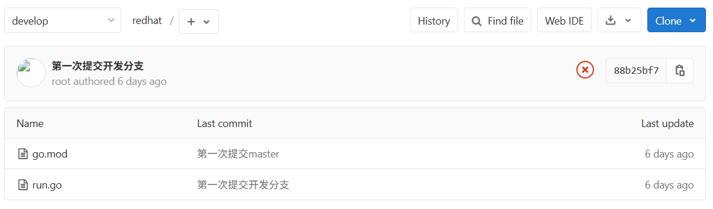

master分支

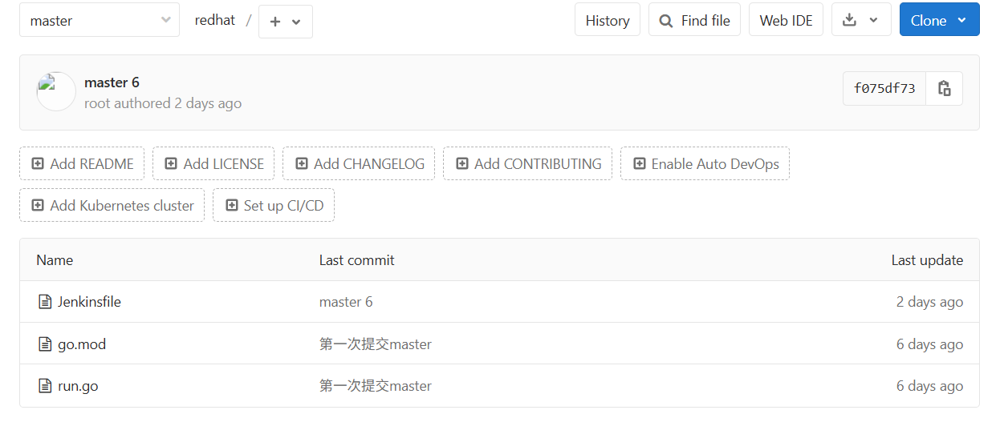

go项目的搭建成功

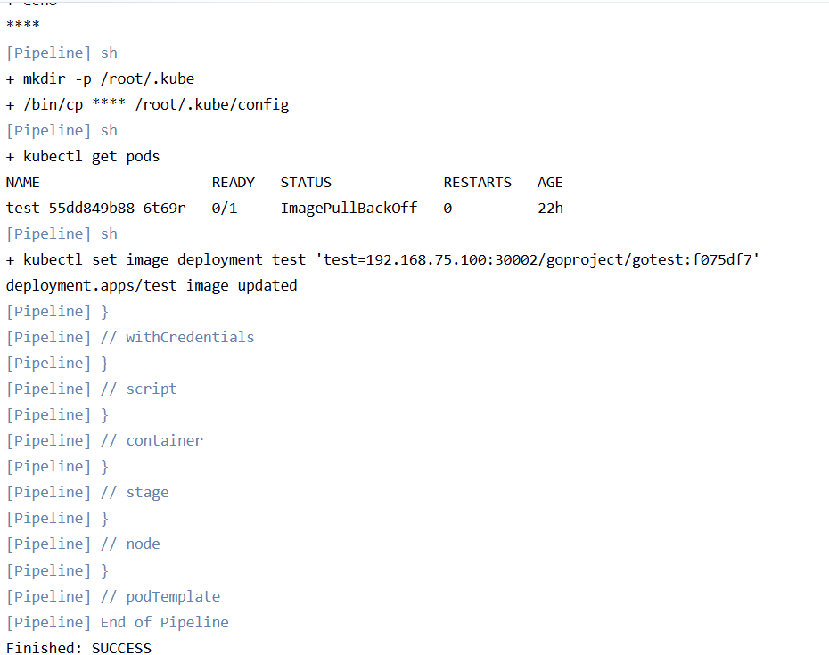

人工部署确认上线

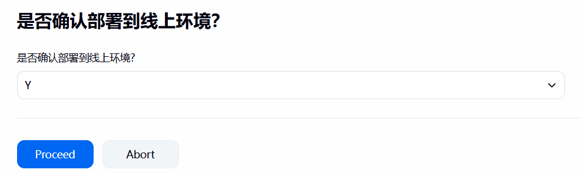

回滚

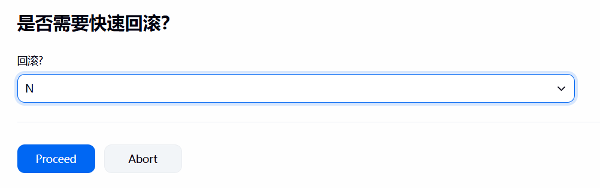

回滚测试

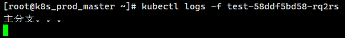

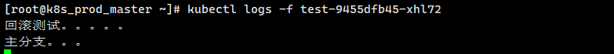

测试的html

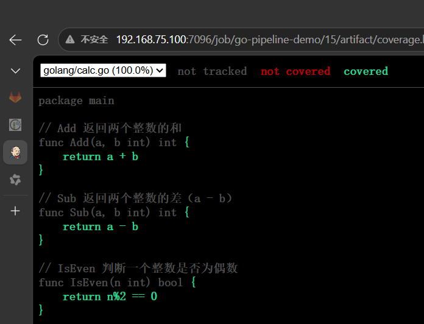

digest

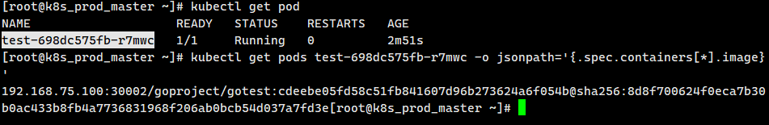

对应的在harbor中的标签和镜像的哈希值

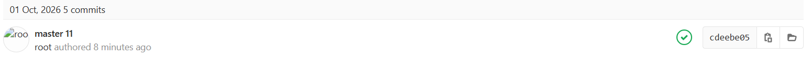


整体的框架和思维导图

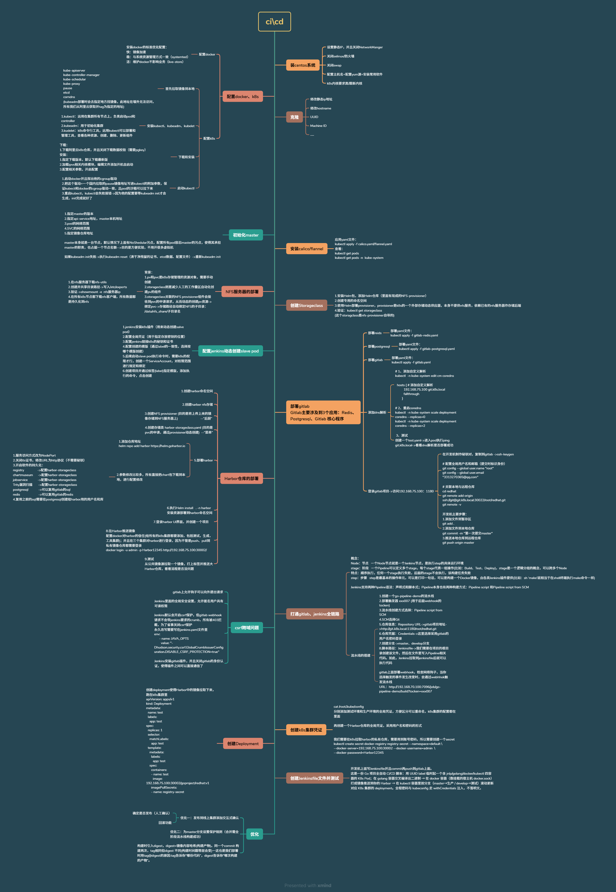

**架构与选型**

1. **请介绍这套 CI/CD 的整体架构。**  
   答：工具集群部署 GitLab、Jenkins、Harbor，测试和生产集群运行业务。开发提交代码到 GitLab 后，Webhook 触发 Jenkins，Jenkins 根据 Jenkinsfile 动态创建 Agent Pod，完成测试、编译、镜像构建和推送，再根据分支部署到对应集群。
2. **为什么使用 Jenkins 动态主从，而不是传统静态 Slave？**  
   答：传统 Slave 配置不统一、空闲时资源浪费、任务容易排队。动态 Agent 由 Kubernetes Plugin 按需创建，用完即删，环境由镜像固化，能复用资源，也能为不同语言选择不同构建容器。
3. **Jenkins 为什么用 StatefulSet 部署？**  
   答：Jenkins 的 `JENKINS_HOME` 有状态数据，需要稳定存储和稳定网络标识。StatefulSet 配合 `volumeClaimTemplates` 会自动创建独立 PVC；Deployment 更适合无状态应用。
4. **课件的 Jenkins 架构能算高可用吗？**  
   答：严格说不算。虽然 Pod 可以由 StatefulSet 重建，但默认只有一个 Master，仍然存在单点。生产上可以提高副本或主备能力，但 Jenkins 本身不是天然多主架构，更常见的是控制面高可用加灾备恢复。
5. **为什么一个 Agent Pod 里要启动多个容器？**  
   答：把 Go、Docker、Kubectl、JNLP 等能力拆成小镜像，在不同 Stage 中复用对应容器，避免维护一个包含所有语言和工具的巨型镜像，也便于按项目组合构建环境。
6. **课件里的 Docker in Docker 到底是什么？**  
   答：实际是 Docker-out-of-Docker。它通过挂载 `/var/run/docker.sock` 让容器调用宿主机 Docker Daemon，并不是真正在容器内启动独立 Docker Daemon。这样有较大安全风险，生产上更适合 Kaniko、BuildKit、Buildah 或独立构建节点。
7. **Jenkins Agent 的 ServiceAccount 应该怎么设计？**  
   答：按最小权限原则，只给创建、删除、查看 Agent Pod，以及必要的日志和事件权限，并限制 Namespace。课件使用较宽的 ClusterRole，实验可以，生产不建议直接照搬。

**存储、仓库与网络**

8. **PV、PVC、StorageClass 的关系是什么？**  
   答：PV 是集群级存储资源，PVC 是用户的存储申请，StorageClass 定义动态供应模板。PVC 指定 StorageClass 后，Provisioner 自动创建 PV 并完成绑定。
9. **RWO 和 RWX 有什么区别，课件怎么用？**  
   答：RWO 是单节点读写，适合 Jenkins 数据盘；RWX 是多节点读写，适合多个组件共享数据。课件中 Harbor 使用 RWX。NFS 方便实验，但数据库等核心有状态服务生产上通常应使用块存储或云盘。
10. **GitLab 为什么要单独部署 Redis 和 PostgreSQL？**  
    答：GitLab 依赖 PostgreSQL 保存业务数据，依赖 Redis 做缓存、会话和后台任务。生产环境更推荐使用外部高可用数据库与 Redis，而不是和 GitLab 一起随意部署。
11. **为什么要部署 Harbor？它包含哪些核心组件？**  
    答：用于私有镜像存储、权限控制和镜像扫描。核心包括 Core、Portal、Registry、JobService、Database、Redis、Trivy 等。它解决了私有镜像管理、版本保存和集群拉取问题。
12. **Kubernetes 拉取 Harbor 私有镜像需要什么？**  
    答：节点能访问 Harbor，配置好证书或 insecure registry，并且创建 `docker-registry` 类型的 Secret，在 Deployment 中配置 `imagePullSecrets`。
13. **Service 的常见类型怎么选？**  
    答：ClusterIP 用于集群内通信；NodePort 适合测试或临时暴露；LoadBalancer 用于云上对外服务；ExternalName 用于映射外部域名。生产通常使用 LoadBalancer 加 Ingress，而不是直接暴露大量 NodePort。

**流水线与发布**

14. **Pipeline script 和 Pipeline script from SCM 有什么区别？**  
    答：前者直接写在 Jenkins 页面，难版本管理和协作；后者把 Jenkinsfile 放入代码仓库，跟代码同步演进，可评审、可追溯、可回滚，正式项目应优先使用。
15. **声明式和脚本式 Pipeline 怎么选？**  
    答：声明式结构清晰、约束强，适合大多数标准流水线；脚本式灵活，适合复杂逻辑。企业项目通常以声明式为主，在 `script` 块里处理复杂判断。
16. **GitLab 到 Jenkins 的触发链路是什么？**  
    答：GitLab 配置 Webhook 指向 Jenkins 的 `buildByToken` 地址，Push 事件触发 Jenkins，Jenkins 再从 SCM 拉取代码和 Jenkinsfile。若返回 403，通常要检查 CSRF、认证、Token、GitLab 出站请求限制和 Jenkins 地址连通性。
17. **课件如何区分测试和线上环境？**  
    答：`develop` 分支部署测试环境，`master` 分支部署生产环境。生产环境增加人工确认，避免开发提交后直接上线。这个分支模型可以回答，但生产还应结合保护分支、审批人、环境隔离和发布窗口。
18. **如何保障构建唯一性和可追溯性？**  
    答：镜像 Tag 使用完整 Commit SHA，推送后获取镜像 Digest，部署时使用 `tag@digest` 这种不可变引用，同时写入 `kubernetes.io/change-cause` 注解，记录构建号和发布来源。
19. **Tag 和 Digest 的区别是什么？**  
    答：Tag 是可变的，例如 `app:abc123`；Digest 是镜像内容的哈希，例如 `sha256:...`。同一个 Tag 可以被覆盖，但 Digest 唯一指向某次构建产物，因此生产部署应使用 Digest 保证一致性。
20. **发布确认和回滚怎么实现？**  
    答：课件用 Jenkins `input` 做生产发布确认，用 `kubectl rollout undo` 回滚。生产中还应加入 `rollout status`、健康检查、自动失败检测、审批权限和版本记录，复杂场景更适合 Helm、Argo CD 或 GitOps。
21. **如何保证 develop 只有测试通过后才能合并 master？**  
    答：GitLab 对 master 配置保护分支，Jenkins 将构建状态回传到 Commit Status API。只有流水线成功，Merge Request 才允许合并。课件的思路正确，但 Token 不应硬编码，应该放进 Jenkins Credentials。
22. **如何扩展 Java 或 Python 项目？**  
    答：保持同一套流水线框架，只替换语言构建容器和构建命令。Go 用 Go 镜像，Java 用 Maven/JDK 镜像，Python 用 Python 镜像；Docker、Kubectl 等公共容器继续复用。
23. **单元测试、SonarQube 和冒烟测试分别放在哪？**  
    答：顺序通常是拉代码、单元测试、SonarQube 质量门禁、编译打包、镜像构建、部署测试环境、冒烟测试、生产审批、生产发布、生产验证。任一关键阶段失败都应阻断后续流程。
24. **这套方案生产化最需要补什么？**  
    答：Jenkins 真正高可用、Agent RBAC 最小化、Secret 管理、镜像扫描与签名、HTTPS、资源配额、并发治理、审计日志、健康检查、自动回滚，以及 GitOps 或 Helm 发布体系。

### 1. 什么叫动态主从？
动态主从指的是 Jenkins 采用 `Master + 动态 Agent` 的构建架构。

`Jenkins Master` 主要负责页面管理、任务配置、调度和流水线编排；真正执行构建任务的不是固定的从节点，而是 Kubernetes 中临时创建的 `Jenkins Agent Pod`。

具体流程是：Jenkins 接到构建任务后，通过 Kubernetes Plugin 读取 PodTemplate，在工具集群中动态创建一个 Agent Pod。这个 Pod 通常包含 JNLP、Go/Python、Docker、Kubectl 等多个容器，不同 Stage 使用不同容器执行任务。构建完成后，这个 Agent Pod 会自动删除。

它相比传统静态 Slave 的优势是：

- 任务来了才创建，任务结束就销毁，不长期占用资源。
- 每个项目可以使用自己的构建镜像和版本。
- Go、Java、Python 等环境互不干扰。
- 公共的 Docker、Kubectl 容器可以复用。
- Jenkins Master 不承担具体构建压力。

面试时可以概括为：

所谓动态主从，就是 Jenkins Master 负责调度，构建时通过 Kubernetes Plugin 动态创建 Slave Pod，构建结束自动销毁，实现按需创建、环境隔离和资源复用。

需要补充一句：StatefulSet 只能保证 Jenkins Pod 重建，并不等于 Jenkins Master 真正高可用。

### 2. 流水线环境是怎么做的？
这套方案没有把流水线环境固定死在 Jenkins 页面里，而是采用 `Pipeline script from SCM + Jenkinsfile` 的方式，让构建环境跟着代码走。

每个项目根目录维护自己的 `Jenkinsfile`。GitLab 触发构建后，Jenkins 从代码仓库拉取源码，同时读取对应分支下的 Jenkinsfile。Jenkinsfile 中动态定义 PodTemplate，例如：

- `jnlp`：负责 Agent 和 Jenkins Master 通信。
- `golang` 或 `python`：负责编译、单元测试。
- `docker`：负责构建和推送镜像。
- `kubectl`：负责部署到测试或生产集群。

然后在不同 Stage 中使用对应容器：

```plain
container('golang') {
    sh 'go build -o app'
}

container('docker') {
    sh 'docker build -t app:${imageTag} .'
}

container('kubectl') {
    sh "kubectl set image deployment/app app=${image}"
}
```

环境隔离方面，课件按分支区分：

- `develop` 分支发布到测试环境。
- `master` 分支发布到生产环境。
- Harbor 和 Kubernetes 的账号密码通过 Jenkins Credentials 管理。
- 测试和生产分别使用不同的 kubeconfig。

面试时可以概括为：

我们把 Jenkinsfile 放进项目仓库，Jenkins 使用 Pipeline script from SCM 拉取流水线代码；Agent 环境则由 Jenkinsfile 中的 PodTemplate 动态定义，构建时按需启动 Go、Python、Docker、Kubectl 等容器，实现构建环境与代码同步、按分支区分测试和生产环境。

生产环境还应该增加保护分支、人工审批、权限控制和环境级凭证隔离。

### 3. 构建唯一性保障是怎么做的？
核心是使用 `完整 Commit SHA + 镜像 Digest`，确保部署的是某一次确定构建产出的镜像，而不是一个可能被覆盖的 Tag。

首先，用完整 Git Commit SHA 作为镜像 Tag：

```plain
def imageTag = sh(
    script: 'git rev-parse HEAD',
    returnStdout: true
).trim()

def image = "${registryUrl}/${imageEndpoint}:${imageTag}"
```

然后构建并推送镜像：

```plain
docker build -t ${image} .
docker push ${image}
```

推送完成后，获取镜像的内容摘要 Digest：

```plain
imageDigest = sh(
    script: "docker inspect --format='{{index .RepoDigests 0}}' ${image} | cut -d'@' -f2",
    returnStdout: true
).trim()

imageWithDigest = "${image}@${imageDigest}"
```

部署时不只使用 Tag，而是使用不可变引用：

```plain
kubectl set image deployment/app app=${imageWithDigest}
```

同时给 Deployment 增加注解，记录构建来源：

```plain
kubectl annotate deployment/app \
  kubernetes.io/change-cause="build#${BUILD_NUMBER} ${imageWithDigest}" \
  --overwrite
```

为什么要这样做？

- Tag 是可变的，同一个 Tag 可以被重新推送并覆盖。
- 短 SHA 存在前缀碰撞风险，完整 SHA 更准确。
- 同一个 Commit 重新构建时，基础镜像或依赖可能变化，生成的镜像内容也可能不同。
- Digest 是镜像内容的哈希，能唯一标识某次实际构建产物。
- 部署时使用 `tag@digest`，可以保证测试和生产运行的是完全一致的镜像。
- 结合 Jenkins 构建号和 annotation，可以追溯某个 Pod 是由哪次 Commit、哪次构建产生的。

面试时可以概括为：

构建唯一性通过三层保障实现：第一，用完整 Commit SHA 作为镜像 Tag，保证代码版本可追溯；第二，推送后获取镜像 Digest，部署时使用 tag@digest 不可变引用，保证运行产物唯一；第三，通过 Deployment annotation 记录 Jenkins 构建号和 Digest，实现发布可追溯、回滚可定位。

### 4.jenkins写statefulset的目的 ?
Jenkins 写成 StatefulSet，核心原因是 **Jenkins 是有状态服务**。

Jenkins 的 Job 配置、插件、凭据、用户、流水线历史和构建记录，全部保存在容器内的 `/var/jenkins_home`。如果使用普通 Deployment，Pod 重建后名称随机、存储绑定关系不够稳定；而 StatefulSet 可以给 Jenkins 提供：

1. **稳定的 Pod 名称**  
   Pod 始终叫 `jenkins-0`，而不是 Deployment 那种随机后缀。
2. **稳定的网络标识**  
   配合 Headless Service，可以使用固定 DNS，例如 `jenkins-0.jenkins.default.svc.cluster.local`。
3. **稳定的持久化存储**  
   通过 `volumeClaimTemplates` 自动创建 PVC。Pod 删除或重建后，仍然会挂载原来的 PVC，`JENKINS_HOME` 数据不会丢。
4. **存储生命周期与 Pod 绑定**  
   StatefulSet 更适合有状态应用，能明确表达“Jenkins 的数据需要长期保存并跟随固定实例”。
5. **有序启动和停止**  
   虽然 Jenkins 通常只有一个实例，但 StatefulSet 提供了有序管理能力，适合对有状态工作负载进行明确控制。

面试时可以这样回答：

Jenkins 用 StatefulSet，不是因为它需要多副本，而是因为它是典型的有状态应用。它的 Job、插件、凭据和构建历史都在 JENKINS\_HOME 中。StatefulSet 能提供固定的 Pod 名称、稳定的 Headless Service DNS，并通过 volumeClaimTemplates 自动创建 PVC。即使 jenkins-0 被重建，也能重新挂载原来的存储，保证 Jenkins 配置和构建数据不丢失。

需要补一句关键区别：

StatefulSet 解决的是“有状态和稳定存储”，不等于 Jenkins Master 高可用。单副本 Jenkins 仍然是单点。而且不能让多个 Jenkins Master 同时共享同一个 JENKINS\_HOME 直接扩副本，否则可能写坏数据。真正的主控高可用需要备份恢复、主备切换或企业级 Jenkins 架构。

如果面试官追问“Deployment 加 PVC 也可以持久化，为什么一定要 StatefulSet”，可以答：

单副本场景下，Deployment 加 PVC 确实可以持久化。选择 StatefulSet 主要是为了稳定的实例标识、固定 DNS 和 volumeClaimTemplates 的绑定关系，更符合 Jenkins 有状态服务的语义；更准确地说，是“更适合”，不是没有 StatefulSet 就绝对做不到。
