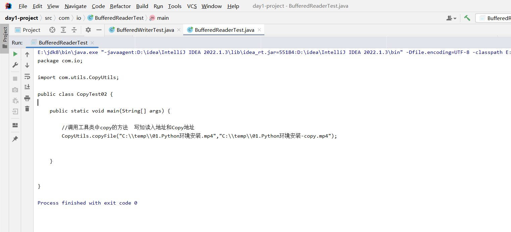

独特方法readLine，其他大同小异

```java
package com.io;

import java.io.BufferedReader;
import java.io.FileInputStream;
import java.io.InputStreamReader;

/**
 * 缓冲流
 *      -包装流
 *      -节点流
 */
public class BufferedReaderTest {

    public static void main(String[] args) throws Exception {

        //创建缓冲流对象 (包装流和节点流都是相对而言的例如InputStreamReader相对于FileInputStream是包装流，而相对于BufferedReader是节点流)
        BufferedReader bufferedReader = new BufferedReader(new InputStreamReader(new FileInputStream("C:\\temp\\CopyTest02.java")));

        //一次读取一行数据
        String readLine = null;

        while ((readLine = bufferedReader.readLine()) != null){

            System.out.println(readLine);

        }

        //关闭资源
        bufferedReader.close();

    }

}
```

创建成功


