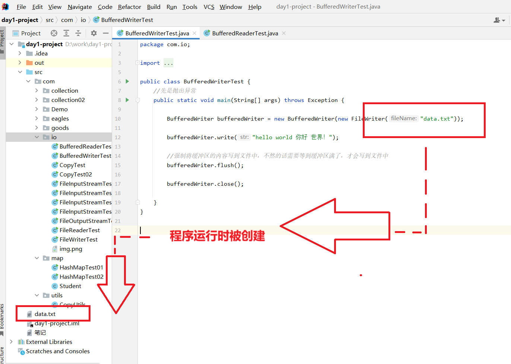
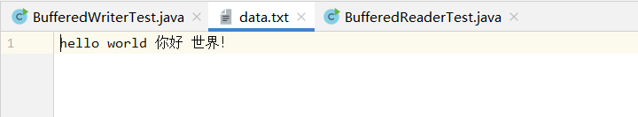

```java
package com.io;

import java.io.BufferedWriter;
import java.io.FileWriter;

public class BufferedWriterTest {
    //先是抛出异常
    public static void main(String[] args) throws Exception {
        //最后这个文件路径不像之前那样是C盘里面的绝对路径，这次是开发在本地的相对路径
        BufferedWriter bufferedWriter = new BufferedWriter(new FileWriter("data.txt"));

        bufferedWriter.write("hello world 你好 世界！");

        //强制将缓冲区的内容写到文件中，不然的话需要等到缓冲区满了，才会写到文件中
        bufferedWriter.flush();

        bufferedWriter.close();

    }
}
```



成功创建


