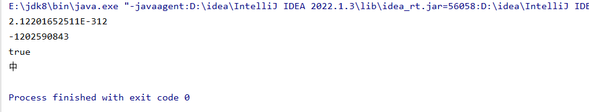
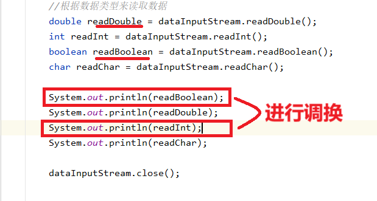
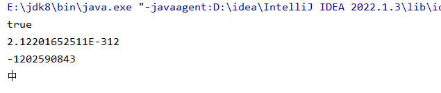

```java
package com.io;
import java.io.DataInputStream;
import java.io.DataOutputStream;
import java.io.FileInputStream;
import java.io.FileOutputStream;

/**
 * 数据流 可以对数据进行加密
 *  -跟据对应的数据类型来存取数据 也要根据数据类型来取数据
 *  -写入的顺序跟取出的顺序必须一样，不然会造成乱码
 */

public class DataInputStreamTest {

    public static void main(String[] args) throws Exception {

        //创建数据流输入对象
        DataInputStream dataInputStream = new DataInputStream(new FileInputStream("data2.txt"));

        //根据数据类型来读取数据
        double readDouble = dataInputStream.readDouble();
        int readInt = dataInputStream.readInt();
        boolean readBoolean = dataInputStream.readBoolean();
        char readChar = dataInputStream.readChar();

        System.out.println(readDouble);
        System.out.println(readInt);
        System.out.println(readBoolean);
        System.out.println(readChar);

        dataInputStream.close();

    }

}

class DataOutputStreamTest{

    public static void main(String[] args) throws Exception {

        //创建数据流输出流对象
        DataOutputStream dataOutputStream = new DataOutputStream(new FileOutputStream("data2.txt"));

        //根据数据类型来写入数据
        dataOutputStream.writeInt(100);
        dataOutputStream.writeBoolean(false);
        dataOutputStream.writeDouble(3.14);
        dataOutputStream.writeChar('中');

        dataOutputStream.flush();
        dataOutputStream.close();

    }

}
```



如果输入顺序和输出顺序不一样的话，会出现乱码，比如：



再次运行程序  


程序无法正常运行
