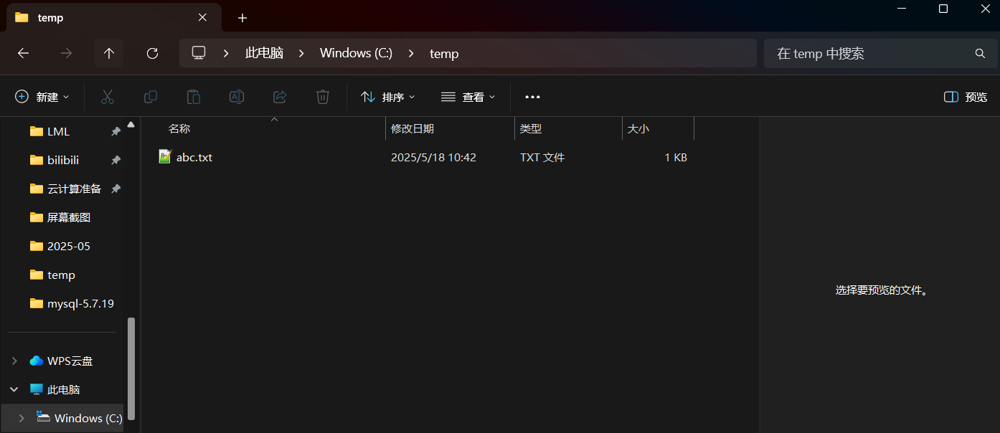
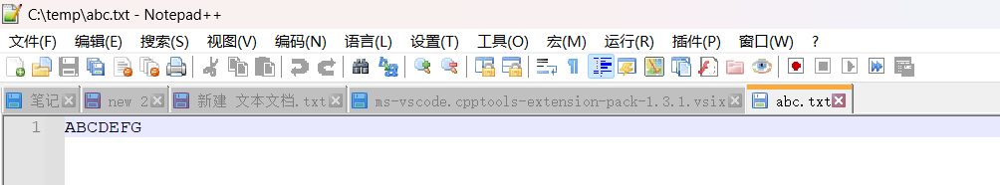
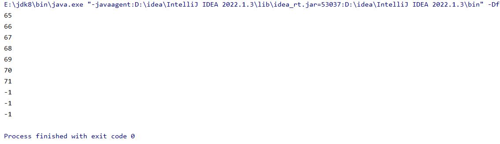
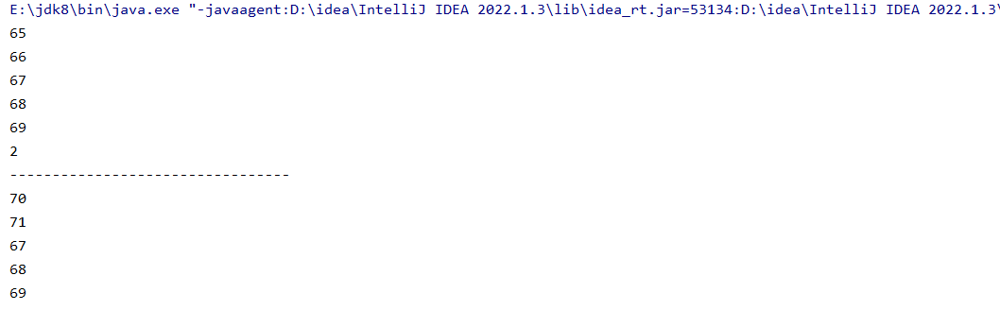
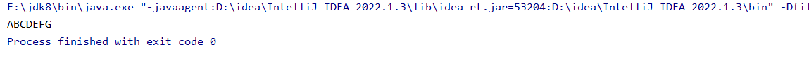

首先在C盘创建一个文件和文本文档，并通过input对文件内容进行输入



在里面输入ABCDEFG

对文件里面的字符一个一个的进行打印，打印的对应的ascll

```java
package com.io;
import java.io.FileInputStream;
import java.io.FileNotFoundException;
import java.io.IOException;

public class FileInputStreamTest {

    public static void main(String[] args) {

        FileInputStream fileInputStream = null;

        try {
            //创建字节输入流(后面跟对应所在的文件位置)
            fileInputStream = new FileInputStream("C:\\temp\\abc.txt");

            //读取文件中的数据（一个一个的读）
            int read = fileInputStream.read();
            System.out.println(read);

            read = fileInputStream.read();
            System.out.println(read);

            read = fileInputStream.read();
            System.out.println(read);

            read = fileInputStream.read();
            System.out.println(read);

            read = fileInputStream.read();
            System.out.println(read);

            read = fileInputStream.read();
            System.out.println(read);

            read = fileInputStream.read();
            System.out.println(read);

            read = fileInputStream.read();
            System.out.println(read);

            read = fileInputStream.read();
            System.out.println(read);

            read = fileInputStream.read();
            System.out.println(read);

         //抛出存在的问题  + finally回收数据
        } catch (FileNotFoundException e) {
            throw new RuntimeException(e);
        } catch (IOException e) {
            throw new RuntimeException(e);
        } finally {
            if (fileInputStream != null){
                try {
                    fileInputStream.close();
                } catch (IOException e) {
                    throw new RuntimeException(e);
                }
            }
        }

    }

}
```



遍历数组，第一次没有遍历完全，遍历第二次，且第二次的字母会将第一次的字母覆盖

```java
package com.io;
import java.io.FileInputStream;
import java.io.FileNotFoundException;
import java.io.IOException;

public class FileInputStreamTest2 {

    public static void main(String[] args) {

        FileInputStream fileInputStream = null;

        try {
            //创建字节输入流
            fileInputStream = new FileInputStream("C:\\temp\\abc.txt");

            //创建byte数组
            byte[] bytes = new byte[5];

            //读取到的字符个数
            int read = fileInputStream.read(bytes);

            //遍历字节数组
            for (byte aByte : bytes) {
                System.out.println(aByte);
            }

            read = fileInputStream.read(bytes);

            System.out.println(read);

            System.out.println("---------------------------------");

            //遍历字节数组
            for (byte aByte : bytes) {
                System.out.println(aByte);
            }

        } catch (FileNotFoundException e) {
            throw new RuntimeException(e);
        } catch (IOException e) {
            throw new RuntimeException(e);
        } finally {
            if (fileInputStream != null){
                try {
                    fileInputStream.close();
                } catch (IOException e) {
                    throw new RuntimeException(e);
                }
            }
        }

    }

}
```



数字2是因为打印了5个 第二次7个只剩余2个

创建数组并用while循环，将遍历到的ascll码转换成对应的字符

```java
package com.io;
import java.io.FileInputStream;
import java.io.FileNotFoundException;
import java.io.IOException;

public class FileInputStreamTest3 {

    public static void main(String[] args) {

        FileInputStream fileInputStream = null;

        try {
            //创建字节输入流
            fileInputStream = new FileInputStream("C:\\temp\\abc.txt");

            //创建byte数组
            byte[] bytes = new byte[5];

            //            //将字节数组中所有的ascll转换成对应的字符
            //            String s = new String(bytes,0,read);
            //            System.out.println(s);
            //
            //            read = fileInputStream.read(bytes);
            //
            //            String s2 = new String(bytes,0,read);
            //            System.out.println(s2);

            //读取数据 返回值是读取字符的个数，我们一般在转换的时候：读取多少个字符，就转换多少个字符
            int num = fileInputStream.read(bytes);
            //while循环
            while (num != -1){

                //将ascll码转换为对应的字符 长度为从0到num
                String str = new String(bytes,0,num);
                System.out.print(str);
                num = fileInputStream.read(bytes);

            }

        } catch (FileNotFoundException e) {
            throw new RuntimeException(e);
        } catch (IOException e) {
            throw new RuntimeException(e);
        } finally {
            if (fileInputStream != null){
                try {
                    fileInputStream.close();
                } catch (IOException e) {
                    throw new RuntimeException(e);
                }
            }
        }

    }

}
```


代码更简便好看一点

```java
package com.io;
import java.io.FileInputStream;
import java.io.FileNotFoundException;
import java.io.IOException;

public class FileInputStreamTest4 {

    public static void main(String[] args) {

        FileInputStream fileInputStream = null;

        try {
            //创建字节输入流
            fileInputStream = new FileInputStream("C:\\temp\\abc.txt");

            //创建byte数组
            byte[] bytes = new byte[5];

            //读取数据 返回值是读取字符的个数，我们一般在转换的时候：读取多少个字符，就转换多少个字符
            int num = 0;
            //将变量放在while的循环条件里面
            while ((num = fileInputStream.read(bytes)) != -1){
                //将ascll码转换为对应的字符
                String str = new String(bytes,0,num);
                System.out.print(str);
            }

        } catch (FileNotFoundException e) {
            throw new RuntimeException(e);
        } catch (IOException e) {
            throw new RuntimeException(e);
        } finally {
            if (fileInputStream != null){
                try {
                    fileInputStream.close();
                } catch (IOException e) {
                    throw new RuntimeException(e);
                }
            }
        }

    }

}
```


