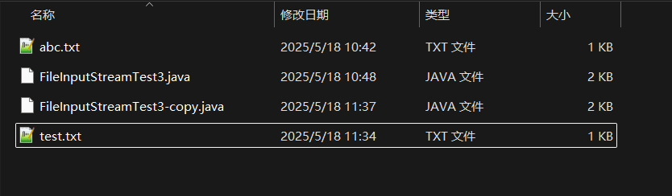

```java
package com.io;

import java.io.FileNotFoundException;
import java.io.FileOutputStream;
import java.io.IOException;

public class FileOutputStreamTest1 {
    public static void main(String[] args) {

        FileOutputStream fileOutputStream = null;

        try {
            //创建字节输出流对象
            fileOutputStream = new FileOutputStream("C:\\temp\\test.txt",false); //开启追加

            //写ascll码
            fileOutputStream.write(65);
            fileOutputStream.write(66);

            //创建一个字节数组
            byte[] bytes = {67,68,69,70};
            byte[] bytes2 = {71,72,73,74};

            fileOutputStream.write(bytes);
            fileOutputStream.write(bytes2,0,2);

            //刷新
            fileOutputStream.flush();

        } catch (FileNotFoundException e) {
            throw new RuntimeException(e);
        } catch (IOException e) {
            throw new RuntimeException(e);
        } finally {
            //回收系统资源
            if (fileOutputStream != null){
                try {
                    fileOutputStream.close();
                } catch (IOException e) {
                    throw new RuntimeException(e);
                }
            }
        }

    }
}
```

输出流都需要进行刷新，避免出现问题

```java
    package com.io;
    
    import java.io.FileInputStream;
    import java.io.FileNotFoundException;
    import java.io.FileOutputStream;
    import java.io.IOException;
    
    public class CopyTest {
    
        public static void main(String[] args) {
    
            FileInputStream fileInputStream = null;
            FileOutputStream fileOutputStream = null;
    
    
            try {
    
                //创建输入流
                fileInputStream = new FileInputStream("C:\\temp\\FileInputStreamTest3.java");
                //创建输出流
                fileOutputStream = new FileOutputStream("C:\\temp\\FileInputStreamTest3-copy.java");
    
                //创建字节数组
                byte[] bytes = new byte[1024];
    
                //开始读取文件中的数据
                int read = 0;
    
                while ((read = fileInputStream.read(bytes)) != -1){
    
                    //String s = new String(bytes,0,read);
                    //开始写数据 一边读 一边写
                    fileOutputStream.write(bytes,0,read);
    
                }
    
                //刷新管道，不然可能会造成数据的错乱
                fileOutputStream.flush();
    
            } catch (FileNotFoundException e) {
                throw new RuntimeException(e);
            } catch (IOException e) {
                throw new RuntimeException(e);
            }finally {
    
                if (fileInputStream != null){
                    try {
                        fileInputStream.close();
                    } catch (IOException e) {
                        throw new RuntimeException(e);
                    }
    
                }
    
            }
    
            if (fileOutputStream != null){
    
                try {
                    fileOutputStream.close();
                } catch (IOException e) {
                    throw new RuntimeException(e);
                }
            }
    
        }
    
    
    }
```


