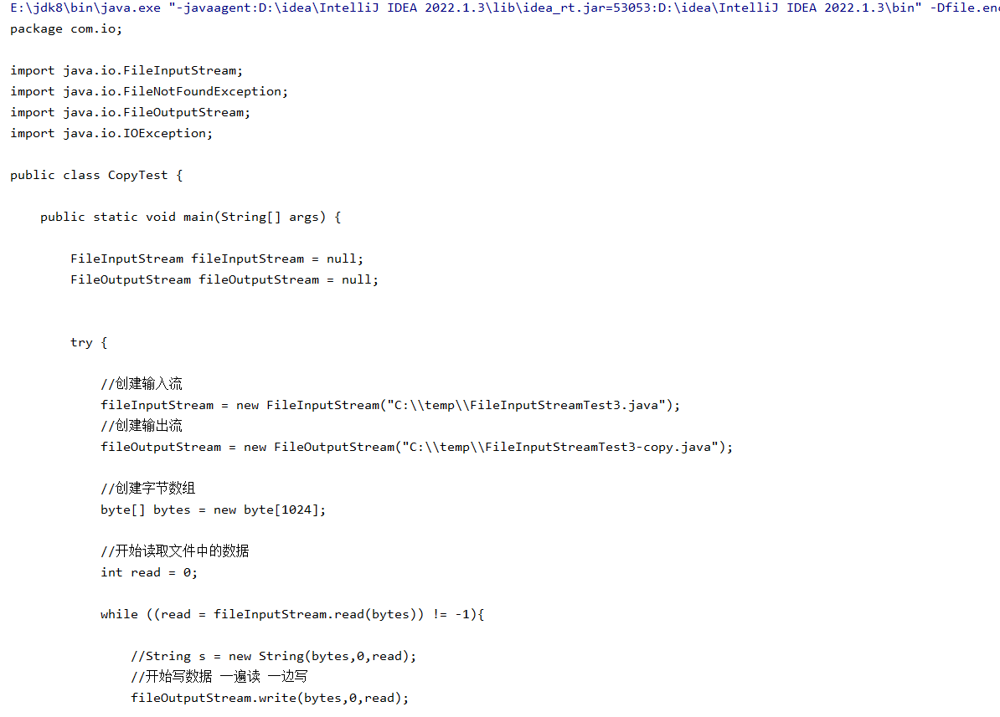

```java
package com.io;

import java.io.FileNotFoundException;
import java.io.FileReader;
import java.io.IOException;

/**
 * 文件字符输入流
 */
public class FileReaderTest {

    public static void main(String[] args) {

        FileReader fileReader = null;

        try {
            //创建输入流对象
            fileReader = new FileReader("C:\\temp\\CopyTest.java");

            //int read = fileReader.read();  显示的是文件开头首字母的Ascll码

            //创建字符数组
            char[] chars = new char[10];

            //读取字符的个数 从0开始读取
            int read = 0;

            while ((read = fileReader.read(chars)) != -1){
                String str = new String(chars);
                System.out.print(str);
            }

            //            String s = new String(chars);
            //
            //            System.out.println(s);

            //            for (char aChar : chars) {
            //                System.out.println(aChar);
            //            }

        } catch (FileNotFoundException e) {
            throw new RuntimeException(e);
        } catch (IOException e) {
            throw new RuntimeException(e);
        } finally {

            if (fileReader != null) {
                try {
                    fileReader.close();
                } catch (IOException e) {
                    throw new RuntimeException(e);
                }
            }
        }

    }
}
```

成功读取到数据


