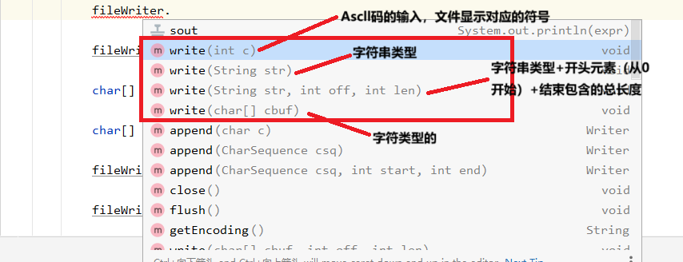
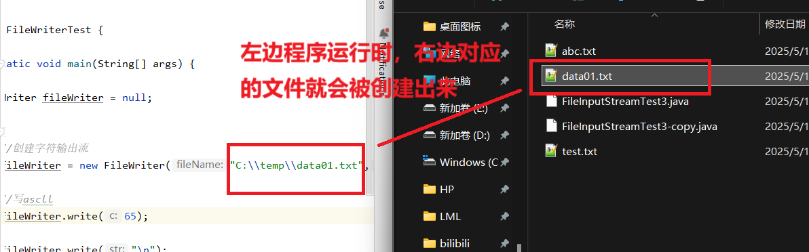
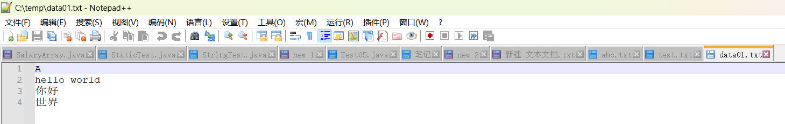

系统C盘里面之前并没有data01.txt文件，如果原电脑没有该文件，程序运行时将会被创建出来。FileWriter里面包含好几种写的Weiter方法



```java
package com.io;

import java.io.FileWriter;
import java.io.IOException;

public class FileWriterTest {

    public static void main(String[] args) {

        FileWriter fileWriter = null;

        try {
            //创建字符输出流
            fileWriter = new FileWriter("C:\\temp\\data01.txt",false);

            //写ascll
            fileWriter.write(65);

            fileWriter.write("\n");
            //创建字符数组并写入对应的数据
            char[] chars = {'h','e','l','l','o'};

            char[] chars02 = {'w','o','r','l','d','1','2','3'};

            fileWriter.write(chars);

            fileWriter.write(" ");

            //按照字符数组的区间写入
            fileWriter.write(chars02,0,5);

            fileWriter.write("\n");

            fileWriter.write("你好");

            fileWriter.write("\n");

            fileWriter.write("你好世界",2,2);

            //进行刷新
            fileWriter.flush();

        } catch (IOException e) {
            throw new RuntimeException(e);
        }finally {
            if (fileWriter != null) {
                try {
                    fileWriter.close();
                } catch (IOException e) {
                    throw new RuntimeException(e);
                }
            }
        }

    }

}
```



成功输入进入数据


