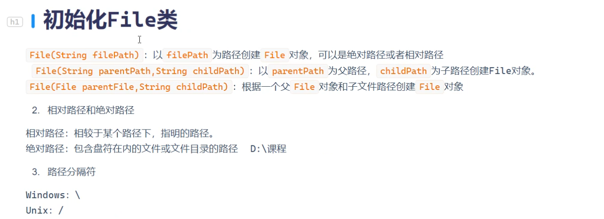
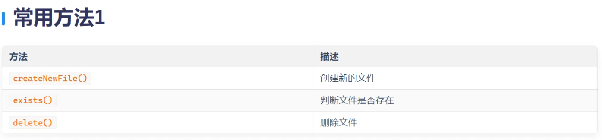
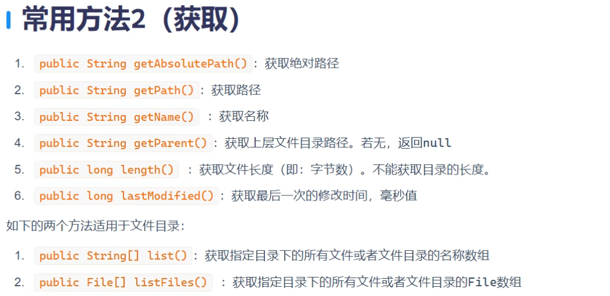
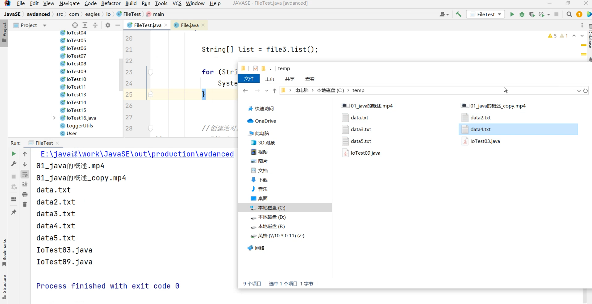
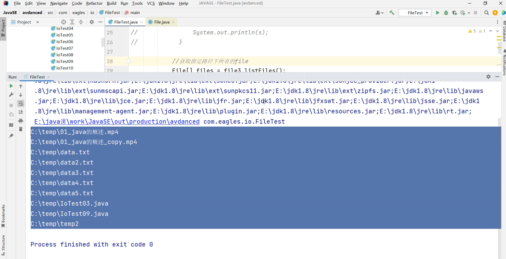
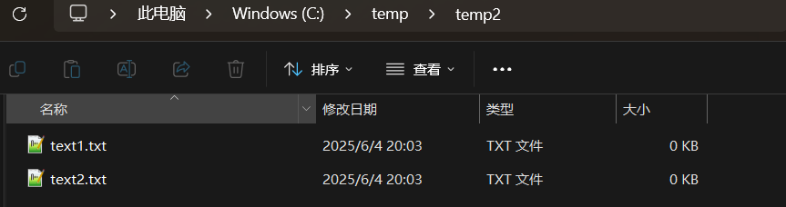
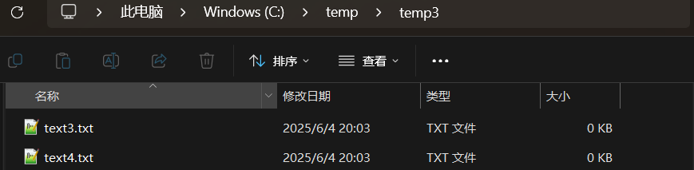
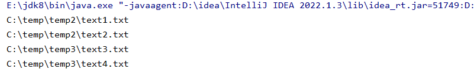
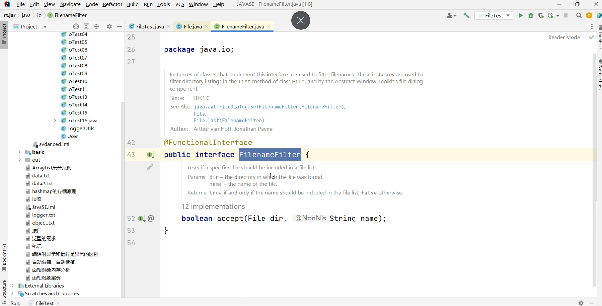

# File常用方法：





```java
package com.io;

import java.io.File;
import java.io.FileFilter;
import java.io.FileOutputStream;
import java.io.IOException;
import java.time.temporal.Temporal;

public class FileTest {

    public static void main(String[] args) {

        //创建一个File类
        File file = new File("text.txt");//相对路径
        File file1 = new File("C:\\temp\\data.txt");//绝对路径
        File file3 = new File("C:\\temp");

        try {

            //将temp文件下所有txt文件过滤
            File[] listFiles = file3.listFiles(new FileFilter()
                                               {
                 /*
                指定过滤规则
                 */
                    @Override
            public boolean accept(File pathname) {
            return pathname.getName().endsWith(".txt");
            //遍历到的文件夹名字pathname + getName文件名字 + endsWith（字符串方法）结尾以什么形式结尾的
                                     }
                                 });
            for (File listFile : listFiles) {
                System.out.println(listFile);
            }

            //获得指定目录下的所有文件  绝对路径
            File[] files = file3.listFiles();
            for (File f : files) {
                System.out.println(f);
            }

            //获取指定目录下的所有文件或者文件目录的名称数组  相对路径
            String[] list = file3.list();
            for (String s : list) {
                System.out.println(s);
            }

            //创建流对象（流对象里面也可以放file文件）
            FileOutputStream fileOutputStream = new FileOutputStream(file);
            fileOutputStream.write(65);//int类型 写一个阿斯克码
            //刷新
            fileOutputStream.flush();
            //关闭
            fileOutputStream.close();

            //获得文件长度(即:字节数)
            long length = file1.length();
            System.out.println(length);

            //获得最后一次的修改时间(时间戳)
            long lastModified = file1.lastModified();
            System.out.println(lastModified);

            //获得父辈目录
            String parent = file1.getParent();
            System.out.println("parent");

            //获得文件名字
            String name = file1.getName();
            System.out.println(name);

            //获得绝对路径
            File absoluteFile = file1.getAbsoluteFile();
            System.out.println(absoluteFile);

            //获得路径
            String path = file1.getPath();
            System.out.println(path);

            //删除文件
            boolean delete = file.delete();
            System.out.println("是否删除成功："+delete);

            //创建文件(绝对路径的)
            boolean newFile = file.createNewFile();

            //创建文件（相对路径的）
            boolean newFile1 = file1.createNewFile();
            System.out.println("是否创建成功："+newFile);
        } catch (IOException e) {
            throw new RuntimeException(e);
        }

    }

}
```

 

# File中文件过滤（递归试）：

在temp里面分别创建两个文件夹temp2、temp3分别在里面放入.txt文件，要求遍历到文件





```java
package com.io;

import java.io.File;
import java.io.FileFilter;

public class FileTest01 {
    public static void main(String[] args) {

        //创建File对象
        File file = new File("C:\\temp");
        isFile(file);

    }
    //重新写一个静态方法
    public static void isFile(File file){
        File[] files = file.listFiles(new FileFilter() {
            @Override
            public boolean accept(File pathname) {
                //判断遍历的文件file是否为文件夹
                if (pathname.isDirectory()){
                    //是文件夹再调用一次这个方法，直到没有文件夹为止，最后只剩文件，再去看后缀是不是.txt
                    // （作用：有文件夹的会被层层拨开，没有的就进行正常过滤）
                    isFile(pathname);

                }
                //不是文件夹判断末尾是不是以.txt结尾
                return pathname.getPath().endsWith(".txt");
            }
        });
        //方法末尾进行遍历
        for (File f : files) {
            System.out.println(f);
        }
    }
}
```

遍历到的结果，末尾含有.txt的文件成功打印



### 这是一个接口


