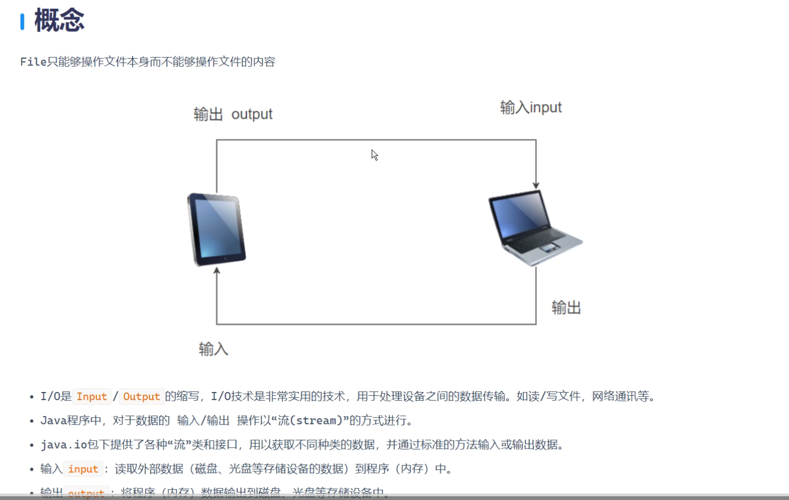
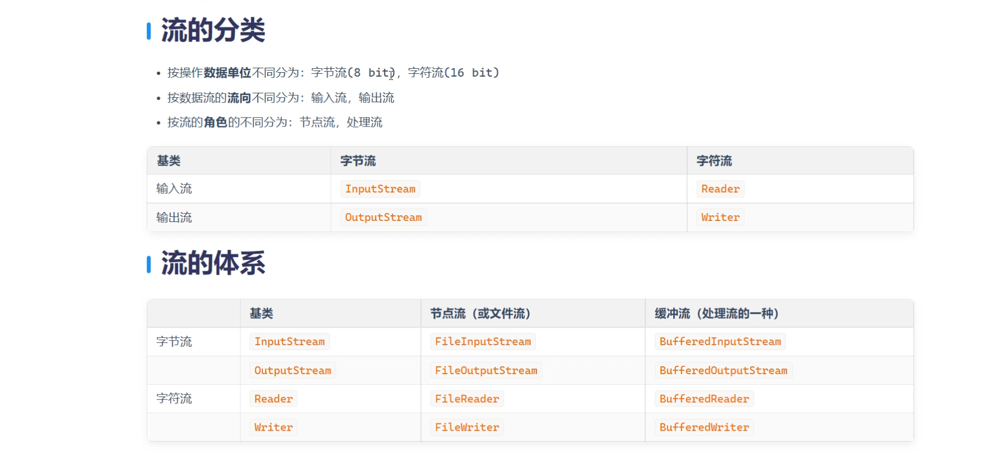

```java
IO流概念介绍
-完成文件数据的读和写
-硬盘<==>内存上
-输入和输出
-输入input：将硬盘上文件中的数据写到内存中 硬盘 ==>内存上
-输出output：将内存中的数据写到硬盘上 硬盘<== 内存上

-字节流和字符流的区别
-字节流：以字节的形式来完成数据的读和写（转换，Ascll码（阿拉伯数字）的转换）
-asCLL码：在计算机的编程语言里面，键盘上的每一个字符都有对应的ascLl
-字节：计量单位
-"hello" 5个字符 5个字符占了多少个字节（5个字节的长度）默认情况下一个英文单词占1个字节，一个汉字占3个字节
-字符流：以字符的形式来完成文件的读和写
```
