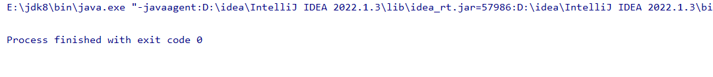
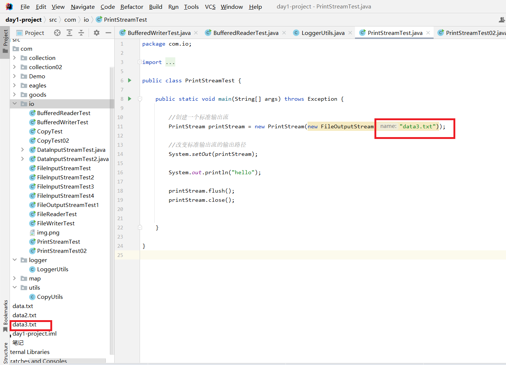
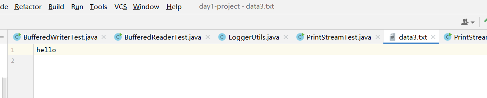
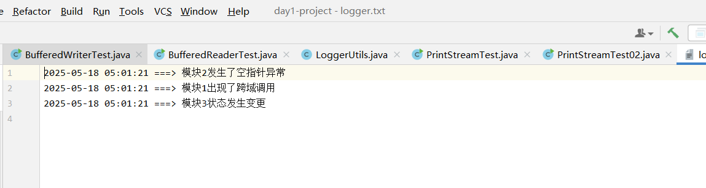
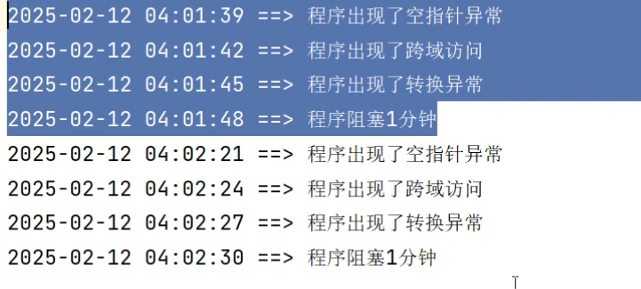

```java
package com.io;

import java.io.FileOutputStream;
import java.io.PrintStream;

public class PrintStreamTest {

    public static void main(String[] args) throws Exception {

        //创建一个标准输出流
        PrintStream printStream = new PrintStream(new FileOutputStream("data3.txt"));
                                                             //追加的话就是("data3.txt".true) 这个追加的意思是每次运行程序都追加一次信息
          //PrintSteam.print("hello world")
        
        //改变标准输出流的输出路径
        System.setOut(printStream);

        System.out.println("hello");

        printStream.flush();
        printStream.close();

    }

}
```



你会发现控制台并没有打印出"hello"，那是因为重新设置了打印路径，将它打印在了新建的data3.txt文件里面

点开文件



成功传入数据

写一个打印日志的工具LoggerUtils

```java
package com.logger;

import java.io.FileNotFoundException;
import java.io.FileOutputStream;
import java.io.PrintStream;
import java.text.SimpleDateFormat;
import java.util.Date;

public class LoggerUtils {
    //方法私有化
    private LoggerUtils(){

    }
    //放入参数 msssage这个日志
    public static void logger(String message){
        //先让他等于空
        PrintStream printStream = null;

        try {

            //创建标准输出流对象  （写在logger.txt里，且true进行追加，不进行覆盖）
            printStream = new PrintStream(new FileOutputStream("logger.txt",true));

            //更改输出路径（将原本的控制台打印数据改在了logger.txt）
            System.setOut(printStream);

            //获取系统当下时间
            Date date = new Date();

            //创建一个日期格式化对象
            SimpleDateFormat simpleDateFormat = new SimpleDateFormat("yyyy-MM-dd hh:mm:ss");
            //获取格式化之后的时间
            String format = simpleDateFormat.format(date);

            //收集日志
            System.out.println(format+" ===> "+message);

            printStream.flush();
        } catch (FileNotFoundException e) {

            throw new RuntimeException(e);
        }finally {
            if (printStream != null) {
                printStream.close();
            }
        }
    }
}
```

对写的工具进行一个调用并进行实验

```java
package com.io;

import com.logger.LoggerUtils;

public class PrintStreamTest02 {

    public static void main(String[] args) throws Exception {
        //调用工具
        LoggerUtils.logger("模块2发生了空指针异常");
        LoggerUtils.logger("模块1出现了跨域调用");
        LoggerUtils.logger("模块3状态发生变更");

        //模拟睡眠
        Thread.sleep(3000);
        //1000mm=1s
    }

}
```

成功打印出日志



加入模拟睡眠时间就会发生变化，就会像前面一样同时出现异常


