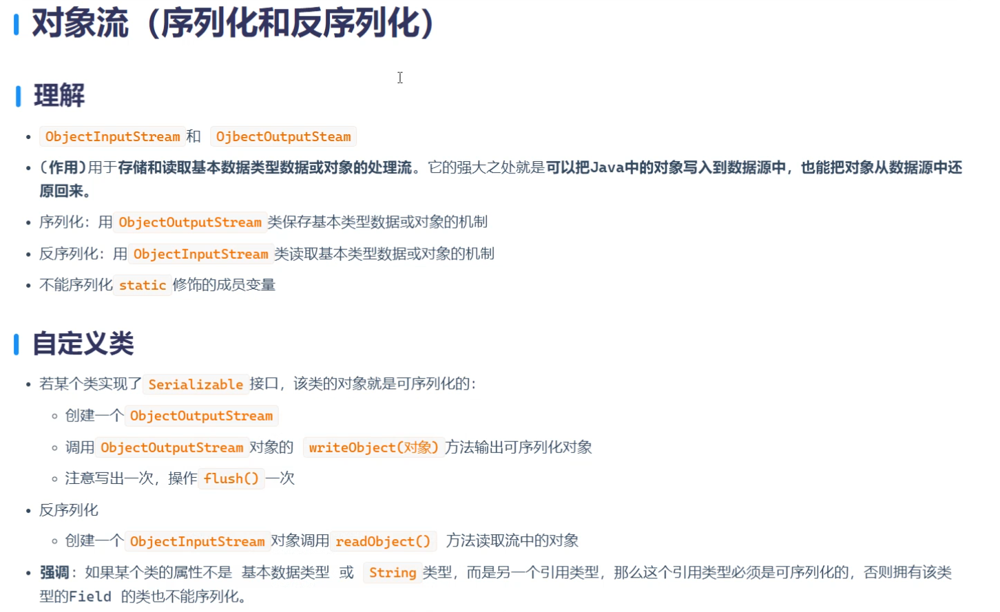

# 对象流

# 序列化（将java对象输出到文件中）

# 反序列化（将java对象从文件中读取出来）

```java
package com.io;

import java.io.FileInputStream;
import java.io.FileOutputStream;
import java.io.ObjectInputStream;
import java.io.ObjectOutputStream;
/*
对象流（序列化（将java对象输出到文件中）和反序列化（将java对象从文件中读取出来））
*/
public class IoTest16 {
    public static void main(String[] args) throws Exception{

        //创建序列化对象
        ObjectOutputStream objectOutputStream = new ObjectOutputStream(new FileOutputStream("Object.txt"));

        //创建一个User对象
        User user = new User(1001,"jack","北京市");
        //将java对象序列化到对象中
        objectOutputStream.writeObject(user);

        //刷新
        objectOutputStream.flush();

        //关闭资源
        objectOutputStream.close();
    }
}

class  IoTest17{

    public static void main(String[] args) throws  Exception{

        //创建反序列化对象
        ObjectInputStream objectInputStream = new ObjectInputStream(new FileInputStream("Object.txt"));

        //将文件中方java对象读取出来
        Object readObject = objectInputStream.readObject();
        //看看是不是属于User对象
        if (readObject instanceof User){
            User user =(User) readObject;
            System.out.println(user);
        }

        //关闭资源
        objectInputStream.close();

    }
}
```

```java
package com.io;

import java.io.Serializable;

public class User implements Serializable {
    //这个接口只是起到一个标识性的作用  这个方法里面什么都没有 实现给jvm虚拟机看的 赋予了User序列化的权限

    private    Integer id;
    private  String  name;
    private  String address;

    @Override
    public String toString() {
        return "User{" +
        "id=" + id +
        ", name='" + name + '\'' +
        ", address='" + address + '\'' +
        '}';
    }

    public Integer getId() {
        return id;
    }

    public void setId(Integer id) {
        this.id = id;
    }

    public String getName() {
        return name;
    }

    public void setName(String name) {
        this.name = name;
    }

    public String getAddress() {
        return address;
    }

    public void setAddress(String address) {
        this.address = address;
    }

    public User(Integer id) {
        this.id = id;
    }

    public User(Integer id, String name, String address) {
        this.id = id;
        this.name = name;
        this.address = address;
    }
}
```

### 如果User没有实现Serializable将会出现这个报错

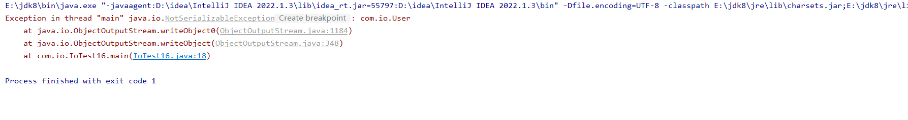

#### Serializable 这是一个空的方法 想当于一个通行证

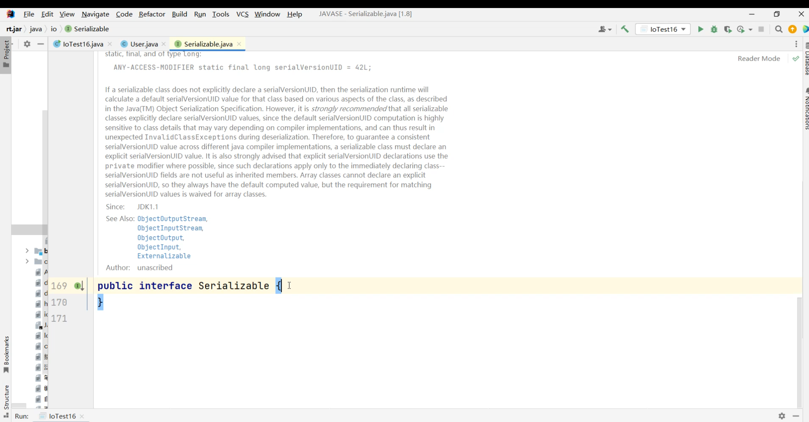

运行IoTest16 序列化 是乱码的

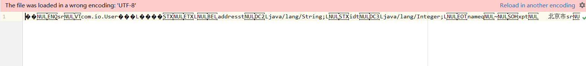

运行IoTest17 反序列化 将看不懂的乱码给读取出来

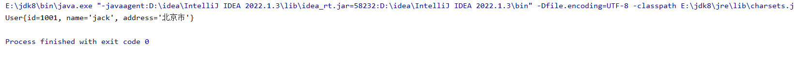

### 将集合类型的数据写到这个文件里面

```java
package com.io;

import java.io.FileInputStream;
import java.io.FileOutputStream;
import java.io.ObjectInputStream;
import java.io.ObjectOutputStream;
import java.util.ArrayList;
import java.util.List;

public class IoTest16 {
    public static void main(String[] args) throws Exception{

        //创建序列化对象
        ObjectOutputStream objectOutputStream = new ObjectOutputStream(new FileOutputStream("Object.txt"));

        //创建一个User对象
        User user1 = new User(1001,"jack","北京市");
        User user2 = new User(1002,"Tom","北京市");
        User user3 = new User(1003,"Time","北京市");

        //创建集合对象
        ArrayList<User> users = new ArrayList<>();
        //将java对象序列化到对象中
        objectOutputStream.writeObject(users);
        //添加
        users.add(user1);
        users.add(user2);
        users.add(user3);

        //刷新
        objectOutputStream.flush();

        //关闭资源
        objectOutputStream.close();
    }
}

class  IoTest17{

    public static void main(String[] args) throws  Exception{

        //创建反序列化对象
        ObjectInputStream objectInputStream = new ObjectInputStream(new FileInputStream("Object.txt"));

        //将文件中方java对象读取出来
        Object readObject = objectInputStream.readObject();
        
        //看看是不是属于User对象
        //        if (readObject instanceof User){
        //           User user =(User) readObject;
        //            System.out.println(user);
        //        }
        
        if (readObject instanceof List){
            List<User> list = (List) readObject;
            for (User user : list) {
                System.out.println(user);
            }
        }

        //关闭资源
        objectInputStream.close();

    }
}
```

运行IoTest16 序列化 是乱码的

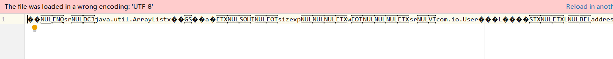

运行IoTest17 反序列化 将看不懂的乱码给读取出来

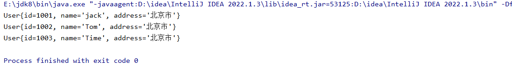

# 序列化版本号

### 当我们去执行的时候，JVM会先看User有没有序列化的权限，如果有系列化的权限的话它会给你这个类随机分配一个序列化版本号，但是当我在调用反序列化版本号之前，我更改了这个类里面的信息，我在这里多加了sex这个属性，这个时候去点反序列化的方法，因为类发生了变化所有JVM会重新去编译这个类，重新去生成字节码文件，发现两次内容不一样会再分配一个序列化版本号，导致两次序列化版本号不一致，这样就会报错

比如前面序列化User里面的内容是这三个，；序列化的号码是-68090129\*\*\*\*\*\*

private Integer id;

private String name;

private String address;

后面User里面想要读出的内容发生改变，当进行反序列化时将会出现报错，反序列化的号码是-9994140173\*\*\*\*\*

private Integer id;

private String name;

private String address;

private String sex；

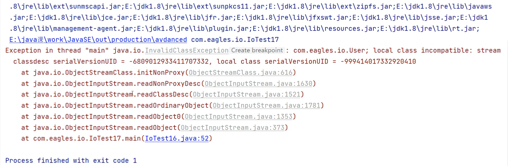

### 这样报错我们可以直接去写死这个序列化版本号就OK了

这是ArrayList 它里面就有一个独一无二的序列化版本号，是写死的：

#### 执行序列化之前先把sex这个属性给注释掉：

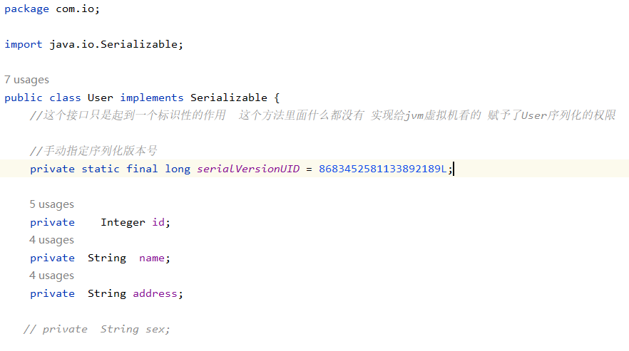

#### 现在执行反序列化时把之前注释的sex属性给放出来：

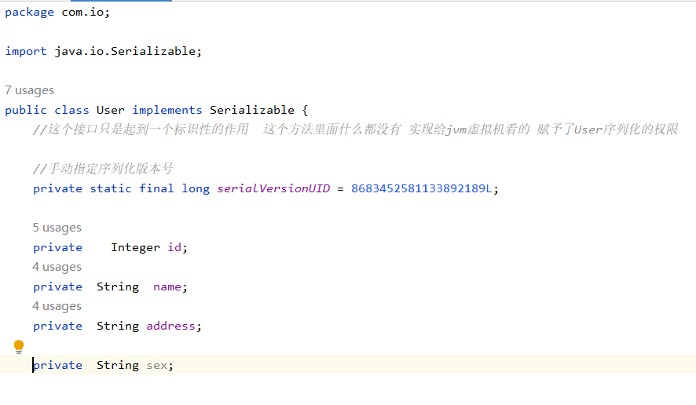

#### 运行反序列化的结果，发现并没有报错，程序正常运行：

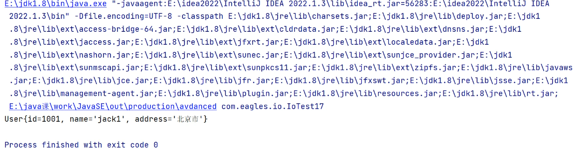

# 序列化关键字 ：trsnsient

# 作用：禁止某一个字段参与序列化

```java
//手动指定序列化版本号
private static final long serialVersionUID = 8683452581133892189L;

private    Integer id;
private  String  name;
private  transient String address; //transient 禁止某一字段参与序列化 address将不会参与序列化
```

你会发现address是空的

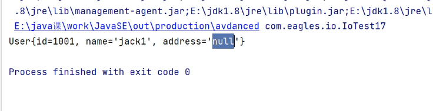
