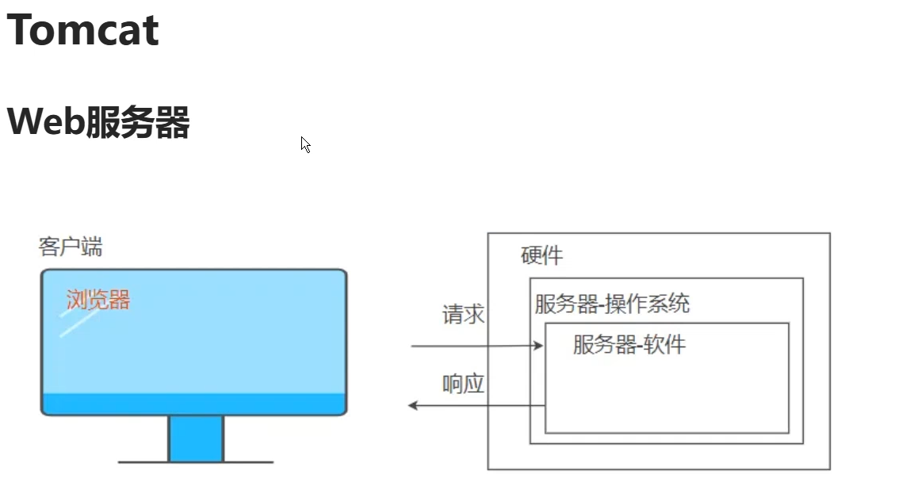

# Java Web 开发核心知识整理

## 一、Java Web 开发基础

### 1. Servlet（服务器端小程序）

- 是 Java 编写的服务器端程序，用于处理 HTTP 请求。
- 是 Java Web 的核心组件之一。
- 常见类：`HttpServlet`，`GenericServlet`
- 生命周期：构造函数 → `init()` → `service()` → `destroy()`

### 2. JSP（Java Server Pages）

- 是一种动态网页技术，允许在 HTML 中嵌入 Java 代码。
- 最终会被编译成 Servlet。
- 常用于视图层（展示数据）。

### 3. Filter（过滤器）

- 用于拦截请求和响应，实现统一处理（如编码、权限验证等）。
- 可以配置多个 Filter，形成 FilterChain。

### 4. Listener（监听器）

- 用于监听 Web 应用中的事件（如应用启动、会话创建等）。
- 常用监听器：`ServletContextListener`、`HttpSessionListener`

## Tomcat 目录结构：

|  |  |
| --- | --- |
| **文件夹** | **作用** |
| `bin` | 启动脚本（startup.bat/sh）和关闭脚本（shutdown.bat/sh） |
| `conf` | 配置文件（server.xml、web.xml、tomcat-users.xml） |
| `webapps` | 部署 Web 应用的目录 |
| `logs` | 日志文件（catalina.out 是主日志） |
| `lib` | Tomcat 使用的公共 jar 包 |
| `temp` | 临时文件目录 |
| `work` | JSP 编译后生成的 Servlet 文件 |



## 前后端交互流程

##### 客户端请求 → Web 服务器 → Servlet → 数据库 → 返回数据 → 浏览器渲染

1. 用户在浏览器输入 URL：`http://localhost:8080/myapp/login`
2. 请求到达 Tomcat 服务器
3. Tomcat 根据 URL 匹配对应的 Servlet（如 `LoginServlet`）
4. `LoginServlet` 接收用户名和密码，调用 DAO 查询数据库
5. 查询结果返回给 Servlet，Servlet 生成响应内容（HTML 或 JSON）
6. 响应通过 HTTP 返回给浏览器，用户看到结果

```plain
+-----------------------------+
|         用户浏览器          |
|  (发起请求：GET /login)     |
+------------+----------------
             |
             | HTTP 请求
             v
+------------+----------------+
|      Tomcat Web 服务器      |
|                             |
| +-------------------------+ |
| |        FilterChain      | |  ← 过滤器链（如编码、权限等）
| +-------------------------+ |
|             |               |
|             v               |
| +-------------------------+ |
| |        ServletContext   | |  ← 全局上下文（应用级）
| +-------------------------+ |
|             |               |
|             v               |
| +-------------------------+ |
| |       ServletConfig     | |  ← 当前 Servlet 的配置
| +-------------------------+ |
|             |               |
|             v               |
| +-------------------------+ |
| |         Servlet         | |  ← 处理请求（doGet/doPost）
| +-------------------------+ |
|             |               |
|             v               |
| +-------------------------+ |
| |        request 域       | |  ← 请求转发时共享数据
| +-------------------------+ |
|             |               |
|             v               |
| +-------------------------+ |
| |         JSP 页面        | |  ← 视图展示（可选）
| +-------------------------+ |
|             |               |
|             v               |
| +-------------------------+ |
| |         web.xml         | |  ← 配置文件（Servlet、Filter、Listener）
| +-------------------------+ |
|             |               |
|             v               |
| +-------------------------+ |
| |         数据库          | |  ← 数据持久化（如 MySQL、Oracle）
| +-------------------------+ |
+-----------------------------+
```

---

## 每个组件的作用与位置详解

|  |  |  |
| --- | --- | --- |
| **组件** | **位置** | **作用** |
| **浏览器** | 客户端 | 发起请求，接收响应，展示页面 |
| **HTTP 请求** | 网络层 | 浏览器与服务器之间的通信协议 |
| **FilterChain** | 服务器端 | 请求拦截、统一处理（如编码、日志、权限） |
| **ServletContext** | 服务器端 | 全局上下文，存储全局数据、获取资源 |
| **ServletConfig** | 服务器端 | 每个 Servlet 的配置信息（初始化参数） |
| **Servlet** | 服务器端 | 接收请求，处理业务逻辑，返回响应 |
| **request 域** | 服务器端 | 一次请求范围内共享数据（转发时有效） |
| **JSP** | 服务器端 | 动态生成 HTML 页面（可选） |
| **web.xml** | 服务器端 | 配置文件（Servlet、Filter、Listener） |
| **数据库** | 后端 | 数据存储、查询、更新等操作 |
