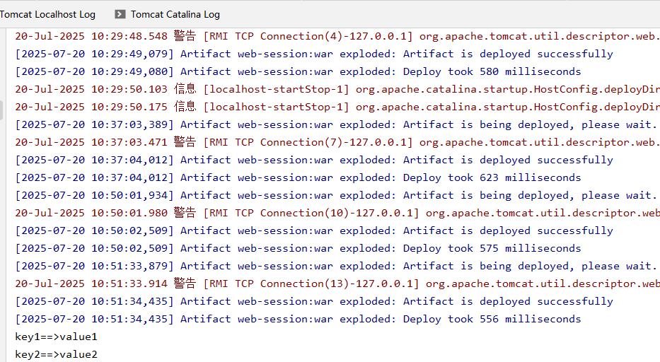
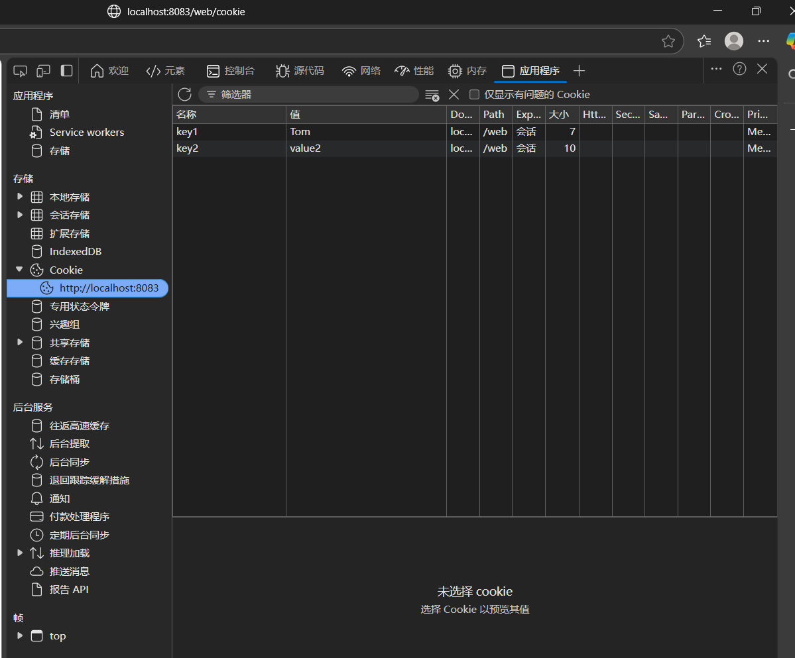

1、Cookie在开发中的作用

-Cookie是把数据保存在浏览器端的计数

-每个Cookie保存的数据大小是4kb

-场景

-在做购物车功能的时候，可以把订单order存储到cookie中，指定过期时间

-在做登录需求时，有可能会将用户保存到cookie中

### 处理中文乱码和一些方法的调用程序

```java
package com.eagles.cookie;

import com.eagles.utils.CookieUtils;

import javax.servlet.ServletException;
import javax.servlet.annotation.WebServlet;
import javax.servlet.http.Cookie;
import javax.servlet.http.HttpServlet;
import javax.servlet.http.HttpServletRequest;
import javax.servlet.http.HttpServletResponse;
import java.io.IOException;

@WebServlet("/cookie")
public class HelloCookie  extends HttpServlet {

    @Override
    protected void service(HttpServletRequest request, HttpServletResponse response) throws ServletException, IOException {

        request.setCharacterEncoding("utf-8");
        response.setContentType("text/html;charset=utf-8");

        //addCookie(request,response);

        //获取cookie
        //getCookie(request,response);

        //findCookie(request,response);

        //updateCookie(request,response);

        //setMaxAge(request,response);

    }

    /*--方法体--*/

}    
```

### 保存cookie

```java
/*
保存cookie
 */
public void addCookie(HttpServletRequest request, HttpServletResponse response){
    //创建cookie对象
    Cookie cookie1 = new Cookie("key1", "value1");
    Cookie cookie2 = new Cookie("key2", "value2");

    //通知浏览器保存cookie
    response.addCookie(cookie1);
    response.addCookie(cookie2);

    try {
        response.getWriter().print("浏览器保存cookie成功!");
    } catch (IOException e) {
        throw new RuntimeException(e);
    }

}
```


### 获取客户端的所有cookie

```java
/*
   获取用户端的所有cookie
   服务器通知浏览器保存cookie。实际上是通过 响应头 的方式来告知浏览器的
    */
public  void getCookie(HttpServletRequest request, HttpServletResponse response){

    //获取客户端的所有cookie
    Cookie[] cookies = request.getCookies();

    //遍历数组
    for (Cookie cookie : cookies) {
        System.out.println(cookie.getName()+"==>"+cookie.getValue());
    }

    try {
        response.getWriter().print("；浏览器获取cookie成功!");
    } catch (IOException e) {
        throw new RuntimeException(e);
    }
}
```



### 获取客户端的某一个cookie 通过cookieUtils工具

```java
/*
获取客户端的某一个cookie 通过cookieUtils工具
 */
public   void findCookie(HttpServletRequest request, HttpServletResponse response){
    Cookie cookie = CookieUtils.findCookie(request.getCookies(), "name");

    System.out.println(cookie.getName()+ "=> "+cookie.getValue());

    try {
        response.getWriter().print("浏览器获取cookie成功！");
    } catch (IOException e) {
        throw new RuntimeException(e);
    }

}
```

### 工具类

```java
package com.eagles.utils;

import javax.servlet.http.Cookie;

public class CookieUtils {
    private  CookieUtils() {}

    public  static Cookie findCookie(Cookie[] cookies,String key){
        if (cookies == null || cookies.length == 0 || key == null || key.trim().equals("")){
            return null;
        }
        for (Cookie cookie : cookies) {
            if (cookie.getName().equals(key)){
                return  cookie;
            }
        }
        return null;
    }
}
```

### 修改cookie的值：

##### 方法一：

```java
/*
    修改cookie的值
     */
public  void updateCookie(HttpServletRequest request, HttpServletResponse response){

    //获取需要修改的cookie对象
    Cookie cookie = CookieUtils.findCookie(request.getCookies(), "key1");

    //调用set方法
    cookie.setValue("Tom");

    //通知浏览器保存
    response.addCookie(cookie);

    try {
        response.getWriter().print("浏览器修改cookie成功！");
    } catch (IOException e) {
        throw new RuntimeException(e);
    }

}
```

##### 方法二：

```java
//重新赋值，自行覆盖
Cookie cookie1 = new Cookie("key1", "jack");

//通知浏览器保存
response.addCookie(cookie1);
```

### 设置cookie的过期时间

```java
/**
 * 设置cookie的过期时间
 * 0 表示立即删除cookie
 * 正数 在指定的秒数后过期
 * 负数 session级别
 * @param request
 * @param response
 */
public void setMaxAge(HttpServletRequest request, HttpServletResponse response){

    Cookie cookie = CookieUtils.findCookie(request.getCookies(), "key2");

    //设置过期时间为1天
    //cookie.setMaxAge(60 * 60 * 24);

    //如果想删除某一个cookie 直接setMaxAge方法设为0即可
    cookie.setMaxAge(0);

    //通知浏览器保存（如果被删掉了将不会被保存）
    response.addCookie(cookie);

    try {
        response.getWriter().print("浏览器保存cookie成功！");
    } catch (IOException e) {
        throw new RuntimeException(e);
    }

}
```



### 案例：

```java
package com.eagles.cookie;

import com.eagles.utils.CookieUtils;

import javax.servlet.ServletException;
import javax.servlet.http.Cookie;
import javax.servlet.http.HttpServlet;
import javax.servlet.http.HttpServletRequest;
import javax.servlet.http.HttpServletResponse;
import java.io.IOException;

public class LoginServlet extends HttpServlet {

    @Override
    protected void service(HttpServletRequest request, HttpServletResponse response) throws ServletException, IOException {
        request.setCharacterEncoding("utf-8");
        response.setContentType("text/html;charset=utf-8");

        String username = request.getParameter("username");
        String password = request.getParameter("password");

        if (username.equals("jack") && password.equals("123456")){
            Cookie cookieUsername = CookieUtils.findCookie(request.getCookies(), "username");
            Cookie cookiePassword = CookieUtils.findCookie(request.getCookies(), "password");

            if (cookieUsername !=null && cookiePassword !=null){
                response.getWriter().print("登录成功~");
            }else {
                //创建cookie对象
                cookieUsername  = new Cookie("username", username);
                cookiePassword  = new Cookie("password",password);

                //用户信息在浏览器保存一年
                cookieUsername.setMaxAge(60 * 60 * 24 * 365);
                cookiePassword.setMaxAge(60 * 60 * 24 * 365);

                //通知浏览器保存cookie
                response.addCookie(cookieUsername);
                response.addCookie(cookiePassword);
                response.getWriter().print("登录成功~");

            }
        }else {
            response.getWriter().print("登录失败~");
        }
    }
}
```
