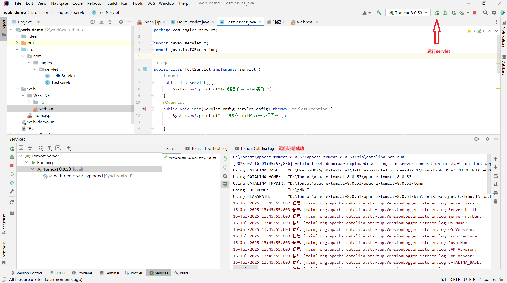
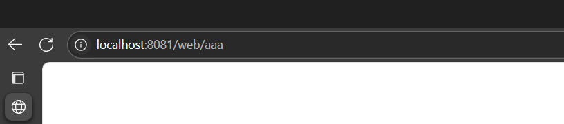
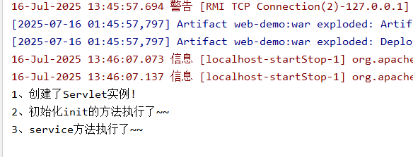
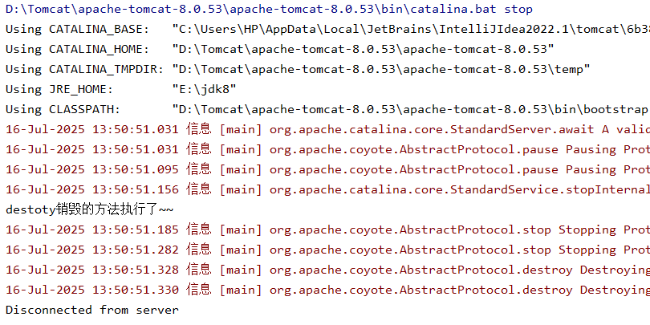
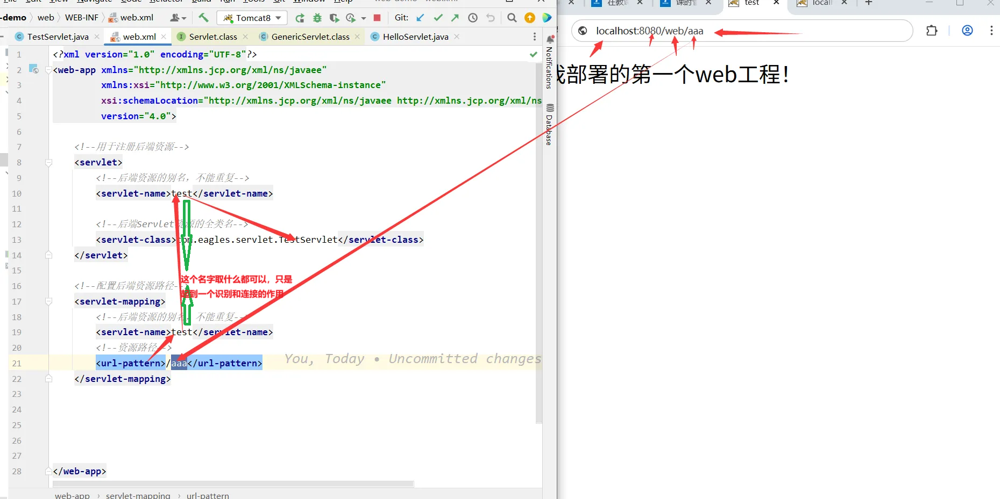
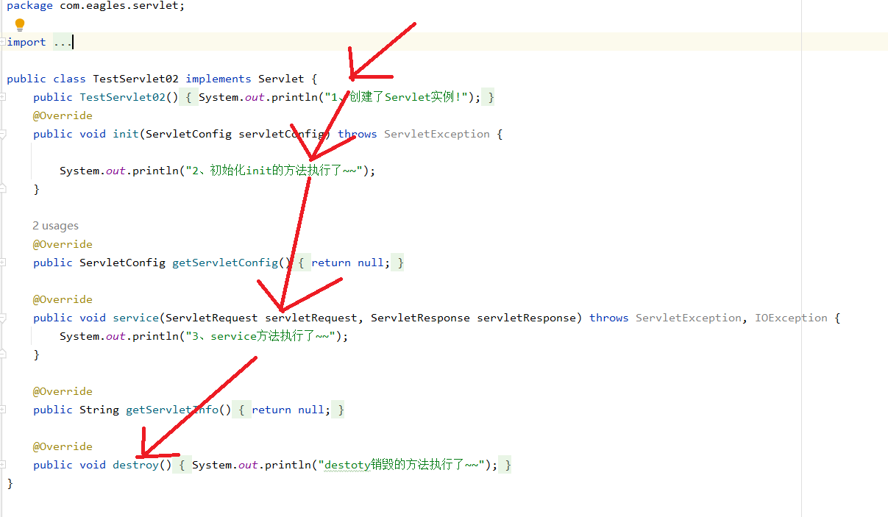
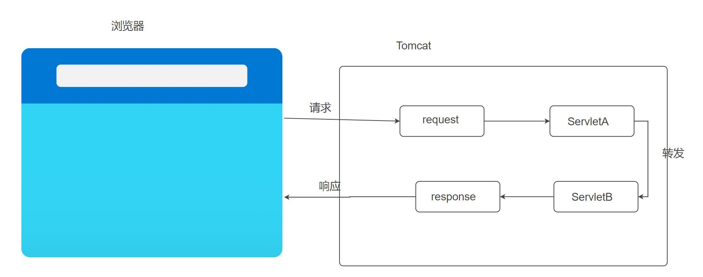
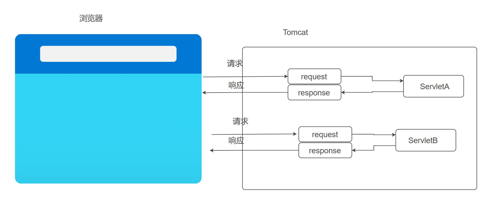

# Java Servlet 全面学习笔记

## 一、什么是 Servlet？

**Servlet 是运行在服务器端的小程序**，用于接收客户端请求并生成动态网页内容。

是 Java 编写的服务器端程序，用于处理 HTTP 请求。是请求和响应的规范

---

## 二、Servlet 生命周期

每个 Servlet 实例在服务器中只会创建一次，它的生命周期由容器管理：

1. **init() 方法：**

- 第一次请求时调用
- 用于初始化资源（如加载配置文件）

2. **service() 方法：**

- 每次请求都会被调用
- 根据请求类型自动调用 `doGet()` 或 `doPost()`

3. **destroy() 方法：**

- 服务器关闭或应用卸载时调用
- 用于释放资源（如数据库连接）

- 生命周期：构造函数 → `init()` → `service()` → `destroy()`

```plain
-1、从浏览器输入地址：http://localhost:8081/web/aaa 程序会解析地址，从地址中匹配到对应的资源路径（/aaa）
-2、通过资源路径从配置资源中匹配到对应的后端Servlet(TestServlet)资源
-3、Tomcat容器会创建对应的Servlet资源的实例
-4、会执行初始化init方法，加载对应初始化信息
-5、执行Service处理前后端请求和响应的业务
-6、当Web容器（Tomcat）关闭时，会执行销毁的方法，销毁Servlet实例！
```

#### 了解生命周期的原理：

###### 一、代码结构分析

```java
package com.eagles.servlet;

import javax.servlet.*;
import java.io.IOException;

public class TestServlet implements Servlet {

    public TestServlet() {
        System.out.println("1、创建Servlet实例！");
    }

    @Override
    public void init(ServletConfig servletConfig) throws ServletException {
        System.out.println("2、初始化init的方法执行了~~");
    }

    @Override
    public ServletConfig getServletConfig() {
        return null;
    }

    @Override
    public void service(ServletRequest servletRequest, ServletResponse servletResponse) throws ServletException, IOException {
        System.out.println("3、service方法执行了~~");
    }

    @Override
    public String getServletInfo() {
        return null;
    }

    @Override
    public void destroy() {
        System.out.println("4、destroy销毁的方法执行了~~");
    }
}
```

编写好Servlet程序，先把Tomcat服务器打开：



在浏览器里面搜索URL，没有报错或者404什么的即为开启成功：



控制台打印的信息：



随着服务器的关闭servlet也随之销毁



---

###### 二、Servlet 生命周期详解（四步）

Servlet 的生命周期由 Web 容器（如 Tomcat）管理，主要包括以下四个阶段：

|  |  |  |  |
| --- | --- | --- | --- |
| **阶段** | **方法** | **触发时机** | **执行次数** |
| 1️⃣ 实例化 | 构造函数 `TestServlet()` | 第一次请求该 Servlet 时 | 仅一次 |
| 2️⃣ 初始化 | `init(ServletConfig config)` | 实例化后自动调用 | 仅一次 |
| 3️⃣ 服务处理 | `service(ServletRequest req, ServletResponse res)` | 每次请求都会调用 | 多次 |
| 4️⃣ 销毁 | `destroy()` | 应用关闭或服务器重启时 | 仅一次 |

---

###### 三、运行流程演示（控制台输出）

当你第一次访问这个 Servlet 时，控制台会输出：

```plain
1、创建Servlet实例！
2、初始化init的方法执行了~~
3、service方法执行了~~
```

当你多次访问时，只会重复输出：

```plain
3、service方法执行了~~
```

当服务器关闭或应用被卸载时，会输出：

```plain
4、destroy销毁的方法执行了~~
```

## 三、HttpServlet 常用方法

|  |  |
| --- | --- |
| **方法名** | **描述** |
| `doGet(HttpServletRequest request, HttpServletResponse response)` | 处理 GET 请求 |
| `doPost(HttpServletRequest request, HttpServletResponse response)` | 处理 POST 请求 |
| `init()` | 初始化操作 |
| `destroy()` | 销毁前的操作 |

---

## 四、Servlet 的配置方式

### 方式1：注解配置 但是不能初始化

```java
@WebServlet("/hello")
public class HelloServlet extends HttpServlet {
    ...
}
```

##### 为什么通常继承 HttpServlet 而不是直接实现 Servlet？

|  |  |  |
| --- | --- | --- |
| **对比项** | **直接实现 Servlet** | **继承 HttpServlet** |
| 功能全面性 | 只有基础功能 | 提供了 HTTP 请求处理（GET / POST） |
| 开发效率 | 需要手动实现所有方法 | 只需重写 doGet / doPost |
| 适用场景 | 学习和测试 | 实际项目开发 |
| 是否需要类型判断 | 是 | 否 |

### 方式2：web.xml 配置（传统方式）

```java
<?xml version="1.0" encoding="UTF-8"?>
<web-app xmlns="http://xmlns.jcp.org/xml/ns/javaee"
xmlns:xsi="http://www.w3.org/2001/XMLSchema-instance"
xsi:schemaLocation="http://xmlns.jcp.org/xml/ns/javaee http://xmlns.jcp.org/xml/ns/javaee/web-app_4_0.xsd"
version="4.0">
<!--用于注册后端资源-->
<servlet>
<!--后端资源的别名，不能重复-->
<servlet-name>test</servlet-name>
<!--后端Servlet资源的全类名-->
<servlet-class>com.eagles.servlet.TestServlet</servlet-class>
</servlet>
<!--配置后端资源路径-->
<servlet-mapping>
<!--后端资源的别名，不能重复-->
<servlet-name>test</servlet-name>
<!--资源路径-->
<url-pattern>/aaa</url-pattern>
</servlet-mapping>
</web-app>
```

访问的整个路径顺序：





## （1）ServletConfig

### 1. **定义**

`ServletConfig` 是一个接口，由 Web 容器实现。它用于在 Servlet 初始化时，向该 Servlet 提供**配置信息**。

### 2. **作用**

- 获取 Servlet 的初始化参数（在 `web.xml` 或 `@WebServlet` 中配置）
- 获取 `ServletContext` 对象
- 获取当前 Servlet 的名称

### 3. **生命周期**

- 在 Servlet 初始化时（即 `init()` 方法被调用时）由容器传入。
- 每个 Servlet 实例都有自己的 `ServletConfig`。

### 4. **使用方式**

#### 方式1：通过注解配置初始化参数（推荐）

```java
@WebServlet(
    name = "MyServlet",
    urlPatterns = {"/my"},
    initParams = {
        @WebInitParam(name = "username", value = "admin"),
        @WebInitParam(name = "password", value = "123456")
    }
)
public class MyServlet extends HttpServlet {
    @Override
    public void init(ServletConfig config) throws ServletException {
        super.init(config);
        //获取 MyServlet 的初始化参数
        String user = config.getInitParameter("username");
        System.out.println("Servlet 初始化参数 username = " + user);
    }

    @Override
    protected void doGet(HttpServletRequest req, HttpServletResponse resp) throws IOException {
        ServletConfig config = getServletConfig();
        String pwd = config.getInitParameter("password");
        resp.getWriter().print("Password: " + pwd);
    }
}
```

#### 方式2：通过 `web.xml` 配置

```java
<servlet>
<servlet-name>MyServlet</servlet-name>
<servlet-class>com.eagles.servlet.MyServlet</servlet-class>
<init-param>
<param-name>username</param-name>
<param-value>admin</param-value>
</init-param>
<init-param>
<param-name>password</param-name>
<param-value>123456</param-value>
</init-param>
</servlet>

<servlet-mapping>
<servlet-name>MyServlet</servlet-name>
<url-pattern>/my</url-pattern>
</servlet-mapping>
```

```java
package com.eagles.servlet;

import javax.servlet.*;
import java.io.IOException;
import java.util.Enumeration;

public class TestServlet implements Servlet {
    public TestServlet(){
        System.out.println("1、创建了Servlet实例!");
    }
    @Override
    public void init(ServletConfig servletConfig) throws ServletException {
        System.out.println(servletConfig);
        //获取配置文件中的初始化信息 web.xml
        String name = servletConfig.getInitParameter("name");
        String address = servletConfig.getInitParameter("address");

        System.out.println("name="+name);
        System.out.println("address="+address);

        //获取当前servlet实例的别名
        String servletName = servletConfig.getServletName();
        System.out.println("当前实例的别名为："+servletName);

        // 获取所有初始化参数
        Enumeration<String> initParameterNames = servletConfig.getInitParameterNames();

        while (initParameterNames.hasMoreElements()) {
            String paramName = initParameterNames.nextElement();
            String paramValue = servletConfig.getInitParameter(paramName);
            System.out.println("参数名：" + paramName + "，参数值：" + paramValue);//参数名：username，参数值：admin;参数名：password，参数值：123456
        }
        System.out.println("2、初始化init的方法执行了~~");
    }

    @Override
    public ServletConfig getServletConfig() {
        return null;
    }

    @Override
    public void service(ServletRequest servletRequest, ServletResponse servletResponse) throws ServletException, IOException {
        System.out.println("3、service方法执行了~~");
    }

    @Override
    public String getServletInfo() {
        return null;
    }

    @Override
    public void destroy() {
        System.out.println("destoty销毁的方法执行了~~");
    }
}
```

## （2）ServletContext（域对象）

### 1. **定义**

`ServletContext` 是一个接口，由 Web 容器为每个 Web 应用创建一个唯一的上下文对象。它代表整个 Web 应用的上下文。

### 2. **作用**

- 获取 Web 应用的初始化参数（全局参数）
- 获取 Web 应用的资源路径（如 `/WEB-INF` 下的文件）
- 存储和获取全局共享数据（`setAttribute()` / `getAttribute()`）
- 获取服务器信息（如服务器版本、应用名称等）

### 3. **生命周期**

- Web 应用启动时创建
- Web 应用关闭时销毁
- **整个 Web 应用共享一个**`ServletContext`**实例**

### 4. **使用方式**

#### 1. 获取上下文初始化参数（全局参数）

##### 在 `web.xml` 中配置：

```java
<context-param>
<param-name>appConfig</param-name>
<param-value>/config/app.properties</param-value>
</context-param>
```

##### 在 Servlet 中获取：

```java
@Override
protected void doGet(HttpServletRequest req, HttpServletResponse resp) throws IOException {
    ServletContext context = getServletContext();
    String configPath = context.getInitParameter("appConfig");
    System.out.println("全局配置路径：" + configPath);
}
```

#### 2. 存储和获取全局数据（共享数据）

```java
// 设置共享数据
context.setAttribute("siteName", "我的网站");

// 获取共享数据
String siteName = (String) context.getAttribute("siteName");
System.out.println("网站名称：" + siteName);
```

#### 3. 获取资源路径（读取文件）

```java
String path = context.getRealPath("/WEB-INF/data.txt");
File file = new File(path);
```

```java
package com.eagles.servlet;

import javax.servlet.ServletConfig;
import javax.servlet.ServletContext;
import javax.servlet.ServletException;
import javax.servlet.annotation.WebServlet;
import javax.servlet.http.HttpServlet;
import javax.servlet.http.HttpServletRequest;
import javax.servlet.http.HttpServletResponse;
import java.io.IOException;
import java.util.Enumeration;
@WebServlet("/hello02")
public class HelloServlet02 extends HttpServlet {
    //重写接口
    @Override
    protected void service(HttpServletRequest request, HttpServletResponse response) throws ServletException, IOException {
        //两种方法创建
        ServletContext servletContext1 = this.getServletConfig().getServletContext();
        ServletContext servletContext2 = getServletContext();
        System.out.println(servletContext1 == servletContext2);

        //往作用域中存储数据
        servletContext1.setAttribute("message1","hello servlet!!");
        servletContext1.setAttribute("message2","hello servlet!!");
        servletContext1.setAttribute("message3","hello servlet!!");
        servletContext1.setAttribute("message4","hello servlet!!");

        ServletConfig servletConfig = this.getServletConfig();

        //全局的配置信息
        String username = servletContext1.getInitParameter("username");
        String password = servletContext1.getInitParameter("password");
        String driver = servletContext1.getInitParameter("driver");

        System.out.println("username = "+username);
        System.out.println("password ="+password);
        System.out.println("driver = "+driver);

        Enumeration<String> initParameterNames = servletContext1.getInitParameterNames();
        while (initParameterNames.hasMoreElements()){

            String key = initParameterNames.nextElement();
            String value = servletContext1.getInitParameter(key);
            System.out.println(key + "==>"+value);

            //获取
            String path = servletContext1.getContextPath();
            System.out.println("path =" +path);//web
        }
    }
}
```

两种创建方式：

### 写法1：

```plain
ServletContext servletContext1 = this.getServletConfig().getServletContext();
```

- `this.getServletConfig()`：获取当前 Servlet 的配置对象（`ServletConfig`）。
- `.getServletContext()`：从配置对象中获取全局的 `ServletContext`。
- **servletConfig指向全局唯一的** `ServletContext`

本质是：**通过当前 Servlet 的配置对象获取全局上下文。**

### 写法2：

```plain
ServletContext servletContext2 = getServletContext();
```

- `getServletContext()` 是 `HttpServlet` 类（或 `GenericServlet`）中的一个便捷方法。
- 它的底层实现就是调用了 `this.getServletConfig().getServletContext();`

本质是：**直接调用父类封装好的方法，获取全局上下文。**

## （3）request（作为域对象使用）：

#### 一、什么是 request 域？

`request` 是 Java Web 中的一个重要对象，它不仅用于获取请求参数、设置响应等操作，还可以作为**请求域对象**来使用。

**request 域的作用范围：一次请求范围内有效。**

- 从客户端发起请求开始，到服务器完成响应结束。
- 如果在请求过程中发生了 **请求转发（RequestDispatcher.forward()）**，那么 request 域中的数据仍然可以访问。
- 一旦浏览器地址栏发生变化（如重定向），则 request 域中的值就会丢失。



```java
package com.eagles.servlet;

import javax.servlet.ServletException;
import javax.servlet.annotation.WebServlet;
import javax.servlet.http.HttpServlet;
import javax.servlet.http.HttpServletRequest;
import javax.servlet.http.HttpServletResponse;
import java.io.IOException;
import java.util.Enumeration;

@WebServlet("/hello04")
public class HelloServlet04  extends HttpServlet {
    @Override
    protected void service(HttpServletRequest request, HttpServletResponse response) throws ServletException, IOException {

        //获取客户端传递过来的参数
        String name = request.getParameter("name");
        System.out.println(name);

        //获取客户端传递过来的所有参数
        String[] parameterValues = request.getParameterValues("hobby");
        for (String parameterValue : parameterValues) {
            System.out.println(parameterValue);
        }

        //获得工程路径
        String path = request.getContextPath();
        System.out.println(path);

        //根据key来获得value，获取的是http的请求头信息
        String cookie = request.getHeader("cookie");
        System.out.println("cookie ==>"+cookie);

        //获取客户端的请求方式
        String method = request.getMethod();
        System.out.println("客户端的提交方式 "+method);

        //获取浏览器请求头所有的key、value的集合
        Enumeration<String> headerNames = request.getHeaderNames();
        while (headerNames.hasMoreElements()){
            String key = headerNames.nextElement();
            String value  = request.getHeader(key);
            System.out.println(key +"==>"+value);

        }
    }
}
```

---

#### 二、request 域常用方法

|  |  |
| --- | --- |
| **方法** | **作用** |
| `setAttribute(String name, Object value)` | 向 request 域中存储数据 |
| `getAttribute(String name)` | 从 request 域中取出数据 |
| `getAttributeNames()` | 获取所有 attribute 的名称枚举 |
| `removeAttribute(String name)` | 移除指定属性 |

---

#### 三、请求转发（RequestDispatcher.forward()）

###### 请求转发的特点：

- 地址栏不会变化
- 是服务器内部跳转（只发生一次请求）
- 可以跳转到另一个 Servlet、JSP 页面或 HTML 页面
- request 域中的数据在转发过程中保持有效

---

#### 四、案例演示：request 域 + 请求转发

###### 功能描述：

1. 用户访问 `/login`，提交用户名和密码；
2. 在 `LoginServlet` 中验证用户名是否为 "admin"；
3. 验证通过后将用户信息存入 request 域；
4. 使用请求转发跳转到 `WelcomeServlet`；
5. `WelcomeServlet` 从 request 域中取出用户信息并输出欢迎语句。

---

##### 项目结构示意：

```plain
webapp/
├── login.html
└── WEB-INF/
    └── web.xml
src/
    └── com.eagles.servlet/
        ├── LoginServlet.java
        └── WelcomeServlet.java
```

---

#### 1. login.html（前端页面）

```html
<!DOCTYPE html>
<html>
  <head>
    <title>登录页面</title>
  </head>
  <body>
    <h2>请登录</h2>
    <form action="login" method="post">
      用户名：<input type="text" name="username"><br><br>
      密码：<input type="password" name="password"><br><br>
      <input type="submit" value="登录">
    </form>
  </body>
</html>
```

---

#### 2. LoginServlet.java

```java
package com.eagles.servlet;

import java.io.IOException;
import javax.servlet.*;
import javax.servlet.annotation.WebServlet;
import javax.servlet.http.*;

@WebServlet("/login")
public class LoginServlet extends HttpServlet {
    @Override
    protected void doPost(HttpServletRequest request, HttpServletResponse response) throws IOException, ServletException {
        // 设置编码
        request.setCharacterEncoding("UTF-8");

        // 获取表单数据
        String username = request.getParameter("username");
        String password = request.getParameter("password");

        // 简单模拟登录验证
        if ("admin".equals(username) && "123456".equals(password)) {
            // 将用户信息放入 request 域
            request.setAttribute("user", username);

            // 请求转发到 WelcomeServlet
            RequestDispatcher dispatcher = request.getRequestDispatcher("/welcome");
            //跳转资源（将/login的request和response进行接收）
            dispatcher.forward(request, response);
        } else {
            response.getWriter().print("登录失败！");
        }
    }
}
```

---

#### 3. WelcomeServlet.java

```java
package com.eagles.servlet;

import java.io.IOException;
import javax.servlet.*;
import javax.servlet.annotation.WebServlet;
import javax.servlet.http.*;

@WebServlet("/welcome")
public class WelcomeServlet extends HttpServlet {
    @Override
    protected void doGet(HttpServletRequest request, HttpServletResponse response) throws IOException, ServletException {
        // 从 request 域中获取用户信息
        String user = (String) request.getAttribute("user");

        // 设置响应类型
        response.setContentType("text/html;charset=UTF-8");

        // 输出欢迎信息
        if (user != null) {
            response.getWriter().print("欢迎回来，" + user + "！");
        } else {
            response.getWriter().print("没有用户信息！");
        }
    }
}
```

---

#### 4. web.xml（可选配置，如果不用注解）

如果你使用的是 Tomcat 7 或更早版本，可能需要手动配置 `web.xml`：

```xml
<servlet>
  <servlet-name>LoginServlet</servlet-name>
  <servlet-class>com.eagles.servlet.LoginServlet</servlet-class>
</servlet>
<servlet-mapping>
  <servlet-name>LoginServlet</servlet-name>
  <url-pattern>/login</url-pattern>
</servlet-mapping>

<servlet>
  <servlet-name>WelcomeServlet</servlet-name>
  <servlet-class>com.eagles.servlet.WelcomeServlet</servlet-class>
</servlet>
<servlet-mapping>
  <servlet-name>WelcomeServlet</servlet-name>
  <url-pattern>/welcome</url-pattern>
</servlet-mapping>
```

---

#### 五、运行流程说明：

1. 打开浏览器访问：

```plain
http://localhost:8080/your_project_name/login.html
```

2. 输入用户名：`admin`，密码：`123456`，点击“登录”
3. 浏览器地址变为：

```plain
http://localhost:8080/your_project_name/login
```

4. 登录成功后，请求被转发到 `/welcome`，但地址栏仍然是 `/login`
5. 页面显示：

```plain
欢迎回来，admin！
```

只要set了无论在哪，只要在转发的地址用get就能访问到，不会有request的限制

## （3）重定向

在 Web 开发中，"重定向"（Redirect）是指当服务器收到客户端的请求后，返回一个特殊的响应给客户端，告诉客户端去访问另一个URL以获取请求的资源。重定向通常用于以下几种情况：

1. **用户访问了一个需要登录的页面但尚未登录**，此时服务器可以重定向用户到登录页面。
2. **网站结构发生变化**，某些页面的URL已经改变，可以通过重定向将旧URL的请求指向新的URL。
3. **简化URL**，例如将`www.example.com/home`重定向到`www.example.com/`。



对内（跳转到别的路径）：

```java
package com.eagles.servlet;

import java.io.IOException;
import javax.servlet.ServletException;
import javax.servlet.annotation.WebServlet;
import javax.servlet.http.HttpServlet;
import javax.servlet.http.HttpServletRequest;
import javax.servlet.http.HttpServletResponse;

@WebServlet({"/hello08"})
public class HelloServlet08 extends HttpServlet {
    public HelloServlet08() {
    }

    protected void service(HttpServletRequest request, HttpServletResponse response) throws ServletException, IOException {
        response.setContentType("text/html;charset=utf-8");
        response.sendRedirect("http://localhost:8080/web/hello09");
    }
}
```

```java
package com.eagles.servlet;

import java.io.IOException;
import javax.servlet.ServletException;
import javax.servlet.annotation.WebServlet;
import javax.servlet.http.HttpServlet;
import javax.servlet.http.HttpServletRequest;
import javax.servlet.http.HttpServletResponse;

@WebServlet({"/hello09"})
public class HelloServlet09 extends HttpServlet {
    public HelloServlet09() {
    }

    protected void service(HttpServletRequest request, HttpServletResponse response) throws ServletException, IOException {
        response.setContentType("text/html;charset=utf-8");
        response.getWriter().print("资源跳转成功~~~");
    }
}
```

对外（跳转到别的页面）：

```java
package com.eagles.servlet;

import javax.servlet.ServletException;
import javax.servlet.annotation.WebServlet;
import javax.servlet.http.HttpServlet;
import javax.servlet.http.HttpServletRequest;
import javax.servlet.http.HttpServletResponse;
import java.io.IOException;

@WebServlet({"/hello08"})
public class HelloServlet08 extends HttpServlet {
    public HelloServlet08() {
    }

    protected void service(HttpServletRequest request, HttpServletResponse response) throws ServletException, IOException {
        response.setContentType("text/html;charset=utf-8");
        response.sendRedirect("https://www.baidu.com/");
    }
}
```

---

## （4）ServletConfig 与 ServletContext 的区别

|  |  |  |
| --- | --- | --- |
| **特性** | **ServletConfig** | **ServletContext** |
| **作用范围** | 单个 Servlet | 整个 Web 应用 |
| **生命周期** | 与 Servlet 实例相同 | 与 Web 应用相同 |
| **获取方式** | 通过 `getServletConfig()` | 通过 `getServletContext()` |
| **配置位置** | `<init-param>`  （Servlet 级） | `<context-param>`  （应用级） |
| **共享性** | 不共享 | 全局共享 |
| **典型用途** | 配置单个 Servlet 参数 | 配置全局参数、共享数据、读取资源文件 |

---

### 示例对比代码

```java
@WebServlet("/demo")
public class DemoServlet extends HttpServlet {

    @Override
    public void init(ServletConfig config) throws ServletException {
        super.init(config);

        // 获取 Servlet 级参数
        String servletParam = config.getInitParameter("username");
        System.out.println("ServletConfig 参数 username = " + servletParam);

        // 获取全局上下文
        ServletContext context = config.getServletContext();

        // 获取全局参数
        String globalParam = context.getInitParameter("appConfig");
        System.out.println("ServletContext 参数 appConfig = " + globalParam);

        // 设置共享数据
        context.setAttribute("siteName", "Eagles 教育平台");
    }

    @Override
    protected void doGet(HttpServletRequest req, HttpServletResponse resp) throws IOException {
        ServletContext context = getServletContext();

        // 获取共享数据
        String siteName = (String) context.getAttribute("siteName");
        resp.getWriter().print("欢迎访问：" + siteName);
    }
}
```

---

## 五、HttpServletRequest 和 HttpServletResponse

### HttpServletRequest（请求对象）

|  |  |
| --- | --- |
| **功能** | **方法** |
| 获取请求参数 | `getParameter("name")` |
| 获取所有参数名称 | `getParameterNames()` |
| 获取请求方式 | `getMethod()` |
| 获取项目路径 | `getContextPath()` |
| 设置属性 | `setAttribute("key", value)` |
| 获取属性 | `getAttribute("key")` |

### HttpServletResponse（响应对象）

|  |  |
| --- | --- |
| **功能** | **方法** |
| 设置响应类型 | `setContentType("text/html;charset=utf-8")` |
| 输出文本 | `getWriter().print("Hello")` |
| 输出字节流（下载） | `getOutputStream().write(bytes)` |
| 重定向 | `sendRedirect("new_page.jsp")` |

---

## 六、GET 与 POST 请求的区别

|  |  |  |
| --- | --- | --- |
| **对比项** | **GET** | **POST** |
| 数据传递 | URL 参数（查询字符串） | 表单数据放在请求体中 |
| 安全性 | 不安全（明文显示） | 相对更安全 |
| 数据长度限制 | 有限制（受浏览器影响） | 无明确限制 |
| 是否可缓存 | 可缓存 | 不可缓存 |
| 幂等性 | 是 | 否 |
| 应用场景 | 查询数据 | 提交表单、上传文件等 |

---

## 七、完整示例：登录验证 Servlet

### 1. login.html（前端页面）

```plain
<form action="login" method="post">
    用户名：<input type="text" name="username"><br>
    密码：<input type="password" name="password"><br>
    <input type="submit" value="登录">
</form>
```

### 2. LoginServlet.java（后端处理）

```plain
@WebServlet("/login")
public class LoginServlet extends HttpServlet {

    @Override
    protected void doPost(HttpServletRequest request, HttpServletResponse response) throws IOException {
        // 设置编码
        request.setCharacterEncoding("UTF-8");
        String username = request.getParameter("username");
        String password = request.getParameter("password");

        if ("admin".equals(username) && "123456".equals(password)) {
            response.getWriter().print("登录成功！");
        } else {
            response.getWriter().print("用户名或密码错误！");
        }
    }
}
```

---

## 八、常见问题汇总

|  |  |
| --- | --- |
| **问题** | **解决方案** |
| 控制台没有输出？ | 检查是否部署成功、Tomcat 是否启动 |
| 参数乱码？ | 添加 `request.setCharacterEncoding("UTF-8");` |
| 页面空白？ | 检查是否调用了 `getWriter()`  或未 flush |
| 访问报错 404？ | 检查 URL 路径是否正确，是否有拼写错误 |
| service 方法没执行？ | 确保没有覆盖 doGet/doPost 却未实现逻辑 |
