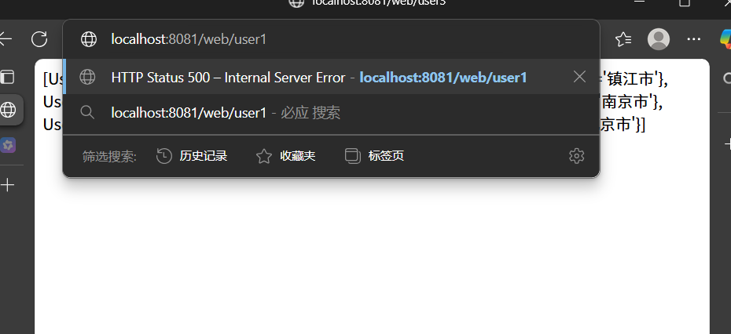
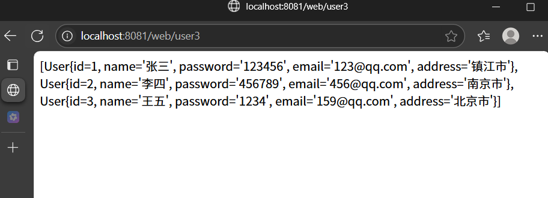
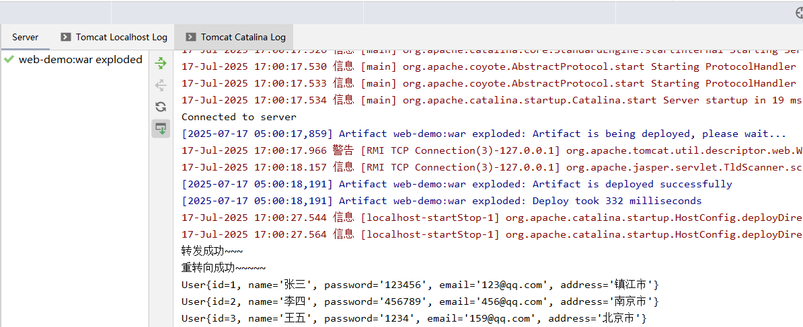
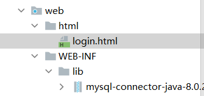
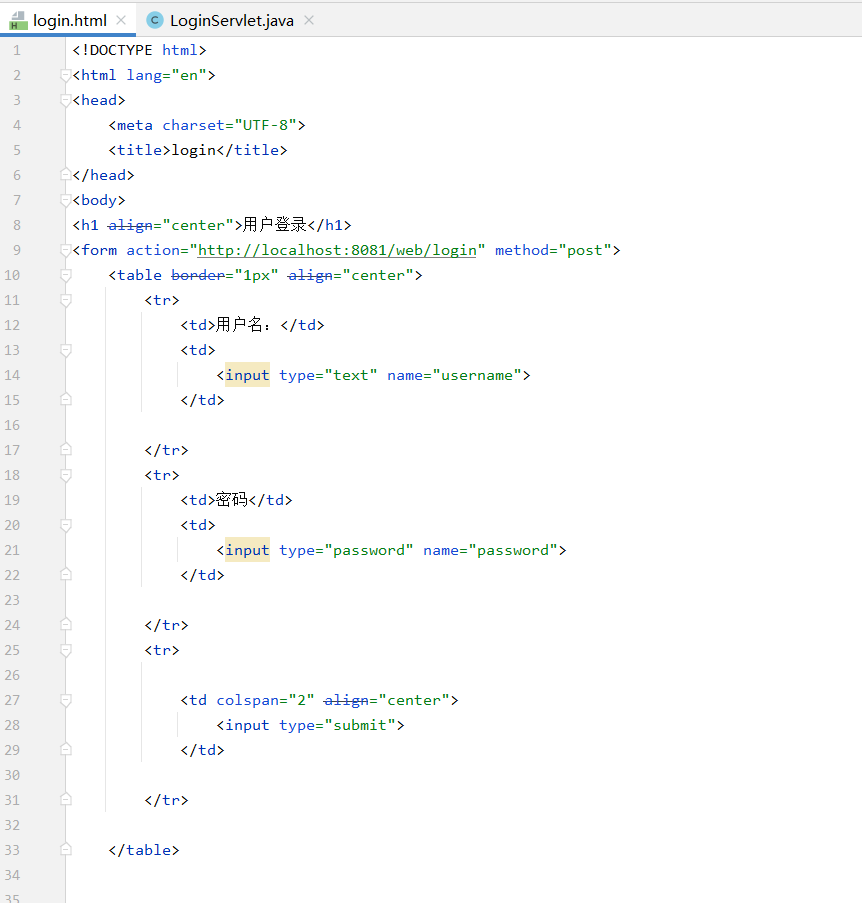
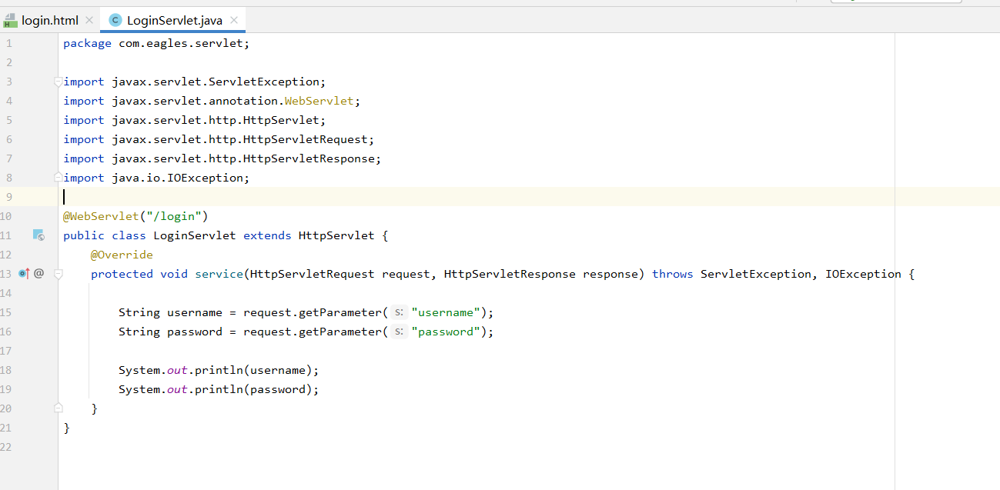
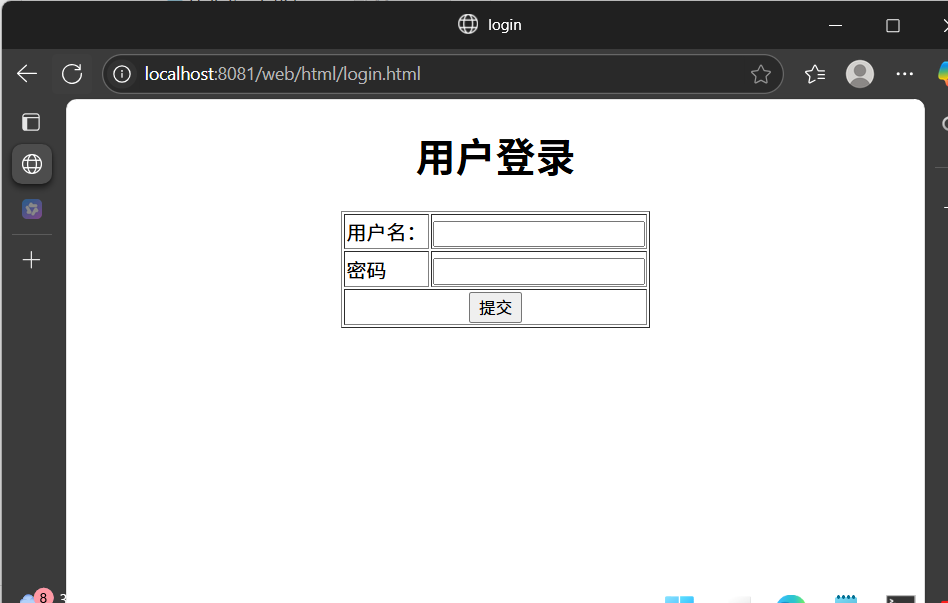
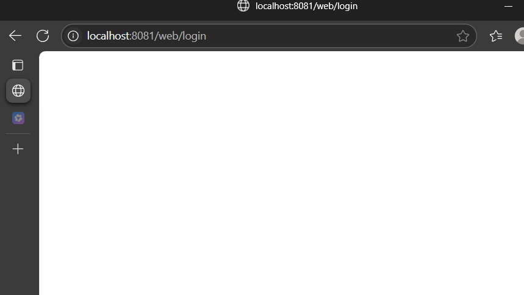
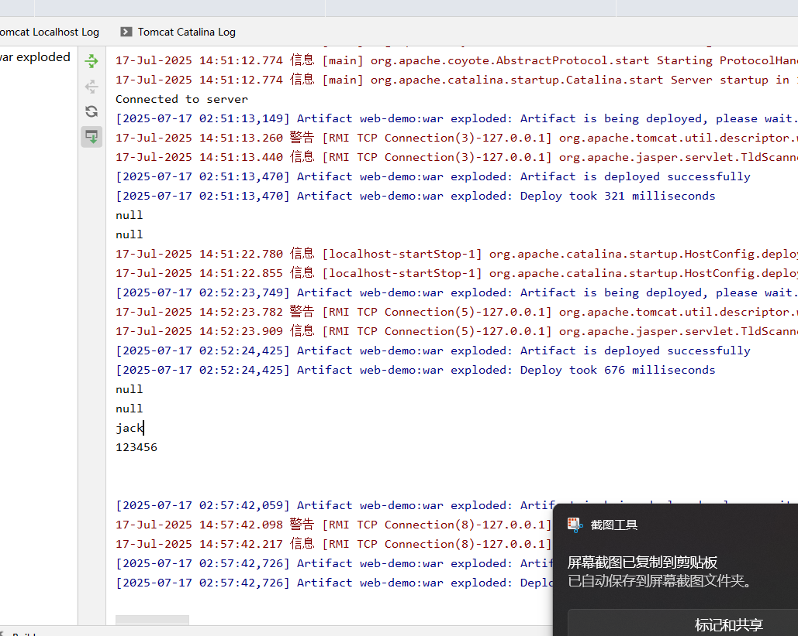

-案例:

1、通过jdbc查询数据库中的所有的用户user数据

2、将每条记录封装成用户对象，添加到集合中

3、将user集合存入request域对象中，通过转发的方式跳转到另外一个后端资源(需要取出并且打印user集合对象)

4、再将user集合存入Servletcontext域对象中，通过重定向的方式跳转到另外一个后端资源(需要取出并且打印user集合对象)

5、将user集合通过响应对象response响应给浏览器，在浏览器页面显示所有用户数据

```java
package com.eagles.servlet;

import com.eagles.pojo.User;
import com.eagles.utils.JDBCUtils;

import javax.servlet.ServletException;
import javax.servlet.annotation.WebServlet;
import javax.servlet.http.HttpServlet;
import javax.servlet.http.HttpServletRequest;
import javax.servlet.http.HttpServletResponse;
import java.io.IOException;
import java.sql.Connection;
import java.sql.PreparedStatement;
import java.sql.ResultSet;
import java.sql.SQLException;
import java.util.ArrayList;
@WebServlet("/user1")
public class UserServlet01 extends HttpServlet {
    @Override
    protected void doGet(HttpServletRequest request, HttpServletResponse response) throws ServletException, IOException {

        //处理中文乱码
        request.setCharacterEncoding("utf-8");
        response.setContentType("text/html;charset=utf-8");

        Connection connection = null;
        PreparedStatement preparedStatement =null;
        ResultSet resultSet = null;
        ArrayList<User> userArrayList = new ArrayList<>();

        //连接数据库，查询用户信息
        try {
            connection = JDBCUtils.getConnection();
            preparedStatement = connection.prepareStatement("select  * from  tb_emp");
            resultSet = preparedStatement.executeQuery();
            while (resultSet!=null&&resultSet.next()){
                int id = resultSet.getInt("id");
                String username = resultSet.getString("username");
                String password = resultSet.getString("password");
                String email = resultSet.getString("email");
                String address = resultSet.getString("address");

                //创建user对象
                User user = new User(id,username,password,email,address);

                //添加到集合中
                userArrayList.add(user);
            }

        } catch (SQLException e) {
            throw new RuntimeException(e);
        }finally {
            JDBCUtils.close(resultSet,preparedStatement,connection);
        }

        //将集合存储到域中
        request.setAttribute("userList",userArrayList);//起一个名字（request域中）

        //请求转发
        request.getRequestDispatcher("/user2").forward(request,response);
    }
}
```

```java
package com.eagles.servlet;

import com.eagles.pojo.User;

import javax.servlet.ServletException;
import javax.servlet.annotation.WebServlet;
import javax.servlet.http.HttpServlet;
import javax.servlet.http.HttpServletRequest;
import javax.servlet.http.HttpServletResponse;
import java.io.IOException;
import java.util.List;
@WebServlet("/user2")
public class UserServlet02 extends HttpServlet {
    @Override
    protected void service(HttpServletRequest request, HttpServletResponse response) throws ServletException, IOException {
        System.out.println("转发成功~~~");
        List<User> userList = (List<User>) request.getAttribute("userList"); //得到的是遍历到的集合是String类型的，强转成集合类型的
        //        for (User user : userList) {
        //            System.out.println(user);
        //        }
        this.getServletContext().setAttribute("userArryList",userList);//再起一个名字（ServletContext域中）
        //重定向
        response.sendRedirect("http://localhost:8081/web/user3");

    }
}
```

```java
package com.eagles.servlet;

import com.eagles.pojo.User;

import javax.servlet.ServletException;
import javax.servlet.annotation.WebServlet;
import javax.servlet.http.HttpServlet;
import javax.servlet.http.HttpServletRequest;
import javax.servlet.http.HttpServletResponse;
import java.io.IOException;
import java.util.List;

@WebServlet("/user3")
public class UserServlet03 extends HttpServlet {
    @Override
    protected void service(HttpServletRequest request, HttpServletResponse response) throws ServletException, IOException {

        //处理中文乱码 (因为重转向，地址有改变，所以再设置一遍)
        request.setCharacterEncoding("utf-8");
        response.setContentType("text/html;charset=utf-8");

        System.out.println("重转向成功~~~~~");
        List<User> userList = (List<User>) this.getServletContext().getAttribute("userArryList");
        for (User user : userList) {
            System.out.println(user);
        }

        //页面端打印
        response.getWriter().print(userList);
    }
}
```

```java
package com.eagles.pojo;

public class User {
    private  int id;
    private String name;
    private String password;
    private String email;
    private String address;

    @Override
    public String toString() {
        return "User{" +
        "id=" + id +
        ", name='" + name + '\'' +
        ", password='" + password + '\'' +
        ", email='" + email + '\'' +
        ", address='" + address + '\'' +
        '}';
    }

    public int getId() {
        return id;
    }

    public void setId(int id) {
        this.id = id;
    }

    public String getName() {
        return name;
    }

    public void setName(String name) {
        this.name = name;
    }

    public String getPassword() {
        return password;
    }

    public void setPassword(String password) {
        this.password = password;
    }

    public String getEmail() {
        return email;
    }

    public void setEmail(String email) {
        this.email = email;
    }

    public String getAddress() {
        return address;
    }

    public void setAddress(String address) {
        this.address = address;
    }

    public User(int id, String name, String password, String email, String address) {
        this.id = id;
        this.name = name;
        this.password = password;
        this.email = email;
        this.address = address;
    }
}
```

```java
package com.eagles.utils;
import java.sql.*;

public class JDBCUtils {

    public static final String DATABASE_NAME = "database1";
    public static final String USERNAME = "root";
    public static final String PASSWORD = "";

    //构造方法私有化
    private JDBCUtils(){}

    static {
        //注册驱动
        try {
            Class.forName("com.mysql.cj.jdbc.Driver");
        } catch (ClassNotFoundException e) {
            throw new RuntimeException(e);
        }
    }

    /**
     * 数据库连接对象
     * @return
     */
    public static Connection getConnection() throws SQLException {

        return DriverManager.getConnection("jdbc:mysql://localhost:3306/"+DATABASE_NAME+"?characterEncoding=utf8&serverTimezone=GMT%2B8",USERNAME,PASSWORD);

    }

    /**
     * 回收数据库资源
     * @param resultSet
     * @param statement
     * @param connection
     */
    public static void close(ResultSet resultSet,Statement statement,Connection connection){

        if (resultSet != null){
            try {
                resultSet.close();
            } catch (SQLException e) {
                throw new RuntimeException(e);
            }
        }

        if (statement != null){
            try {
                statement.close();
            } catch (SQLException e) {
                throw new RuntimeException(e);
            }
        }

        if (connection != null){
            try {
                connection.close();
            } catch (SQLException e) {
                throw new RuntimeException(e);
            }
        }
    }
}
```



回车 结果：





前端页面HTML：









写完点提交：





```java
package com.eagles.servlet;

import javax.servlet.ServletException;
import javax.servlet.annotation.WebServlet;
import javax.servlet.http.HttpServlet;
import javax.servlet.http.HttpServletRequest;
import javax.servlet.http.HttpServletResponse;
import java.io.IOException;

@WebServlet("/login")
public class LoginServlet extends HttpServlet {
    @Override
    protected void service(HttpServletRequest request, HttpServletResponse response) throws ServletException, IOException {

        String username = request.getParameter("username");
        String password = request.getParameter("password");

        System.out.println(username);
        System.out.println(password);
    }
}
```

```java
<!DOCTYPE html>
<html lang="en">
<head>
<meta charset="UTF-8">
<title>login</title>
</head>
<body>
<h1 align="center">用户登录</h1>
<form action="http://localhost:8081/web/login" method="post">
<table border="1px" align="center">
<tr>
<td>用户名：</td>
<td>
<input type="text" name="username">
</td>

</tr>
<tr>
<td>密码</td>
<td>
<input type="password" name="password">
</td>

</tr>
<tr>

<td colspan="2" align="center">
<input type="submit">
</td>
</tr>
</table>
</form>

</body>
</html>
```
