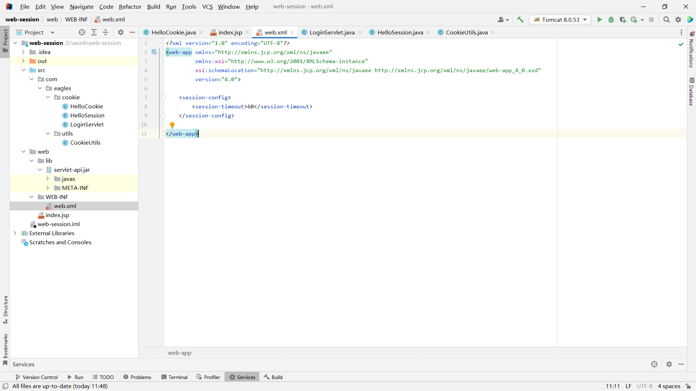

## 案例：

```java
package com.eagles.cookie;

import javax.servlet.ServletException;
import javax.servlet.annotation.WebServlet;
import javax.servlet.http.HttpServlet;
import javax.servlet.http.HttpServletRequest;
import javax.servlet.http.HttpServletResponse;
import javax.servlet.http.HttpSession;
import java.io.IOException;
@WebServlet("/session")
public class HelloSession extends HttpServlet {
    @Override
    protected void service(HttpServletRequest request, HttpServletResponse response) throws ServletException, IOException {

        request.setCharacterEncoding("utf-8");
        response.setContentType("text/html;charset=utf-8");

        //获取session会话对象
        HttpSession session = request.getSession();
        HttpSession session2 = request.getSession();

        //System.out.println(session1 == session2);（单例的 所对应的是一份内存地址）

        //判断session是不是刚创建出来的
        boolean aNew = session.isNew();

        //获取session的会话id
        String sessionId = session.getId();
        String sessionId2 = session2.getId();

        //设置session的超时时间
        session.setMaxInactiveInterval(3600*24);

        //销毁session
        session.invalidate();

        //往域中存储数据
        session.setAttribute("messsge","hello");

        response.getWriter().print("session域中的值为==>"+session.getAttribute("message"));
        response.getWriter().print("<br/>");
        response.getWriter().print("判断session是不是刚创建出来的==>"+aNew);
        response.getWriter().print("<br/>");
        response.getWriter().print("session的会话id==>"+sessionId);
        response.getWriter().print("session2的会话id==>"+sessionId2);
        response.getWriter().print("<br/>");
        response.getWriter().print("session的超时时间:"+session.getMaxInactiveInterval());

    }
}
```

## Cookie 与 Session 的联系和区别：

### 联系

1. **用户会话管理**：两者都可以用来跟踪用户的会话信息，例如登录状态、购物车内容等。
2. **相互依赖性**：通常情况下，Session 的实现依赖于 Cookie 来存储会话 ID（Session ID）。当客户端请求服务器时，服务器会在响应头中设置一个包含 Session ID 的 Cookie，之后每次客户端发送请求到服务器时都会带上这个 Cookie，从而服务器可以识别出是哪个用户。

### 区别

1. **存储位置**

- **Cookie**：数据存储在客户端（浏览器）上。每个域下的 Cookie 数量和大小有限制。
- **Session**：数据存储在服务器端。理论上可以存储更多数据，但会占用服务器资源。

2. **安全性**

- **Cookie**：由于数据保存在客户端，如果未加密或不当配置，可能会被恶意访问者截获或篡改。可以通过设置 HttpOnly 和 Secure 标志增强安全性。
- **Session**：因为数据保存在服务器端，所以相对来说更安全。不过，Session ID 如果泄露也可能导致会话劫持问题。

3. **持久性**

- **Cookie**：可以根据需要设定过期时间，长期有效或者仅在浏览器关闭时失效。
- **Session**：通常随着浏览器的关闭而结束，但也可以通过特定配置延长其生命周期。

4. **性能影响**

- **Cookie**：每次 HTTP 请求都会携带所有相关域的 Cookie 数据，这可能增加传输的数据量，影响性能。
- **Session**：只传递 Session ID，减少了网络传输的数据量，但对于大规模并发用户来说，服务器端的内存消耗是一个考虑因素。

5. **用途**

- **Cookie**：除了用于会话跟踪外，还常用于记住用户的偏好设置、广告追踪等。
- **Session**：主要用于维护用户的登录状态和其他敏感信息的存储。
