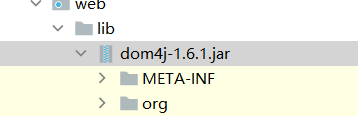

XML（**eXtensible Markup Language**，可扩展标记语言）是一种**用于存储和传输数据的标记语言**。它被设计为具有可读性和结构清晰的特点，广泛用于**配置文件、数据交换、Web 服务（如 SOAP）、文档格式（如 Office 文件、Android 的布局文件）等场景**。

`web.xml` 是 Java Web 应用的核心配置文件，定义了 Web 应用的结构、行为和资源。你提供的这个 `web.xml` 文件用于注册一个 Servlet 并映射其访问路径。下面是对每个标签的详细解释：

## xml****语法
**xml****命名规则**

名称可以含字母、数字以及其他的字符

名称不能以数字或者标点符号开始

名称不能包含空格

**1.****文档声明**

**2.****元素（标签）**

元素是指开始标签到结束标签的内容

```xml
<?xml version="1.0" encoding="UTF-8"?> 
```

```xml
<!--根标签--> 
<students> 

  <!--子标签--> 
<student id="1001"> 
  <name>张三</name> 
  <age>25</age> 
  <address>镇江市</address> 
 </student>

  <!--子标签-->
<student id="1002">
  <name>李四</name>
  <age>29</age>
  <address>南京市</address>
 </student>

  <!--子标签-->
<student id="1003">
  <name>王五</name>
  <age>19</age>
  <address>上海市</address>
  </student>
</students>
```

**3.xml属性**

**id****属性为****1003**

```xml
<student id="1003">
```

**4.xml****注释**

ctrl + shift + /

```xml
<!--此处写注释-->
```

XML 和 HTML 类似，但用途不同：

|  |  |  |
| --- | --- | --- |
| **对比项** | **HTML** | **XML** |
| 目的 | 显示数据，关注**如何显示** | 存储/传输数据，关注**数据本身** |
| 标签 | 预定义标签（如 `<p>`  , `<div>`  ） | 用户自定义标签（如 `<student>`  , `<book>`  ） |
| 语法 | 松散（可不闭合标签） | 严格（必须闭合标签） |
| 错误处理 | 浏览器容错性强 | XML 解析器遇到错误会直接报错 |

## XML 的基本语法规则

1. **必须有根元素**（一个 XML 文件只能有一个根节点）
2. **所有标签必须闭合**

- 正确：`<name>Tom</name>`
- 错误：`<name>Tom`

3. **标签区分大小写**

- `<Student>` 和 `<student>` 是两个不同的标签

4. **属性值必须用引号括起来**

- 正确：`<student id="1">`
- 错误：`<student id=1>`

5. **不能包含非法字符**

- 如 `<`、`>`、`&` 等需要转义：

- `<` → `&lt;`
- `>` → `&gt;`
- `&` → `&amp;`

### 1. 根元素：`<web-app>`

```xml
<web-app xmlns="http://xmlns.jcp.org/xml/ns/javaee"
  xmlns:xsi="http://www.w3.org/2001/XMLSchema-instance"
  xsi:schemaLocation="http://xmlns.jcp.org/xml/ns/javaee http://xmlns.jcp.org/xml/ns/javaee/web-app_4_0.xsd"
  version="4.0">
```

- **作用**：这是整个 `web.xml` 的根节点，表示这是一个 Web 应用程序的配置。
- **属性说明**：

- `xmlns`：XML 命名空间（Namespace），指定 JCP 组织的 Java EE 命名空间。
- `xmlns:xsi`：XML Schema 实例命名空间，用于引用 XSD 文件。
- `xsi:schemaLocation`：指定了当前 XML 文件使用的 Schema 文件位置。
- `version="4.0"`：表示使用的是 **Servlet 4.0 规范**。

---

### 2. `<servlet>`：注册一个 Servlet

```xml
<servlet>
  <servlet-name>emp</servlet-name>
  <servlet-class>com.eagles.servlet.EmpServlet</servlet-class>
</servlet>
```

- **作用**：声明并注册一个 Servlet 类。
- **子标签说明**：

- `<servlet-name>`：为该 Servlet 起一个逻辑名称（如 `emp`），后续在 `<servlet-mapping>` 中会用到。
- `<servlet-class>`：指定实际的 Java Servlet 类的全限定类名（包名 + 类名）。

---

### 3. `<servlet-mapping>`：映射 Servlet 的访问路径

```xml
<servlet-mapping>
  <servlet-name>emp</servlet-name>
  <url-pattern>/emp</url-pattern>
</servlet-mapping>
```

- **作用**：将已注册的 Servlet 映射到某个 URL 路径上，使得可以通过浏览器访问该路径来调用对应的 Servlet。
- **子标签说明**：

- `<servlet-name>`：必须与 `<servlet>` 中定义的 `<servlet-name>` 相同，这里是 `emp`。
- `<url-pattern>`：指定访问该 Servlet 的 URL 路径。例如，`/emp` 表示可以通过如下 URL 访问：

```plain
http://localhost:8080/your-webapp-context-path/emp
```

---

## 总结表格

|  |  |  |  |
| --- | --- | --- | --- |
| **标签** | **含义** | **示例值** | **作用** |
| `<web-app>` | 根元素，表示整个 Web 应用配置 | — | 定义整个 Web 应用的行为和资源 |
| `<servlet>` | 注册一个 Servlet | `<servlet-name>emp</servlet-name>` | 声明一个 Java Servlet 类 |
| `<servlet-name>` | Servlet 的逻辑名称 | `emp` | 用于后续映射和引用 |
| `<servlet-class>` | Servlet 的完整类名 | `com.eagles.servlet.EmpServlet` | 指定具体实现类 |
| `<servlet-mapping>` | 映射 Servlet 到 URL | `<url-pattern>/emp</url-pattern>` | 设置访问路径 |
| `<url-pattern>` | 定义外部访问的 URL 路径 | `/emp` | 浏览器通过该路径访问 Servlet |

## xml解析技术
**xml可扩展的标记语言，不管是html文件还是xml文件它们都是标记型文档，都可以使用w3c组织制定**

**的****dom****技术来解析**

**document****对象表示的是整个文档（可以是****html****文档，也可以是****xml****文档）**

**w3c****是一个制定规范的组织，针对于****xml****，****html****都制定了相关的规范，元素都是以标签的形式体现**

**的，每个标签都是一个对象，而且每个标签都是有层级关系的，****w3c****通过一种树形图来管理这种关系，**

**而且提供了一个文本对象dom对象，通过这个dom对象可以去获取所有的标签对象**

#### 调用jsp方法的jar包：



#### 读取xml配置文件：

###### jsp文件：

```html
<?xml version="1.0" encoding="UTF-8"?>  <!--对xml的声明-->
<!--
超文本编辑语言
通过标签来存储数据
拥有自我描述性
-可以自定义标签
-自定义属性
-->
<!--xml中必须有根标签-->
<students>
  <student id="1001">
    <name>jack1</name>
    <age>20</age>
    <address>南京市</address>
  </student>

  <student id="1002">
    <name>jack2</name>
    <age>22</age>
    <address>南京市</address>
  </student>

  <student id="1003">
    <name>jack3</name>
    <age>23</age>
    <address>南京市</address>
  </student>

  <student id="1004">
    <name>jack4</name>
    <age>24</age>
    <address>南京市</address>
  </student>
</students>
```

**Dom4j**

- **Dom4j是第三方的解析技术，我们需要使用第三方给我们提供好的类库才可以解析xml文件**
- **由于dom4j它不是sun公司的技术，而属于第三方公司的技术，需要使用dom4j就需要到dom4j官**

**网下载dom4j的jar包**

**dom4j****编程步骤**

**1.先加载xml文件创建Document对象**

**2.****通过****Document****对象拿到根元素对象** **getRootElement()**

**3.****通过** **根元素****.elements(****标签名****)** **；可以返回一个集合，这个集合里放着。所有你指定的标签名的元素**

**对象**

**4.****找到你想要修改、删除的子元素，进行相应的操作**

**5.保存到硬盘上**

###### java测试代码：

```java
package com.eagles.test;

import org.dom4j.Document;
import org.dom4j.DocumentException;
import org.dom4j.Element;
import org.dom4j.io.SAXReader;

import java.util.List;

public class XmlTest {
    public static void main(String[] args) {

        try {
            //创建流对象，来读取xml配置文件 SAX（Simple API for XML） SAX解析
            SAXReader saxReader = new SAXReader();

            //document xml的文本文件 通过该对象可以获取xml的任何一个标签
            Document document = saxReader.read("src/xml/student.xml");

            //获取根标签
            Element rootElement = document.getRootElement();

            //获取所有的字标签
            List<Element> elements = rootElement.elements();

            //遍历所有的标签
            for (Element element : elements) {
                String name = element.elementText("name");
                String age = element.elementText("age");
                String address = element.elementText("address");

                System.out.println(name + " "+age + " "+address);
            }
        } catch (DocumentException e) {
            throw new RuntimeException(e);
        }

    }
}
```

```plain
jack1 20 南京市
jack2 22 南京市
jack3 23 南京市
jack4 24 南京市
```
