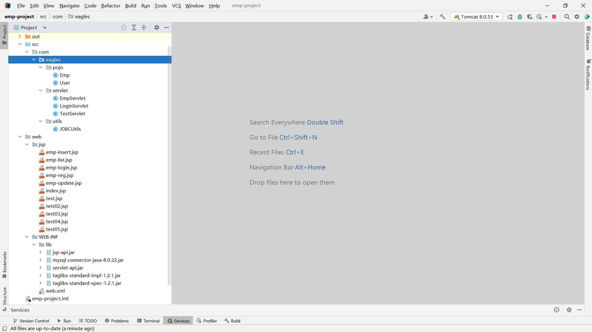
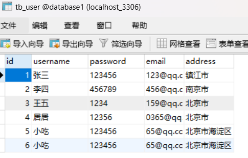
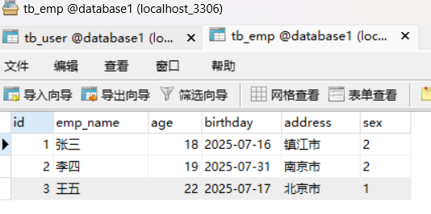
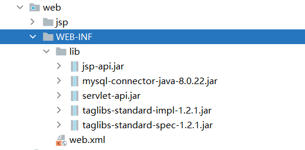
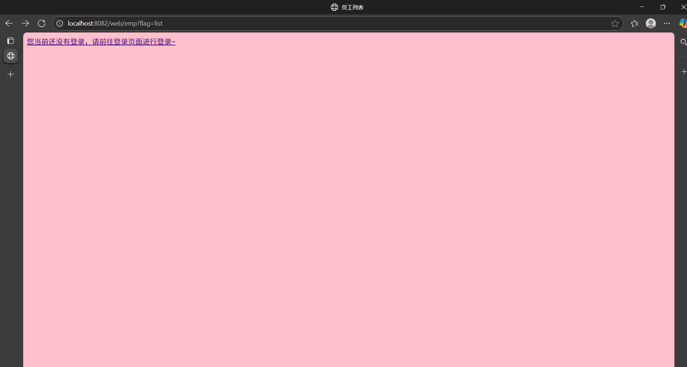
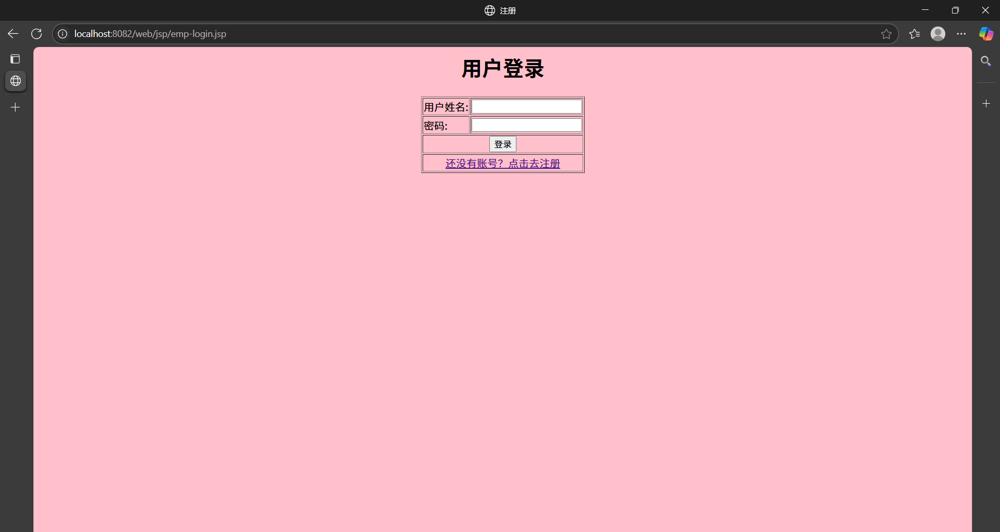
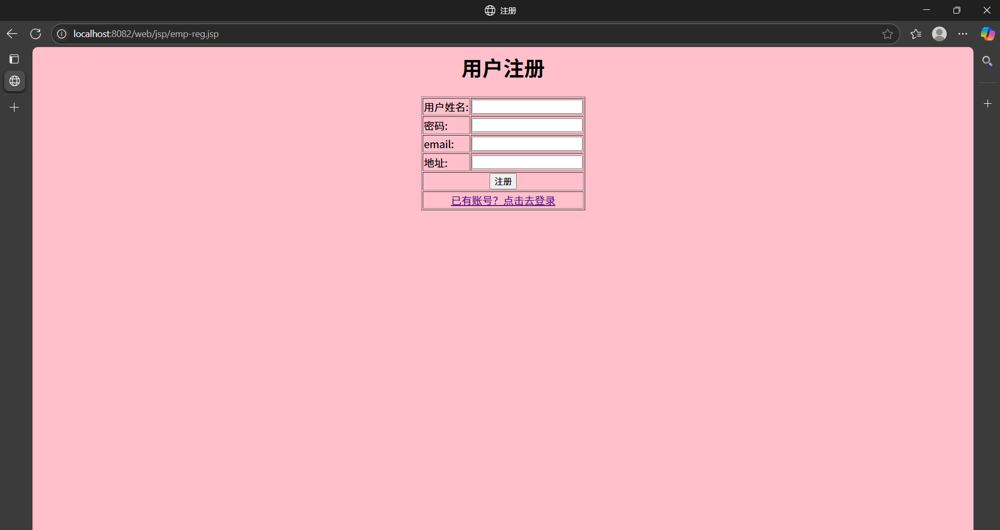
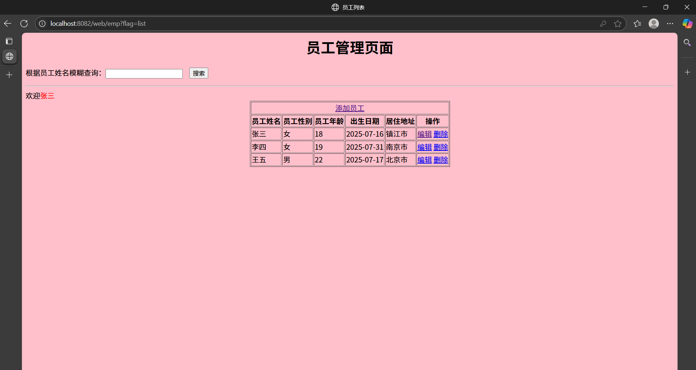
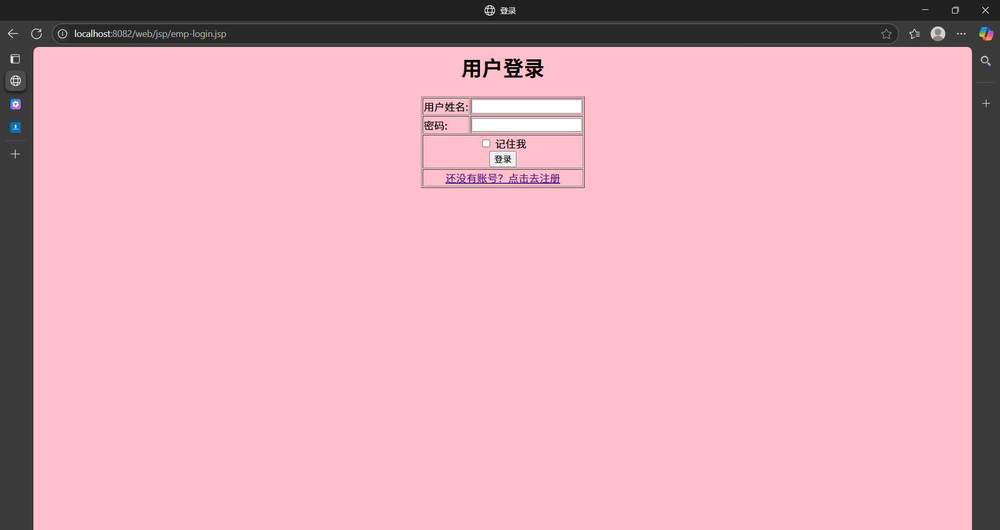

**员工管理系统（Employee Management System）**，通常用于学习 Web 开发中的 CRUD（增删改查）操作、用户认证、会话管理等内容。以下我将从 **功能模块划分、技术选型、数据库设计、接口设计、页面设计** 等方面为你提供一个完整的开发方案，并给出示例代码框架。

## 一、功能模块划分

|  |  |
| --- | --- |
| **模块** | **功能描述** |
| 员工管理 | 列表、添加、编辑、删除 |
| 用户认证 | 注册、登录 |
| 权限控制 | 登录后才能访问员工管理模块 |
| 数据存储 | 使用数据库保存员工和用户信息 |

## 二、技术选型（Java Web 技术栈）

|  |  |
| --- | --- |
| **层级** | **技术/框架** |
| 后端语言 | Java |
| Web 容器 | Apache Tomcat |
| 框架 | Servlet + JSP |
| 数据库 | MySQL |
| 数据访问层 | JDBC |
| 用户认证 | Session 管理 |
| 前端页面 | JSP |
| 构建工具 | Maven（推荐） |

## 三、数据库设计

### 用户表 `tb_user`



### 员工表 `tb_emp`



### pojo（java用来接收User,Emp对象的实例）：

#### user：

```java
package com.eagles.pojo;

public class User {
    private  Integer id;
    private  String username;
    private  String password;
    private  String email;
    private  String address;

    @Override
    public String toString() {
        return "User{" +
        "id=" + id +
        ", username='" + username + '\'' +
        ", password='" + password + '\'' +
        ", email='" + email + '\'' +
        ", address='" + address + '\'' +
        '}';
    }

    public Integer getId() {
        return id;
    }

    public void setId(Integer id) {
        this.id = id;
    }

    public String getUsername() {
        return username;
    }

    public void setUsername(String username) {
        this.username = username;
    }

    public String getPassword() {
        return password;
    }

    public void setPassword(String password) {
        this.password = password;
    }

    public String getEmail() {
        return email;
    }

    public void setEmail(String email) {
        this.email = email;
    }

    public String getAddress() {
        return address;
    }

    public void setAddress(String address) {
        this.address = address;
    }

    public User() {
    }

    public User(String username, String password) {
        this.username = username;
        this.password = password;
    }

    public User(Integer id, String username) {
        this.id = id;
        this.username = username;
    }

    public User(Integer id, String username, String password, String email, String address) {
        this.id = id;
        this.username = username;
        this.password = password;
        this.email = email;
        this.address = address;
    }
}
```

#### Emp：

```java
package com.eagles.pojo;

public class Emp {

    private int id;
    private String empName;
    private int sex;
    private int age;
    private String birthday;
    private String address;

    public Emp(int id, String empName, int sex, int age, String birthday, String address) {
        this.id = id;
        this.empName = empName;
        this.sex = sex;
        this.age = age;
        this.birthday = birthday;
        this.address = address;
    }

    public Emp() {
    }

    public int getId() {
        return id;
    }

    public void setId(int id) {
        this.id = id;
    }

    public String getEmpName() {
        return empName;
    }

    public void setEmpName(String empName) {
        this.empName = empName;
    }

    public int getSex() {
        return sex;
    }

    public void setSex(int sex) {
        this.sex = sex;
    }

    public int getAge() {
        return age;
    }

    public int getAge(int age) {
        return this.age;
    }

    public void setAge(int age) {
        this.age = age;
    }

    public String getBirthday() {
        return birthday;
    }

    public void setBirthday(String birthday) {
        this.birthday = birthday;
    }

    public String getAddress() {
        return address;
    }

    public void setAddress(String address) {
        this.address = address;
    }

    @Override
    public String toString() {
        return "Emp{" +
        "id=" + id +
        ", empName='" + empName + '\'' +
        ", sex=" + sex +
        ", age=" + age +
        ", birthday='" + birthday + '\'' +
        ", address='" + address + '\'' +
        '}';
    }
}
```

### Utils：

```java
package com.eagles.utils;
import java.sql.*;

public class JDBCUtils {

    public static final String DATABASE_NAME = "database1";
    public static final String USERNAME = "root";
    public static final String PASSWORD = "";

    //构造方法私有化
    private JDBCUtils(){}

    static {
        //注册驱动
        try {
            Class.forName("com.mysql.cj.jdbc.Driver");
        } catch (ClassNotFoundException e) {
            throw new RuntimeException(e);
        }
    }

    /**
     * 数据库连接对象
     * @return
     */
    public static Connection getConnection() throws SQLException {

        return DriverManager.getConnection("jdbc:mysql://localhost:3306/"+DATABASE_NAME+"?characterEncoding=utf8&serverTimezone=GMT%2B8",USERNAME,PASSWORD);

    }

    /**
     * 回收数据库资源
     * @param resultSet
     * @param statement
     * @param connection
     */
    public static void close(ResultSet resultSet,Statement statement,Connection connection){

        if (resultSet != null){
            try {
                resultSet.close();
            } catch (SQLException e) {
                throw new RuntimeException(e);
            }
        }

        if (statement != null){
            try {
                statement.close();
            } catch (SQLException e) {
                throw new RuntimeException(e);
            }
        }

        if (connection != null){
            try {
                connection.close();
            } catch (SQLException e) {
                throw new RuntimeException(e);
            }
        }
    }
}
```

### 【增删改查】Servlet：

#### 获取Method和处理中文乱码以及获取表示进行不同的业务处理：

```java
package com.eagles.servlet;
import com.eagles.pojo.Emp;
import com.eagles.utils.JDBCUtils;

import javax.servlet.ServletException;
import javax.servlet.http.HttpServlet;
import javax.servlet.http.HttpServletRequest;
import javax.servlet.http.HttpServletResponse;
import java.io.IOException;
import java.sql.Connection;
import java.sql.PreparedStatement;
import java.sql.ResultSet;
import java.sql.SQLException;
import java.util.ArrayList;

public class EmpServlet  extends HttpServlet {

    @Override
    protected void doGet(HttpServletRequest request, HttpServletResponse response) throws ServletException, IOException {
        doPost(request,response);
    }

    @Override
    protected void doPost(HttpServletRequest request, HttpServletResponse response) throws ServletException, IOException {

        //处理中文乱码
        request.setCharacterEncoding("utf-8");
        response.setContentType("text/html;charset=utf-8");

        String flag = request.getParameter("flag");

        if (flag != null && flag.equals("list")){

            this.findEmpListAll(request,response);

        }else if (flag != null && flag.equals("insertEmp")){

            this.insertEmp(request,response);

        }else if (flag != null && flag.equals("findEmpById")){

            this.findEmpById(request,response);

        }else if (flag != null && flag.equals("updateEmpById")){

            this.updateEmpById(request,response);

        }else if (flag != null && flag.equals("deleteEmpById")){

            this.deleteEmpById(request,response);
        }
    }

    /*--需求--*/

}
```

#### 添加员工：

```java
/**
 * 添加员工
 * @param request
 * @param response
 */
public void insertEmp(HttpServletRequest request, HttpServletResponse response) {

    //接收前端传递过来添加的数据
    String empName = request.getParameter("empName");
    String sex = request.getParameter("sex");

    if (sex.equals("男")){
        sex = "1";
    }else if (sex.equals("女")){
        sex = "2";
    }else {
        sex = "0";
    }

    String age = request.getParameter("age");
    String birthday = request.getParameter("birthday");
    String address = request.getParameter("address");

    Connection connection = null;
    PreparedStatement preparedStatement = null;
    ResultSet resultSet = null;

    try {
        connection = JDBCUtils.getConnection();

        String sql = "insert into tb_emp (emp_name,sex,age,birthday,address)values (?,?,?,?,?)";

        preparedStatement = connection.prepareStatement(sql);

        //给占位符赋值
        preparedStatement.setString(1,empName);
        preparedStatement.setInt(2,Integer.parseInt(sex));
        preparedStatement.setInt(3,Integer.parseInt(age));
        preparedStatement.setString(4,birthday);
        preparedStatement.setString(5,address);

        int executeUpdate = preparedStatement.executeUpdate();

        if (executeUpdate == 1){

            response.sendRedirect("http://localhost:8082/web/emp?flag=list");

        }else {
            System.out.println("添加失败！");
            response.getWriter().print("添加失败~");
        }

    } catch (SQLException e) {
        throw new RuntimeException(e);
    } catch (IOException e) {
        throw new RuntimeException(e);
    } finally {
        JDBCUtils.close(null,preparedStatement,connection);
    }

}
```

##### 对应的JSP：

```html
<%@ page contentType="text/html;charset=UTF-8" language="java" %>
  <%--导入jstl标签库--%>
    <%@taglib prefix="c" uri="http://java.sun.com/jsp/jstl/core"%>
      <html>
        <head>
          <title>员工添加</title>
          <style>
            body{
              background-color: #953e1e;
            }
          </style>
        </head>
        <body>
          <h1 align="center">员工添加页面</h1>
          <form method="post" action="http://localhost:8082/web/emp?flag=insertEmp">
            <table align="center" border="1px">
              <tr>
                <td>员工姓名:</td>
                <td>
                  <input type="text" name="empName">
                </td>
              </tr>

              <tr>
                <td>员工性别:</td>
                <td>
                  <input type="text" name="sex">
                </td>
              </tr>

              <tr>
                <td>年龄:</td>
                <td>
                  <input type="text" name="age">
                </td>
              </tr>

              <tr>
                <td>出生日期:</td>
                <td>
                  <input type="date" name="birthday">
                </td>
              </tr>

              <tr>
                <td>居住地址:</td>
                <td>
                  <input type="text" name="address">
                </td>
              </tr>

              <tr>
                <td colspan="11" align="center">
                  <input type="submit" value="添加">
                </td>
              </tr>

            </table>
          </form>

        </body>
      </html>
```

#### 根据id来删除员工记录：

```java
/**
 * 根据id来删除员工记录
 * @param request
 * @param response
 */
public void deleteEmpById(HttpServletRequest request, HttpServletResponse response) {

    String id = request.getParameter("id");

    Connection connection = null;
    PreparedStatement preparedStatement = null;
    ResultSet resultSet = null;

    try {

        connection = JDBCUtils.getConnection();

        String sql = "delete from tb_emp where id = ?";

        preparedStatement = connection.prepareStatement(sql);

        //给占位符赋值
        preparedStatement.setInt(1,Integer.parseInt(id));

        int executeUpdate = preparedStatement.executeUpdate();

        if (executeUpdate == 1){

            response.sendRedirect("http://localhost:8082/web/emp?flag=list");

        }else {
            System.out.println("删除失败！");
            response.getWriter().print("删除失败~");
        }

    } catch (SQLException e) {
        throw new RuntimeException(e);
    } catch (IOException e) {
        throw new RuntimeException(e);
    } finally {
        JDBCUtils.close(null,preparedStatement,connection);
    }
}
```

##### 

#### 修改员工数据：

##### 1. `findEmpById(...)`：根据员工 ID 查询员工信息，并转发到修改页面：

实现回显的操作，将id获取到通过id与数据库中的信息相对应，将值取出来放在集合中，集合添加到域中，通过域传到编辑页面从而在前端进行显示

```java
 /**
     * 修改员工数据
     * @param request
     * @param response
     */

    public void findEmpById(HttpServletRequest request, HttpServletResponse response) {

        //接收客户端传递过来的员工id
        String id = request.getParameter("id");

        Connection connection = null;
        PreparedStatement preparedStatement = null;
        ResultSet resultSet = null;

        try {
            connection = JDBCUtils.getConnection();

            String sql = "select * from tb_emp where id = ?";

            preparedStatement = connection.prepareStatement(sql);

            //给占位符赋值
            preparedStatement.setInt(1,Integer.parseInt(id));

            resultSet = preparedStatement.executeQuery();

            if (resultSet != null && resultSet.next()){

                String empName = resultSet.getString("emp_name");
                int sex = resultSet.getInt("sex");
                int age = resultSet.getInt("age");
                String birthday = resultSet.getString("birthday");
                String address = resultSet.getString("address");
              
                Emp emp = new Emp();
                emp.setId(Integer.parseInt(id));
                emp.setSex(sex);
                emp.setAge(age);
                emp.setBirthday(birthday);
                emp.setAddress(address);
                emp.setEmpName(empName);

                //将员工对象添加到域中
                getServletContext().setAttribute("emp",emp);

                //重定向
                response.sendRedirect("http://localhost:8082/web/jsp/emp-update.jsp");

            }

        } catch (SQLException e) {
            throw new RuntimeException(e);
        } catch (IOException e) {
            throw new RuntimeException(e);
        } finally {
            JDBCUtils.close(resultSet,preparedStatement,connection);
        }
    }
```

##### 2. `updateEmpById(...)`：接收前端提交的员工信息，执行数据库更新。

```java
/**
 * 更新数据库信息
 * @param request
 * @param response
 */
public void updateEmpById(HttpServletRequest request, HttpServletResponse response) {

    //接收前端传递过来添加的数据
    String id = request.getParameter("id");
    String empName = request.getParameter("empName");
    String sex = request.getParameter("sex");

    if (sex.equals("男")){
        sex = "1";
    }else if (sex.equals("女")){
        sex = "2";
    }else {
        sex = "0";
    }

    String age = request.getParameter("age");
    String birthday = request.getParameter("birthday");
    String address = request.getParameter("address");

   // System.out.println(id); 看看是否接受到id

    Connection connection = null;
    PreparedStatement preparedStatement = null;
    ResultSet resultSet = null;

    try {
        connection = JDBCUtils.getConnection();

        String sql = "update tb_emp set emp_name=?,sex=?,age=?,birthday=?,address=? where id=?";

        preparedStatement = connection.prepareStatement(sql);

        //给占位符赋值
        preparedStatement.setString(1,empName);
        preparedStatement.setInt(2,Integer.parseInt(sex));
        preparedStatement.setInt(3,Integer.parseInt(age));
        preparedStatement.setString(4,birthday);
        preparedStatement.setString(5,address);
        preparedStatement.setInt(6,Integer.parseInt(id));

        int executeUpdate = preparedStatement.executeUpdate();

        if (executeUpdate == 1){

            response.sendRedirect("http://localhost:8082/web/emp?flag=list");

        }else {
            System.out.println("修改失败！");
            response.getWriter().print("修改失败~");
        }

    } catch (SQLException e) {
        throw new RuntimeException(e);
    } catch (IOException e) {
        throw new RuntimeException(e);
    } finally {
        JDBCUtils.close(null,preparedStatement,connection);
    }
}
```

##### 对应的JSP：

```html
<%@ page contentType="text/html;charset=UTF-8" language="java" %>
  <%--导入jstl标签库--%>
    <%@taglib prefix="c" uri="http://java.sun.com/jsp/jstl/core"%>
      <html>
        <head>
          <title>编辑员工</title>
          <style>
            body{
              background-color: #e7939f;
            }
          </style>
        </head>
        <body>

          <h1 align="center">员工编辑页面</h1>

          <form method="post" action="http://localhost:8082/web/emp?flag=updateEmpById">
            <%--隐藏域标签，客户端看不见，真实存在的标签--%>
              <input type="hidden" name="id" value="${emp.id}">
              <table align="center" border="1px">

                <tr>
                  <td>员工姓名:</td>
                  <td>
                    <input type="text" name="empName" value="${emp.empName}">
                  </td>
                </tr>

                <tr>
                  <td>员工性别:</td>
                  <td>
                    <input type="text" name="sex" value="${emp.sex == 1 ? '男' : '女'}">
                  </td>
                </tr>

                <tr>
                  <td>年龄:</td>
                  <td>
                    <input type="text" name="age" value="${emp.age}">
                  </td>
                </tr>

                <tr>
                  <td>出生日期:</td>
                  <td>
                    <input type="date" name="birthday" value="${emp.birthday}">
                  </td>
                </tr>

                <tr>
                  <td>居住地址:</td>
                  <td>
                    <input type="text" name="address" value="${emp.address}">
                  </td>
                </tr>

                <tr>
                  <td colspan="11" align="center">
                    <input type="submit" value="修改">
                  </td>
                </tr>

              </table>
          </form>

        </body>
      </html>
```

#### 查询所有的员工记录：

```java
/**
 * 查询所有的员工记录
 */
public void findEmpListAll(HttpServletRequest request, HttpServletResponse response){

    Connection connection = null;
    PreparedStatement preparedStatement = null;
    ResultSet resultSet = null;

    //获取模糊的值
    String likeName = request.getParameter("likeName");

    //创建集合对象
    ArrayList<Emp> empArrayList = new ArrayList<>();

    try {
        connection = JDBCUtils.getConnection();

        String sql = null;

        if (likeName != null && !likeName.trim().equals("")){
            sql = "select * from tb_emp where emp_name like '%"+likeName.trim()+"%' ";

            request.setAttribute("likeName",likeName.trim());
        }else {
            sql = "select * from tb_emp";
        }

        preparedStatement = connection.prepareStatement(sql);

        resultSet = preparedStatement.executeQuery();

        while (resultSet != null && resultSet.next()){

            int id = resultSet.getInt("id");
            String empName = resultSet.getString("emp_name");
            int sex = resultSet.getInt("sex");
            int age = resultSet.getInt("age");
            String birthday = resultSet.getString("birthday");
            String address = resultSet.getString("address");

            //创建emp对象
            Emp emp = new Emp(id, empName, sex, age, birthday, address);

            //将对象存入到集合中
            empArrayList.add(emp);
        }
    } catch (SQLException e) {
        throw new RuntimeException(e);
    }finally {
        JDBCUtils.close(resultSet,preparedStatement,connection);
    }

    //将集合对象存入到域中
    request.setAttribute("empList",empArrayList);

    //请求转发
    try {
        request.getRequestDispatcher("/jsp/emp-list.jsp").forward(request,response);
    } catch (ServletException e) {
        throw new RuntimeException(e);
    } catch (IOException e) {
        throw new RuntimeException(e);
    }

}
```

##### 对应的JSP：

```html
<%@ page contentType="text/html;charset=UTF-8" language="java"%>
  <%--导入jstl标签库--%>
    <%@taglib prefix="c" uri="http://java.sun.com/jsp/jstl/core"%>
      <html>
        <head>
          <title>员工列表</title>
          <style>
            body{
              background-color: pink;
            }
          </style>
        </head>
        <body>

          <c:if test="${empty user}">
            <a href="http://localhost:8082/web/jsp/emp-login.jsp">您当前还没有登录，请前往登录页面进行登录~</a>
          </c:if>

          <c:if test="${not empty user}">
            <h1 align="center">员工管理页面</h1>

            <form method="post" action="http://localhost:8082/web/emp?flag=list">
              根据员工姓名模糊查询：<input type="text" name="likeName" value="${likeName}">
              &nbsp;&nbsp;
              <input type="submit" value="搜索">
            </form>

            <hr/>
            欢迎<span style="color: red">${user.username}</span>

            <table align="center" border="1px">
              <tr>
                <td colspan="10" align="center">
                  <a href="http://localhost:8082/web/jsp/emp-insert.jsp">添加员工</a>
                </td>
              </tr>
              <tr>
                <th>员工姓名</th>
                <th>员工性别</th>
                <th>员工年龄</th>
                <th>出生日期</th>
                <th>居住地址</th>
                <th>操作</th>
              </tr>

              <c:forEach items="${empList}" var="emp">
                <tr>
                  <td>${emp.empName}</td>
                  <td>${emp.sex ==1 ?'男':'女'}</td>
                  <td>${emp.age}</td>
                  <td>${emp.birthday}</td>
                  <td>${emp.address}</td>
                  <td>
                    <a href="http://localhost:8082/web/emp?flag=findEmpById&id=${emp.id}">编辑</a>
                    <a href="http://localhost:8082/web/emp?flag=deleteEmpById&id=${emp.id}">删除</a>
                  </td>
                </tr>
              </c:forEach>

            </table>
          </c:if>

        </body>
      </html>
```

### 【注册和登录】Servlet：

#### 处理中文乱码以及获取表示进行不同的业务处理：

```java
package com.eagles.servlet;

import com.eagles.pojo.User;
import com.eagles.utils.JDBCUtils;

import javax.servlet.ServletException;
import javax.servlet.http.HttpServlet;
import javax.servlet.http.HttpServletRequest;
import javax.servlet.http.HttpServletResponse;
import javax.servlet.http.HttpSession;
import java.io.IOException;
import java.sql.Connection;
import java.sql.PreparedStatement;
import java.sql.ResultSet;
import java.sql.SQLException;

public class LoginServlet extends HttpServlet {

    @Override
    protected void service(HttpServletRequest request, HttpServletResponse response) throws ServletException, IOException {

        //处理中文乱码
        request.setCharacterEncoding("utf-8");
        response.setContentType("text/html;charset=utf-8");

        String flag = request.getParameter("flag");

        if (flag != null && flag.equals("toReg")) {

            this.toReg(request, response);

        } else if (flag != null && flag.equals("toLogin")) {

            this.toLogin(request, response);
        }
    }

    /*--需求--*/

}
```

#### 用户登录：

```java
/*
用户登录
 */
public void toLogin(HttpServletRequest request, HttpServletResponse response) {
    //接收前端传递过来添加的数据
    String username = request.getParameter("username");
    String password = request.getParameter("password");

    Connection connection = null;
    PreparedStatement preparedStatement = null;
    ResultSet resultSet = null;

    try {
        connection = JDBCUtils.getConnection();

        String sql = "select * from tb_user where username = ? and password = ?";

        preparedStatement = connection.prepareStatement(sql);

        //给占位符赋值
        preparedStatement.setString(1,username);
        preparedStatement.setString(2,password);

        resultSet = preparedStatement.executeQuery();

        if (resultSet != null && resultSet.next()){

            //创建user对象
            User user = new User(username, password);

            //获取会话对象
            HttpSession session = request.getSession();

            //将用户信息添加到session中
            session.setAttribute("user",user);

            response.sendRedirect("http://localhost:8082/web/emp?flag=list");

        }else {
            System.out.println("登录失败！");
            response.getWriter().print("登录失败~");
        }

    } catch (SQLException e) {
        throw new RuntimeException(e);
    } catch (IOException e) {
        throw new RuntimeException(e);
    }  finally {
        JDBCUtils.close(null,preparedStatement,connection);
    }
}
```

##### 对应的JSP：

```html
<%@ page contentType="text/html;charset=UTF-8" language="java" %>
  <%--导入jstl标签库--%>
    <%@taglib prefix="c" uri="http://java.sun.com/jsp/jstl/core"%>
      <html>
        <head>
          <title>注册</title>
          <style>
            body{
              background-color: pink;
            }
          </style>
        </head>
        <body>

          <h1 align="center">用户登录</h1>
          <form method="post" action="http://localhost:8082/web/login?flag=toLogin">
            <table align="center" border="1px">
              <tr>
                <td>用户姓名:</td>
                <td>
                  <input type="text" name="username">
                </td>
              </tr>

              <tr>
                <td>密码:</td>
                <td>
                  <input type="password" name="password">
                </td>
              </tr>

              <tr>
                <td colspan="11" align="center">
                  <input type="submit" value="登录">
                </td>
              </tr>

              <tr>
                <td colspan="11" align="center">
                  <a href="http://localhost:8082/web/jsp/emp-reg.jsp">还没有账号？点击去注册</a>
                </td>
              </tr>

            </table>
          </form>

        </body>
      </html>
```

#### 用户注册：

```java
/*
用户注册
 */
public void toReg(HttpServletRequest request, HttpServletResponse response) {
    //接收前端传递过来添加的数据
    String username = request.getParameter("username");
    String password = request.getParameter("password");
    String email = request.getParameter("email");
    String address = request.getParameter("address");

    Connection connection = null;
    PreparedStatement preparedStatement = null;
    ResultSet resultSet = null;

    try {
        connection = JDBCUtils.getConnection();

        String sql = "insert into tb_user (username,password,email,address)values (?,?,?,?)";

        preparedStatement = connection.prepareStatement(sql);

        //给占位符赋值
        preparedStatement.setString(1,username);
        preparedStatement.setString(2,password);
        preparedStatement.setString(3,email);
        preparedStatement.setString(4,address);

        int executeUpdate = preparedStatement.executeUpdate();

        if (executeUpdate == 1){

            response.sendRedirect("http://localhost:8082/web/jsp/emp-login.jsp");

        }else {
            System.out.println("注册失败！");
            response.getWriter().print("注册失败~");
        }

    } catch (SQLException e) {
        throw new RuntimeException(e);
    } catch (IOException e) {
        throw new RuntimeException(e);
    } finally {
        JDBCUtils.close(null,preparedStatement,connection);
    }
}
```

##### 对应的JSP：

```html
<%@ page contentType="text/html;charset=UTF-8" language="java" %>
  <%--导入jstl标签库--%>
    <%@taglib prefix="c" uri="http://java.sun.com/jsp/jstl/core"%>
      <html>
        <head>
          <title>注册</title>
          <style>
            body{
              background-color: pink;
            }
          </style>
        </head>
        <body>

          <h1 align="center">用户注册</h1>
          <form method="post" action="http://localhost:8082/web/login?flag=toReg">
            <table align="center" border="1px">
              <tr>
                <td>用户姓名:</td>
                <td>
                  <input type="text" name="username">
                </td>
              </tr>

              <tr>
                <td>密码:</td>
                <td>
                  <input type="password" name="password">
                </td>
              </tr>
              <tr>
                <td>email:</td>
                <td>
                  <input type="text" name="email">
                </td>
              </tr>
              <tr>
                <td>地址:</td>
                <td>
                  <input type="text" name="address">
                </td>
              </tr>

              <tr>
                <td colspan="11" align="center">
                  <input type="submit" value="注册">
                </td>
              </tr>

              <tr>
                <td colspan="11" align="center">
                  <a href="http://localhost:8082/web/jsp/emp-login.jsp">已有账号？点击去登录</a>
                </td>
              </tr>

            </table>
          </form>

        </body>
      </html>
```

## 四、导包



## 五、部署（Maven）

在 `web.xml` 中添加依赖：

```xml
<?xml version="1.0" encoding="UTF-8"?>
<web-app xmlns="http://xmlns.jcp.org/xml/ns/javaee"
  xmlns:xsi="http://www.w3.org/2001/XMLSchema-instance"
  xsi:schemaLocation="http://xmlns.jcp.org/xml/ns/javaee http://xmlns.jcp.org/xml/ns/javaee/web-app_4_0.xsd"
  version="4.0">
  <!-- 声明并注册一个 Servlet 类 （增删改查）-->
  <servlet>
    <servlet-name>emp</servlet-name>
    <servlet-class>com.eagles.servlet.EmpServlet</servlet-class>
  </servlet>

  <!--映射 Servlet 的访问路径-->
  <servlet-mapping>
    <servlet-name>emp</servlet-name>
    <url-pattern>/emp</url-pattern>
  </servlet-mapping>

  <!-- 声明并注册一个 Servlet 类 （注册、登录）-->
  <servlet>
    <servlet-name>login</servlet-name>
    <servlet-class>com.eagles.servlet.LoginServlet</servlet-class>
  </servlet>

  <!--映射 Servlet 的访问路径-->
  <servlet-mapping>
    <servlet-name>login</servlet-name>
    <url-pattern>/login</url-pattern>
  </servlet-mapping>

</web-app>
```

### 运行流程：









## 六、免密码登录：

要将 **“免用户名和密码登录”** 功能添加到你的 **员工管理系统项目** 中，通常是指实现 **“记住我”**（Remember Me）功能，即用户在登录时选择“记住我”，系统将自动保存用户名和密码，下次访问时自动填充或自动登录。

---

## 功能目标

1. **登录页面**添加“记住我”复选框。
2. 如果用户勾选“记住我”，则将用户名和密码保存到 **Cookie** 中。
3. 下次访问登录页面时，自动从 Cookie 中读取用户名和密码并填充到输入框。
4. 可选：自动登录（需谨慎使用，涉及安全问题）。

---

## 实现步骤

### 1. 修改登录页面（JSP）

在 `emp-login.jsp` 中添加“记住我”复选框：

```html
<form action="http://localhost:8082/web/login?flag=toLogin" method="post">
  用户名：<input type="text" name="username" value="${cookie.username.value}"><br>
  密码：&nbsp;&nbsp;<input type="password" name="password" value="${cookie.password.value}"><br>
  <input type="checkbox" name="rememberMe" value="true"> 记住我<br>
  <input type="submit" value="登录">
</form>
```

---

### 2. 修改 `LoginServlet` 的 `toLogin` 方法

在 `toLogin` 方法中判断是否勾选了“记住我”，并设置 Cookie：

```java
public void toLogin(HttpServletRequest request, HttpServletResponse response) throws IOException {

    request.setCharacterEncoding("utf-8");
    response.setContentType("text/html;charset=utf-8");

    String username = request.getParameter("username");
    String password = request.getParameter("password");
    String rememberMe = request.getParameter("rememberMe");

    Connection connection = null;
    PreparedStatement preparedStatement = null;
    ResultSet resultSet = null;

    try {
        connection = JDBCUtils.getConnection();
        String sql = "SELECT * FROM tb_user WHERE username = ? AND password = ?";
        preparedStatement = connection.prepareStatement(sql);
        preparedStatement.setString(1, username);
        preparedStatement.setString(2, password);

        resultSet = preparedStatement.executeQuery();

        if (resultSet.next()) {
            // 登录成功

            // 创建会话并保存用户信息
            HttpSession session = request.getSession();
            session.setAttribute("user", new User(username, password));

            // 判断是否勾选“记住我”
            if ("true".equals(rememberMe)) {
                Cookie cookieUsername = new Cookie("username", username);
                Cookie cookiePassword = new Cookie("password", password);
                cookieUsername.setMaxAge(60 * 60 * 24 * 365); // 保存一年
                cookiePassword.setMaxAge(60 * 60 * 24 * 365);
                response.addCookie(cookieUsername);
                response.addCookie(cookiePassword);
            } else {
                // 如果未勾选，删除旧的 Cookie
                Cookie cookieUsername = new Cookie("username", null);
                Cookie cookiePassword = new Cookie("password", null);
                cookieUsername.setMaxAge(0);
                cookiePassword.setMaxAge(0);
                response.addCookie(cookieUsername);
                response.addCookie(cookiePassword);
            }

            // 跳转到员工列表
            response.sendRedirect("http://localhost:8082/web/emp?flag=list");

        } else {
            response.getWriter().print("登录失败，请检查用户名或密码！");
        }

    } catch (SQLException e) {
        e.printStackTrace();
        response.getWriter().print("系统异常，请稍后再试！");
    } finally {
        JDBCUtils.close(null, preparedStatement, connection);
    }
}
```

---

### 3. 修改登录页面，自动填充用户名和密码

在 JSP 页面中，可以直接使用 EL 表达式从 Cookie 中读取值：

```html
<input type="text" name="username" value="${cookie.username.value}">
<input type="password" name="password" value="${cookie.password.value}">
```

✅ 注意：如果用户未勾选“记住我”，下次访问时不会自动填充。

---

### 4. 【可选】实现自动登录功能

如果你想在检测到 Cookie 中有用户名和密码时，**直接登录**（跳过登录页面），可以在 `LoginServlet` 的 `service` 方法中添加逻辑：

```java
@Override
protected void service(HttpServletRequest request, HttpServletResponse response) throws ServletException, IOException {

    request.setCharacterEncoding("utf-8");
    response.setContentType("text/html;charset=utf-8");

    String flag = request.getParameter("flag");

    if (flag != null && flag.equals("toReg")) {
        this.toReg(request, response);
    } else if (flag != null && flag.equals("toLogin")) {
        this.toLogin(request, response);
    } else {
        // 自动登录逻辑
        Cookie cookieUsername = CookieUtils.findCookie(request.getCookies(), "username");
        Cookie cookiePassword = CookieUtils.findCookie(request.getCookies(), "password");

        if (cookieUsername != null && cookiePassword != null) {
            String username = cookieUsername.getValue();
            String password = cookiePassword.getValue();

            // 验证数据库是否存在该用户
            if (isValidUser(username, password)) {
                HttpSession session = request.getSession();
                session.setAttribute("user", new User(username, password));
                response.sendRedirect("http://localhost:8082/web/emp?flag=list");
                return;
            }
        }

        // 默认跳转回登录页面
        response.sendRedirect("http://localhost:8082/web/jsp/emp-login.jsp");
    }
}

// 验证用户是否合法
private boolean isValidUser(String username, String password) {
    Connection connection = null;
    PreparedStatement preparedStatement = null;
    ResultSet resultSet = null;

    try {
        connection = JDBCUtils.getConnection();
        String sql = "SELECT * FROM tb_user WHERE username = ? AND password = ?";
        preparedStatement = connection.prepareStatement(sql);
        preparedStatement.setString(1, username);
        preparedStatement.setString(2, password);
        resultSet = preparedStatement.executeQuery();
        return resultSet.next();
    } catch (SQLException e) {
        e.printStackTrace();
        return false;
    } finally {
        JDBCUtils.close(null, preparedStatement, connection);
    }
}
```

---

## 安全建议

- **密码明文存储 Cookie 是不安全的**。建议：

- 使用加密（如 Base64 编码 + 加密）存储密码。
- 或者仅存储用户名，登录时仍需用户输入密码。

- 不建议在生产环境中使用“自动登录”功能，除非你有完善的 Token 认证机制（如 JWT、Spring Security Remember Me）。

效果呈现：


