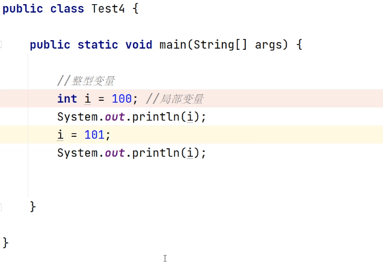
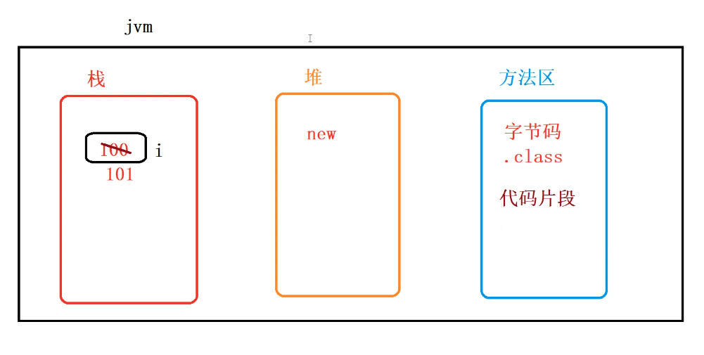

局部变量：

这个变量定义在主函数里面，定义在方法里面

当对名称叫 i 的变量的值进行修改的话，这份空间不会发生变化， 后面的值会自动覆盖前面的值

局部变量会存储到栈中

创建对象会存放在堆中

方法区空间会存放字节码即代码片段，后缀为.class，idea会将java源代码编译成字节码文件，字节码文件是交由JVM来识别的，JVM通过类加载器classLoader找到源文件,编译好字节码文件，字节码文件会放在方法区里面，会根据字节码文件生成二进制文件，生成的二进制文件会与计算机进行底层交互

#### 错误点：

- `.class`**是磁盘文件名后缀**，而“方法区”是 JVM 的**内存区域**。
- 方法区不会存放 `.class` 文件本身，而是存放从 `.class` 文件中解析出来的**类的元数据和字节码指令**。

#### 正确说法：

方法区存放的是类的结构信息（如字段、方法）、常量池、静态变量以及**字节码指令**（即编译后的代码片段），但不是 `.class` 文件本身。

#### 部分正确，但需澄清：

- IntelliJ IDEA 确实可以自动调用 `javac` 编译 `.java` 文件生成 `.class` 文件。
- 但**真正执行编译的是 JDK 中的**`javac`**编译器**，IDEA 只是封装了这个过程。

#### 更准确说法：

开发工具（如 IntelliJ IDEA）会调用 `javac` 编译器将 `.java` 源代码编译成 `.class` 字节码文件。

#### 基本正确，但不够精确：

- JVM 不是“识别”文件，而是通过 **类加载器（ClassLoader）加载** `.class` 文件，再由 **执行引擎** 解释或编译执行其中的字节码。

#### 更准确说法：

字节码文件由 JVM 的类加载器加载，之后由执行引擎解释或编译执行。

#### 严重错误！

- **类加载器不会“编译”源文件**！
- 编译是由 `javac` 在运行前完成的。
- ClassLoader 的职责是：**加载、验证、准备、解析、初始化**已经存在的 `.class` 文件。

#### 正确流程：

1. 你写 `.java` 源文件
2. `javac` 编译 → 生成 `.class`
3. JVM 启动 → ClassLoader 从磁盘/类路径加载 `.class`
4. 加载到内存 → 存入方法区

#### 修正：

JVM 通过类加载器（ClassLoader）找到已编译好的 `.class` 文件并加载它，而不是编译源文件。

#### 再次强调：错误

- `.class` 文件是磁盘上的二进制文件，不会“放进”方法区。
- 方法区是 JVM 内存的一部分，存放的是**类的运行时数据结构**。

#### 正确说法：

类加载完成后，其字节码指令、类信息等会被存入 JVM 的方法区（JDK 8 及以前）或元空间（Metaspace，JDK 8+）。

- **没有生成新的“二进制文件”写入磁盘**。
- JVM 会将字节码**动态翻译成当前 CPU 架构的机器码**（native code），在内存中执行。
- 这个过程由 **解释器** 或 **JIT 编译器** 完成。

#### 正确机制：

- 解释执行：逐行解释字节码为机器码执行
- JIT 编译：将热点代码编译为本地机器码，缓存执行，提升性能

#### 修正：

JVM 通过解释器或 JIT 编译器将字节码动态翻译为本地机器码，在内存中执行，从而与操作系统和硬件进行交互。

## 正确的总结（推荐版本）

Java 源代码（`.java`）由开发工具（如 IntelliJ IDEA）调用 `javac` 编译器编译生成 `.class` 字节码文件。  
JVM 启动后，通过类加载器（ClassLoader）从类路径中加载 `.class` 文件，  
将其解析后的类信息（包括字段、方法、常量池、字节码指令等）存入**方法区**。  
执行引擎通过解释器或 JIT 编译器，将字节码翻译为当前平台的机器码，在内存中执行，  
从而与操作系统和硬件进行底层交互。

---

## 关键概念澄清表

|  |  |
| --- | --- |
| **概念** | **正确认识** |
| `.class`  文件 | 磁盘上的字节码文件，由 `javac`  生成 |
| 方法区 | JVM 内存区域，存放类的元数据和字节码指令 |
| ClassLoader | 只负责加载 `.class`  文件，不负责编译 |
| 编译 | 由 `javac`  完成，在程序运行前 |
| 执行 | JVM 将字节码翻译为机器码，在内存中执行 |
| “二进制文件” | 不生成新文件，机器码在内存中直接执行 |

---

## 一句话总结

`.class` **文件是磁盘上的字节码，方法区存放的是它的“运行时镜像”；ClassLoader 只加载不编译；JVM 动态翻译字节码为机器码执行，无需生成新文件。**

---

如果你能记住这三句话，就掌握了 Java 程序从源码到运行的核心流程：

1. `javac`**编译**`.java`**→**`.class`
2. **ClassLoader 加载**`.class`**→ 方法区**
3. **执行引擎解释/JIT → 机器码执行**

## 正确的总结（推荐版本）

Java 源代码（`.java`）由开发工具（如 IntelliJ IDEA）调用 `javac` 编译器编译生成 `.class` 字节码文件。  
JVM 启动后，通过类加载器（ClassLoader）从类路径中加载 `.class` 文件，  
将其解析后的类信息（包括字段、方法、常量池、字节码指令等）存入**方法区**。  
执行引擎通过解释器或 JIT 编译器，将字节码翻译为当前平台的机器码，在内存中执行，  
从而与操作系统和硬件进行底层交互。

---

## 关键概念澄清表

|  |  |
| --- | --- |
| **概念** | **正确认识** |
| `.class`  文件 | 磁盘上的字节码文件，由 `javac`  生成 |
| 方法区 | JVM 内存区域，存放类的元数据和字节码指令 |
| ClassLoader | 只负责加载 `.class`  文件，不负责编译 |
| 编译 | 由 `javac`  完成，在程序运行前 |
| 执行 | JVM 将字节码翻译为机器码，在内存中执行 |
| “二进制文件” | 不生成新文件，机器码在内存中直接执行 |

---

## 一句话总结

`.class` **文件是磁盘上的字节码，方法区存放的是它的“运行时镜像”；ClassLoader 只加载不编译；JVM 动态翻译字节码为机器码执行，无需生成新文件。**

---

如果你能记住这三句话，就掌握了 Java 程序从源码到运行的核心流程：

1. `javac`**编译**`.java`**→**`.class`
2. **ClassLoader 加载**`.class`**→ 方法区**
3. **执行引擎解释/JIT → 机器码执行**

需要我用流程图或代码演示这个过程，也可以继续告诉我！
