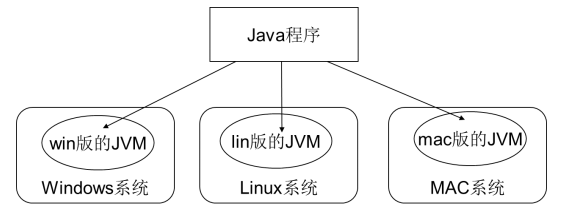
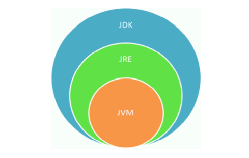

# java发展史

- 詹姆斯.高斯林（Janes Gosling）

- 1977年获得了加拿大卡尔加里大学计算机科学学士学位，1983年获得了美国内机梅隆大学计算机科学博士学位，毕业后到IBM工作，设计IBM第一代NeWs系统，但不受重视，后来转至Sun公司，1990年，与Patrick，Naughton和Mike Sheridan等人合作“绿色计划”，后来发展一套语言叫做“Oak”，后改名为Java

# java的特征与优势

- 简单性
- 面对对象
- 可移植性
- 高性能
- 分布式
- 多态性
- 多线性
- 安全性
- 健壮性

# java的特色

1. **面向对象（oop）**

2. **健壮性：强类型机制，异常处理，垃圾的自动收集**

**强类型****：语法校验十分严格，每一个数据类型的数据都有对应的关键字去接收，弱类型语言比如javascript，可以又一个关键字接收很多的数据类型**

**异常处理****：程序运行有问题你可以通过异常的日志去排错，会告诉你错在哪****自动收集** **：有一个自动垃圾回收的一个线程，会检测，发现资源不使用，帮你回收**

3. **跨平台性的 （一个编译好的.class可以在多个系统下运行）**

**关键点解释：**

1. **Java 编译器（javac）不直接生成机器码**，而是生成 **字节码（.class 文件）**。
2. 字节码是一种**中间语言**，与具体 CPU 架构和操作系统无关。
3. 每个操作系统都有对应的 **JVM 实现**，它负责将字节码翻译成该平台的机器码。
4. 因此，只要目标系统安装了 JVM，同一个 `.class` 文件就能运行。

**举个例子**：

- 你在 Windows 上编译出 `Hello.class`
- 把它复制到 Linux 服务器
- 只要 Linux 安装了 JVM，就能运行：`java Hello`
- JVM 会自动将字节码适配为 Linux 的机器指令

4. **java语言是解释型的语言 ： js php java 解释型语言（代码不能在**

**编译器直接运行，需要用到解释器） c/c++ 编译型语言 （二进制代**

**码，可以直接在编译器里面运行）**

# JVM JDK JRE三者之间的关系
- **JDK** (Java Development Kit)：是Java程序开发工具包，包含JRE 和

开发人员使用的工具。

- **JRE** (Java Runtime Environment) ：是Java程序的运行时环境，包

含JVM 和运行时所需要的核心类库。

**三者的关系**

JDK = JRE + 其他

JRE = JVM + 其他

**总结：使用**JDK**开发完成的**java**程序，交给**JRE**去运行**
