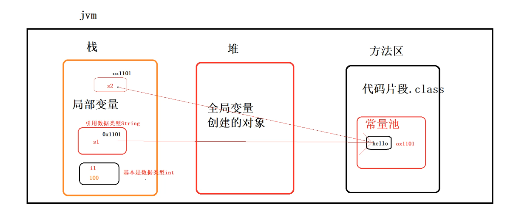

# 变量的概念

- 内存中的一个存储区域，该区域的数据可以在同一类型范围内不断变化
- 变量的构成包含三个要素：数据类型、变量名、存储的值
- Java中变量声明的格式：数据类型 变量名 = 变量值

# 变量的作用
用于在内存中保存数据。

# 使用注意：
Java中每个变量必须先声明，后使用。

使用变量名来访问这块区域的数据。

变量的作用域：其定义所在的一对{ }内。

变量只有在其作用域内才有效。出了作用域，变量不可以再被调

用。

同一个作用域内，不能定义重名的变量。

在Java中，变量分为两种：基本类型的变量 和 引用类型的变

量。

# 基本使用
在Java中，变量必须先定义后使用，在定义变量的时候，可以给它一个初

始值。例如：

```bash
int i = 10;
```

不写初始值，就相当于给它指定了默认值。默认值总是0。

变量的一个重要特点是可以重新赋值。

```bash
  public class Variable02 {
  public static void main(String[] args) {
  
  // 定义 int 类型变量
  int x = 100;
  
   System.out.println(x);
   x = 200;
   System.out.println(x);
  }
}
```

变量不但可以重新赋值，还可以赋值给其他变量。

```bash
public class Variavle02 {
   public static void main（String[] args) {
     //定义 int类型变量
     int x =100;
     System.out.println(x);//100

     x =200;
     System.out println(x);//200

     int y=x;
     System.out.println(y);//200

     x =x+100;
     System.out.println(x);//300
    }
 }   
```

# 数据类型
**基本数据类型**：包括 整数类型、浮点数类型、字符类型、布尔类型。

**引用数据类型**：包括数组、 类、接口、枚举、注解、记录。

# 基本数据类型
整数类型： byte (1个)、 short （2个）、 int （4ge） 、 long

（8个）

浮点数类型： float （4个）、 double （8个）

字符类型： char （2个）

布尔： boolean

计算机内存的最小存储单元是字节（byte），一个字节就是一个8位二进

制数，即8个bit。

一个字节是1byte，1024字节是1K，1024K是1M，1024M是1G，1024G

是1T。一个拥有4T内存的计算机的字节数量就是：

### 整型（**4**个）
byte：-128 ~ 127

short: -32768 ~ 32767

int: -2147483648 ~ 2147483647

long: -9223372036854775808 ~ 9223372036854775807

布尔类型 boolean 只有 true 和 false 两个值。

字符类型 char 表示一个字符。Java的 char 类型除了可表示标准的

ASCII 外，还可以表示一个 Unicode 字符：

```bash
public class BaseType {
  public static void main(String[] args) {
  
   //整形
   int a =1237;

   //浮点
   float f = 3.14f;//浮点类型默认为double，后面+f
   double d =1.73;

   //布尔类型
   boolean b1 =true;
   boolean b2= false;

    //true
    boolean flag = 5 >3;
    System.out.println(flag);

    int age = 15;

    //false
    boolean isAdult = age ≥ 18；
    System.out.println(isAdult);

    //字符类型
    char c ='A';
    char zh = '中'；
    System.out.println(c);
    System.out.println(zh);

    //不定义值，默认值为0

    }
  }  
```

**引用数据类型**

**字符串**

**String是一个类，所以大驼峰规范**

```bash
  String str = "今晚去洗脚"
```

**常量**

定义变量的时候，如果加上 final 修饰符，这个变量就变成了常量：

```bash
  public class Constant {
    public static void main(String[] args) {
       final double PI= 3.14;
       double r = 5.0;
       double area = PI*r*r;
       System.out.println(area）；

     // TODO 对常量进行再次赋值
     PI =20；//即这样是错误的
     }
 }    
```

常量在定义时进行初始化后就不可再次赋值，再次赋值会导致编译错误。

# 几者之间的关系以及存放位置



```bash
publlic class Demo02 {
   public static void main(String[] args) {

   char c1 = 'C';
   char c2 = 'C';

   //基本数据类型使用“==”比较的是内容
   int i1 = 100;
   int i2 = 100;

   //引用数据类型使用“==”比较的是地址
   String s1 = "Hello";  //"Hello"存放在方法区里面的常量池的
   String s2 = "Hello";

   System.out.println(c1 == c2);
   System.out.println(i1 == i2);
   System.out.println(s1 == s2); 
   }
}
```

i1和s1都处于主函数下面，所以两个都作为局部变量，局部变量存储于栈中；堆里面存放的是全局变量和创建对象；方法区则放置的是代码片段.class（二进制代码，与计算机底层直接联系的东西将java源文件通过javac.exe转化为.class文件）和常量池

基本数据类型（整数类型、浮点数类型、字符类型、布尔类型）里面的整数类型i1及所对应的值都在栈中分配空间并进行保存，引用数据类型则是s1在栈中分配空间，其所对应的“Hello”常量则是存储在方法区里面的常量池中，s1表示其常量在常量池中所对应的地址（一般是一个十六位进制的数 例如：x1001）

比较基本类型是比较内容 比较引用类型是比较地址

# 字符串的比较

```bash
（1）//判断字符串是否匹配的方法
       System.out.println(s1.equals(s2));

       如果两个字符串返回的内容是一样的话返回值是true，否则是false
（s1和s2的内容都是Hello）且返回类型是布尔值  

（2）   String s1 = "Hello";  //"Hello"存放在方法区里面的常量池的
        String s2 = "Hello";
        System.out.println(s1 == s2); 
  下面则比较的是两个字符串所对应的地址是否一致，两者是有区别的 
```

# 字符串的其他写法

```bash
String s3 = new String(original:"hello");
String s4 = new String(original:"hello");
System.out.println(s3);
System.out.println(s4);
```

结果输出的值都是“hello”，这个是字符串在java中的另一个写法，创建String对象，如果判断System.out.println(s3 == s4); 此时的结果是false，原因是创建对象是在堆中去创建空间，new了两个String则开辟了两个空间，则两个空间的是不一样的
