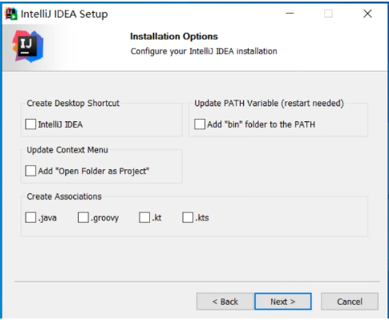
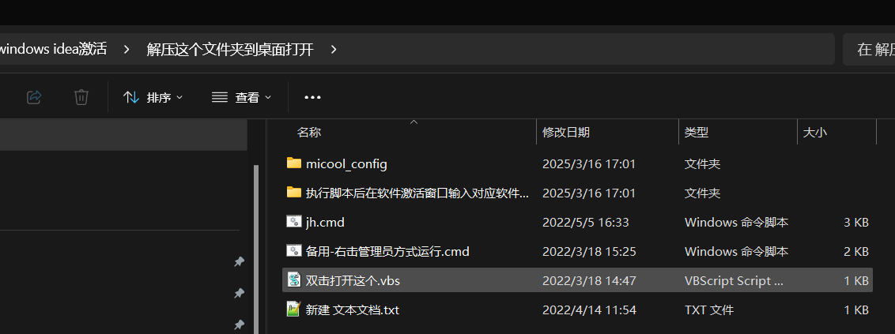
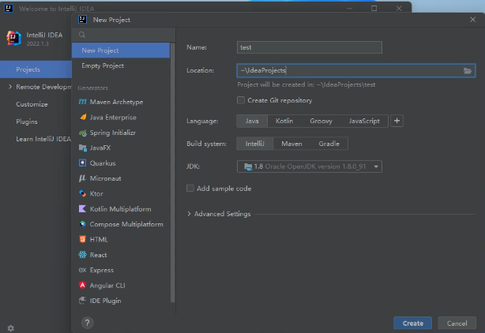

### 安装idea

### 激活

1.解压缩 桌面上有一个名字叫windows idea激活

2.点击解压这个文件夹到桌面（里面有一个脚本 双击打开这个）

3.全局搜索idea，再打开文件所在位置，然后直接将快捷方式拖拽到桌面上即可

### 创建项目

Name：工程名称

Location：工程保存的一个地址 （work工作文件夹）

Language：java

JDK：一般可识别，无法识别手动选择JDK文件下载位置 JDK1.8.0文件夹

### 个性化设置

1.字体

File-->Setting-->搜索font（字体的意思）-->Color schema font-->Use Color schema font instead of default -->个性化修改-->apply-->yes
