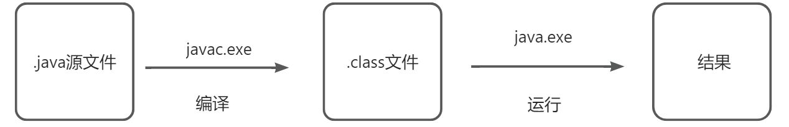
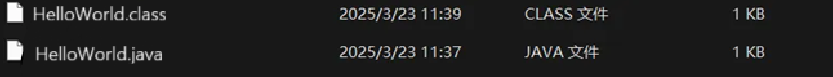
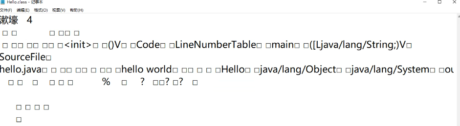
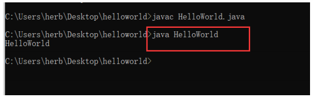

# 开发步骤
1. 编写

将JAVA 代码编写到项目扩展名为 .java 的源文件中

2. 编译

通过 javac.exe 命令对这个 java 文件进行编译，生成一个或多个字节

码文件

3. 运行

通过 java.exe 命令对生成的 class 文件进行运行



# 编写
创建文件改名为.java后缀

```java
class HelloWorld {
    public static void main(String[] args) {
        System.out.println("HelloWorld");
    }
}
```

# 编译
javac java文件

```bash
javac HelldWorld.java
```



**这个时候会生成一个字节码文件，这里面的文件我们是看不懂的**

  
**但是jvm虚拟机能看懂，能识别字节码文件**

# 运行
java 主类文件

```bash
 java HelloWorld
```



**这样HelloWorld就成功打印在控制台上面了**

# 常见的错误
**拼写问题**

单词拼写问题

正确 ： class 错误： Class

正确： String 错误：string

正确：System 错误：system

Java语言是一门严格区分大小写的语言

标点符号使用问题

不能用中文符号，英文半角的标点符号（正确）

括号问题，成对出现
