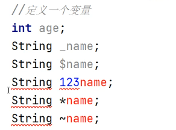
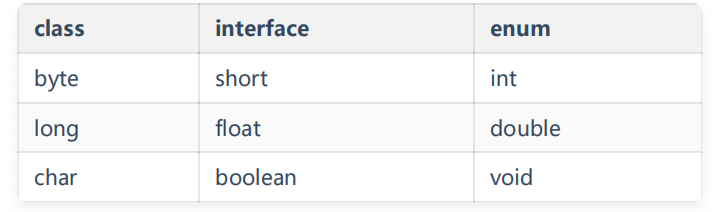
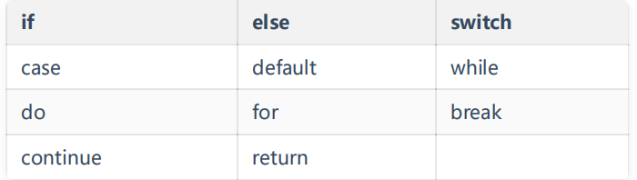

# 标识符（对他们的命名就是标识符）

所有标识符都应该以 字母、

、\_ 或数字任

何字符组合

美元符 、 下划线 开头，首字母之后可以是字母、

**关键字不能作为变量名或方法名**

**严格区分大小写，长度无限制**

**可以用中文命名，但不建议使用**

# 关键字

定义：被 Java 语言赋予了特殊含义，用做专门用途的字符串（单词）

特点：关键字中所有字母都为小写

官网：

https://docs.oracle.com/javase/tutorial/java/nutsandbolts/\_keywords.html

用于定义数据类型的关键字

用于定义流程控制的关键字

用于定义访问权限修饰符的关键字

用于定义类,函数，变量修饰符的关键字

用于定义类与类之间关系的关键字

用于定义建立实例及引用实例,判断实例的关键字

用于异常处理的关键字

用于包的关键字

其他修饰符关键字

用于定义数据类型值的字面值

# 命名规范

**java中元素的命名（标识符）**

**-java中的关键字不能作为元素名称**

**-类的命名**

**-大驼峰规范**

**-单词首字母大写，若后面拼接有其他单词，拼接单词首字母大写**

**（UserLogin）**

**-方法的命名**

**-变量的命名**

**-小驼峰规范**

**-单词首字母是小写，若后面拼接有其他单词，拼接单词首字母大写**

**（getUsername、className）**
