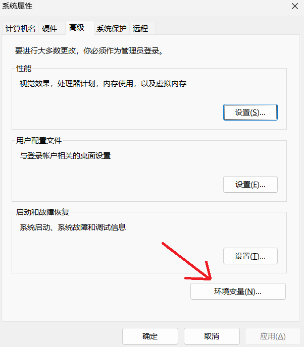
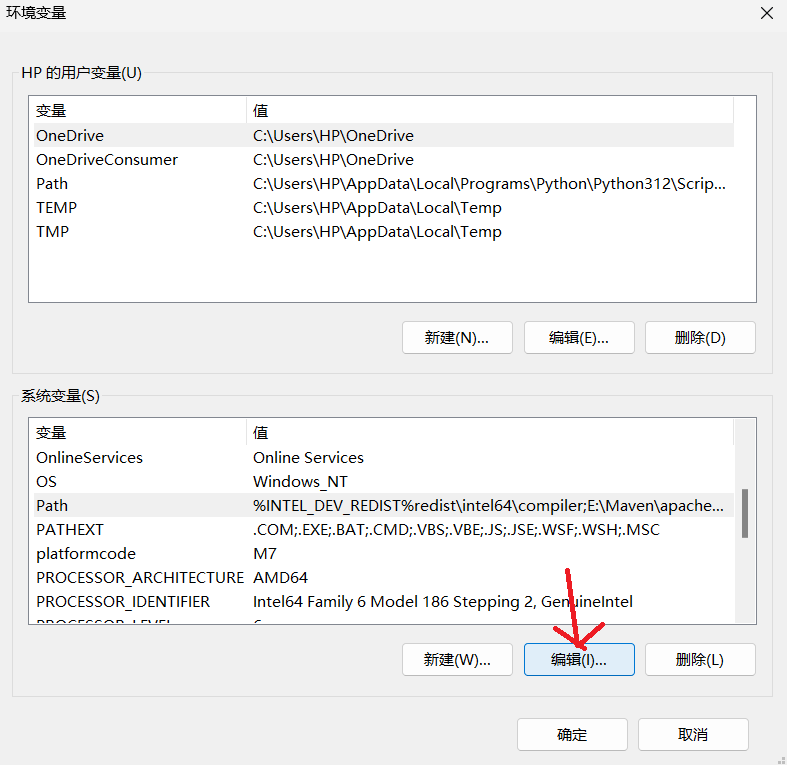
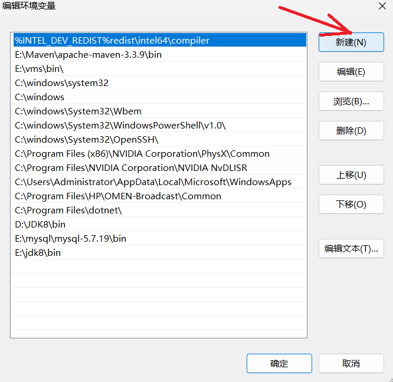
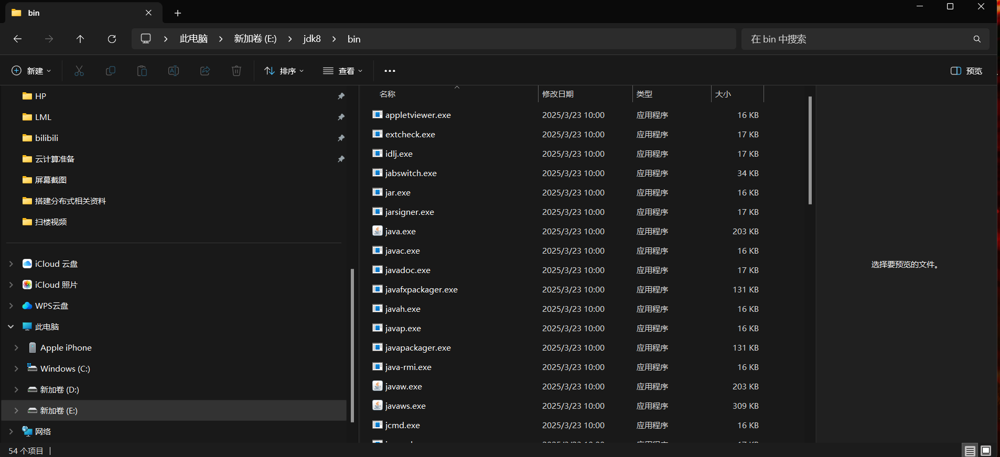
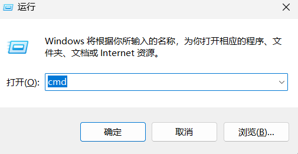
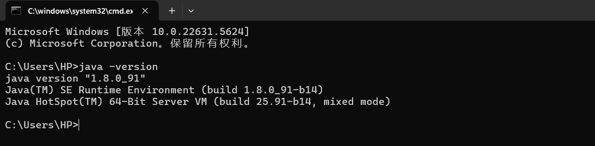

### 下载 **OpenJDK 8**

OpenJDK 是 Java 的开源实现，功能与 Oracle JDK 基本一致，推荐用于学习和生产。

**1. Adoptium（原 AdoptOpenJDK）**

- 官网：https://adoptium.net/
- 选择版本：Temurin 8 (OpenJDK 8)
- 支持平台：Windows / macOS / Linux
- 特点：由 Eclipse 基金会维护，企业级支持，完全免费。

👉 直达下载页：  
https://adoptium.net/temurin/releases/?version=8

**中间会跳出来jre的下载页面，直接删掉就好**

### 部署环境
**1.在windows里面搜索高级系统设置**

**点击环境变量**

**在path行选择编辑**

**将下载好的jdk8的bin（jdk的执行文件目录）目录的路径添加到环境变量中**

**检测配置环境是否成功：**

**输入指令windows+r，输入cmd**

**会跳出一个黑窗口，即windows的命令行，输入指令 java -version查看java的版本号**

**配置环境变量的目的：**

**为了让jdk中bin路径下的可执行文件，在计算机的任意路径下都可以使用**
