# 一、什么是 `mysql-connector-java-8.0.22.jar`？

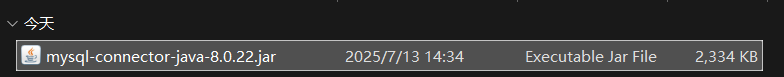

**MySQL 官方提供的 JDBC 驱动程序**，用于 Java 程序连接 MySQL 数据库。

|  |  |
| --- | --- |
| **属性** | **描述** |
| 名称 | MySQL Connector/J |
| 版本 | 8.0.22 |
| 类型 | JDBC 驱动（Java Database Connectivity） |
| 功能 | 让 Java 应用程序通过 JDBC 接口访问 MySQL 数据库 |
| 包含类 | `com.mysql.cj.jdbc.Driver`  （驱动类） |
| 支持数据库版本 | MySQL 5.6、5.7、8.0 等 |

---

## 二、如何使用这个 `.jar` 文件？

### 手动添加到项目中（适用于普通 Java 项目）

1. **下载 jar 文件**：

- 可从官网下载：https://dev.mysql.com/downloads/connector/j/
- 选择 Platform Independent → 下载 ZIP 或 TAR 包，解压后得到 `mysql-connector-java-8.0.22.jar`

2. **复制到你的项目 lib 目录**：

```plain
your-project/
└── lib/
    └── mysql-connector-java-8.0.22.jar
```

3. **在 IntelliJ IDEA 中添加依赖**：

- 右键点击该 jar 文件 → `Add as Library...`【**Library（库）就是别人写好的代码集合（打包成** `.jar` **文件），你可以直接拿来用，不需要自己重新造轮子。**】

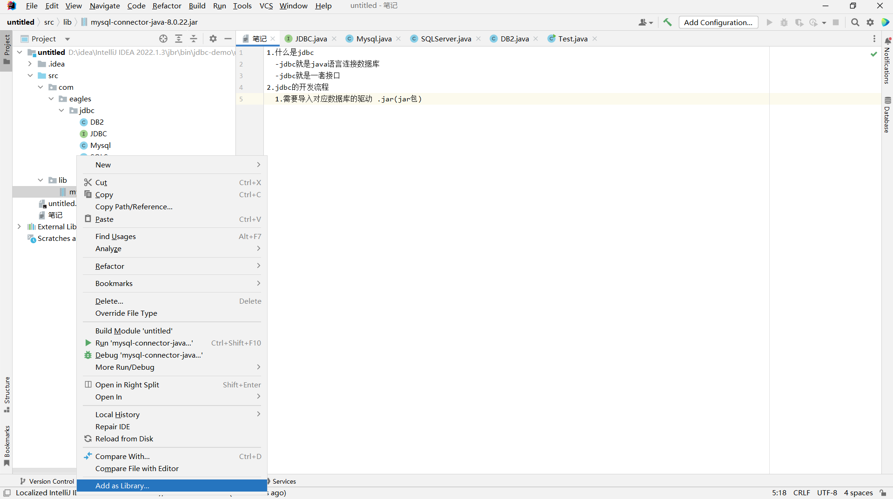

4. **Driver驱动器的具体位置以及测试是否可用**：

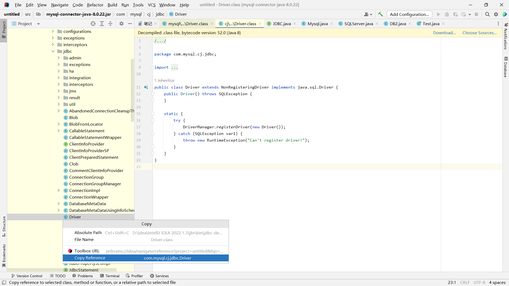

```java
Class.forName("com.mysql.cj.jdbc.Driver");
System.out.println("驱动加载成功！");
```

---

## 三、JDBC 连接字符串示例

```java
String url = "jdbc:mysql://localhost:3306/your_database?useSSL=false&serverTimezone=UTC&characterEncoding=utf8";
String username = "root";
String password = "your_password";

Connection connection = DriverManager.getConnection(url, username, password);
```

---

## 四、常见问题及解决方法

|  |  |  |
| --- | --- | --- |
| **问题** | **原因** | **解决办法** |
| `ClassNotFoundException`  : `com.mysql.cj.jdbc.Driver` | 没有添加驱动 | 添加 `mysql-connector-java-8.0.22.jar`  到 classpath |
| `java.sql.SQLException: No suitable driver found` | URL 格式错误或未加载驱动 | 检查 URL 是否以 `jdbc:mysql://`  开头 |
| `The server time zone value 'XXX' is unrecognized` | 时区设置错误 | 添加 `serverTimezone=UTC`  或 `GMT%2B8`  到 URL 中 |
| `Public Key Retrieval is not allowed` | 身份验证方式问题 | 在 URL 中加上 `allowPublicKeyRetrieval=true` |

---

## 五、完整测试代码

```java
import java.sql.*;

public class TestMySQL {
    public static void main(String[] args) {
        String url = "jdbc:mysql://localhost:3306/testdb?serverTimezone=UTC&characterEncoding=utf8";
        String user = "root";
        String pass = "your_password";

        try {
            // 加载驱动（Maven 项目可省略）
            Class.forName("com.mysql.cj.jdbc.Driver");

            // 获取连接
            Connection conn = DriverManager.getConnection(url, user, pass);
            Statement stmt = conn.createStatement();
            ResultSet rs = stmt.executeQuery("SELECT * FROM users");

            while (rs.next()) {
                System.out.println(rs.getString("username"));
            }

            rs.close();
            stmt.close();
            conn.close();

        } catch (Exception e) {
            e.printStackTrace();
        }
    }
}
```

# 一、JDBC 是什么？

### 全称：

**Java Database Connectivity**

### jdbc的事务操作

- 事务一定是跟数据库有关的
- 一个事务基本上会跟数据库有一次交互(DML)
- 事务的操作一定跟现实生活的业务有关
- 一个业务可能会包含多个事务

### 定义：

JDBC 是 Java 提供的一套用于连接数据库、执行 SQL 语句、处理结果集的 API，它允许 Java 程序与各种数据库进行交互。

```java
package com.eagles.jdbc;

public class DB2 implements JDBC {
    public DB2() {
    }

    public void getConnection() {
        System.out.println("DB2成功获取连接对象~~");
    }

    public void commit() {
        System.out.println("DB2 commit~~");
    }

    public void close() {
        System.out.println("DB2 close~~");
    }
}
```

```java
package com.eagles.jdbc;

public class Mysql implements JDBC {
    public Mysql() {
    }

    public void getConnection() {
        System.out.println("mysql成功获取连接对象~~");
    }

    public void commit() {
        System.out.println("mysql commit~~");
    }

    public void close() {
        System.out.println("mysql close~~");
    }
}
```

```java
package com.eagles.jdbc;

public class SqlServer implements JDBC {
    public SqlServer() {
    }

    public void getConnection() {
        System.out.println("sqlServer成功获取连接对象~~");
    }

    public void commit() {
        System.out.println("sqlServer commit~~");
    }

    public void close() {
        System.out.println("sqlServer close~~");
    }
}
```

```java
package com.eagles.jdbc;

public interface JDBC {//抽象类 继承后方法都得重写
    void getConnection();

    void commit();

    void close();
}
```

```java
package com.eagles.jdbc;

public class Test {
    public static void main(String[] args) {
    JDBC jdbc = new sqlServer();
    jdbc.getConnection();
    jdbc.commit();
    jdbc.close();
   }
}
```

sqlServer成功获取连接对象~~

sqlServer commit~~

sqlServer close~~

---

## 二、JDBC 的核心功能

|  |  |
| --- | --- |
| **功能** | **描述** |
| 连接数据库 | 使用驱动程序和 URL 连接目标数据库（如 MySQL、Oracle、PostgreSQL 等） |
| 执行 SQL 语句 | 支持 `SELECT`  、`INSERT`  、`UPDATE`  、`DELETE`  等 SQL 操作 |
| 处理查询结果 | 通过 `ResultSet`  对象获取并处理查询结果 |
| 事务管理 | 支持事务控制（提交、回滚等） |
| 异常处理 | 提供 `SQLException`  用于处理数据库操作中的错误 |

---

## 三、JDBC 使用的基本步骤（以 MySQL 为例）

下面是一个使用 JDBC 连接 MySQL 数据库并执行查询的完整示例：

### 添加 MySQL JDBC 驱动依赖 （Java 代码示例）：

```java
import java.sql.*;

public class JdbcDemo {
    public static void main(String[] args) {
        String url = "jdbc:mysql://localhost:3306/your_database?useSSL=false&serverTimezone=UTC&characterEncoding=utf8";
        String username = "root";
        String password = "your_password";

        try {
            // 1. 加载驱动（JDBC 4.0 后可省略）
            Class.forName("com.mysql.cj.jdbc.Driver");

            // 2. 建立连接
            Connection connection = DriverManager.getConnection(url, username, password);

            // 3. 创建 Statement
            Statement statement = connection.createStatement();

            // 4. 执行查询
            ResultSet resultSet = statement.executeQuery("SELECT * FROM student");

            // 5. 处理结果
            while (resultSet.next()) {
                int id = resultSet.getInt("Id");
                String name = resultSet.getString("Name");
                String department = resultSet.getString("Department");
                System.out.println("ID: " + id + ", Name: " + name + ", Department: " + department);
            }

            // 6. 关闭资源
            resultSet.close();
            statement.close();
            connection.close();

        } catch (Exception e) {
            e.printStackTrace();
        }
    }
}
```

---

## 四、JDBC 常用接口和类

|  |  |
| --- | --- |
| **类/接口** | **作用** |
| `DriverManager` | 管理 JDBC 驱动，用于建立数据库连接 |
| `Connection` | 表示与数据库的连接 |
| `Statement` | 用于执行静态 SQL 语句 |
| `PreparedStatement` | 用于执行带参数的 SQL 语句（推荐使用） |
| `ResultSet` | 用于保存查询结果 |
| `SQLException` | 处理数据库操作中的异常 |

---

## 五、常见数据库的 JDBC URL 格式

|  |  |
| --- | --- |
| **数据库** | **JDBC URL 格式** |
| MySQL | `jdbc:mysql://host:port/dbname` |
| PostgreSQL | `jdbc:postgresql://host:port/dbname` |
| Oracle | `jdbc:oracle:thin:@host:port:SID` |
| SQL Server | `jdbc:sqlserver://host:port;databaseName=DBName` |

# 案例：

## jdbc的具体流程和方法：

```java
package com.eagles.jdbc;

import java.sql.Connection;
import java.sql.DriverManager;
import java.sql.SQLException;
import java.sql.Statement;

public class JDBCTest01 {
    public static void main(String[] args) {

        Connection connection = null;
        Statement statement = null;

        try {
            //1、注册驱动
            Class.forName("com.mysql.cj.jdbc.Driver");

            /**
             *  jdbc:mysql:// java连接mysql数据库的协议
             *  localhost 本地的ip地址 127.0.0.1
             *  3306 mysql 服务的端口号
             */
            String url = "jdbc:mysql://localhost:3306/database1?characterEncoding=utf8&serverTimezone=GMT%2B8";
            String username = "root";
            String password = "root";

            //2、获取数据库连接对象
            connection = DriverManager.getConnection(url, username, password);

            System.out.println(connection);

            //3、获取数据库操作对象
            statement = connection.createStatement();
            System.out.println(statement);

            //4、编写sql语句
            String sql = "insert into tb_user(username,password,email,address)values('jack','123456','123@qq.com','镇江市')";

            //5、执行sql语句
            int executeUpdate = statement.executeUpdate(sql);

            System.out.println(executeUpdate == 1 ? "成功" : "失败");

        } catch (ClassNotFoundException e) {
            throw new RuntimeException(e);
        } catch (SQLException e) {
            throw new RuntimeException(e);
        }finally {

            //关闭资源

            if (statement != null){
                try {
                    statement.close();
                } catch (SQLException e) {
                    throw new RuntimeException(e);
                }
            }

            if (connection != null){
                try {
                    connection.close();
                } catch (SQLException e) {
                    throw new RuntimeException(e);
                }
            }
        }
    }
}
```

com.mysql.cj.jdbc.ConnectionImpl@36f6e879

com.mysql.cj.jdbc.StatementImpl@12843fce

成功

## 通过jdbc完成对user表的修改操作：

```java
package com.eagles.demo;

import java.sql.Connection;
import java.sql.DriverManager;
import java.sql.Statement;

/*
通过jdbc完成对user表的修改操作
 */
public class JDBCTest02 {
    public static void main(String[] args) throws  Exception {
        //1.注册驱动
        Class.forName("com.mysql.cj.jdbc.Driver");

        //2.获取数据库连接对象
        Connection connection = DriverManager.getConnection("jdbc:mysql://localhost:3306/database1?characterEncoding=utf8&serverTimezone=GMT%2B8","root","");

        //3.获取数据库操作对象
        Statement statement = connection.createStatement();

        //4.编写sql语句
        String sql = "update tb_user set username ='ls',password ='456789',email='345@qq.com',address='南京市' where id = 1";

        //5.执行sql语句
        int executeUpdate = statement.executeUpdate(sql);
        System.out.println(executeUpdate  == 1? "修改成功" :"修改失败");
        场景	                    executeUpdate            返回值
    成功插入一行            	                                  1
    成功更新一行	                                              1
  没有改变任何数据（如 UPDATE 条件不匹配）	                  0
  SQL 错误（如字段不存在）	              抛出异常（SQLException），不会走到判断这一步

        //6.关闭资源
        statement.cancel();
        connection.close();

    }
}
```

修改成功

## 通过jdbc完成对user表的删除操作：

```java
    package com.eagles.demo;

import java.lang.instrument.ClassDefinition;
import java.sql.Connection;
import java.sql.DriverManager;
import java.sql.Statement;

/*
通过jdbc完成对user表的删除操作
 */
public class  {
    public static void main(String[] args)  throws  Exception{

        //1.注册驱动
        Class.forName("com.mysql.cj.jdbc.Driver");

        //2.获取数据库连接对象
        Connection connection = DriverManager.getConnection("jdbc:mysql://localhost:3306/database1?characterEncoding=utf8&serverTimezone=GMT%2B8","root","");

        //3.获取数据库操作对象
        Statement statement = connection.createStatement();

        //编写sql语句
        String sql ="delete from  tb_user where id = 1";

        //执行sql语句
        int executeUpdate = statement.executeUpdate(sql);//executeUpdate影响数据条数
        System.out.println(executeUpdate ==1 ?"删除成功": "删除失败");

        //6.关闭资源
        statement.close();
        connection.close();

    }
}
```

删除成功

## 查询用户表的所有数据：

```java
package com.eagles.demo;

import java.sql.*;

/*
查询用户表的所有数据
 */
public class JDBCTest04 {
    public static void main(String[] args) {

        Connection connection = null;//这样写是为了可以关闭资源，这些数据库对象
        Statement statement = null;
        ResultSet resultSet = null;

        try {
            //1、注册驱动
            Class.forName("com.mysql.cj.jdbc.Driver");

            /**
             *  jdbc:mysql:// java连接mysql数据库的协议
             *  localhost 本地的ip地址 127.0.0.1
             *  3306 mysql 服务的端口号
             */
            String url = "jdbc:mysql://localhost:3306/database1?characterEncoding=utf8&serverTimezone=GMT%2B8" ;
            String username = "root";
            String password = "";

            //2、获取数据库连接对象
            connection = DriverManager.getConnection(url, username, password);

            System.out.println(connection);

            //3、获取数据库操作对象
            statement = connection.createStatement();
            System.out.println(statement);

            //4、编写sql语句
            String sql = "select * from tb_user";

            //5、执行sql语句
            resultSet = statement.executeQuery(sql);

            //对结果集进行遍历
            while (resultSet != null && resultSet.next()){ //resultSet这是一个结果集，所以得遍历集合

                //根据数据库表字段的数据类型取出对应的值
                int id = resultSet.getInt("id");
                String usernameTable = resultSet.getString("username");
                String passwordTable = resultSet.getString("password");
                String email = resultSet.getString("email");
                String address = resultSet.getString("address");

                System.out.println("id = "+id+" username = "+usernameTable+" password= "+passwordTable+" email = "+email+" address= "+address);

            }

        } catch (ClassNotFoundException e) {
            throw new RuntimeException(e);
        } catch (SQLException e) {
            throw new RuntimeException(e);
        }finally {

            //关闭资源

            if (resultSet != null){
                try {
                    resultSet.close();
                } catch (SQLException e) {
                    throw new RuntimeException(e);
                }
            }

            if (statement != null){
                try {
                    statement.close();
                } catch (SQLException e) {
                    throw new RuntimeException(e);
                }
            }

            if (connection != null){
                try {
                    connection.close();
                } catch (SQLException e) {
                    throw new RuntimeException(e);
                }
            }
        }
    }
}
```

com.mysql.cj.jdbc.ConnectionImpl@36f6e879

com.mysql.cj.jdbc.StatementImpl@12843fce

## 控制台输入对象，对输入对象与数据库的数据进行比对，有此数据即为登录成功否则登录失败：

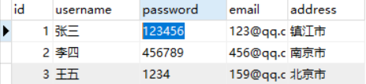

```java
package com.eagles.demo;

import java.sql.Connection;
import java.sql.DriverManager;
import java.sql.ResultSet;
import java.sql.SQLException;
import java.sql.Statement;
import java.util.Scanner;

public class JDBCTest05 {
    public JDBCTest05() {
    }
    
    public static void main(String[] args) {
        JDBCTest05 jdbcTest05 = new JDBCTest05();
        Scanner scanner = new Scanner(System.in);
        System.out.println("请输入用户名：");
        String username = scanner.nextLine();//用next（）不能过滤空格，但是nexLine可以
        System.out.println("请输入密码：");
        String password = scanner.nextLine();
        String login = jdbcTest05.login(username, password);
        System.out.println(login);
    }

    public String login(String username, String password) {
        Connection connection = null;
        Statement statement = null;
        ResultSet resultSet = null;

        String var7;
        try {
            Class.forName("com.mysql.cj.jdbc.Driver");
            connection = DriverManager.getConnection("jdbc:mysql://localhost:3306/database1?characterEncoding=utf8&serverTimezone=GMT%2B8", "root", "");
            statement = connection.createStatement();//拼接变量的方法 ' " " '(大单引号里面放双引号) 【变量与字符串的拼接】
            String sql = "select * from tb_user where username = '" + username + "' and password = '" + password + "'";
            resultSet = statement.executeQuery(sql);//resultSet 结果集
            if (resultSet != null && resultSet.next()) {
                var7 = "登录成功";
                return var7;
            }

            var7 = "登录失败";
        } catch (ClassNotFoundException var26) {
            throw new RuntimeException(var26);
        } catch (SQLException var27) {
            throw new RuntimeException(var27);
        } finally {
            if (resultSet != null) {
                try {
                    resultSet.close();
                } catch (SQLException var25) {
                    throw new RuntimeException(var25);
                }
            }

            if (statement != null) {
                try {
                    statement.close();
                } catch (SQLException var24) {
                    throw new RuntimeException(var24);
                }
            }
            
            if (connection != null) {
                try {
                    connection.close();
                } catch (SQLException var23) {
                    throw new RuntimeException(var23);
                }
            }
        }
        return var7;
    }
}
```

请输入用户名：

张三

请输入密码：

123456

登录成功

## 封装jdbc工具类

将重复的、冗余的代码抽离出来形成一个工具类，后面进行增删改查的时候直接使用工具类即可

```java
package com.eagles.utils;
import java.sql.*;

public class JDBCUtils {

    public static final String DATABASE_NAME = "database1";
    public static final String USERNAME = "root";
    public static final String PASSWORD = "";

    //构造方法私有化
    private JDBCUtils(){}

    static {
        //注册驱动
        try {
            Class.forName("com.mysql.cj.jdbc.Driver");
        } catch (ClassNotFoundException e) {
            throw new RuntimeException(e);
        }
    }

    /**
     * 数据库连接对象
     * @return
     */
    public static Connection getConnection() throws SQLException {

        return DriverManager.getConnection("jdbc:mysql://localhost:3306/"+DATABASE_NAME+"?characterEncoding=utf8&serverTimezone=GMT%2B8",USERNAME,PASSWORD);

    }

    /**
     * 回收数据库资源
     * @param resultSet
     * @param statement
     * @param connection
     */
    public static void close(ResultSet resultSet,Statement statement,Connection connection){

        if (resultSet != null){
            try {
                resultSet.close();
            } catch (SQLException e) {
                throw new RuntimeException(e);
            }
        }

        if (statement != null){
            try {
                statement.close();
            } catch (SQLException e) {
                throw new RuntimeException(e);
            }
        }

        if (connection != null){
            try {
                connection.close();
            } catch (SQLException e) {
                throw new RuntimeException(e);
            }
        }
    }
}
```

# 一、什么是`PreparedStatement？`

`PreparedStatement` 是 `Statement` 接口的子接口，表示**预编译的 SQL 语句对象**。它可以将 SQL 中的变量部分用占位符 `?` 表示，然后在运行时动态赋值。

## 二、对比（`PreparedStatement`对比 `Statement`）

|  |  |  |
| --- | --- | --- |
| **功能** | `Statement` | `PreparedStatement` |
| 是否支持参数化查询 | ❌ 不支持，需要拼接 SQL 字符串（原理是字符串的拼接） | ✅ 支持，使用 `?`  占位符 |
| 是否防止 SQL 注入 | ❌ 否，容易被攻击 | ✅ 是，自动处理特殊字符 |
| 执行效率 | 每次都要重新编译 SQL | ✅ 预编译一次，多次执行更高效 |
| 使用场景 | 简单的静态 SQL 查询 | ✅ 更安全、高效的动态 SQL 操作 |

## 三、基本使用步骤

### 1. 获取 `PreparedStatement` 对象

```java
String sql = "INSERT INTO user(username, password, email) VALUES(?, ?, ?)";
PreparedStatement ps = connection.prepareStatement(sql);
```

### 2. 给 `?` 占位符赋值（从 1 开始编号）

```java
ps.setString(1, "jack");       // 第一个 ?
ps.setString(2, "123456");     // 第二个 ?
ps.setString(3, "jack@qq.com"); // 第三个 ?
```

### 3. 执行 SQL

- **插入/更新/删除**：使用 `executeUpdate()`
- **查询**：使用 `executeQuery()`

```java
int rows = ps.executeUpdate(); // 返回影响的行数
```

### 4. 关闭资源

```java
ps.close();
```

---

## 四、完整示例代码（插入数据）

```java
import java.sql.*;

public class PreparedStatementDemo {
    public static void main(String[] args) {
        String url = "jdbc:mysql://localhost:3306/testdb?serverTimezone=UTC&characterEncoding=utf8";
        String user = "root";
        String password = "your_password";

        try (Connection conn = DriverManager.getConnection(url, user, password)) {

            String sql = "INSERT INTO user(username, password, email) VALUES(?, ?, ?)";
            PreparedStatement ps = conn.prepareStatement(sql);

            ps.setString(1, "tom");
            ps.setString(2, "654321");
            ps.setString(3, "tom@example.com");

            int rows = ps.executeUpdate();

            System.out.println(rows > 0 ? "插入成功" : "插入失败");

            ps.close();

        } catch (SQLException e) {
            e.printStackTrace();
        }
    }
}
```

---

## 五、为什么推荐使用 `PreparedStatement`？

### 1. 防止 SQL 注入

例如用户输入恶意内容：

```java
String username = "jack'; DROP TABLE user;--"; // SQL 注入攻击
String sql = "SELECT * FROM user WHERE username = '" + username + "'";
Statement stmt = connection.createStatement();
ResultSet rs = stmt.executeQuery(sql); // 非常危险！
```

而用 `PreparedStatement` 就安全了：

```java
PreparedStatement ps = connection.prepareStatement("SELECT * FROM user WHERE username = ?");
ps.setString(1, "jack'; DROP TABLE user;--"); // 会被当作字符串处理，不会执行恶意 SQL
```

### 2. 提高性能（预编译）

SQL 语句只编译一次，可以多次执行不同的参数，节省数据库资源。

---

## 六、常用 `setXXX()` 方法

|  |  |
| --- | --- |
| **方法名** | **说明** |
| `setString(int parameterIndex, String x)` | 设置字符串类型参数 |
| `setInt(int parameterIndex, int x)` | 设置整型参数 |
| `setDouble(int parameterIndex, double x)` | 设置浮点数参数 |
| `setDate(int parameterIndex, Date x)` | 设置日期类型参数 |
| `setBoolean(int parameterIndex, boolean x)` | 设置布尔值参数 |
| `setObject(int parameterIndex, Object x)` | 设置任意类型参数（通用） |

---

## 七、进阶技巧：批量插入

```java
String sql = "INSERT INTO user(username, password, email) VALUES (?, ?, ?)";
PreparedStatement ps = connection.prepareStatement(sql);

for (int i = 0; i < 100; i++) {
    ps.setString(1, "user" + i);
    ps.setString(2, "pass" + i);
    ps.setString(3, "user" + i + "@example.com");
    ps.addBatch(); // 添加到批处理
}

ps.executeBatch(); // 一次性执行所有插入
```

# 案例：

### 案例1：

创建一个员工表

再通过java连接数据库，查询员工表中所有的数据

创建对应的员工实体类，从数据库查询出来的记录都要封装成java对象

将java对象存储到集合中，对集合进行遍历输出

判断年龄大于20岁的员工

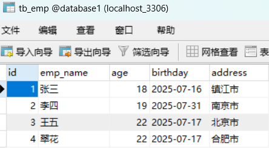

```java
package com.eagles.pojo;

public class Emp {
    private  Integer id;
    private String empName;
    private Integer age;
    private String birthday;
    private String address;

    @Override
    public String toString() {
        return "Emp{" +
        "id=" + id +
        ", empName='" + empName + '\'' +
        ", age=" + age +
        ", birthday='" + birthday + '\'' +
        ", address='" + address + '\'' +
        '}';
    }

    public Integer getId() {
        return id;
    }

    public void setId(Integer id) {
        this.id = id;
    }

    public String getEmpName() {
        return empName;
    }

    public void setEmpName(String empName) {
        this.empName = empName;
    }

    public Integer getAge() {
        return age;
    }

    public void setAge(Integer age) {
        this.age = age;
    }

    public String getBirthday() {
        return birthday;
    }

    public void setBirthday(String birthday) {
        this.birthday = birthday;
    }

    public String getAddress() {
        return address;
    }

    public void setAddress(String address) {
        this.address = address;
    }

    public Emp(Integer id, String empName, Integer age, String birthday, String address) {
        this.id = id;
        this.empName = empName;
        this.age = age;
        this.birthday = birthday;
        this.address = address;
    }
}
```

```java
package com.eagles.demo;

import com.eagles.pojo.Emp;
import com.eagles.utils.JDBCUtils;

import java.sql.*;
import java.util.ArrayList;

public class JDBCEmpTest {
    public static void main(String[] args) {
        Connection connection =null;
        PreparedStatement preparedStatement =null;
        ResultSet resultSet =null;

        try {
            //注册驱动
            connection = JDBCUtils.getConnection();
            //创建集合
            ArrayList<Emp> arrayList =new ArrayList<>();
            //创建数据库操作对象
            preparedStatement = connection.prepareStatement("select  * from  tb_emp");

            //查询
            resultSet = preparedStatement.executeQuery();
            while (resultSet !=null &&resultSet.next()){
                int id = resultSet.getInt("id");
                String empName = resultSet.getString("emp_name");
                int age = resultSet.getInt("age");
                String birthday = resultSet.getString("birthday");
                String address = resultSet.getString("address");
                //创建emp对象
                Emp emp = new Emp(id,empName,age,birthday,address);
                arrayList.add(emp);
            }

            for (Emp emp : arrayList) {
                if (emp.getAge() > 20){
                    System.out.println(emp);
                }
            }

            preparedStatement.executeQuery();
        } catch (SQLException e) {
            throw new RuntimeException(e);
        }finally {
            JDBCUtils.close(resultSet,preparedStatement,connection);
        }
    }

}
```

Emp{id=3, empName='王五', age=22, birthday='2025-07-17', address='北京市'}

Emp{id=4, empName='翠花', age=22, birthday='2025-07-17', address='合肥市'}

### 案例2：

银行转账:A账户(1000)给B账户(1000)转账500元

保证事务的原子性和一致性

要么全部成功，要么全部失败

给A账户-钱，给B账户+钱

- 成功了，就提交事务，保证数据的持久性
- 失败了,就回滚事务(RollBack),撤销之前的操作，让事务回到执行之前的状态

首先创建数据库并导入数据

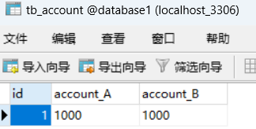

```java
package com.eagles.demo;

import com.eagles.utils.JDBCUtils;
import com.eagles.utils.JDBCUtils;

import java.sql.Connection;
import java.sql.PreparedStatement;
import java.sql.ResultSet;
import java.sql.SQLException;

public class JDBCTest08 {

    public static void main(String[] args) {

        Connection connection = null;

        PreparedStatement preparedStatement = null;

        ResultSet resultSet = null;

        try {
            //获取数据库连接对象
            connection = JDBCUtils.getConnection();

            //获取数据库操作对象并且预编译sql
            preparedStatement = connection.prepareStatement("update tb_account set account_A = account_A - ? where id = ?");

            //给占位符赋值
            preparedStatement.setDouble(1,500);
            preparedStatement.setInt(2,1);

            //执行sql语句
            int executeUpdate = preparedStatement.executeUpdate();

            System.out.println(executeUpdate == 1 ? "A账户扣钱成功":"A账户扣钱失败");

            

            //b账户加钱
            preparedStatement = connection.prepareStatement("update tb_account set account_B = account_B + ? where id = ?");

            //给占位符赋值
            preparedStatement.setDouble(1,500);
            preparedStatement.setInt(2,1);

            //执行sql语句
            executeUpdate = preparedStatement.executeUpdate();

            System.out.println(executeUpdate == 1 ? "转账成功" : "转账失败");

        } catch (SQLException e) {
            throw new RuntimeException(e);

        }finally {

            JDBCUtils.close(null,preparedStatement,connection);
        }
    }
}
```

##### 如果没有线程没有出现问题，将会是：

```java
A账户扣钱成功
转账成功
```

【分别为：int executeUpdate = preparedStatement.executeUpdate();

executeUpdate = preparedStatement.executeUpdate();

//变量接收，重新赋值 inr executeupdate 与ececuteupdate】

prepareStatement这个接口流程是先进行预编译，在执行sql语句之后，

全过程没有出现问题，将会自动提交数据，数据库的信息会随之进行改变

但是这样会遇到一个问题就是当数据编译进行过程中在任务与任务之间有错误的话，将会出现第一个程序正常运行，紧接着报错导致第二个任务无法正常运行，会出现以下这种情况：

```plain
package com.eagles.demo;

import com.eagles.utils.JDBCUtils;

import java.sql.Connection;
import java.sql.PreparedStatement;
import java.sql.ResultSet;
import java.sql.SQLException;

public class JDBCTest07 {

    public static void main(String[] args) {

        Connection connection = null;

        PreparedStatement preparedStatement = null;

        ResultSet resultSet = null;

        try {
            //获取数据库连接对象
            connection = JDBCUtils.getConnection();

          

            //获取数据库操作对象并且预编译sql
            preparedStatement = connection.prepareStatement("update tb_account set account_A = account_A - ? where id = ?");

            //给占位符赋值
            preparedStatement.setDouble(1,500);
            preparedStatement.setInt(2,1);

            //执行sql语句
            int executeUpdate = preparedStatement.executeUpdate();

            System.out.println(executeUpdate == 1 ? "A账户扣钱成功":"A账户扣钱失败");

            int i = 1 / 0;

            //b账户加钱
            preparedStatement = connection.prepareStatement("update tb_account set account_B = account_B + ? where id = ?");

            //给占位符赋值
            preparedStatement.setDouble(1,500);
            preparedStatement.setInt(2,1);

            //执行sql语句
            executeUpdate = preparedStatement.executeUpdate();

            System.out.println(executeUpdate == 1 ? "转账成功" : "转账失败");

            

        } catch (SQLException e) {

            //事务回滚
            try {
            connection.rollback();
            } catch (SQLException ex) {
                throw new RuntimeException(ex);
            }
            throw new RuntimeException(e);

        }finally {

            JDBCUtils.close(null,preparedStatement,connection);
        }
    }
}
```

##### 如果出错将会出现（ *int i = 1 / 0;*）：

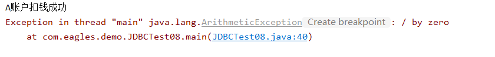

##### 这个时候报错，且数据库信息会随之改变，也就是账户A扣钱，但是账户B不会执行

###### 所以这个时候我们把自动提交给关掉，改为手动提交，并且再添加一个回滚使得数据遇到错误时就会跳转到程序最初阶段

```java
（开头）
//将jdbc自动提交事务换成手动提交
connection.setAutoCommit(false); //将自动提交（setAutoCommit）关闭，改为手动提交

（中间）
执行的任务。。。

（最后，catch语句块之前）
 //提交事务
 connection.commit();
```

###### 修改的最终代码：

```java
package com.eagles.demo;

import com.eagles.jdbc.utils.JDBCUtils;

import java.sql.Connection;
import java.sql.PreparedStatement;
import java.sql.ResultSet;
import java.sql.SQLException;

public class JDBCTest08 {

    public static void main(String[] args) {

        Connection connection = null;

        PreparedStatement preparedStatement = null;

        ResultSet resultSet = null;

        try {
            //获取数据库连接对象
            connection = JDBCUtils.getConnection();

            //将jdbc自动提交事务换成手动提交
            connection.setAutoCommit(false); //将自动提交关闭，改为手动提交

            //获取数据库操作对象并且预编译sql
            preparedStatement = connection.prepareStatement("update tb_account set account_A = account_A - ? where id = ?");

            //给占位符赋值
            preparedStatement.setDouble(1,500);
            preparedStatement.setInt(2,1);

            //执行sql语句
            int executeUpdate = preparedStatement.executeUpdate();

            System.out.println(executeUpdate == 1 ? "A账户扣钱成功":"A账户扣钱失败");

            int i = 1 / 0;

            //b账户加钱
            preparedStatement = connection.prepareStatement("update tb_account set account_B = account_B + ? where id = ?");

            //给占位符赋值
            preparedStatement.setDouble(1,500);
            preparedStatement.setInt(2,1);

            //执行sql语句
            executeUpdate = preparedStatement.executeUpdate();

            System.out.println(executeUpdate == 1 ? "转账成功" : "转账失败");

            //提交事务
            connection.commit();

        } catch (SQLException e) {

            //事务回滚
            try {
                connection.rollback();
            } catch (SQLException ex) {
                throw new RuntimeException(ex);
            }
            throw new RuntimeException(e);

        }finally {

            JDBCUtils.close(null,preparedStatement,connection);
        }
    }
}
```

##### 这样只要前面一出现问题，直接就会进入catch语句块里面，进行回滚的操作，数据并没有执行完所以不会进行提交，数据库的信息不会进行改变

### 

### 案例3:

创建学生表(student)班级表(class)

完成简易版的学生管理系统

- 1、定义方法:查询学生信息，以及每个学生对应的班级信息
- 2、定义方法:根据id删除学生记录
- 3、定义方法:根据传入的条件修改学生信息
- 4、定义方法:根据id查询具体的学生信息
- 5、定义方法:根据学生姓名模糊查询学生信息(需要查询班级信息)
- 6、定义方法:查询年龄在20~25岁的学生信息

###### 创建学生表：

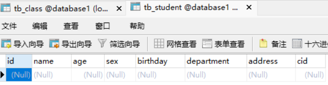

###### 导入数据：

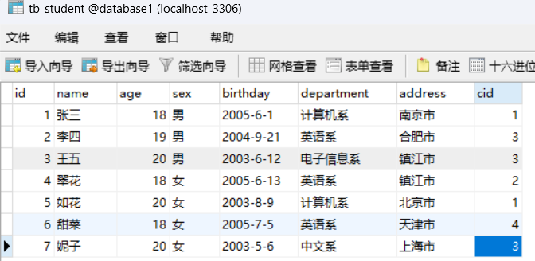

###### 创建班级表：

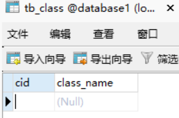

###### 导入数据：

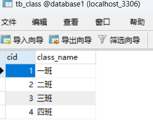

###### 在java里写一个Student类，用于接收数据库读到的信息：

```java
package com.eagles.pojo;

public class Student {
    private  Integer id;
    private  String name;
    private  Integer age;
    private  String sex;
    private  String birthday;
    private  String address;
    private  String department;
    private int cid;
    private Clazz clazz;
    //有参
    public Student(Integer id, String name, Integer age, String sex, String birthday, String address, String department, int cid, Clazz clazz) {
        this.id = id;
        this.name = name;
        this.age = age;
        this.sex = sex;
        this.birthday = birthday;
        this.address = address;
        this.department = department;
        this.cid = cid;
        this.clazz = clazz;
    }
    //无参
    public Student() {

    }
    //get set
    public Integer getId() {
        return id;
    }

    public void setId(Integer id) {
        this.id = id;
    }

    public String getName() {
        return name;
    }

    public void setName(String name) {
        this.name = name;
    }

    public Integer getAge() {
        return this.age;
    }

    public void setAge(Integer age) {
        this.age = age;
    }

    public String getSex() {
        return this.sex;
    }

    public void setSex(String sex) {
        this.sex = sex;
    }

    public String getBirthday() {
        return birthday;
    }

    public void setBirthday(String birthday) {
        this.birthday = birthday;
    }

    public String getAddress() {
        return getAddress();
    }

    public void setAddress(String address) {
        this.address = address;
    }

    public String getDepartment() {
        return department;
    }

    public void setDepartment(String department) {
        this.department = department;
    }

    public int getCid() {
        return cid;
    }

    public void setCid(int cid) {
        this.cid = cid;
    }

    public Clazz getClazz() {
        return clazz;
    }

    public void setClazz(Clazz clazz) {
        this.clazz = clazz;
    }
    //toString
    @Override
    public String toString() {
        return "Student{" +
        "id=" + id +
        ", name='" + name + '\'' +
        ", age=" + age +
        ", sex='" + sex + '\'' +
        ", birthday='" + birthday + '\'' +
        ", adderss='" + address + '\'' +
        ", department='" + department + '\'' +
        ", cid=" + cid +
        ", clazz=" + clazz +
        '}';
    }

}
```

###### 在java里写一个Clazz类（与java中的关键字Class重复了，所以换了一个名字），用于接收数据库读到的信息：

```java
package com.eagles.pojo;

public class Clazz {
    private Integer cid;
    private String className;

    public Clazz() {
        this.cid = cid;
        this.className = className;
    }

    @Override
    public String toString() {
        return "Clazz{" +
        "cid=" + cid +
        ", className='" + className + '\'' +
        '}';
    }

    public Integer getCid() {
        return cid;
    }

    public void setCid(Integer cid) {
        this.cid = cid;
    }

    public String getClassName() {
        return className;
    }

    public void setClassName(String className) {
        this.className = className;
    }
}
```

##### 方法：

```java
package com.eagles.manager;

import com.eagles.pojo.Clazz;
import com.eagles.pojo.Student;
import com.eagles.utils.JDBCUtils;

import java.sql.Connection;
import java.sql.PreparedStatement;
import java.sql.ResultSet;
import java.sql.SQLException;
import java.util.List;

public class StudentManager {
    private List<Student> studentList;
    private Connection connection;
    private ResultSet resultSet;
    private PreparedStatement preparedStatement;

    public List<Student> getStudentList() {
        return studentList;
    }

    public void setStudentList(List<Student> studentList) {
        this.studentList = studentList;
    }

    public StudentManager(List<Student> studentList) {
        this.studentList = studentList;
    }

    //1.查询学生信息，以及每个学生对应的班级信息
    public void FindStudentAndClass(){
        try {
            //获取数据库连接对象
            connection = JDBCUtils.getConnection();
            //sql语句
            String sql ="select ts.*,tc.class_name from tb_student ts inner join tb_class tc on ts.cid=tc.cid";
            //获取数据库操作对象并预编译
            preparedStatement= connection.prepareStatement(sql);
            //查询 ==> 结果集
            resultSet = preparedStatement.executeQuery();
            //这个是结果集首先得不是空，紧接着是去取值，.next()将游标移动到下一行。初始时，游标位于第一行之前。
            // 有数据返回true并进入循环体，对读取到的数据进行获取，没有数据返回false，
            //直到数据取完返回值为false，则跳出
            while (resultSet!=null&&resultSet.next()){
                int id = resultSet.getInt("id");
                String name = resultSet.getString("name");
                int age = resultSet.getInt("age");
                String sex = resultSet.getString("sex");
                String birthday = resultSet.getString("birthday");
                String department = resultSet.getString("department");
                String address = resultSet.getString("address");
                int cid = resultSet.getInt("cid");
                String className = resultSet.getString("class_name");
                //上面读取到的数据不仅包含student表（学生表）里面的所有数据，还有Clazz表（班级表）里面的数据，所以都给读取出来[括号里面是表的列名]

                //现在new一个student的实例，通过set方法将读取到的数据全部填入Student里面，给里面的每个属性赋值
                Student student = new Student();
                student.setId(id);
                student.setName(name);
                student.getAge();
                student.getSex();
                student.setBirthday(birthday);
                student.setDepartment(department);
                student.setAddress(address);
                student.setCid(cid);

                //new一个Clazz的实例，对其属性进行赋值
                Clazz clazz = new Clazz();
                clazz.setCid(cid);
                clazz.setClassName(className);

                //俩表结合成一个表,并导入创建好的studentList集合里面
                student.setClazz(clazz);//将clazz的数据传入给student
                studentList.add(student);//添加到集合中

            }

        } catch (SQLException e) {
            throw new RuntimeException(e);
        }finally {
            JDBCUtils.close(resultSet,preparedStatement,connection);
        }
    }

    
    //2.根据 id 删除学生记录
    public  void deleteStudentById(int id){
        //传参的含义是通过id进行删除

        try {
            //注册驱动
            connection = JDBCUtils.getConnection();
            //获取数据库连接对象
            preparedStatement = connection.prepareStatement("delete from tb_student where id =?");
            preparedStatement.setInt(1,id);//给预编译的 SQL 语句中的第一个占位符（?）设置一个整数类型的值,通常为变量。
            //精确查询
            int num = preparedStatement.executeUpdate();//表示受影响的数据库记录数

        } catch (SQLException e) {
            throw new RuntimeException(e);
        }finally {
            JDBCUtils.close(resultSet,preparedStatement,connection);
        }

    }

    //3.根据传入的条件修改学生信息
    public void updateStudentById(Student student){

        try {
            //注册驱动
            connection = JDBCUtils.getConnection();
            //获取数据库连接对象
            preparedStatement = connection.prepareStatement("update  tb_student set name=?,age=?,sex=?,birthday=?,department=?,address=?,cid=?where id=?");
            //将student里面的信息又读回数据库
            preparedStatement.setString(1,student.getName());
            preparedStatement.setInt(2,student.getAge());
            this.preparedStatement.setString(3, student.getSex());
            this.preparedStatement.setString(4, student.getBirthday());
            this.preparedStatement.setString(5, student.getDepartment());
            this.preparedStatement.setString(6, student.getAddress());
            this.preparedStatement.setInt(7, student.getCid());
            this.preparedStatement.setInt(8, student.getId());
            int num = this.preparedStatement.executeUpdate();
            System.out.println(num == 1 ? "修改成功" : "修改失败");
        } catch (SQLException e) {
            throw new RuntimeException(e);
        }finally {
            //回收资源
            JDBCUtils.close(resultSet,preparedStatement,connection);
        }
    }
    
    
    // 4. 根据 id 查询学生信息
    public Student getStudentById(int id) throws SQLException {
        String sql = "SELECT s.*, c.className FROM student s LEFT JOIN class c ON s.cid = c.cid WHERE s.id = ?";
        try (PreparedStatement ps = connection.prepareStatement(sql)) {
            ps.setInt(1, id);
            ResultSet rs = ps.executeQuery();

            if (rs.next()) {
                Clazz clazz = new Clazz();
                clazz.setCid(rs.getInt("cid"));
                clazz.setClassName(rs.getString("className"));

                Student student = new Student();
                student.setId(rs.getInt("id"));
                student.setName(rs.getString("name"));
                student.setAge(rs.getObject("age", Integer.class));
                student.setSex(rs.getString("sex"));
                student.setBirthday(rs.getString("birthday"));
                student.setAddress(rs.getString("address"));
                student.setDepartment(rs.getString("department"));
                student.setCid(rs.getInt("cid"));
                student.setClazz(clazz);

                return student;
            }
        }
        return null;
    }

    // 5. 模糊查询学生信息（含班级）
    public List<Student> searchStudentsByName(String keyword) throws SQLException {
        List<Student> students = new ArrayList<>();
        String sql = "SELECT s.*, c.className FROM student s LEFT JOIN class c ON s.cid = c.cid WHERE s.name LIKE ?";

        try (PreparedStatement ps = connection.prepareStatement(sql)) {
            ps.setString(1, "%" + keyword + "%");
            ResultSet rs = ps.executeQuery();

            while (rs.next()) {
                Clazz clazz = new Clazz();
                clazz.setCid(rs.getInt("cid"));
                clazz.setClassName(rs.getString("className"));

                Student student = new Student();
                student.setId(rs.getInt("id"));
                student.setName(rs.getString("name"));
                student.setAge(rs.getObject("age", Integer.class));
                student.setSex(rs.getString("sex"));
                student.setBirthday(rs.getString("birthday"));
                student.setAddress(rs.getString("address"));
                student.setDepartment(rs.getString("department"));
                student.setCid(rs.getInt("cid"));
                student.setClazz(clazz);

                students.add(student);
            }
        }
        return students;
    }

    // 6. 查询年龄在 20~25 岁之间的学生
    public List<Student> getStudentsByAgeRange(int minAge, int maxAge) throws SQLException {
        List<Student> students = new ArrayList<>();
        String sql = "SELECT s.*, c.className FROM student s LEFT JOIN class c ON s.cid = c.cid WHERE s.age BETWEEN ? AND ?";

        try (PreparedStatement ps = connection.prepareStatement(sql)) {
            ps.setInt(1, minAge);
            ps.setInt(2, maxAge);
            ResultSet rs = ps.executeQuery();

            while (rs.next()) {
                Clazz clazz = new Clazz();
                clazz.setCid(rs.getInt("cid"));
                clazz.setClassName(rs.getString("className"));

                Student student = new Student();
                student.setId(rs.getInt("id"));
                student.setName(rs.getString("name"));
                student.setAge(rs.getObject("age", Integer.class));
                student.setSex(rs.getString("sex"));
                student.setBirthday(rs.getString("birthday"));
                student.setAddress(rs.getString("address"));
                student.setDepartment(rs.getString("department"));
                student.setCid(rs.getInt("cid"));
                student.setClazz(clazz);

                students.add(student);
            }
        }
        return students;
    }
}
```

##### 测试第一点：

```java
package com.eagles.manager;

import com.eagles.pojo.Student;

import java.sql.Connection;
import java.util.List;

public class StudentJDBCTest {
    public static void main(String[] args) {
        try (Connection conn = com.eagles.util.DBUtil.getConnection()) {
            StudentManager manager = new StudentManager(conn);

            // 1. 查询所有学生及其班级信息
            System.out.println("【1】所有学生信息：");
            List<Student> allStudents = manager.getAllStudentsWithClass();
            for (Student s : allStudents) {
                System.out.println(s);
            }
            } catch (Exception e) {
            e.printStackTrace();
        }
    }
}
```

```java
【1】所有学生信息：
Student{id=1, name='张三', age=18, sex='男', birthday='2005', adderss='南京市', department='计算机系', cid=1, clazz=Clazz{cid=1, className='一班'}}
Student{id=2, name='李四', age=19, sex='男', birthday='2004', adderss='合肥市', department='英语系', cid=3, clazz=Clazz{cid=3, className='三班'}}
Student{id=3, name='王五', age=20, sex='男', birthday='2003', adderss='镇江市', department='电子信息系', cid=3, clazz=Clazz{cid=3, className='三班'}}
Student{id=4, name='翠花', age=18, sex='女', birthday='2005', adderss='镇江市', department='英语系', cid=2, clazz=Clazz{cid=2, className='二班'}}
Student{id=5, name='如花', age=20, sex='女', birthday='2003', adderss='北京市', department='计算机系', cid=1, clazz=Clazz{cid=1, className='一班'}}
Student{id=6, name='甜菜', age=18, sex='女', birthday='2005', adderss='天津市', department='英语系', cid=4, clazz=Clazz{cid=4, className='四班'}}
Student{id=7, name='妮子', age=20, sex='女', birthday='2003', adderss='上海市', department='中文系', cid=3, clazz=Clazz{cid=3, className='三班'}}
```

##### 测试第二点：

```java
package com.eagles.manager;

import com.eagles.pojo.Student;

import java.sql.Connection;
import java.util.List;

public class StudentJDBCTest {
    public static void main(String[] args) {
        try (Connection conn = com.eagles.util.DBUtil.getConnection()) {
            StudentManager manager = new StudentManager(conn);
            // 2.根据 id 删除学生记录
            System.out.println("【删除前】所有学生信息："); // 输出当前所有学生信息
            List<Student> beforeDelete = manager.getAllStudentsWithClass();
            for (Student s : beforeDelete) {
                System.out.println(s);
            }

            // 删除 id=2 的学生
            int studentIdToDelete = 2;
            boolean isDeleted = manager.deleteStudentById(studentIdToDelete);

            if (isDeleted) {
                System.out.println("✅ 学生 id=" + studentIdToDelete + " 已成功删除！");
            } else {
                System.out.println("❌ 删除失败，可能没有该学生记录。");
            }

            // 再次查询所有学生信息，确认是否已删除
            System.out.println("\n【删除后】所有学生信息：");
            List<Student> afterDelete = manager.getAllStudentsWithClass();
            for (Student s : afterDelete) {
                System.out.println(s);
            }
            } catch (Exception e) {
            e.printStackTrace();
        }
    }
}
            
```

```java
【删除前】所有学生信息：
Student{id=1, name='张三', age=20, sex='男', birthday='2004-01-01', adderss='北京市朝阳区', department='中文系', cid=1, clazz=Clazz{cid=1, className='三年一班'}}
Student{id=2, name='李四', age=22, sex='男', birthday='2003-05-15', adderss='北京市海淀区', department='计算机系', cid=1, clazz=Clazz{cid=1, className='三年一班'}}

 学生 id=2 已成功删除！

【删除后】所有学生信息：
Student{id=1, name='张三', age=20, sex='男', birthday='2004-01-01', adderss='北京市朝阳区', department='中文系', cid=1, clazz=Clazz{cid=1, className='三年一班'}}
```

##### 测试第三点：

```java
package com.eagles.manager;

import com.eagles.pojo.Student;

import java.util.ArrayList;
import java.util.Iterator;
import java.util.List;

public class StudentJDBCTest {
    public static void main(String[] args) {
        //要调用里面的方法所以创建一个实例
        StudentManager studentManager = new StudentManager(new ArrayList<>());
        //因为studentmanager类创了一个List集合所以这个得传一个集合对象
        StudentJDBCTest studentJDBCTest = new StudentJDBCTest();
        System.out.println("---------------------------打印学生信息----------------------------------");
        //因为Studentmanager里面是用prepareStatement写的，数据是最后才提交的所以打一遍studentJDBCTest.printStudent(studentManager)在这里没用
        System.out.println("---------------------------根据id修改学生记录---------------------------");
        Student student = new Student();
        student.setId(1);
        student.setName("张伟");
        student.setAge(27);
        student.setSex("女");
        student.setBirthday("1998");
        student.setDepartment("中文系");
        student.setAddress("北京市朝阳区");
        student.setCid(1);
        studentManager.updateStudentById(student);//调用studentManager的方法,将改好的信息放进studentManager
        System.out.println("---------------------------根据传入的条件修改学生信息---------------------------");
        studentJDBCTest.printStudent(studentManager);//调用方法＋传参

    }
    public  void printStudent(StudentManager studentManager){
        //前面在StudentManager已经创建了一个集合拿来放数据，所以后续修改和导出都会用到这个

        //调用方法
        studentManager.FindStudentAndClass();
        //获取集合
        List<Student> studentList = studentManager.getStudentList();
        //遍历集合
        Iterator<Student> iterator = studentList.iterator();
        //循环  取值
        while (iterator.hasNext()){
            Student next = iterator.next();
            System.out.println(next);
        }

    }
}
```

```java
【3】
----------------------------打印学生信息----------------------------------
因为Studentmanager里面是用prepareStatement写的，数据是最后才提交的所以打一遍studentJDBCTest.printStudent(studentManager)在这里没用
---------------------------根据id修改学生记录---------------------------
修改成功
---------------------------根据传入的条件修改学生信息---------------------------
Student{id=1, name='张伟', age=null, sex='null', birthday='1998', adderss='北京市朝阳区', department='中文系', cid=1, clazz=Clazz{cid=1, className='一班'}}
Student{id=2, name='李四', age=null, sex='null', birthday='2004', adderss='合肥市', department='英语系', cid=3, clazz=Clazz{cid=3, className='三班'}}
Student{id=3, name='王五', age=null, sex='null', birthday='2003', adderss='镇江市', department='电子信息系', cid=3, clazz=Clazz{cid=3, className='三班'}}
Student{id=4, name='翠花', age=null, sex='null', birthday='2005', adderss='镇江市', department='英语系', cid=2, clazz=Clazz{cid=2, className='二班'}}
Student{id=5, name='如花', age=null, sex='null', birthday='2003', adderss='北京市', department='计算机系', cid=1, clazz=Clazz{cid=1, className='一班'}}
Student{id=6, name='甜菜', age=null, sex='null', birthday='2005', adderss='天津市', department='英语系', cid=4, clazz=Clazz{cid=4, className='四班'}}
Student{id=7, name='妮子', age=null, sex='null', birthday='2003', adderss='上海市', department='中文系', cid=3, clazz=Clazz{cid=3, className='三班'}}
```

##### 测试第四点：

```java
package com.eagles.manager;

import com.eagles.pojo.Student;

import java.sql.Connection;
import java.util.List;

public class StudentJDBCTest {
    public static void main(String[] args) {
        try (Connection conn = com.eagles.util.DBUtil.getConnection()) {
            StudentManager manager = new StudentManager(conn);
            // 4. 根据 id 查询学生
            System.out.println("\n【4】查询 id=2 学生信息：");
            Student student = manager.getStudentById(2);
            System.out.println(student);
             } catch (Exception e) {
            e.printStackTrace();
        }
    }
}
```

```java
【4】查询 id=4 学生信息：
Student{id=4, name='翠花', age=18, sex='女', birthday='2005', adderss='镇江市', department='英语系', cid=2, clazz=Clazz{cid=2, className='二班'}}
```

##### 测试第五点：

```java
package com.eagles.manager;

import com.eagles.pojo.Student;

import java.sql.Connection;
import java.util.List;

public class StudentJDBCTest {
    public static void main(String[] args) {
        try (Connection conn = com.eagles.util.DBUtil.getConnection()) {
            StudentManager manager = new StudentManager(conn);
            // 5. 模糊查询
            System.out.println("\n【5】模糊查询姓名中包含 '张' 的学生：");
            List<Student> result = manager.searchStudentsByName("张");
            for (Student s : result) {
                System.out.println(s);
            }
         } catch (Exception e) {
            e.printStackTrace();
        }
    }
}
```

```java
【5】模糊查询姓名中包含 '花' 的学生：
Student{id=5, name='如花', age=20, sex='女', birthday='2003', adderss='北京市', department='计算机系', cid=1, clazz=Clazz{cid=1, className='一班'}}
```

##### 测试第六点：

```java
package com.eagles.manager;

import com.eagles.pojo.Student;

import java.sql.Connection;
import java.util.List;

public class StudentJDBCTest {
    public static void main(String[] args) {
        try (Connection conn = com.eagles.util.DBUtil.getConnection()) {
            StudentManager manager = new StudentManager(conn);
            // 6. 查询年龄范围
            System.out.println("\n【6】查询年龄在 20~25 岁之间的学生：");
            List<Student> ageList = manager.getStudentsByAgeRange(20, 25);
            for (Student s : ageList) {
                System.out.println(s);
            }
             } catch (Exception e) {
            e.printStackTrace();
        }
    }
}
```

```java
【6】查询年龄在 20~25 岁之间的学生：
Student{id=3, name='王五', age=20, sex='男', birthday='2003', adderss='镇江市', department='电子信息系', cid=3, clazz=Clazz{cid=3, className='三班'}}
Student{id=5, name='如花', age=20, sex='女', birthday='2003', adderss='北京市', department='计算机系', cid=1, clazz=Clazz{cid=1, className='一班'}}
Student{id=7, name='妮子', age=20, sex='女', birthday='2003', adderss='上海市', department='中文系', cid=3, clazz=Clazz{cid=3, className='三班'}}
```

##### 总的：

```java
package com.eagles.manager;

import com.eagles.pojo.Student;

import java.sql.Connection;
import java.util.List;

public class StudentJDBCTest {
    public static void main(String[] args) {
        try (Connection conn = com.eagles.util.DBUtil.getConnection()) {
            StudentManager manager = new StudentManager(conn);

            // 1. 查询所有学生及其班级信息
            System.out.println("【1】所有学生信息：");
            List<Student> allStudents = manager.getAllStudentsWithClass();
            for (Student s : allStudents) {
                System.out.println(s);
            }
            // 2.根据 id 删除学生记录
            System.out.println("【删除前】所有学生信息："); // 输出当前所有学生信息
            List<Student> beforeDelete = manager.getAllStudentsWithClass();
            for (Student s : beforeDelete) {
                System.out.println(s);
            }

            // 删除 id=2 的学生
            int studentIdToDelete = 2;
            boolean isDeleted = manager.deleteStudentById(studentIdToDelete);

            if (isDeleted) {
                System.out.println("✅ 学生 id=" + studentIdToDelete + " 已成功删除！");
            } else {
                System.out.println("❌ 删除失败，可能没有该学生记录。");
            }

            // 再次查询所有学生信息，确认是否已删除
            System.out.println("\n【删除后】所有学生信息：");
            List<Student> afterDelete = manager.getAllStudentsWithClass();
            for (Student s : afterDelete) {
                System.out.println(s);
            }
            
            // 4. 根据 id 查询学生
            System.out.println("\n【4】查询 id=2 学生信息：");
            Student student = manager.getStudentById(2);
            System.out.println(student);

            // 5. 模糊查询
            System.out.println("\n【5】模糊查询姓名中包含 '张' 的学生：");
            List<Student> result = manager.searchStudentsByName("张");
            for (Student s : result) {
                System.out.println(s);
            }

            // 6. 查询年龄范围
            System.out.println("\n【6】查询年龄在 20~25 岁之间的学生：");
            List<Student> ageList = manager.getStudentsByAgeRange(20, 25);
            for (Student s : ageList) {
                System.out.println(s);
            }

        } catch (Exception e) {
            e.printStackTrace();
        }
    }
}
```
