|  |  |  |
| --- | --- | --- |
| **名称** | **解释** | **命令** |
| DDL |  |  |
| DML |  |  |
| DQL |  |  |
| DCL |  |  |

## 1、表结构描述
表名称：dept

描述：部门信息表

|  |  |  |
| --- | --- | --- |
| 英文字段名称 | 中文描述 | 类型 |
| DEPTNO(id) | 部门编号 | INT(2)(括号里面数字表示给他的字节长度) |
| DNAME | 部门名称 | VARCHAR(14) |
| LOC | 位置 | VARCHAR(13) |

表名称：emp

描述：员工信息表

|  |  |  |
| --- | --- | --- |
| 英文字段名称 | 中文描述 | 类型 |
| EMPNO(id) | 员工编号 | INT (4) |
| ENAME | 员工姓名 | VARCHAR(10) |
| JOB | 工作岗位 | VARCHAR(9) |
| MGR | 上级领导 | INT (4) |
| HIREDATE | 入职日期 | DATE |
| SAL | 薪水 | DOUBLE(7,2) |
| COMM | 津贴 | DOUBLE (7,2) |
| DEPTNO | 部门编号 | INT(2) |

注：DEPTNO字段是外键，DEPTNO的值来源于dept表的主键，起到了约束的作用

表名称：salgrade

描述：薪水等级信息表

|  |  |  |
| --- | --- | --- |
| 英文字段名称 | 中文描述 | 类型 |
| GRADE | 等级 | INT |
| LOSAL | 最低薪水 | INT |
| HISAL | 最高薪水 | INT |

## 2****、常用命令
### 2.1****、查看****msyql****版本
• MySQL程序选项具有以下两种通用形式：

– 长选项，由单词之前加两个减号组成

– 短选项，由单个字母之前加一个减号组成

C:\Users\Administrator>mysql --version

mysql Ver 14.14 Distrib 5.5.36, for Win32 (x86)

C:\Users\Administrator>mysql -V

mysql Ver 14.14 Distrib 5.5.36, for Win32 (x86)

### 2.2****、创建数据库
1. create database 数据库名称;

create database testdatabase;

2. use 数据库名称

use testdatabase;

在数据库中建立表，因此创建表的时候必须要先选择数据库。

### 2.3****、查询当前使用的数据库
select database();

查询数据库版本也可以使用

select  version();

### 2.4****、终止一条语句
如果想要终止一条正在编写的语句，可键入\c。

### 2.5****、退出****mysql
可使用\q、QUIT或EXIT：

如：

mysql> \q (ctrl+c)

### 3.6****、查看表的结构
desc <table name>;

如：

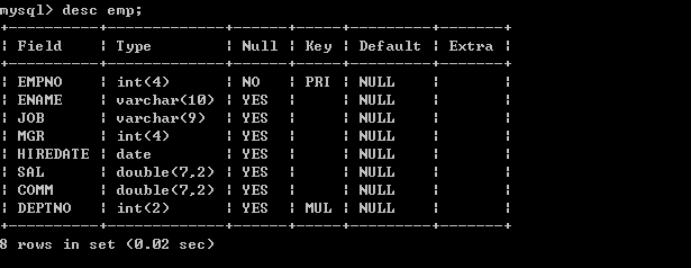

### 3.7****、查看表的创建语句
show create table <table name>;

如：

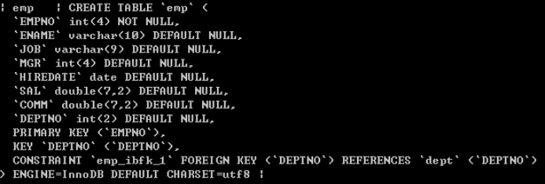

## 4****、简单的查询
### 4.1****、查询一个字段
l 查询员工姓名

|  |
| --- |
| select ename from emp; |
|  |

Select语句后面跟的是字段名称，select是关键字，select和字段名称之间采用空格隔开，from表示将要查询的表，它和字段之间采用空格隔开

### 4.2****、查询多个字段
l 查询员工的编号和姓名

|  |
| --- |
| select empno, ename from emp; |

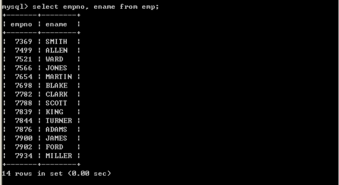

查询多个字段，select中的字段采用逗号间隔即可。

### 4.3****、查询全部字段
可以将所有的字段放到select语句的后面，这种方案不方便，但是比较清楚，我们可以采用如下便捷的方式查询全部字段

|  |
| --- |
| select \* from emp; |

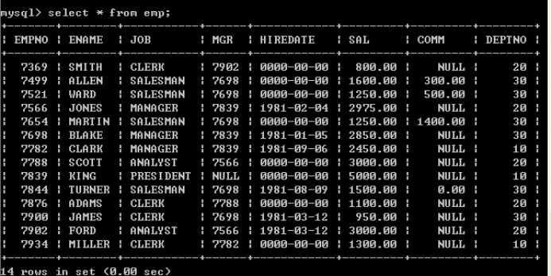

采用select \* from emp，虽然简单，但是\*号不是很明确，建议查询全部字段将相关字段写到select语句的后面,在以后java连接数据库的时候,是需要在java程序中编写SQL语句的,这个时候编写的SQL语句不建议使用select \* 这种形式,建议写明字段,这样可读性强.

### 4.4****、计算员工的年薪
l 列出员工的编号，姓名和年薪

|  |
| --- |
| select empno, ename, sal\*12 from emp; |

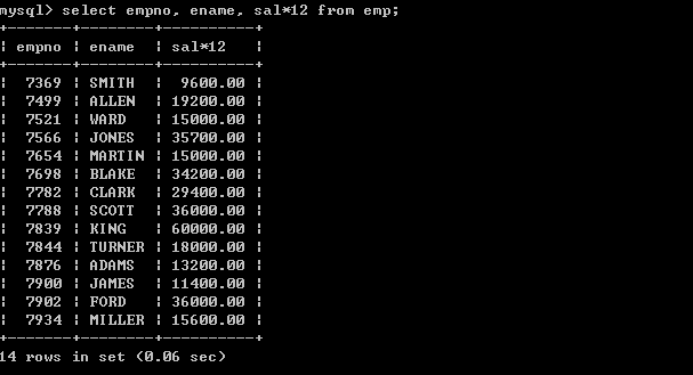

在select语句中可以使用运算符，以上存在一些问题，年薪的字段名称不太明确

### 4.5****、将查询出来的字段显示为中文
|  |
| --- |
| select empno as ‘员工编号’, ename as ‘员工姓名’, sal\*12 as ‘年薪’ from emp;  注意:字符串必须添加单引号 | 双引号 |

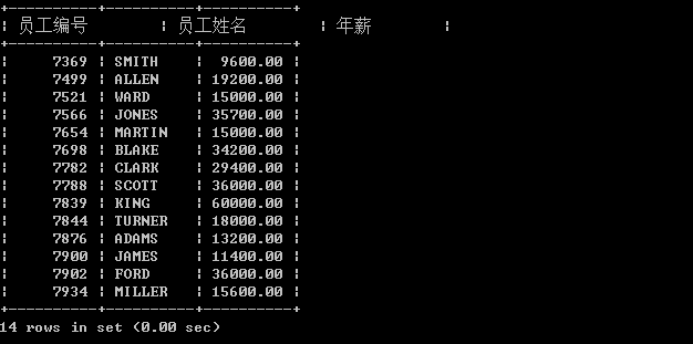

可以采用as关键字重命名表字段，其实as也可以省略，如：

|  |
| --- |
| select empno  "员工编号", ename  "员工姓名", sal\*12  "年薪" from emp; |

## 5****、条件查询
条件查询需要用到where语句，where必须放到from语句表的后面

支持如下运算符

|  |  |
| --- | --- |
| 运算符 | 说明 |
| = | 等于 |
| <>或!= | 不等于 |
| < | 小于 |
| <= | 小于等于 |
| > | 大于 |
| >= | 大于等于 |
| between … and …. | 两个值之间,**等同于****>= and <=** |
| is null | 为null（is not null 不为空） |
| **and** | 并且 |
| **or** | 或者 |
| in | 包含，相当于多个or（not in不在这个范围中） |
| not | not可以取非，主要用在is 或in中 |
| like | like称为模糊查询，支持%或下划线匹配  %匹配任意个字符  下划线，一个下划线只匹配一个字符 |

### 5.1****、等号操作符
l 查询薪水为5000的员工

|  |
| --- |
| select empno, ename, sal from emp where sal=5000; |

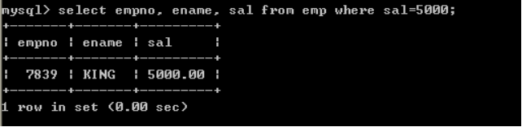

l 查询job为MANAGER的员工

|  |
| --- |
| select empno, ename from emp where job=manager; |

以上查询出现错误，因为job为字符串，所以出现了以上错误

|  |
| --- |
| select empno, ename from emp where job="manager"; |

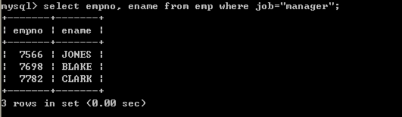

|  |
| --- |
| select empno, ename from emp where job=’manager’; |

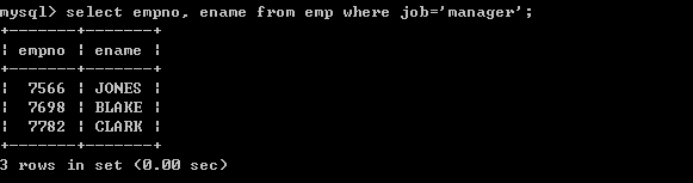

也可以使用单引号

|  |
| --- |
| select empno, ename from emp where job='MANAGER'; |

以上输出正确，Mysql默认情况下大小写是不敏感的。

注意：

MySQL在windows下是不区分大小写的，将script文件导入MySQL后表名也会自动转化为小写，结果再 想要将数据库导出放到linux服务器中使用时就出错了。因为在linux下表名区分大小写而找不到表，查了很多都是说在linux下更改MySQL的设置使其也不区分大小写，但是有没有办法反过来让windows 下大小写敏感呢。其实方法是一样的，相应的更改windows中MySQL的设置就行了。

具体操作：

在MySQL的配置文件my.ini中增加一行：

lower\_case\_table\_names = 0

其中 0：区分大小写，1：不区分大小写

MySQL在Linux下数据库名、表名、列名、别名大小写规则是这样的：

1、数据库名与表名是严格区分大小写的；

2、表的别名是严格区分大小写的；

3、列名与列的别名在所有的情况下均是忽略大小写的；

4、变量名也是严格区分大小写的； MySQL在Windows下都不区分大小写

### 5.2****、****<>****操作符
l 查询薪水不等于5000的员工

|  |
| --- |
| select empno, ename, sal from emp where sal <> 5000; |

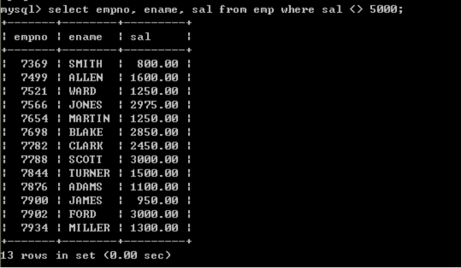

一下写法等同于以上写法，建议使用第一种写法

|  |
| --- |
| select empno, ename, sal from emp where sal != 5000; |

数值也可以采用单引号引起来，如一下语句是正确的

|  |
| --- |
| select empno, ename, sal from emp where sal <> '5000'; |

l 查询工作岗位不等于MANAGER的员工

|  |
| --- |
| select empno, ename from emp where job <> 'MANAGER'; |

### 5.3****、****between** **…****and** **…****操作符
l 查询薪水为1600到3000的员工(第一种方式，采用>=和<=)

|  |
| --- |
| select empno, ename, sal from emp where sal >= 1600 and sal <= 3000; |

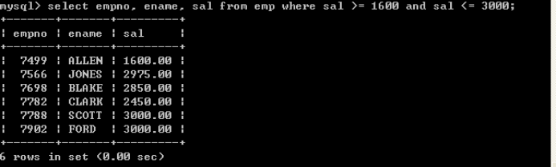

l 查询薪水为1600到3000的员工(第一种方式，采用between … and …)

|  |
| --- |
| select empno, ename, sal from emp where sal between 1600 and 3000; |

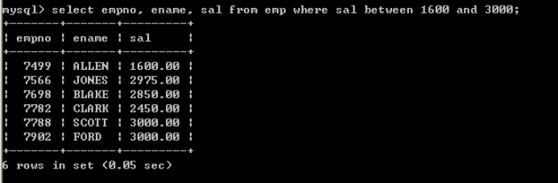

关于between … and …，它是包含最大值和最小值的

### 5.4****、****is null
l Null为空，但不是空串，为null可以设置这个字段不填值，如果查询为null的字段，采用is null

l 查询津贴为空的员工

|  |
| --- |
| select \* from emp where comm=null; |

以上也无法查询出符合条件的数据，因为null类型比较特殊，必须使用 is来比较

|  |
| --- |
| select \* from emp where comm is null; |

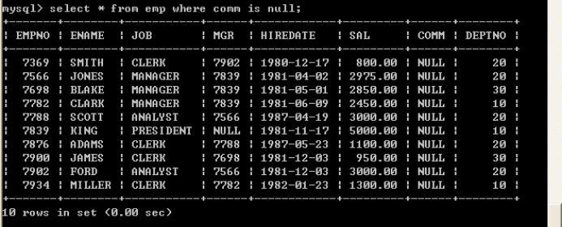

以上查询正确

### 5.5****、** **and
and表示并且的含义，表示所有的条件必须满足

l 工作岗位为MANAGER,薪水大于2500的员工

|  |
| --- |
| select \* from emp where job='MANAGER' and sal > 2500; |

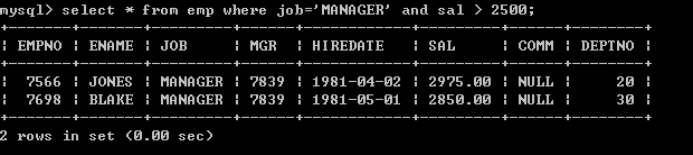

### 5.6****、****or
or，只要满足条件即可,相当于包含

l 查询出job为manager或者job为salesman的员工

|  |
| --- |
| select \* from emp where job='MANAGER' or job='SALESMAN'; |

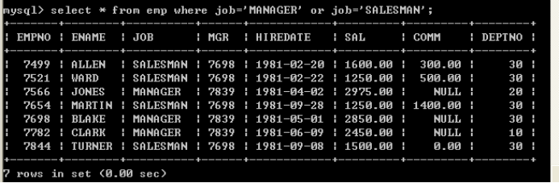

### 5.7****、表达式的优先级
l 查询薪水大于1800，并且部门代码为20或30的员工（错误的写法）

|  |
| --- |
| select \* from emp where sal > 1800 and deptno = 20 or deptno = 30; |

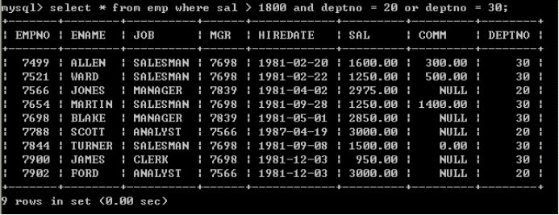

以上输出不是预期结果，薪水小于1800的数据也被查询上来了，原因是表达式的优先级导致的，首先过滤sal > 1800 and deptno = 20，然后再将deptno = 30员工合并过来，所以是不对的

l 查询薪水大于1800，并且部门代码为20或30的（正确的写法）

|  |
| --- |
| select \* from emp where sal > 1800 and (deptno = 20 or deptno = 30); |

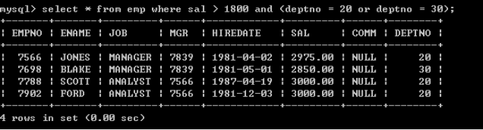

关于运算符的问题：不用记，没有把握尽量采用括号

### 5.8****、****in
in表示包含的意思，完全可以采用or来表示，采用in会更简洁一些

l 查询出job为manager或者job为salesman的员工

|  |
| --- |
| select \* from emp where job in ('manager','salesman'); |

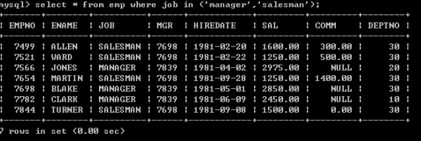

l 查询出薪水包含1600和薪水包含3000的员工

|  |
| --- |
| select \* from emp where sal in(1600, 3000); |

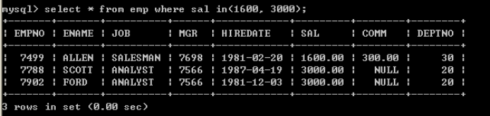

### 5.9****、****not
l 查询出薪水不包含1600和薪水不包含3000的员工（第一种写法）

|  |
| --- |
| select \* from emp where sal <> 1600 and sal <> 3000; |

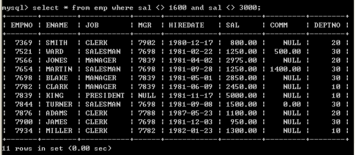

l 查询出薪水不包含1600和薪水不包含3000的员工（第二种写法

|  |
| --- |
| select \* from emp where not (sal = 1600 or sal = 3000); |

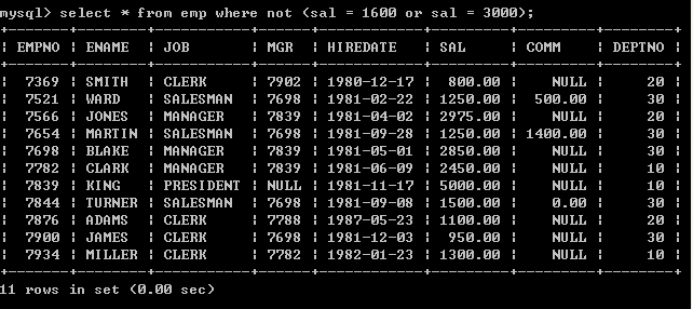

l 查询出薪水不包含1600和薪水不包含3000的员工（第三种写法）

|  |
| --- |
| select \* from emp where sal not in (1600, 3000); |

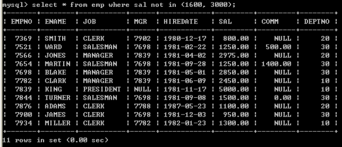

l 查询出津贴不为null的所有员工

|  |
| --- |
| select \* from emp where comm is not null; |

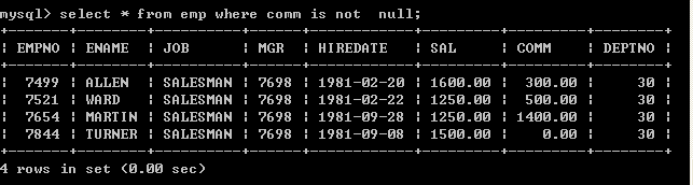

### 5.10****、****like
l Like可以实现模糊查询，like支持%和下划线匹配

l 查询姓名以M开头所有的员工

|  |
| --- |
| select \* from emp where ename like 'M%'; |

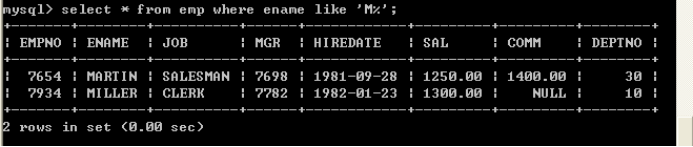

l 查询姓名以N结尾的所有的员工

|  |
| --- |
| select \* from emp where ename like '%N'; |

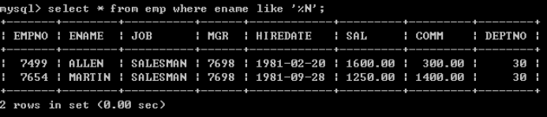

l 查询姓名中包含O的所有的员工

|  |
| --- |
| select \* from emp where ename like '%O%'; |

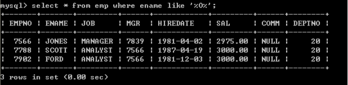

l 查询姓名中第二个字符为A的所有员工

|  |
| --- |
| select \* from emp where ename like '\_A%'; |

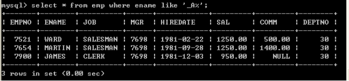

Like中%和下划线的差别？

%匹配任意字符出现的个数

下划线只匹配一个字符

Like 中的表达式必须放到单引号中|双引号中，以下写法是错误的：

|  |
| --- |
| select \* from emp where ename like \_A% |

## 6****、排序数据
### 6.1****、单一字段排序
排序采用order by子句，order by后面跟上排序字段，排序字段可以放多个，多个采用逗号间隔，order by默认采用升序，如果存在where子句那么order by必须放到where语句的后面

l 按照薪水由小到大排序(系统默认由小到大)

|  |
| --- |
| select \* from emp order by sal; |

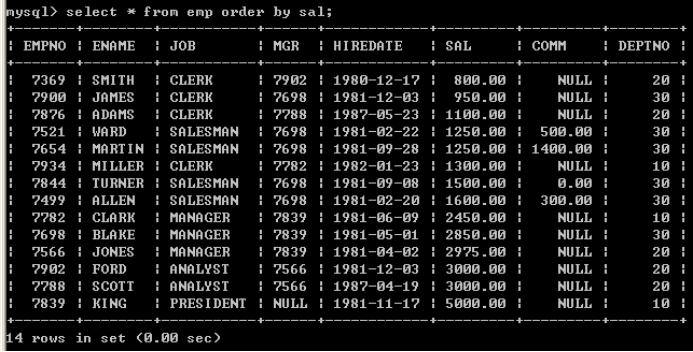

l 取得job为MANAGER的员工，按照薪水由小到大排序(系统默认由小到大)

|  |
| --- |
| select \* from emp where job='MANAGER' order by sal; |

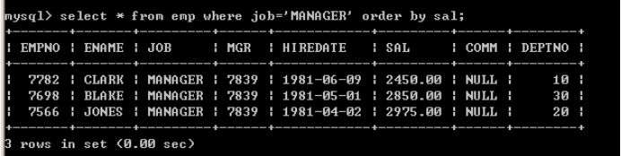

如果包含where语句order by必须放到where后面，如果没有where语句order by放到表的后面

以下写法是错误的：

|  |
| --- |
| select \* from emp order by sal where job='MANAGER'; |

l 按照多个字段排序，如：首先按照job排序，再按照sal排序

|  |
| --- |
| select \* from emp order by job,sal; |

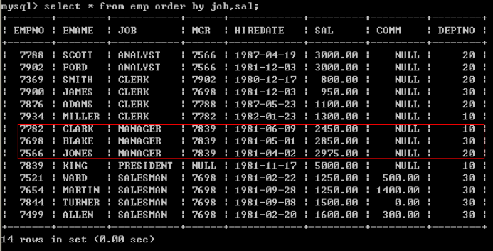

### 6.2****、手动指定排序顺序
l 手动指定按照薪水由小到大排序(默认情况)

|  |
| --- |
| select \* from emp order by sal asc; |

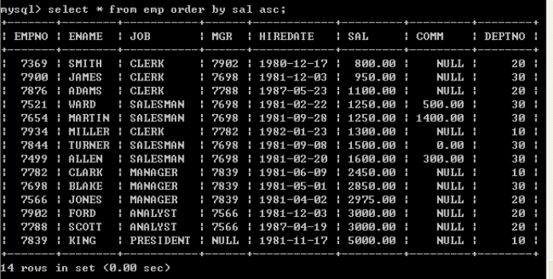

l 手动指定按照薪水由大到小排序

|  |
| --- |
| select \* from emp order by sal desc; |

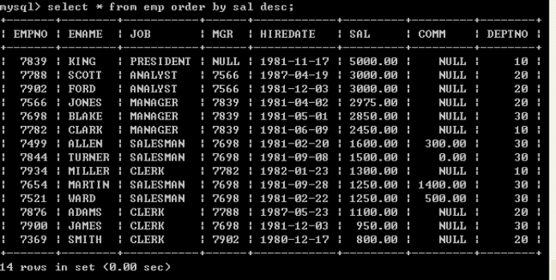

### 6.3****、多个字段排序
l 按照job和薪水倒序

|  |
| --- |
| select \* from emp order by job desc, sal desc; |

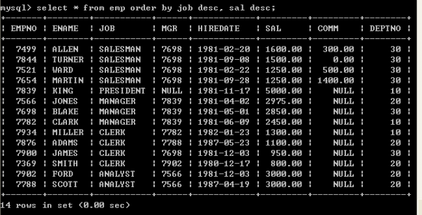

如果采用多个字段排序，如果根据第一个字段排序重复了，会根据第二个字段排序

### 6.4****、使用字段的位置来排序
l 按照薪水升序

|  |
| --- |
| select \* from emp order by 6; |

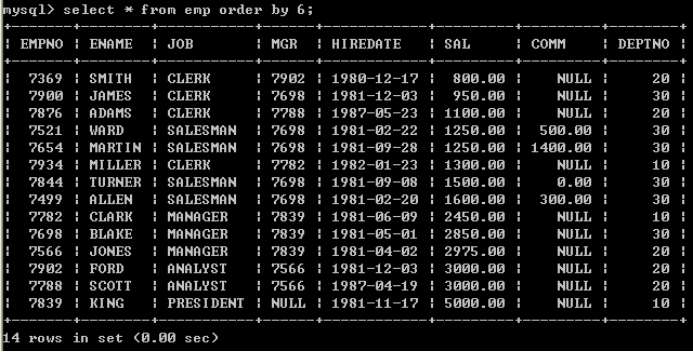

不建议使用此种方式，采用数字含义不明确，程序不健壮

## 7****、分组函数****/****聚合函数****/****多行处理函数
|  |  |
| --- | --- |
| count | 取得记录数 |
| sum | 求和 |
| avg | 取平均 |
| max | 取最大的数 |
| min | 取最小的数 |

**注意：分组函数自动忽略空值，不需要手动的加****where****条件排除空值。**

**select count(\*) from emp****where xxx****;****符合条件的所有记录总数。**

**select count(comm) from emp;****comm****这个字段中不为空的元素总数。**

注意：分组函数不能直接使用在where关键字后面。

mysql> select ename,sal from emp where sal > avg(sal);

ERROR 1111 (HY000): Invalid use of group function

### 7.1****、****count
l 取得所有的员工数

|  |
| --- |
| select count(\*) from emp; |

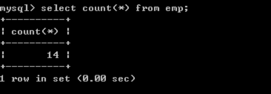

Count(\*)表示取得所有记录，忽略null，为null的值也会取得

l 取得津贴不为null员工数

|  |
| --- |
| select count(comm) from emp; |

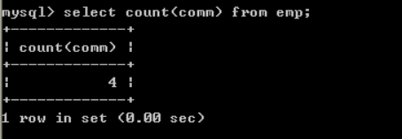

采用count(字段名称)，不会取得为null的记录

l 取得工作岗位的个数

|  |
| --- |
| select count(distinct job ) from emp; |

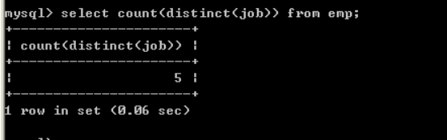

### 7.2****、****sum
l Sum可以取得某一个列的和，null会被忽略

l 取得薪水的合计

|  |
| --- |
| select sum(sal) from emp; |

l 取得津贴的合计

|  |
| --- |
| select sum(comm) from emp; |

null会被忽略

l 取得薪水的合计（sal+comm）

|  |
| --- |
| select sum(sal+comm) from emp; |

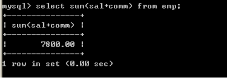

从以上结果来看，不正确，原因在于comm字段有null值，所以无法计算，sum会忽略掉，正确的做法是将comm字段转换成0

|  |
| --- |
| select sum(sal+IFNULL(comm, 0)) from emp; |

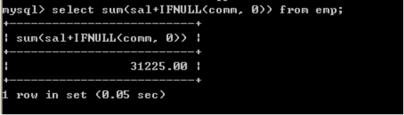

### 7.3****、****avg
取得某一列的平均值

l 取得平均薪水

|  |
| --- |
| select avg(sal) from emp; |

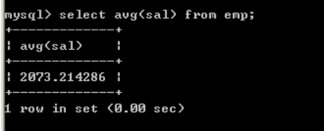

### 7.4****、****max
取得某个一列的最大值

l 取得最高薪水

|  |
| --- |
| select max(sal) from emp; |

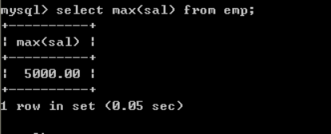

l 取得最晚入职得员工

|  |
| --- |
| select max(str\_to\_date (hiredate, '%Y-%m-%d')) from emp; |

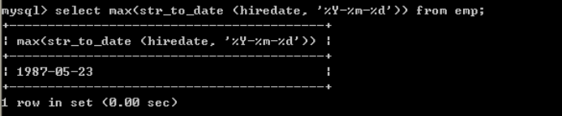

### 7.5****、****min
取得某个一列的最小值

l 取得最低薪水

|  |
| --- |
| select min(sal) from emp; |

l 取得最早入职得员工（可以不使用str\_to\_date转换）

|  |
| --- |
| select min(str\_to\_date(hiredate, '%Y-%m-%d')) from emp; |

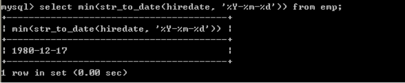

### 7.6****、组合聚合函数
可以将这些聚合函数都放到select中一起使用

|  |
| --- |
| select count(\*),sum(sal),avg(sal),max(sal),min(sal) from emp; |

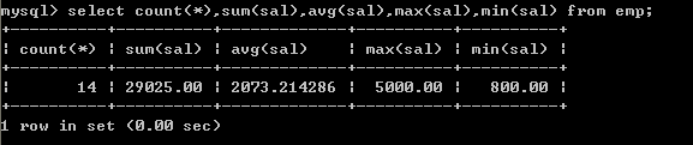

## 8****、分组查询
分组查询主要涉及到两个子句，分别是：group by和having

### 8.1****、****group by
l 取得每个工作岗位的工资合计，要求显示岗位名称和工资合计

|  |
| --- |
| select job, sum(sal) from emp group by job; |

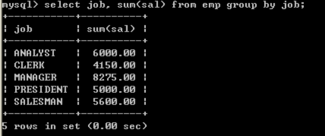

如果使用了order by，order by必须放到group by后面

l 按照工作岗位和部门编码分组，取得的工资合计(**题目表意不明)**

n 原始数据

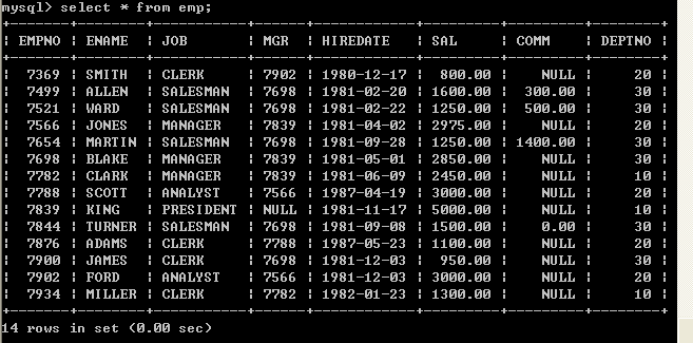

n 分组语句

|  |
| --- |
| select job,deptno,sum(sal) from emp group by job,deptno; |

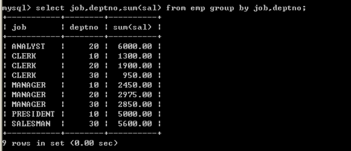

mysql> select empno,deptno,avg(sal) from emp group by deptno;

+-------+--------+-------------+

| empno | deptno | avg(sal) |

+-------+--------+-------------+

| 7782 | 10 | 2916.666667 |

| 7369 | 20 | 2175.000000 |

| 7499 | 30 | 1566.666667 |

+-------+--------+-------------+

以上SQL语句在Oracle数据库中无法执行，执行报错。

以上SQL语句在Mysql数据库中可以执行，但是执行结果矛盾。

在SQL语句中若有group by 语句，那么在select语句后面只能跟**分组函数****+****参与分组的字段**。

### 8.2****、****having
如果想对分组数据再进行过滤需要使用having子句

取得每个岗位的平均工资大于2000

|  |
| --- |
| select job, avg(sal) from emp group by job having avg(sal) >2000; |

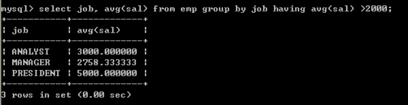

分组函数的执行顺序：

根据条件查询数据

分组

采用having过滤，取得正确的数据

### 8.3****、****select****语句总结
一个完整的select语句格式如下

|  |
| --- |
| select 字段  from 表名  where …….  group by ……..  having …….(就是为了过滤分组后的数据而存在的—不可以单独的出现)  order by …….. |

以上语句的执行顺序

1. 首先执行where语句过滤原始数据

2. 执行group by进行分组

3. 执行having对分组数据进行操作

4. 执行select选出数据

5. 执行order by排序

原则：能在where中过滤的数据，尽量在where中过滤，效率较高。having的过滤是专门对分组之后的数据进行过滤的。

## 9****、连接查询
### 9.1****、****SQL92****语法
连接查询：也可以叫跨表查询，需要关联多个表进行查询

l 显示每个员工信息，并显示所属的部门名称

|  |
| --- |
| select ename, dname from emp, dept; |
| SQL> select ename, dname from emp, dept;    ENAME  DNAME  ---------- --------------  SMITH  ACCOUNTING  ALLEN  ACCOUNTING  WARD  ACCOUNTING  JONES  ACCOUNTING  MARTIN  ACCOUNTING  BLAKE  ACCOUNTING  CLARK  ACCOUNTING  SCOTT  ACCOUNTING  KING  ACCOUNTING  TURNER  ACCOUNTING  ADAMS  ACCOUNTING  JAMES  ACCOUNTING  FORD  ACCOUNTING  MILLER  ACCOUNTING  SMITH  RESEARCH  ALLEN  RESEARCH  WARD  RESEARCH  JONES  RESEARCH  MARTIN  RESEARCH  BLAKE  RESEARCH  CLARK  RESEARCH  SCOTT  RESEARCH  KING  RESEARCH  TURNER  RESEARCH  ADAMS  RESEARCH  JAMES  RESEARCH  FORD  RESEARCH  MILLER  RESEARCH  SMITH  SALES  ALLEN  SALES  WARD  SALES  JONES  SALES  MARTIN  SALES  BLAKE  SALES  CLARK  SALES  SCOTT  SALES  KING  SALES  TURNER  SALES  ADAMS  SALES  JAMES  SALES  FORD  SALES  MILLER  SALES  SMITH  OPERATIONS  ALLEN  OPERATIONS  WARD  OPERATIONS  JONES  OPERATIONS  MARTIN  OPERATIONS  BLAKE  OPERATIONS  CLARK  OPERATIONS  SCOTT  OPERATIONS  KING  OPERATIONS  TURNER  OPERATIONS  ADAMS  OPERATIONS  JAMES  OPERATIONS  FORD  OPERATIONS  MILLER  OPERATIONS    已选择56行。 |

以上输出，不正确，输出了56条数据，其实就是两个表记录的成绩，这种情况我们称为：“笛卡儿乘积”，出现错误的原因是：没有指定连接条件

指定连接条件

|  |
| --- |
| select emp.ename, dept.dname from emp, dept where emp.deptno=dept.deptno;  也可以使用别名  select e.ename , d.dname from emp e, dept d where e.deptno=d.deptno; |

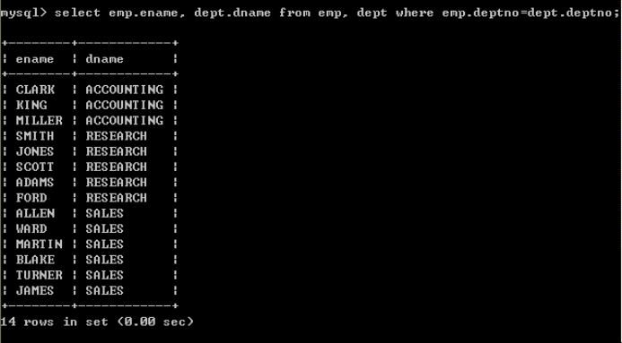

以上结果输出正确，因为加入了正确的连接条件

以上查询也称为“内连接”，只查询相等的数据（连接条件相等的数据）

l 取得员工和所属的领导的姓名

|  |
| --- |
| select e.ename '员工姓名', m.ename '领导' from emp e, emp m where e.mgr=m.empno; |
| SQL> select \* from emp;（普通员工）    EMPNO ENAME  JOB  MGR HIREDATE  SAL  COMM  DEPTNO  ---------- ---------- --------- ---------- -------------- ---------- ---------- ----------  7369 SMITH  CLERK  7902 17-12月-80  800  20  7499 ALLEN  SALESMAN  7698 20-2月 -81  1600  300  30  7521 WARD  SALESMAN  7698 22-2月 -81  1250  500  30  7566 JONES  MANAGER  7839 02-4月 -81  2975  20  7654 MARTIN  SALESMAN  7698 28-9月 -81  1250  1400  30  7698 BLAKE  MANAGER  7839 01-5月 -81  2850  30  7782 CLARK  MANAGER  7839 09-6月 -81  2450  10  7788 SCOTT  ANALYST  7566 19-4月 -87  3000  20  7839 KING  PRESIDENT  17-11月-81  5000  10  7844 TURNER  SALESMAN  7698 08-9月 -81  1500  0  30  7876 ADAMS  CLERK  7788 23-5月 -87  1100  20  7900 JAMES  CLERK  7698 03-12月-81  950  30  7902 FORD  ANALYST  7566 03-12月-81  3000  20  7934 MILLER  CLERK  7782 23-1月 -82  1300  10    已选择14行。    SQL> select \* from emp;（管理者）    EMPNO ENAME  JOB  MGR HIREDATE  SAL  COMM  DEPTNO  ---------- ---------- --------- ---------- -------------- ---------- ---------- ----------  7369 SMITH  CLERK  7902 17-12月-80  800  20  7499 ALLEN  SALESMAN  7698 20-2月 -81  1600  300  30  7521 WARD  SALESMAN  7698 22-2月 -81  1250  500  30  7566 JONES  MANAGER  7839 02-4月 -81  2975  20  7654 MARTIN  SALESMAN  7698 28-9月 -81  1250  1400  30  7698 BLAKE  MANAGER  7839 01-5月 -81  2850  30  7782 CLARK  MANAGER  7839 09-6月 -81  2450  10  7788 SCOTT  ANALYST  7566 19-4月 -87  3000  20  7839 KING  PRESIDENT  17-11月-81  5000  10  7844 TURNER  SALESMAN  7698 08-9月 -81  1500  0  30  7876 ADAMS  CLERK  7788 23-5月 -87  1100  20  7900 JAMES  CLERK  7698 03-12月-81  950  30  7902 FORD  ANALYST  7566 03-12月-81  3000  20  7934 MILLER  CLERK  7782 23-1月 -82  1300  10    已选择14行。    SQL> select e.ename, m.ename from emp e, emp m where e.mgr=m.empno;    ENAME  ENAME  ---------- ----------  SMITH  FORD  ALLEN  BLAKE  WARD  BLAKE  JONES  KING  MARTIN  BLAKE  BLAKE  KING  CLARK  KING  SCOTT  JONES  TURNER  BLAKE  ADAMS  SCOTT  JAMES  BLAKE  FORD  JONES  MILLER  CLARK    已选择13行。 |

以上称为“自连接”，只有一张表连接，具体的查询方法，把一张表看作两张表即可，如以上示例：第一个表emp e代码了员工表，emp m代表了领导表，相当于员工表和部门表一样

### 9.2****、****SQL99****语法
l （内连接）显示薪水大于2000的员工信息，并显示所属的部门名称

|  |
| --- |
| 采用SQL92语法：  select e.ename '员工信息' , e.sal '薪水' , d.dname '部门名称' from emp e, dept d where e.deptno=d.deptno and e.sal > 2000;  采用SQL99语法：  select e.ename '员工信息' , e.sal '薪水', d.dname '部门名称' from emp e join dept d on e.deptno=d.deptno where e.sal>2000;  或  select e.ename '员工信息', e.sal '薪水', d.dname '部门名称' from emp e inner join dept d on e.deptno=d.deptno where e.sal>2000;  在实际中一般不加inner关键字（inner可省） |

Sql92语法和sql99语法的区别：99语法可以做到表的连接和查询条件分离，特别是多个表进行连接的时候，会比sql92更清晰

l （外连接）显示员工信息，并显示所属的部门名称，如果某一个部门没有员工，那么该部门也必须显示出来

|  |
| --- |
| 右连接：  select e.ename, e.sal, d.dname from emp e right join dept d on e.deptno=d.deptno;  左连接：  select e.ename, e.sal, d.dname from dept d left join emp e on e.deptno=d.deptno;  以上两个查询效果相同 |

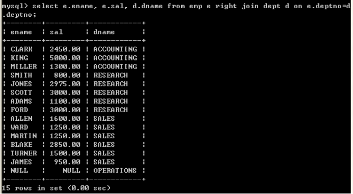

连接分类：

内链接

\* 表1 inner join 表2 on 关联条件

\* 做连接查询的时候一定要写上关联条件

\* inner 可以省略

外连接

\*左外连接

\* 表1 left outer join 表2 on 关联条件

\* 做连接查询的时候一定要写上关联条件

\* outer 可以省略\*右外连接

\* 表1 right outer join 表2 on 关联条件

\* 做连接查询的时候一定要写上关联条件

\* outer 可以省略

\*左外连接（左连接）和右外连接（右连接）的区别：

\*左连接以左面的表为准和右边的表比较，和左表相等的不相等都会显示出来，右表符合条件的显示,不符合条件的不显示

\*右连接恰恰相反，以上左连接和右连接也可以加入outer关键字，但一般不建议这种写法，如：

|  |
| --- |
| select e.ename, e.sal, d.dname from emp e right outer join dept d on e.deptno=d.deptno;  select e.ename, e.sal, d.dname from dept d left outer join emp e on e.deptno=d.deptno; |

左连接能完成的功能右连接一定可以完成

## 10****、子查询
子查询就是嵌套的select语句，可以理解为子查询是一张表

### 10.1****、在****where****语句中使用子查询，也就是在****where****语句中加入****select****语句
l 查询员工信息，查询哪些人是管理者，要求显示出其员工编号和员工姓名

实现思路：

l 1、首先取得管理者的编号，去除重复的

|  |
| --- |
| select distinct mgr from emp where mgr is not null;    distinct 去除重复行 |

l 2、查询员工编号包含管理者编号的

|  |
| --- |
| select empno, ename from emp where empno in(select mgr from emp where mgr is not null); |

l 查询哪些人的薪水高于员工的平均薪水，需要显示员工编号，员工姓名，薪水

实现思路

1、 取得平均薪水

|  |
| --- |
| select avg(sal) from emp; |

2、 取得大于平均薪水的员工

|  |
| --- |
| select empno, ename, sal from emp where sal > (select avg(sal) from emp); |

### 10.2****、在****from****语句中使用子查询，可以将该子查询看做一张表
l 查询员工信息，查询哪些人是管理者，要求显示出其员工编号和员工姓名

首先取得管理者的编号，去除重复的

|  |
| --- |
| select distinct mgr from emp where mgr is not null; |

将以上查询作为一张表，放到from语句的后面

|  |
| --- |
| 使用92语法：  select e.empno, e.ename from emp e, (select distinct mgr from emp where mgr is not null) m where e.empno=m.mgr;  使用99语法：  select e.empno, e.ename from emp e join (select distinct mgr from emp where mgr is not null) m on e.empno=m.mgr; |

l 查询各个部门的平均薪水所属等级，需要显示部门编号，平均薪水，等级编号

实现思路

1、首先取得各个部门的平均薪水

|  |
| --- |
| select deptno, avg(sal) avg\_sal from emp group by deptno; |

2、将部门的平均薪水作为一张表与薪水等级表建立连接，取得等级

|  |
| --- |
| select deptno,avg(sal) avg\_sal from emp group by deptno; |
| select \* from salgrade; |
| select a.deptno,a.avg\_sal,g.grade from (select deptno,avg(sal) avg\_sal from emp group by deptno ) a join salgrade g on a.avg\_sal between g.losal and hisal; |

### 10.3****、在****select****语句中使用子查询
l 查询员工信息，并显示出员工所属的部门名称

第一种做法，将员工表和部门表连接

|  |
| --- |
| select e.ename, d.dname from emp e, dept d where e.deptno=d.deptno; |

第二种做法，在select语句中再次嵌套select语句完成部分名称的查询

|  |
| --- |
| select e.ename, (select d.dname from dept d where e.deptno=d.deptno) as dname from emp e; |

## 11、分页查询
### limit

|  |
| --- |
| -select \* from emp limit 起始索引位置，分页单位 //分页单位（多少条数据为一页）    -将前三个数据分一页  -select \* from emp limit 0,3;  -将前四五六数据分一页  -select \* from emp limit 3,3;  -将前七八九数据分一页  -select \* from emp limit 6,3;  -起始索引位置=（当前页-1）\*分页单位    -查询第六个到第十个员工的详细信息  -select \* from emp limit 5,5; |
