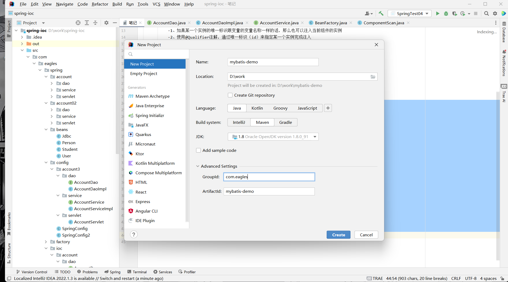
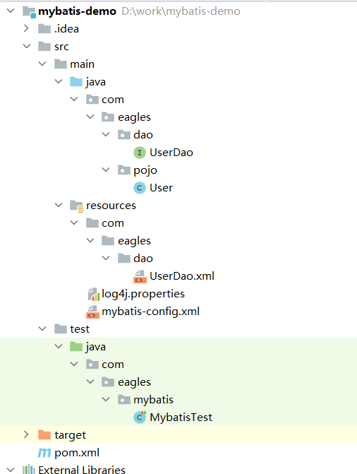
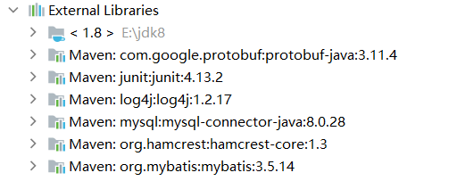
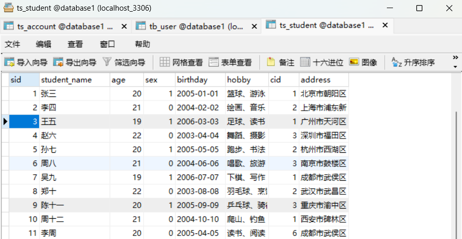
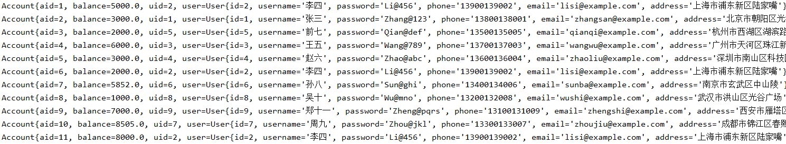

### 创建细节

在Maven项目中，`groupId`（组ID）和`artifactId`（构件ID）是用于唯一标识项目的两个关键属性。它们共同构成了项目的坐标，以便于依赖管理和项目定位。下面是对这两个概念的详细解释：

#### `groupId`（组ID）

- **定义**：`groupId`是一个字符串，通常用来代表创建该项目的组织或公司。它通常是组织的反向域名（例如，如果你的公司网站是`eagles.com`，那么`groupId`可能是`com.eagles`），这样可以确保在全球范围内的唯一性。
- **作用**：提供一个命名空间来避免不同组织之间的项目命名冲突。它有助于区分来自不同组织的相似项目。
- **格式**：一般遵循Java包名的命名规则，使用全小写，并且以点（`.`）分隔不同的层次结构。

#### `artifactId`（构件ID）

- **定义**：`artifactId`是项目名称，指的是实际生成的项目工件的名称。它通常反映了项目的名称或者核心功能，比如一个web应用可能命名为`my-web-app`。
- **作用**：与`groupId`一起，确定了Maven仓库中某个特定版本的唯一构件。换句话说，它帮助用户识别他们想要下载和使用的具体库或应用程序。
- **格式**：通常为小写字母，有时会包含连字符（`-`）来提高可读性，但不建议使用下划线或其他特殊字符。

#### 示例

假设你正在开发一个名为“AwesomeLibrary”的开源Java库，而你的组织域名为`awesome.org`，那么你可以这样设置：

```xml
<groupId>org.awesome</groupId>
<artifactId>awesomelibrary</artifactId>
```

在这个例子中，`org.awesome`作为`groupId`保证了全球范围内的唯一性，同时表明了这是一个由“awesome.org”组织发布的项目；而`awesomelibrary`作为`artifactId`则直接描述了这个项目的名称。

#### 总结

- `groupId`提供了项目的命名空间，通常基于组织的域名。
- `artifactId`则是项目本身的标识符，通常反映项目的名字或用途。
- 这两个属性结合在一起，加上版本号，形成了一个Maven坐标(`groupId:artifactId:version`)，可以唯一地确定Maven仓库中的任何一个构件。

### 核心关键词

#### SqlSessionFactory

`SqlSessionFactory` 是 MyBatis 的一个核心组件，它主要负责创建 `SqlSession` 实例。由于创建 `SqlSessionFactory` 的过程相对耗资源，因此在整个应用生命周期中通常只需要一个 `SqlSessionFactory` 实例。这也是为什么它通常被设计为单例模式的原因之一。

- **创建**：`SqlSessionFactory` 通常是通过 `SqlSessionFactoryBuilder` 类从 XML 配置文件或 Java 配置类构建出来的。
- **作用**：它是生成 `SqlSession` 实例的工厂。每次需要执行数据库操作时，都会通过 `SqlSessionFactory` 来获取一个新的 `SqlSession` 实例。

```java
String resource = "mybatis-config.xml";
InputStream inputStream = Resources.getResourceAsStream(resource);
SqlSessionFactory sqlSessionFactory = new SqlSessionFactoryBuilder().build(inputStream);
```

#### SqlSession

`SqlSession` 提供了直接执行已映射语句所需的所有方法。你可以通过它来执行命令、提交或回滚事务以及获取映射器实例等。

- **创建**：通过 `SqlSessionFactory` 开启一个 `SqlSession`，这通常意味着开始了一个新的数据库会话。
- **作用**：

- 执行 SQL 命令。
- 管理事务（如开启、提交和回滚）。
- 获取映射器（Mapper），这是一个面向接口编程的方式，能够让你以更优雅的方式执行 SQL 操作。

```java
try (SqlSession session = sqlSessionFactory.openSession()) {
    // 使用session进行数据库操作
    UserMapper mapper = session.getMapper(UserMapper.class);
    User user = mapper.selectUser(1);
}
```

#### openSession

用于**创建一个新的数据库会话（SqlSession）**，它是你与数据库进行交互的入口。

`openSession()` 有多个重载方法，控制 **事务行为** 和 **连接获取方式**。

##### 1. `openSession()` → 默认方式（推荐初学者使用）

```plain
SqlSession sqlSession = sqlSessionFactory.openSession();
```

|  |  |
| --- | --- |
| **特点** | **说明** |
| **不自动提交事务** | `autoCommit = false` |
| 手动控制事务 | 必须手动调用 `sqlSession.commit()`  或 `rollback()` |
| 适合多条 SQL 组成一个事务 | 比如转账：A 减钱 + B 加钱 |

##### 2. `openSession(true)` → 开启自动提交

```java
SqlSession sqlSession = sqlSessionFactory.openSession(true);
```

|  |  |
| --- | --- |
| **特点** | **说明** |
| **自动提交事务** | 每条 SQL 执行完后自动生效 |
| 不能回滚 | 一旦执行就无法撤销 |
| 适合只执行单条 SQL 的场景 | 比如只查一条数据、只插入一条日志 |

##### 3. `openSession(TransactionIsolationLevel level)`

→ 指定事务隔离级别

```java
SqlSession sqlSession = sqlSessionFactory.openSession(TransactionIsolationLevel.READ_COMMITTED);
```

可用于设置如：

- `READ_UNCOMMITTED`
- `READ_COMMITTED`（默认）
- `REPEATABLE_READ`
- `SERIALIZABLE`

##### 4. `openSession(ExecutorType executorType)`

→ 指定执行器类型

```java
SqlSession sqlSession = sqlSessionFactory.openSession(ExecutorType.BATCH);
```

|  |  |
| --- | --- |
| **执行器类型** | **用途** |
| `ExecutorType.SIMPLE` | 默认，普通执行 |
| `ExecutorType.REUSE` | 重用 PreparedStatement |
| `ExecutorType.BATCH` | 批量操作，提升插入/更新性能 |

##### Q1：openSession() 后必须 commit 吗？

- 是的！如果你没设置 `true`（自动提交），就必须 `commit()`，否则数据不会写入数据库！

##### Q2：每次操作都要 openSession 吗？

- 是的！`SqlSession` 不是线程安全的，每个业务逻辑应使用独立的 `SqlSession`。

##### Q3：openSession() 会创建新数据库连接吗？

- 通常会，但如果你用了连接池（如 Druid、HikariCP），它会从池中获取一个连接，效率更高。

#### 注意事项

1. **自动提交**：默认情况下，`SqlSession` 的 `autoCommit` 属性是关闭的，这意味着你需要手动调用 `commit()` 方法来保存你的更改，或者调用 `rollback()` 回滚事务。
2. **资源管理**：因为 `SqlSession` 维护着数据库连接，所以应该确保在完成操作后正确地关闭 `SqlSession`。推荐使用 try-with-resources 语法来自动管理资源。
3. **线程安全**：`SqlSessionFactory` 是线程安全的，可以被多个线程共享。但是，`SqlSession` 并不是线程安全的，每个线程都应该有自己的 `SqlSession` 实例。

#### 总结

- `SqlSessionFactory` 是用于创建 `SqlSession` 实例的工厂，一般整个应用程序只存在一个实例。
- `SqlSession` 则是实际执行 SQL 语句、管理事务的地方。每个业务逻辑处理单元（比如一次请求）都应该获得自己的 `SqlSession` 实例，并且在完成后关闭它。

### 企业中使用的包结构逻辑与顺序



### MyBatis是如何与数据库交互的

#### Userdao 持久层接口

```java
package com.eagles.dao;

import com.eagles.pojo.User;

import java.util.List;

public interface UserDao {

    /*
    查询所有的用户记录
     */
    List<User> findUsers();

}
```

#### User 实现类

```java
package com.eagles.pojo;

public class User {
    private int id;
    private  String username;
    private   String password;
    private   String phone;
    private  String email;

    public User() {
    }

    @Override
    public String toString() {
        return "User{" +
        "id=" + id +
        ", username='" + username + '\'' +
        ", password='" + password + '\'' +
        ", phone='" + phone + '\'' +
        ", email='" + email + '\'' +
        ", address='" + address + '\'' +
        '}';
    }

    public int getId() {
        return id;
    }

    public void setId(int id) {
        this.id = id;
    }

    public String getUsername() {
        return username;
    }

    public void setUsername(String username) {
        this.username = username;
    }

    public String getPassword() {
        return password;
    }

    public void setPassword(String password) {
        this.password = password;
    }

    public String getPhone() {
        return phone;
    }

    public void setPhone(String phone) {
        this.phone = phone;
    }

    public String getEmail() {
        return email;
    }

    public void setEmail(String email) {
        this.email = email;
    }

    public String getAddress() {
        return address;
    }

    public void setAddress(String address) {
        this.address = address;
    }

    public User(int id, String username, String password, String phone, String email, String address) {
        this.id = id;
        this.username = username;
        this.password = password;
        this.phone = phone;
        this.email = email;
        this.address = address;
    }

    private   String address;

}
```

#### UserDao.xml 映射文件

```xml
<?xml version="1.0" encoding="UTF-8" ?>
<!DOCTYPE mapper
PUBLIC "-//mybatis.org//DTD Mapper 3.0//EN"
"https://mybatis.org/dtd/mybatis-3-mapper.dtd">
<mapper namespace="com.eagles.dao.UserDao">

  <!--查询所有的用户记录-->
  <select id="findUsers" resultType="com.eagles.pojo.User">
    select * from tb_user
  </select>
</mapper>
```

#### MyBatisTest 里面的test 测试类

```java
package com.eagles.mybatis;

import com.eagles.dao.UserDao;
import com.eagles.pojo.User;
import org.apache.ibatis.io.Resources;
import org.apache.ibatis.session.SqlSession;
import org.apache.ibatis.session.SqlSessionFactory;
import org.apache.ibatis.session.SqlSessionFactoryBuilder;
import org.junit.Test;

import java.io.IOException;
import java.io.InputStream;
import java.util.List;

public class MybatisTest {

    InputStream resourceAsStream =null; //提出来写是因为这是一个流对象，后面需要对资源进行回收

    @Test
    public void test(){

        try {
            resourceAsStream = Resources.getResourceAsStream("mybatis-config.xml");

            //创建sqlSessionFactory工厂对象
            SqlSessionFactory sqlSessionFactory = new SqlSessionFactoryBuilder().build(resourceAsStream);

            //从sqlSessionFactory对象中创建sqlSession对象
            SqlSession sqlSession = sqlSessionFactory.openSession();

            //通过动态代理的方式来构建持久层接口所对应的实现类
            UserDao userDao = sqlSession.getMapper(UserDao.class);

            List<User> users = userDao.findUsers();

            for (User user : users) {
                System.out.println(user);
            }
        } catch (IOException e) {
            throw new RuntimeException(e);
        }finally {
            try {
                resourceAsStream.close();
            } catch (IOException e) {
                throw new RuntimeException(e);
            }
        }
    }
}
```

#### pom.xml 资源的导入

```xml
<?xml version="1.0" encoding="UTF-8"?>
<project xmlns="http://maven.apache.org/POM/4.0.0"
  xmlns:xsi="http://www.w3.org/2001/XMLSchema-instance"
  xsi:schemaLocation="http://maven.apache.org/POM/4.0.0 http://maven.apache.org/xsd/maven-4.0.0.xsd">
  <modelVersion>4.0.0</modelVersion>

  <groupId>com.eagles</groupId>
  <artifactId>mybatis-demo</artifactId>
  <version>1.0-SNAPSHOT</version>

  <properties>
    <maven.compiler.source>8</maven.compiler.source>
    <maven.compiler.target>8</maven.compiler.target>
  </properties>

  <dependencies>
    <!--导入mybatis的坐标-->
    <dependency>
      <groupId>org.mybatis</groupId>
      <artifactId>mybatis</artifactId>
      <version>3.5.14</version>
    </dependency>

    <!--导入mysql的驱动-->
    <dependency>
      <groupId>mysql</groupId>
      <artifactId>mysql-connector-java</artifactId>
      <version>8.0.28</version>
    </dependency>

    <!--导入junit相关的资源-->
    <dependency>
      <groupId>junit</groupId>
      <artifactId>junit</artifactId>
      <version>4.13.2</version>
      <scope>test</scope>
    </dependency>

    <!--日志相关的资源-->
    <dependency>
      <groupId>log4j</groupId>
      <artifactId>log4j</artifactId>
      <version>1.2.17</version>
    </dependency>
  </dependencies>

</project>
```



#### Maven 是怎么工作的？ pom.xml是**Maven 的核心工作机制**

```plain
你的 pom.xml
       ↓
   Maven 解析依赖
       ↓
   检查本地仓库有没有？
       ├── 有 → 直接使用
       └── 没有 → 去远程仓库下载（如 https://repo.maven.apache.org）
               ↓
         存入本地仓库
               ↓
         加入项目 classpath
               ↓
       你的代码就能用了！
```

##### 为了彻底理解UserDao接口的实现类干的事情，所以创建这个代理类理解（后文test02）

```java
package com.eagles.dao;

import com.eagles.pojo.User;
import org.apache.ibatis.session.SqlSession;

import java.util.List;

/**
 * 这里写了一个代理类，就是接口所对应的实例，实际开发过程中这个实例是又工厂创建的，不会真正的写出来，这个只是为了将一下他的原理和所做的事情
 * 回到之前代理模式，实现类和目标类实现共同的接口，重写里面的方法，完成代理，这个也是类似的意思，但是模拟的是由sqlSessionFactoty所创建出来
 * 的sqlSession所对应的情况
 */
public class UserDaoImpl implements UserDao {

    private SqlSession sqlSession;

    public UserDaoImpl(SqlSession sqlSession) {
        this.sqlSession = sqlSession;
    }

    @Override
    public List<User> findUsers() {
        //这里是UserDao.xml里面的namespace+id所构成的，目的是防止当其他配置文件如UserDao2.xml也存有findUsers这个id时会报错
        return sqlSession.selectList("com.eagles.dao.UserDao.findUsers");
    }
}
```

#### MyBatisTest 里面的test 测试类 此时已将前置代理和最终代理放在开头减少代码冗杂

```java
package com.eagles.mybatis;

import com.eagles.dao.UserDao;
import com.eagles.dao.UserDaoImpl;
import com.eagles.pojo.User;
import org.apache.ibatis.io.Resources;
import org.apache.ibatis.session.SqlSession;
import org.apache.ibatis.session.SqlSessionFactory;
import org.apache.ibatis.session.SqlSessionFactoryBuilder;
import org.junit.After;
import org.junit.Before;
import org.junit.Test;

import java.io.IOException;
import java.io.InputStream;
import java.lang.reflect.InvocationHandler;
import java.lang.reflect.Method;
import java.lang.reflect.Proxy;
import java.util.List;

public class MybatisTest {

    InputStream resourceAsStream =null; //提出来写是因为这是一个流对象，后面需要对资源进行回收
    SqlSession sqlSession =null; //同理
    @Before
    public void beforeMybatis(){
        try {
            Resources.getResourceAsStream("mybatis-config.xml");
        } catch (IOException e) {
            throw new RuntimeException(e);
        }
        //创建sqlSessionFactory工厂对象
        SqlSessionFactory sqlSessionFactory = new SqlSessionFactoryBuilder().build(resourceAsStream);

        //从sqlSessionFactory对象中创建sqlSession对象
        sqlSession = sqlSessionFactory.openSession();
    }

    @After
    public  void afterMybits(){

        if (resourceAsStream !=null){
            try {
                resourceAsStream.close();
            } catch (IOException e) {
                throw new RuntimeException(e);
            }
        }
        if (sqlSession !=null){
            sqlSession.close();
        }
    }

    @Test
    public void test01(){

        //通过动态代理的方式来构建持久层接口所对应的实现类
        UserDao userDao = sqlSession.getMapper(UserDao.class);

        List<User> users = userDao.findUsers();

        for (User user : users) {
            System.out.println(user);
        }
    }
    @Test
    public  void test02(){
        UserDaoImpl userDao = new UserDaoImpl(sqlSession);
        List<User> users = userDao.findUsers();

        for (User user : users) {
            System.out.println(user);

        }
    }
    @Test
    public void test03(){
        //UserDao userDao = sqlSession.getMapper(UserDao.class);
        UserDao userDao = (UserDao)getProxy();
        List<User> users = userDao.findUsers();

        for (User user : users) {
            System.out.println(user);
        }

    }

    public Object getProxy(){
        return Proxy.newProxyInstance(UserDao.class.getClassLoader(), new Class[]{UserDao.class}, new InvocationHandler() {
            @Override
            public Object invoke(Object proxy, Method method, Object[] args) throws Throwable {

                Object invoke = method.invoke(new UserDao() {
                    @Override
                    public List<User> findUsers() {
                        return sqlSession.selectList("com.eagles.dao.UserDao.findUsers");
                    }
                }, args);
                return invoke;
            }
        });
    }

}
```

##### test01/test02/test03运行结果均是如此，但是方法的书写有所不同

```plain
2025-08-10 15:48:55,783 DEBUG (org.apache.ibatis.logging.LogFactory:109) - Logging initialized using 'class org.apache.ibatis.logging.log4j.Log4jImpl' adapter.
2025-08-10 15:48:55,793 DEBUG (org.apache.ibatis.datasource.pooled.PooledDataSource:379) - PooledDataSource forcefully closed/removed all connections.
2025-08-10 15:48:55,793 DEBUG (org.apache.ibatis.datasource.pooled.PooledDataSource:379) - PooledDataSource forcefully closed/removed all connections.
2025-08-10 15:48:55,793 DEBUG (org.apache.ibatis.datasource.pooled.PooledDataSource:379) - PooledDataSource forcefully closed/removed all connections.
2025-08-10 15:48:55,793 DEBUG (org.apache.ibatis.datasource.pooled.PooledDataSource:379) - PooledDataSource forcefully closed/removed all connections.
2025-08-10 15:48:55,840 DEBUG (org.apache.ibatis.transaction.jdbc.JdbcTransaction:143) - Opening JDBC Connection
2025-08-10 15:48:55,945 DEBUG (org.apache.ibatis.datasource.pooled.PooledDataSource:454) - Created connection 1850180796.
2025-08-10 15:48:55,946 DEBUG (org.apache.ibatis.transaction.jdbc.JdbcTransaction:107) - Setting autocommit to false on JDBC Connection [com.mysql.cj.jdbc.ConnectionImpl@6e4784bc]
2025-08-10 15:48:55,948 DEBUG (com.eagles.dao.UserDao.findUsers:135) - ==>  Preparing: select * from tb_user
2025-08-10 15:48:55,972 DEBUG (com.eagles.dao.UserDao.findUsers:135) - ==> Parameters: 
2025-08-10 15:48:55,988 DEBUG (com.eagles.dao.UserDao.findUsers:135) - <==      Total: 10
User{id=1, username='张三', password='Zhang@123', phone='13800138001', email='zhangsan@example.com', address='北京市朝阳区光华路'}
User{id=2, username='李四', password='Li@456', phone='13900139002', email='lisi@example.com', address='上海市浦东新区陆家嘴'}
User{id=3, username='王五', password='Wang@789', phone='13700137003', email='wangwu@example.com', address='广州市天河区珠江新城'}
User{id=4, username='赵六', password='Zhao@abc', phone='13600136004', email='zhaoliu@example.com', address='深圳市南山区科技园'}
User{id=5, username='前七', password='Qian@def', phone='13500135005', email='qianqi@example.com', address='杭州市西湖区湖滨路'}
User{id=6, username='孙八', password='Sun@ghi', phone='13400134006', email='sunba@example.com', address='南京市玄武区中山陵'}
User{id=7, username='周九', password='Zhou@jkl', phone='13300133007', email='zhoujiu@example.com', address='成都市锦江区春熙路'}
User{id=8, username='吴十', password='Wu@mno', phone='13200132008', email='wushi@example.com', address='武汉市洪山区光谷广场'}
User{id=9, username='郑十一', password='Zheng@pqrs', phone='13100131009', email='zhengshi@example.com', address='西安市雁塔区大雁塔'}
User{id=10, username='陈十二', password='Chen@tuv', phone='13000130010', email='chenshiyi@example.com', address='重庆市渝中区解放碑'}
2025-08-10 15:48:55,988 DEBUG (org.apache.ibatis.transaction.jdbc.JdbcTransaction:130) - Resetting autocommit to true on JDBC Connection [com.mysql.cj.jdbc.ConnectionImpl@6e4784bc]
2025-08-10 15:48:55,989 DEBUG (org.apache.ibatis.transaction.jdbc.JdbcTransaction:97) - Closing JDBC Connection [com.mysql.cj.jdbc.ConnectionImpl@6e4784bc]
2025-08-10 15:48:55,989 DEBUG (org.apache.ibatis.datasource.pooled.PooledDataSource:409) - Returned connection 1850180796 to pool.

Process finished with exit code 0
```

##### mybatis-config.xml 配置文件 注册映射文件位置

```xml
<?xml version="1.0" encoding="UTF-8" ?>
<!DOCTYPE configuration
PUBLIC "-//mybatis.org//DTD Config 3.0//EN"
"https://mybatis.org/dtd/mybatis-3-config.dtd">
<configuration>

  <environments default="aaa">
    <environment id="aaa">
      <!--当前的工程默认是开启事务的-->
      <transactionManager type="JDBC"/>
      <!--配置数据源相关的信息-->
      <!--
      POOLED 数据库连接池的思想 保证不是每次创建都需要创建的新的连接对象 保证连接对象是单例的
      -->
      <dataSource type="POOLED">
        <property name="driver" value="com.mysql.cj.jdbc.Driver"/>
        <property name="url" value="jdbc:mysql://localhost:3306/database1?characterEncoding=utf8&amp;serverTimezone=GMT%2B8"/>
        <property name="username" value="root"/>
        <property name="password" value=""/>
      </dataSource>
    </environment>
  </environments>

  <!--注册映射文件的位置-->
  <mappers>
    <mapper resource="com/eagles/dao/UserDao.xml" ></mapper>
  </mappers>

</configuration>
```

<transactionManager type="JDBC"/>

它的作用是：**配置事务管理器**

### 它背后做了什么？

当你设置 `type="JDBC"` 时：

1. MyBatis 会使用底层数据库连接（`java.sql.Connection`）来控制事务。
2. 默认情况下，**自动提交（autoCommit）是关闭的**。
3. 你需要手动调用：

- `sqlSession.commit()` → 提交事务（让修改生效）
- `sqlSession.rollback()` → 回滚事务（撤销修改）

### 解释<environments default="aaa"> 和<environment id="aaa">

- `<environments>` **标签**：这是 MyBatis 配置文件中的一个重要标签，用来定义不同的环境配置。通过这种方式，你可以为不同的部署环境（如开发、测试、生产等）设置不同的数据库连接信息和其他相关配置。
- `default="aaa"` **属性**：这个属性指定了默认使用的环境 ID。在这个例子中，默认的环境是 `"aaa"`。这意味着如果你的应用程序没有特别指定使用哪个环境，那么将会使用 ID 为 `"aaa"` 的环境配置。
- `<environment id="aaa">` **标签**：这里定义了一个具体的环境，其 ID 为 `"aaa"`。每个 `<environment>` 标签内部可以包含事务管理和数据源的配置。例如，你可能会在这里定义 JDBC 连接池的相关参数。

#### 示例

以下是一个简单的示例，展示了如何在 MyBatis 中配置多个环境，并指定其中一个作为默认环境：

```xml
<configuration>
  <environments default="development">
    <!-- 开发环境 -->
    <environment id="development">
      <transactionManager type="JDBC"/>
      <dataSource type="POOLED">
        <property name="driver" value="com.mysql.jdbc.Driver"/>
        <property name="url" value="jdbc:mysql://localhost:3306/dev_db"/>
        <property name="username" value="dev_user"/>
        <property name="password" value="dev_pass"/>
      </dataSource>
    </environment>

    <!-- 生产环境 -->
    <environment id="production">
      <transactionManager type="JDBC"/>
      <dataSource type="POOLED">
        <property name="driver" value="com.mysql.jdbc.Driver"/>
        <property name="url" value="jdbc:mysql://localhost:3306/prod_db"/>
        <property name="username" value="prod_user"/>
        <property name="password" value="prod_pass"/>
      </dataSource>
    </environment>
  </environments>
</configuration>
```

在这个示例中，`default="development"` 表示如果没有特别指定，应用将使用开发环境的数据库配置。同时，也定义了一个生产环境的配置，可以通过编程方式或配置切换到该环境。

这种机制使得同一个应用程序能够方便地在不同的环境中运行，只需简单地更改配置即可，而不需要修改代码。这对于管理不同阶段的应用程序生命周期非常有用。

`<dataSource type="POOLED">` 是 MyBatis 框架中用于配置**数据源（DataSource）** 的一个关键配置项。它出现在 MyBatis 的主配置文件 `mybatis-config.xml` 中，用来告诉 MyBatis 如何连接和管理数据库连接。

---

#### 一、拆解标签含义

```plain
<dataSource type="POOLED">
```

|  |  |
| --- | --- |
| **部分** | **说明** |
| `<dataSource>` | 表示这是一个数据源配置块，定义了数据库连接的方式 |
| `type="POOLED"` | 指定使用**带连接池的数据源** |

---

#### 二、MyBatis 支持的三种 `type` 类型

MyBatis 提供了三种内置的数据源类型（通过 `type` 属性指定）：

|  |  |
| --- | --- |
| **类型** | **说明** |
| `UNPOOLED` | 不使用连接池，每次请求都创建新的数据库连接（效率低，适合学习） |
| `POOLED` | 使用内置的简单连接池，复用连接，提升性能（ 推荐用于开发/测试） |
| `JNDI` | 使用容器管理的数据源（如 Tomcat、WebLogic 中配置的 JNDI 数据源，用于生产环境） |

---

#### 三、`type="POOLED"` 到底做了什么？

当你设置 `type="POOLED"` 时，MyBatis 会：

1. **创建一个连接池**

- 初始化时创建一定数量的数据库连接
- 把它们放在“池子”里备用

2. **复用连接**

- 当你的代码执行 SQL 时，从池中取出一个空闲连接
- 执行完后，不关闭，而是**归还到池中**

3. **避免频繁创建/关闭连接**

- 创建数据库连接是非常耗时的操作
- 连接池大大提高了应用性能

4. **管理连接状态**

- 自动验证连接是否有效
- 超时连接自动回收

---

#### 四、完整配置示例

```xml
<configuration>
  <environments default="development">
    <environment id="development">
      <transactionManager type="JDBC"/>
      <dataSource type="POOLED">
        <property name="driver" value="com.mysql.cj.jdbc.Driver"/>
        <property name="url" value="jdbc:mysql://localhost:3306/database1?useSSL=false&amp;serverTimezone=UTC"/>
        <property name="username" value="root"/>
        <property name="password" value="your_password"/>
      </dataSource>
    </environment>
  </environments>
</configuration>
```

---

#### 五、POOLED vs UNPOOLED 对比

|  |  |  |
| --- | --- | --- |
| **特性** | `POOLED` | `UNPOOLED` |
| 是否使用连接池 | ✅ 是 | ❌ 否 |
| 性能 | 高（连接复用） | 低（每次新建） |
| 适用场景 | 开发、测试、轻量生产 | 学习、演示 |
| 资源消耗 | 初始略高，长期节省 | 每次都高 |
| 配置复杂度 | 简单 | 更简单 |

---

#### 六、注意事项

1. **不要用于高并发生产环境**

- MyBatis 内置的 `POOLED` 是一个**简单的连接池实现**
- 生产环境建议使用专业的连接池框架：

- **HikariCP**（最快）
- **Druid**（阿里开源，功能强）
- **DBCP**

2. **可以自定义连接池行为**（高级用法）

```xml
<dataSource type="POOLED">
  <property name="poolMaximumActiveConnections" value="10"/>
  <property name="poolMaximumIdleConnections" value="5"/>
  <property name="poolMaximumCheckoutTime" value="20000"/>
  <property name="poolTimeToWait" value="20000"/>
</dataSource>
```

常用属性：

- `poolMaximumActiveConnections`：最大活跃连接数
- `poolMaximumIdleConnections`：最大空闲连接数
- `poolMaximumCheckoutTime`：连接最长使用时间（毫秒）
- `poolTimeToWait`：获取连接失败前等待时间

---

#### 七、总结

|  |  |
| --- | --- |
| **问题** | **回答** |
| `<dataSource type="POOLED">`  是什么？ | 使用 MyBatis 内置的连接池来管理数据库连接 |
| 为什么要用 POOLED？ | 避免频繁创建/关闭连接，提高性能 |
| 适合生产用吗？ | 学习/测试 ，高并发生产建议换 HikariCP/Druid |
| 和 Spring 集成时用吗？ | 通常不用，Spring 会用 `DataSource`  Bean 替代 |

## 增删改查相关的事务

#### ts\_student数据库



#### Student 实现类

```java
package com.eagles.pojo;

public class Student {
    private  int id;
    private  String studentName;
    private  int age;
    private  int  sex;
    private  String  birthday;

    @Override
    public String toString() {
        return "Student{" +
        "id=" + id +
        ", studentName='" + studentName + '\'' +
        ", age=" + age +
        ", sex=" + sex +
        ", birthday='" + birthday + '\'' +
        '}';
    }

    public int getId() {
        return id;
    }

    public void setId(int id) {
        this.id = id;
    }

    public String getStudentName() {
        return studentName;
    }

    public void setStudentName(String studentName) {
        this.studentName = studentName;
    }

    public int getAge() {
        return age;
    }

    public void setAge(int age) {
        this.age = age;
    }

    public int getSex() {
        return sex;
    }

    public void setSex(int sex) {
        this.sex = sex;
    }

    public String getBirthday() {
        return birthday;
    }

    public void setBirthday(String birthday) {
        this.birthday = birthday;
    }

    public Student() {
    }

    public Student(int id, String studentName, int age, int sex, String birthday) {
        this.id = id;
        this.studentName = studentName;
        this.age = age;
        this.sex = sex;
        this.birthday = birthday;
    }
}
```

#### StudentMapper 持久层接口

```java
package com.eagles.mapper;

import com.eagles.pojo.Student;

import java.util.HashMap;
import java.util.List;

public interface StudentMapper {

    /**
     * 查询所有学生的记录
     * @return
     */
    List<Student> findStudents();

    /**
     * 添加
     * @return
     */
    int insertStudent(Student student);

    /**
     *修改
     * @return
     */
    int updateStudent(Student student);

    /**
     *删除
     * @return
     */
    int deleteStudent(int sid);

    /**
     *根据id查询某一条学生记录
     * @return
     */
    Student findStudentById(int sid);

    /**
     *模糊查询
     * @return
     */
    List<Student> findStudentLike(String  LikeName);
}
```

#### StudentMapper.xml 映射文件

```xml
<?xml version="1.0" encoding="UTF-8" ?>
<!DOCTYPE mapper
PUBLIC "-//mybatis.org//DTD Mapper 3.0//EN"
"https://mybatis.org/dtd/mybatis-3-mapper.dtd">
<mapper namespace="com.eagles.mapper.StudentMapper">

  <!--建立起数据库表和java实体的映射关系-->
  <resultMap id="studentVo" type="com.eagles.pojo.Student">
    <!--主键的映射-->
    <id column="sid" property="id"></id>
    <!--非主键映射-->
    <result column="student_name" property="studentName"></result>
    <result column="age" property="age"></result>
    <result column="sex" property="sex"></result>
    <result column="birthday" property="birthday"></result>

  </resultMap>

  <!--查询所有的学生信息-->
  <select id="findStudents" resultMap="studentVo">
    select * from ts_student
  </select>

  <!--
  omg表达式 #{} 防止sql注入
  增删改先关的操作默认返回的就是影响记录条数
  -->
  <!--添加学生-->
  <insert id="insertStudent" parameterType="com.eagles.pojo.Student">
    insert into ts_student(student_name,age,sex,birthday)values(#{studentName},#{age},#{sex},#{birthday})
  </insert>

  <!--根据id修改学生-->
  <update id="updateStudent" parameterType="com.eagles.pojo.Student">
    update ts_student set student_name=#{studentName},age=#{age},sex=#{sex},birthday=#{birthday} where sid = #{id}
  </update>

  <!--根据id删除学生-->
  <delete id="deleteStudent" parameterType="int">
    delete from ts_student where sid = #{sid}
  </delete>
  
  <!--根据id查询学生信息-->
  <select id="findStudentById" parameterType="java.lang.Integer" resultMap="studentVo">
    select * from ts_student where sid=#{abc}
  </select>
  
  
  <!--
  ${}  el表达式 不能防止sql注入
  #{}  pgm表达式 可以防止sql注入，但是不能和任何的字符串进行拼接
  -->
  
  <!--模糊查询-->
  <select id="findStudentLike" parameterType="string" resultType="com.eagles.pojo.Student">
    select * from ts_student where student_name like #{likeName}
  </select>

</mapper>
```

#### mybatis-config.xml 配置文件 注册映射文件位置

```xml
<!--注册映射文件的位置-->
<mappers>
  <mapper resource="com/eagles/dao/UserDao.xml" ></mapper>
  <mapper resource="com/eagles/mapper/StudentMapper.xml"></mapper>
</mappers>
```

#### MyBatisTest 里面的test09 测试类

```java
@Test
public void test09() {
    StudentMapper mapper = sqlSession.getMapper(StudentMapper.class);

    //  关键：在 Java 中拼接 %，表示“包含”
    String keyword = "%周%";  // 姓名中包含“周”字

    List<Student> students = mapper.findStudentLike(keyword);

    //List<Student> students = mapper.findStudentLike(%周%);也是一个意思

    for (Student student : students) {
        System.out.println(student);
    }
}
```

#### 运行结果

```java
Student{id=6, studentName='周八', age=21, sex=0, birthday='2004-06-06'}
Student{id=10, studentName='周十二', age=21, sex=0, birthday='2004-10-10'}
Student{id=11, studentName='李周', age=20, sex=0, birthday='2005-4-5'}
```

### 如果想进行分页查询！！！！

原本参数只是LikeName

后面要对模糊查询进行分页

参数变为多个（模糊查询，分页起始 ，分页单位） 可选择用一个实体类将参数进行封装或者传入集合

##### StudentMapper 持久层接口

```java
/**
     * 模糊查询 对模糊查询的结果进行分页（查询前两条数据）
     * @return
     */
    List<Student>  findStudentLike(HashMap<Object,Object> hashMap);
```

##### StudentMapper.xml 映射文件

```java
<!--模糊查询-->
    <select id="findStudentLike" parameterType="hashmap" resultMap="studentVo">
        select * from ts_student where student_name like '%${likeName}%' limit #{indexStart},#{pageSize}
    </select>
```

%${ }% 根据key获取value 分页limit关键字

##### MyBatisTest 里面的test09 测试类

```java
@Test
public void test09(){
    StudentMapper studentMapper = sqlSession.getMapper(StudentMapper.class);

    HashMap<Object, Object> objectObjectHashMap = new HashMap<>();

    objectObjectHashMap.put("likeName","周");
    objectObjectHashMap.put("indexStart",0);
    objectObjectHashMap.put("pageSize",2);

    List<Student> studentLike = studentMapper.findStudentLike(objectObjectHashMap);
    for (Student student : studentLike) {
        System.out.println(student);
    }
}
```

##### 运行结果

```java
Student{id=6, studentName='周八', age=21, sex=0, birthday='2004-06-06'}
Student{id=10, studentName='周十二', age=21, sex=0, birthday='2004-10-10'}
```

# 一对一，多对多，多对一的配置

#### AccountMapper 持久层接口

```java
package com.eagles.mapper;

import com.eagles.pojo.Account;

import java.util.List;

public interface AccountMapper {

    List<Account> accountList();

    /**
     * 根据用户id查询账单数据
     */
    List<Account> accountByUid(int uid);
}
```

#### Account 实现类

```java
package com.eagles.pojo;

public class Account {

    private  int aid;
    private  double balance;
    private  int uid;

    private  User user;

    @Override
    public String toString() {
        return "Account{" +
        "aid=" + aid +
        ", balance=" + balance +
        ", uid=" + uid +
        ", user=" + user +
        '}';
    }

    public int getAid() {
        return aid;
    }

    public void setAid(int aid) {
        this.aid = aid;
    }

    public double getBalance() {
        return balance;
    }

    public void setBalance(double balance) {
        this.balance = balance;
    }

    public int getUid() {
        return uid;
    }

    public void setUid(int uid) {
        this.uid = uid;
    }

    public User getUser() {
        return user;
    }

    public void setUser(User user) {
        this.user = user;
    }

    public Account() {
    }

    public Account(int aid, double balance, int uid, User user) {
        this.aid = aid;
        this.balance = balance;
        this.uid = uid;
        this.user = user;
    }
}
```

#### AccountMapper.xml 映射文件

```xml
<?xml version="1.0" encoding="UTF-8" ?>
<!DOCTYPE mapper
PUBLIC "-//mybatis.org//DTD Mapper 3.0//EN"
"https://mybatis.org/dtd/mybatis-3-mapper.dtd">
<mapper namespace="com.eagles.mapper.AccountMapper">

  <!--建立起数据库表和java实体的映射关系-->
  <resultMap id="accountVo" type="com.eagles.pojo.Account">
    <!--主键的映射-->
    <id column="aid" property="aid"></id>
    <!--非主键映射-->
    <result column="balance" property="balance"></result>
    <result column="uid" property="uid"></result>

    <!--多对一、一对一的时候会使用的标签-->
    <association property="user" javaType="com.eagles.pojo.User">
      <!--主键的映射-->
      <id column="id" property="id"></id>
      <!--非主键映射-->
      <result column="username" property="username"></result>
      <result column="password" property="password"></result>
      <result column="phone" property="phone"></result>
      <result column="email" property="email"></result>
      <result column="address" property="address"></result>
    </association>

  </resultMap>

  <!--查询所有的账单记录-->
  <select id="accountList" resultMap="accountVo">
    select * from ts_account ta join tb_user tu on ta.uid=tu.id
  </select>

  <select id="accountByUid" resultType="com.eagles.pojo.Account">
    select * from ts_account where uid = #{uid}
  </select>
  <!--uid从后面test传进去-->
  <!--将会获得user的值，user将不为空 select * from ts_account ta join tb_user tu on ta.uid=tu.id-->

  
</mapper>
```

我们来逐个讲解你提到的这些 MyBatis 核心概念：

- `namespace`
- `type`
- `javaType`
- `resultMap`

并结合你的 XML 配置进行详细解析。

---

### 一、`namespace`：命名空间

#### 作用：

`namespace` 是当前这个 `<mapper>` 文件的**唯一标识**，通常指向对应的 **Mapper 接口的全限定类名**。

```xml
<mapper namespace="com.eagles.mapper.AccountMapper">
```

#### 含义：

- 表示这个 XML 文件是为 `AccountMapper` 接口服务的。
- MyBatis 会根据 `namespace + id` 定位到具体的 SQL 语句。

#### 举例：

```xml
<select id="accountList" ...>
```

完整标识是：`com.eagles.mapper.AccountMapper.accountList`

当你在代码中调用：

```java
accountMapper.accountList(); 
// MyBatis 就知道去执行 namespace="com.eagles.mapper.AccountMapper" 中 id="accountList" 的 SQL
```

**必须保证**：`namespace` 的值 = Mapper 接口的全类名。

---

### 二、`type`（在 `<resultMap>` 中）

#### 作用：

指定这个 `resultMap` 映射的结果类型，也就是查询结果要封装成哪个 Java 类。

```xml
<resultMap id="accountVo" type="com.eagles.pojo.Account">
```

#### 含义：

- `type="com.eagles.pojo.Account"` 表示：最终查询结果要封装成 `Account` 类的对象。
- 这个 `Account` 类就是你的实体类（POJO），比如账单信息。

提示：`type` 也可以写别名（如果配置了的话），比如 `<resultMap type="Account">`

---

### 三、`javaType`（在 `<association>` 中）

#### 作用：

指定关联对象的 Java 类型。用在 `association`、`collection` 等标签中，告诉 MyBatis 这个属性是一个什么类型的对象。

```xml
<association property="user" javaType="com.eagles.pojo.User">
```

#### 含义：

- `property="user"`：表示 `Account` 类中有一个 `user` 属性（`private User user;`）
- `javaType="com.eagles.pojo.User"`：表示这个 `user` 属性的类型是 `User` 类

所以这行代码的意思是：**把查询结果中与** `User` **相关的字段，封装成一个** `User` **对象，并赋值给** `Account.user`

---

### 四、`resultMap`：结果映射

#### 作用：

定义数据库字段（column）和 Java 对象属性（property）之间的映射关系，解决“字段名 ≠ 属性名”或“对象嵌套”等问题。

```xml
<resultMap id="accountVo" type="com.eagles.pojo.Account">
  <id column="aid" property="aid"/>
  <result column="balance" property="balance"/>
  <result column="uid" property="uid"/>

  <association property="user" javaType="com.eagles.pojo.User">
    <id column="id" property="id"/>
    <result column="username" property="username"/>
    <!-- 其他字段 -->
  </association>
</resultMap>
```

#### 分析结构：

|  |  |
| --- | --- |
| **标签** | **说明** |
| `<resultMap>` | 定义一个结果映射规则，`id`  是它的名字，`type`  是目标类 |
| `<id>` | 映射主键字段（性能优化，MyBatis 会用它做缓存 key） |
| `<result>` | 映射普通字段 |
| `<association>` | 映射“一对一”或“多对一”关系（如一个账单属于一个用户） |

---

### 五、`resultMap` vs `resultType`

你有两个查询：

```xml
<!-- 使用 resultMap -->
<select id="accountList" resultMap="accountVo">
  select * from ts_account ta join tb_user tu on ta.uid=tu.id
</select>

<!-- 使用 resultType -->
<select id="accountByUid" resultType="com.eagles.pojo.Account">
  select * from ts_account where uid = #{uid}
</select>
```

|  |  |  |
| --- | --- | --- |
| **对比项** | `resultMap` | `resultType` |
| **功能** | 强大，支持复杂映射（如关联对象、字段别名） | 简单，只能做基本映射 |
| **适用场景** | 多表联查、对象嵌套（如 Account + User） | 单表查询、字段名与属性名一致 |
| **是否需要提前定义** | 是（通过 `<resultMap>`  标签） | 否 |
| **灵活性** | ✅ 高 | ❌ 低 |

所以：

- `accountList` 用了 `resultMap="accountVo"`：因为要查 **账单 + 用户信息**，需要封装成 `Account` 对象，且 `Account.user` 不为空。
- `accountByUid` 用了 `resultType`：只查账单表，简单封装。
- **选择** `resultMap` 当你需要：

- 映射复杂的对象关系，例如一对一、一对多的关系。
- 数据库字段名称与 Java 对象属性名称不一致时。
- 想要对某些字段进行特别处理，比如类型转换或者自定义逻辑。

- **选择** `resultType` 当：

- 数据库字段名称可以直接对应到 Java 对象的属性名称（或可以通过设置 `mapUnderscoreToCamelCase=true` 自动转换）。
- 查询涉及的是单个表，没有复杂的对象关系。

---

### 六、SQL 执行过程解析

你的 SQL：

```sql
select * from ts_account ta join tb_user tu on ta.uid=tu.id
```

查出的字段包括：

```plain
aid, balance, uid, id, username, password, phone, email, address
```

MyBatis 使用 `resultMap` 做如下映射：

```java
Account account = new Account();
account.setAid(rs.getInt("aid"));
account.setBalance(rs.getDouble("balance"));
account.setUid(rs.getInt("uid"));

User user = new User();
user.setId(rs.getInt("id"));
user.setUsername(rs.getString("username"));
user.setPassword(rs.getString("password"));
// ...其他字段

account.setUser(user); // 把 user 对象赋给 account
```

最终得到一个 **完整的 Account 对象，包含嵌套的 User 信息**。

---

### 总结：关键词速查表

|  |  |  |
| --- | --- | --- |
| **关键词** | **作用** | **类比理解** |
| `namespace` | 指定这个 XML 属于哪个 Mapper 接口 | “这是谁的 SQL 文件” |
| `type` | `resultMap`  的目标 Java 类型 | “我要封装成什么类” |
| `javaType` | 关联对象的 Java 类型 | “这个属性是哪种对象” |
| `resultMap` | 定义复杂的字段-属性映射关系 | “手把手教 MyBatis 怎么封装对象” |
| `resultType` | 简单映射，自动封装 | “你看着办，能映射就行” |

---

#### mybatis-config.xml 配置文件 注册映射文件的位置

```java
<mapper resource="com/eagles/mapper/AccountMapper.xml"></mapper>
```

#### MyBatisTest 里面的测试类

```java
@Test
public void test10(){

    AccountMapper accountMapper = sqlSession.getMapper(AccountMapper.class);
    List<Account> accounts = accountMapper.accountList();
    for (Account account : accounts) {
        System.out.println(account);
    }

}

@Test
public void test11(){

    AccountMapper accountMapper = sqlSession.getMapper(AccountMapper.class);
    List<Account> accounts = accountMapper.accountByUid(6);
    System.out.println(accounts);

}
```

test10 accountList 打印两表对应信息



test11 accountById 根据id查询信息


# 区分多对一和一对多

在 MyBatis 中，**多对一（many-to-one）和一对多（one-to-many）的配置是不同的**，虽然它们都使用 `<association>` 和 `<collection>` 标签，但**使用的标签不同、语义不同、配置方式也不同**。

---

### 总结一句话：

|  |  |  |
| --- | --- | --- |
| **关系类型** | **使用标签** | **说明** |
| **多对一**（如：多个订单 → 一个用户） | `<association>` | “我属于谁” |
| **一对多**（如：一个用户 → 多个订单） | `<collection>` | “我拥有哪些” |

---

下面我们通过 **具体例子** 来对比讲解。

---

### 场景设定

### 表结构：

- `tb_user(id, name)`
- `tb_order(id, order_no, user_id)`

### Java 实体类：

```java
// 用户
public class User {
    private Integer id;
    private String name;
    private List<Order> orders; // 一个用户有多个订单 → 一对多
}

// 订单
public class Order {
    private Integer id;
    private String orderNo;
    private User user; // 多个订单属于一个用户 → 多对一
}
```

---

### 一、多对一：Order → User

多个订单属于同一个用户。

#### XML 配置：使用 `<association>`

```xml
<resultMap id="OrderUserMap" type="com.example.Order">
  <id property="id" column="id"/>
  <result property="orderNo" column="order_no"/>

  <!-- 多对一：订单属于一个用户 -->
  <association property="user" javaType="com.example.User">
    <id property="id" column="user_id"/>
    <result property="name" column="user_name"/>
  </association>
</resultMap>

<select id="selectOrderWithUser" resultMap="OrderUserMap">
  SELECT 
  o.id, o.order_no,
  u.id AS user_id, u.name AS user_name
  FROM tb_order o
  LEFT JOIN tb_user u ON o.user_id = u.id
  WHERE o.id = #{id}
</select>
```

**关键点：**

- `<association property="user" javaType="User">`
- 表示：当前对象（Order）中有一个关联对象（User）

---

### 二、一对多（one-to-many）：User → Orders

一个用户有多个订单。

#### XML 配置：使用 `<collection>`

```xml
<resultMap id="UserOrderMap" type="com.example.User">
  <id property="id" column="id"/>
  <result property="name" column="name"/>

  <!-- 一对多：用户有多个订单 -->
  <collection property="orders" ofType="com.example.Order">
    <id property="id" column="order_id"/>
    <result property="orderNo" column="order_no"/>
  </collection>
</resultMap>

<select id="selectUserWithOrders" resultMap="UserOrderMap">
  SELECT 
  u.id, u.name,
  o.id AS order_id, o.order_no
  FROM tb_user u
  LEFT JOIN tb_order o ON u.id = o.user_id
  WHERE u.id = #{id}
</select>
```

**关键点：**

- `<collection property="orders" ofType="Order">`
- `ofType`：集合中元素的类型（相当于 `List<Order>` 中的 `Order`）
- 表示：当前对象（User）包含一个集合（List<Order>）

---

### 对比总结

|  |  |  |
| --- | --- | --- |
| **特性** | **多对一（Order → User）** | **一对多（User → Orders）** |
| **语义** | “我属于谁” | “我拥有哪些” |
| **Java 字段** | `private User user;` | `private List<Order> orders;` |
| **MyBatis 标签** | `<association>` | `<collection>` |
| **属性配置** | `javaType="User"` | `ofType="Order"` |
| **典型场景** | 订单 → 用户<br>文章 → 作者 | 用户 → 订单<br>部门 → 员工 |

---

### 常见误区

|  |  |
| --- | --- |
| **错误** | **正确** |
| 一对多用 `<association>` | 应该用 `<collection>` |
| 多对一用 `ofType` | 应该用 `javaType` |
| 不写 `ofType`  或 `javaType` | MyBatis 无法实例化对象 |

---

### 补充：双向关联（可选）

你可以在 `Order` 中保留 `User`，在 `User` 中保留 `List<Order>`，实现双向导航。

只要配置正确，MyBatis 可以同时支持：

```java
User user = userService.selectUserWithOrders(1);
Order order = user.getOrders().get(0);
User owner = order.getUser(); // 也能拿到用户
```

---

### 总结

**多对一和一对多的配置不一样！**

- **多对一**：用 `<association>`，表示“我属于谁”
- **一对多**：用 `<collection>`，表示“我拥有哪些”

记住这个口诀：

**“一”用 collection，“多”用 association**

因为：

- “一个用户” 拥有 **多个** 订单 → 用 `<collection>`
- “多个订单” 属于 **一个** 用户 → 用 `<association>`

---

掌握这一点，你就能轻松处理 MyBatis 中的关联映射了！

# 区别一对多和多对多，有什么相同和不同

太好了！我们来 **通过一个完整的例子**，从 **数据库设计 → Java 实体 → MyBatis 配置 → 运行结果输出**，清晰地对比：

**一对多（User → Orders）** 与  
 **多对多（User → Roles）**  
在 **配置上的异同** 和 **输出结果上的表现**

---

### 一、数据库表结构

```sql
-- 用户表
CREATE TABLE tb_user (
  id INT PRIMARY KEY AUTO_INCREMENT,
  name VARCHAR(50)
);

-- 订单表（一对多：一个用户有多个订单）
CREATE TABLE tb_order (
  id INT PRIMARY KEY AUTO_INCREMENT,
  order_no VARCHAR(50),
  user_id INT,
  FOREIGN KEY (user_id) REFERENCES tb_user(id)
);

-- 角色表
CREATE TABLE tb_role (
  id INT PRIMARY KEY AUTO_INCREMENT,
  role_name VARCHAR(50)
);

-- 用户角色中间表（多对多：用户和角色互相关联）
CREATE TABLE tb_user_role (
  user_id INT,
  role_id INT,
  PRIMARY KEY (user_id, role_id),
  FOREIGN KEY (user_id) REFERENCES tb_user(id),
  FOREIGN KEY (role_id) REFERENCES tb_role(id)
);
```

---

### 二、Java 实体类（完全相同结构）

```java
// User.java
public class User {
    private Integer id;
    private String name;
    private List<Order> orders;     // 一对多：用户 → 订单
    private List<Role> roles;       // 多对多：用户 → 角色

    // toString 省略，后面统一输出
}

// Order.java
public class Order {
    private Integer id;
    private String orderNo;
    private User user; // 多对一（可选）

    @Override
    public String toString() {
        return "Order{id=" + id + ", orderNo='" + orderNo + "'}";
    }
}

// Role.java
public class Role {
    private Integer id;
    private String roleName;

    @Override
    public String toString() {
        return "Role{id=" + id + ", roleName='" + roleName + "'}";
    }
}
```

---

### 三、MyBatis Mapper XML 配置

#### `UserMapper.xml`

```xml
<?xml version="1.0" encoding="UTF-8"?>
<!DOCTYPE mapper PUBLIC "-//mybatis.org//DTD Mapper 3.0//EN" 
"http://mybatis.org/dtd/mybatis-3-mapper.dtd">

<mapper namespace="com.example.UserMapper">

  <!-- 一对多：用户 + 订单 -->
  <resultMap id="UserWithOrdersMap" type="User">
    <id property="id" column="id"/>
    <result property="name" column="name"/>

    <!-- 一对多映射 -->
    <collection property="orders" ofType="Order">
      <id property="id" column="order_id"/>
      <result property="orderNo" column="order_no"/>
    </collection>
  </resultMap>

  <select id="selectUserWithOrders" resultMap="UserWithOrdersMap">
    SELECT 
    u.id, u.name,
    o.id AS order_id, o.order_no
    FROM tb_user u
    LEFT JOIN tb_order o ON u.id = o.user_id
    WHERE u.id = #{id}
  </select>

  <!-- 多对多：用户 + 角色 -->
  <resultMap id="UserWithRolesMap" type="User">
    <id property="id" column="id"/>
    <result property="name" column="name"/>

    <!-- 多对多映射（看起来和一对多一模一样！） -->
    <collection property="roles" ofType="Role">
      <id property="id" column="role_id"/>
      <result property="roleName" column="role_name"/>
    </collection>
  </resultMap>

  <select id="selectUserWithRoles" resultMap="UserWithRolesMap">
    SELECT 
    u.id, u.name,
    r.id AS role_id, r.role_name
    FROM tb_user u
    LEFT JOIN tb_user_role ur ON u.id = ur.user_id
    LEFT JOIN tb_role r ON ur.role_id = r.id
    WHERE u.id = #{id}
  </select>

</mapper>
```

---

### 四、插入测试数据

```sql
INSERT INTO tb_user(id, name) VALUES (1, '张三');

INSERT INTO tb_order(order_no, user_id) VALUES 
    ('NO001', 1),
    ('NO002', 1);

INSERT INTO tb_role(role_name) VALUES 
    ('管理员'),
    ('编辑'),
    ('审核员');

INSERT INTO tb_user_role(user_id, role_id) VALUES 
    (1, 1),
    (1, 2);
```

---

### 五、测试代码

```java
SqlSession sqlSession = sqlSessionFactory.openSession();

UserMapper mapper = sqlSession.getMapper(UserMapper.class);

// 查询用户的所有订单（一对多）
User userWithOrders = mapper.selectUserWithOrders(1);
System.out.println("=== 一对多：用户 + 订单 ===");
System.out.println(userWithOrders);

// 查询用户的所有角色（多对多）
User userWithRoles = mapper.selectUserWithRoles(1);
System.out.println("\n=== 多对多：用户 + 角色 ===");
System.out.println(userWithRoles);

sqlSession.close();
```

---

### 六、运行结果输出

假设我们给 `User` 加上 `toString()`：

```java
@Override
public String toString() {
    return "User{" +
    "id=" + id +
    ", name='" + name + '\'' +
    ", orders=" + orders +
    ", roles=" + roles +
    '}';
}
```

### 输出结果：

```plain
=== 一对多：用户 + 订单 ===
User{
    id=1, 
    name='张三', 
    orders=[
        Order{id=1, orderNo='NO001'}, 
        Order{id=2, orderNo='NO002'}
    ], 
    roles=null
}

=== 多对多：用户 + 角色 ===
User{
    id=1, 
    name='张三', 
    orders=null, 
    roles=[
        Role{id=1, roleName='管理员'}, 
        Role{id=2, roleName='编辑'}
    ]
}
```

---

### 七、关键对比分析

|  |  |  |
| --- | --- | --- |
| **对比项** | **一对多（User → Orders）** | **多对多（User → Roles）** |
| **数据库关系** | 1 用户 → N 订单 | 1 用户 → N 角色（通过中间表） |
| **中间表** | 不需要（外键在订单表） | 需要 `tb_user_role` |
| **SQL JOIN 次数** | 1 次（用户 → 订单） | 2 次（用户 → 中间表 → 角色） |
| **MyBatis 映射标签** | `<collection>` | `<collection>` |
| **property 类型** | `List<Order>` | `List<Role>` |
| **ofType** | `Order` | `Role` |
| **配置结构** | 完全相同 | 完全相同 |
| **输出结果结构** | `orders=[...]` | `roles=[...]` |
| **本质区别** | 直接外键关联 | 间接通过中间表关联 |

---

### 八、结论：滤清思路

#### 相同点（让你困惑的根源）

|  |  |
| --- | --- |
| **项目** | **说明** |
| **映射方式相同** | 都用 `<collection>` |
| **Java 字段类型相同** | 都是 `List<Xxx>` |
| **resultMap 结构相同** | 写法几乎一模一样 |
| **输出结构相同** | 都是“一个对象包含一个集合” |

所以从 **对象模型和输出上看，一对多和多对多没有区别**！

---

#### 不同点（本质差异）

|  |  |
| --- | --- |
| **项目** | **说明** |
| **数据连接方式不同** | 一对多：直接外键；多对多：必须中间表 |
| **SQL 复杂度不同** | 多对多需要 `JOIN`（这里用了两次） |
| **表结构不同** | 多对多必须有中间表 |
| **语义不同** | 一对多是“归属”；多对多是“关联” |

---

#### 终极总结（一句话说清）

**在 MyBatis 的输出和配置层面，一对多和多对多长得一模一样（都用** `<collection>`**），因为它们都是“一个有多个”；**  
**但在数据库层面，多对多比一对多多了一个中间表作为桥梁，SQL 多一次 JOIN。**

---

**类比记忆：**

|  |  |
| --- | --- |
| **类比** | **说明** |
| **一对多** | 你家的灯：一个开关控制多盏灯（直接连接） |
| **多对多** | 智能家居：一个手机 App 控制多个设备，一个设备也能被多个 App 控制（通过 Wi-Fi 中间网络） |

---

现在你应该完全清晰了：

- **配置为什么一样？** → 因为都是“一个对象拥有一个集合”
- **本质为什么不同？** → 因为数据存储路径不同（有无中间表）

掌握这一点，你就真正理解了 MyBatis 关联映射的精髓！

# 在mybatis中一对多 延迟加载/立即加载 的配置

在 MyBatis 中，对于 **一对多** 的关系，可以通过配置来决定是使用 **立即加载（eager loading）** 还是 **延迟加载（lazy loading）**。这两种加载策略的选择主要取决于性能优化的需求以及业务场景的特点。

### 立即加载 vs 延迟加载

- **立即加载**：当查询主对象时，关联的对象也会被一同加载。适用于关联数据通常一起使用的场景。
- **延迟加载**：只有在访问关联对象的属性时，才会触发查询并加载关联的数据。适合于关联数据不总是需要的情况，可以减少不必要的数据库查询，提高性能。

---

### 配置示例

假设我们有一个用户和订单的一对多关系：

```sql
-- 用户表
CREATE TABLE tb_user (
  id INT PRIMARY KEY AUTO_INCREMENT,
  name VARCHAR(50)
);

-- 订单表
CREATE TABLE tb_order (
  id INT PRIMARY KEY AUTO_INCREMENT,
  order_no VARCHAR(50),
  user_id INT,
  FOREIGN KEY (user_id) REFERENCES tb_user(id)
);
```

### Java 实体类

```java
public class User {
    private Integer id;
    private String name;
    private List<Order> orders; // 一对多：一个用户有多个订单

    // getters and setters
}

public class Order {
    private Integer id;
    private String orderNo;
    private User user; // 多对一（可选）

    // getters and setters
}
```

### Mapper XML 配置

#### 立即加载配置

默认情况下，MyBatis 使用的是立即加载策略。这意味着当你查询 `User` 对象时，相关的 `Order` 数据也会被一同加载。

```xml
<mapper namespace="com.example.UserMapper">

  <resultMap id="UserWithOrdersMap" type="User">
    <id property="id" column="id"/>
    <result property="name" column="name"/>

    <!-- 立即加载 -->
    <collection property="orders" ofType="Order" select="selectOrdersByUserId" fetchType="eager">
      <id property="id" column="order_id"/>
      <result property="orderNo" column="order_no"/>
    </collection>
  </resultMap>

  <select id="selectUserById" resultMap="UserWithOrdersMap">
    SELECT * FROM tb_user WHERE id = #{id}
  </select>

  <select id="selectOrdersByUserId" resultType="Order">
    SELECT * FROM tb_order WHERE user_id = #{userId}
  </select>

</mapper>
```

注意这里的 `fetchType="eager"` 表明这是立即加载。实际上，在这种情况下即使不指定 `fetchType`，由于它默认就是立即加载，所以你也可以省略这个属性。

#### 延迟加载配置

要启用延迟加载，首先需要确保 MyBatis 的延迟加载功能已经开启，并且设置了合适的代理工厂。然后在 `<collection>` 标签中设置 `fetchType="lazy"`。

**开启全局延迟加载**

1. 在 `mybatis-config.xml` 中进行如下配置：

```xml
<settings>
  <!-- 开启延迟加载 -->
  <setting name="lazyLoadingEnabled" value="true"/>
  <!-- 关闭按需加载（即关闭懒加载的触发条件），使得只有在显式调用时才加载关联对象 -->
  <setting name="aggressiveLazyLoading" value="false"/>
</settings>
```

**配置延迟加载**

2. 修改 `UserMapper.xml` 中的 `<collection>` 标签：

```xml
<resultMap id="UserWithOrdersMap" type="User">
  <id property="id" column="id"/>
  <result property="name" column="name"/>

  <!-- 延迟加载 -->
  <collection property="orders" ofType="Order" select="selectOrdersByUserId" fetchType="lazy">
    <id property="id" column="order_id"/>
    <result property="orderNo" column="order_no"/>
  </collection>
</resultMap>
```

### 测试代码

```java
SqlSession sqlSession = sqlSessionFactory.openSession();

UserMapper mapper = sqlSession.getMapper(UserMapper.class);

// 查询用户信息
User user = mapper.selectUserById(1);

// 如果是延迟加载，直到这里才会真正执行查询订单的操作
System.out.println(user.getName());

if (user.getOrders() != null) { // 触发延迟加载
    for (Order order : user.getOrders()) {
        System.out.println(order.getOrderNo());
    }
}

sqlSession.close();
```

### 总结

#### 立即加载（Eager Loading）

**只要查询主对象（如 User），不管后续是否使用关联数据（如 Orders），MyBatis 都会“立刻”把关联的数据也查出来并封装好。**

- **触发时机**：执行主查询（如 `selectUserById`）时，**立即**执行关联查询（如查订单）。
- **数据状态**：主对象返回时，`user.getOrders()` 已经是一个**填充好的** `List<Order>`，哪怕你根本没调用它。
- **是否打印不影响**：即使你不 `System.out.println(orders)`，只要配置了立即加载，数据就已经从数据库查出来了。
- **潜在问题**：如果关联数据很多或不常用，会造成**性能浪费**（查了不用）。

**示例：**

```java
User user = mapper.selectUserById(1); 
// 此时，orders 已经被查出并封装进 user 对象中
// 即使你后面 never 调用 user.getOrders()
```

#### 延迟加载（Lazy Loading）

**只有当你真正调用** `user.getOrders()` **时，MyBatis 才会去数据库执行查询，把订单数据加载进来。**

- **触发时机**：**第一次调用** `getOrders()` **方法时**，才触发 SQL 查询。
- **数据状态**：`user.getOrders()` 最初返回的是一个**代理对象（Proxy）**，里面是空的。只有调用时才去查数据库。
- **底层原理**：MyBatis 使用 **CGLIB 或 Javassist** 创建代理类，拦截 `getOrders()` 方法调用，实现“按需加载”。
- **优势**：避免不必要的查询，提升性能，尤其适合“主数据常用，关联数据不常访问”的场景。

**示例：**

```java
User user = mapper.selectUserById(1);
// 此时，orders 是一个“空壳”代理对象，还没查数据库

System.out.println(user.getName()); // ✅ 只访问 name，不会触发查订单

List<Order> orders = user.getOrders(); 
// ⚡️ 只有到这里，才真正执行 SQL 查订单数据！
```

---

#### 举个生活化的比喻

|  |  |
| --- | --- |
| **加载方式** | **比喻** |
| **立即加载** | 你点了一份套餐（主菜 + 配菜），服务员**立刻把所有菜都端上来**，哪怕你先只吃主菜。 |
| **延迟加载** | 你点套餐，服务员先上主菜。等你吃完主菜说“来份配菜”，他才去厨房做并端上来。 |

---

#### 注意事项：延迟加载的前提

要让延迟加载生效，必须在 `mybatis-config.xml` 中开启：

```xml
<settings>
  <!-- 开启延迟加载 -->
  <setting name="lazyLoadingEnabled" value="true"/>

  <!-- 推荐：关闭“积极加载”，避免一访问对象就加载所有属性 -->
  <setting name="aggressiveLazyLoading" value="false"/>
</settings>
```

否则：

- `lazyLoadingEnabled=false` → 所有都是立即加载。
- `aggressiveLazyLoading=true` → 即使你只调用 `getName()`，也可能触发加载所有延迟属性（不推荐）。

# 为什么将配置文件写在核心代码的外面

**使用** `<properties resource="db.properties"/>` **引入外部配置文件**  
vs  
**直接在** `mybatis-config.xml` **中写死** `property` **值**

---

### 举个对比例子

#### ❌ 方式一：直接写死（硬编码）

```xml
<dataSource type="POOLED">
  <property name="driver" value="com.mysql.cj.jdbc.Driver"/>
  <property name="url" value="jdbc:mysql://localhost:3306/mydb"/>
  <property name="username" value="root"/>
  <property name="password" value="rootpwd"/>
</dataSource>
```

#### ✅ 方式二：使用外部配置文件

```xml
<!-- 先引入外部配置 -->
<properties resource="db.properties"/>

<dataSource type="POOLED">
  <property name="driver" value="${driver}"/>
  <property name="url" value="${url}"/>
  <property name="username" value="${username}"/>
  <property name="password" value="${password}"/>
</dataSource>
```

`db.properties` 内容：

```properties
driver=com.mysql.cj.jdbc.Driver
url=jdbc:mysql://localhost:3306/mydb
username=root
password=rootpwd
```

---

### 使用外部配置文件的 **5 大好处**

|  |  |
| --- | --- |
| **优势** | **说明** |
| ### 1. **解耦配置与代码**（核心优势） | 数据库配置不再“硬编码”在 XML 中，实现了 **配置与代码的分离**。便于团队协作，运维人员可以独立修改配置，无需动代码。 |
| ### 2. **环境切换更灵活** | 开发、测试、生产环境使用不同的  `db-dev.properties`  `db-test.properties`  `db-prod.properties`  只需改 `<properties resource="..."/>`  的文件名即可切换环境。 |
| ### 3. **安全性更高** | 密码等敏感信息可以放在外部文件中，并通过权限控制（如服务器文件权限、Git 忽略 `*.properties`）避免泄露。不会不小心提交到 Git。 |
| ### 4. **便于维护和复用** | 如果多个模块或项目使用相同的数据库配置，只需共用一个 `db.properties`  文件，修改一次，全部生效。 |
| ### 5. **支持属性覆盖** | MyBatis 支持在 `<properties>`  中同时定义属性，**内部定义的属性会覆盖外部文件中的同名属性**，适合做“默认值 + 动态覆盖”： |

```xml
<properties resource="db.properties">
  <!-- 如果 db.properties 中也有 url，这里会覆盖它 -->
  <property name="url" value="jdbc:mysql://backup-server:3306/mydb"/>
</properties>
```

---

### 直接写死的缺点

|  |  |
| --- | --- |
| **问题** | **说明** |
| **修改麻烦** | 换数据库地址或密码，必须改 `mybatis-config.xml`，属于“改代码”，风险高。 |
| **环境不友好** | 开发、测试、生产要维护多个 `mybatis-config.xml`文件，容易出错。 |
| **安全风险** | 密码明文写在配置文件中，容易被提交到版本库（如 GitHub），造成泄露。 |
| **不灵活** | 无法动态调整配置，不利于自动化部署（如 CI/CD）。 |

---

### 实际开发中的最佳实践

```plain
# 项目结构
src/
├── main/
│   ├── java/
│   └── resources/
│       ├── mybatis-config.xml
│       ├── db-dev.properties     # 开发环境
│       ├── db-test.properties    # 测试环境
│       └── db-prod.properties    # 生产环境（不提交到 Git）
```

在 `mybatis-config.xml` 中：

```xml
<!-- 根据环境切换 -->
<properties resource="db-dev.properties"/>
```

部署时，运维人员根据环境替换为 `db-test.properties` 或 `db-prod.properties`。

生产环境的 `db-prod.properties` 甚至可以由运维**手动上传**，不放在项目中，彻底避免泄露。

---

# **类型别名的**配置

### 一、什么是类型别名（Type Aliases）？

在 MyBatis 的 SQL 映射文件（如 `UserMapper.xml`）中，我们经常要写：

- `resultType="com.example.entity.User"`
- `parameterType="com.example.entity.User"`

这些全限定类名太长，容易出错。

**类型别名就是给类起一个“小名”**，比如：

```xml
<!-- 原来 -->
<resultType="com.example.entity.User">

  <!-- 使用别名后 -->
  <resultType="User">
```

---

### 二、配置方式（在 `mybatis-config.xml` 中）

#### 1. 给单个类配置别名

```xml
<typeAliases>
  <!-- 方式1：为单个类指定别名 -->
  <typeAlias type="com.example.entity.User" alias="User"/>
  <typeAlias type="com.example.entity.Order" alias="Order"/>
  <typeAlias type="com.example.entity.Role" alias="Role"/>
</typeAliases>
```

`alias` 可以自定义，比如你也可以写成 `<typeAlias type="User" alias="U"/>`，然后在 XML 中用 `U`。

---

#### 2. 给整个包配置别名（推荐）

```xml
<typeAliases>
  <!-- 方式2：扫描整个包，自动为该包下所有类创建别名 -->
  <package name="com.example.entity"/>
</typeAliases>
```

效果：MyBatis 会自动为 `com.example.entity` 包下的每个类创建一个**简短别名**，即类名本身（首字母大小写均可！）

---

### 三、别名是否区分大小写？

**答案：不区分大小写！**

MyBatis 的别名机制是**不区分大小写的**。

#### 举个例子：

假设你有类：

```java
package com.example.entity;
public class User { ... }
```

你配置了：

```xml
<package name="com.example.entity"/>
```

那么在 `Mapper.xml` 中，以下写法都  **合法且等价**：

```xml
<!-- 这些都可以！ -->
<resultType="User"/>
  <resultType="user"/>
    <resultType="USER"/>
      <resultType="UsEr"/>
```

MyBatis 会自动找到 `com.example.entity.User` 这个类。

但建议统一使用**首字母大写**（如 `User`），保持代码规范。

---

### 四、完整示例演示

#### 1. 目录结构

```plain
src/
├── main/
│   ├── java/
│   │   └── com.example.entity/
│   │       ├── User.java
│   │       └── Order.java
│   └── resources/
│       ├── mybatis-config.xml
│       └── mapper/UserMapper.xml
```

---

#### 2. 实体类

```java
// com.example.entity.User
public class User {
    private Integer id;
    private String name;
    // getter/setter
}
```

```java
// com.example.entity.Order
public class Order {
    private Integer id;
    private String orderNo;
    // getter/setter
}
```

---

#### 3. `mybatis-config.xml`

```xml
<?xml version="1.0" encoding="UTF-8"?>
<!DOCTYPE configuration PUBLIC "-//mybatis.org//DTD Config 3.0//EN"
"http://mybatis.org/dtd/mybatis-3-config.dtd">

<configuration>

  <!-- 配置别名：扫描整个包 -->
  <typeAliases>
    <package name="com.example.entity"/>
  </typeAliases>

  <environments default="development">
    <environment id="development">
      <transactionManager type="JDBC"/>
      <dataSource type="POOLED">
        <!-- 数据源配置 -->
      </dataSource>
    </environment>
  </environments>

  <mappers>
    <mapper resource="mapper/UserMapper.xml"/>
  </mappers>

</configuration>
```

---

#### 4. `UserMapper.xml`

```xml
<?xml version="1.0" encoding="UTF-8"?>
<!DOCTYPE mapper PUBLIC "-//mybatis.org//DTD Mapper 3.0//EN"
"http://mybatis.org/dtd/mybatis-3-mapper.dtd">

<mapper namespace="com.example.mapper.UserMapper">

  <!-- 使用别名：User（大小写随意） -->
  <select id="selectUserById" resultType="user">  <!-- 小写 user 也可以！ -->
    SELECT id, name FROM tb_user WHERE id = #{id}
  </select>

  <!-- 插入时 parameterType 也可以用别名 -->
  <insert id="insertUser" parameterType="USER">   <!-- 大写 USER 也可以！ -->
    INSERT INTO tb_user(name) VALUES(#{name})
  </insert>

  <!-- 查询订单列表 -->
  <select id="selectOrders" resultType="Order">  <!-- 标准写法 -->
    SELECT id, order_no AS orderNo FROM tb_order
  </select>

</mapper>
```

上面三个 `resultType` 写法都正确！

---

### 五、MyBatis 内置别名（常用）

MyBatis 还自带了一些常用类型的别名，无需配置：

|  |  |
| --- | --- |
| **别名** | **对应类型** |
| `int`  / `integer` | `java.lang.Integer` |
| `long` | `java.lang.Long` |
| `string` | `java.lang.String` |
| `map` | `java.util.Map` |
| `list` | `java.util.List` |
| `arraylist` | `java.util.ArrayList` |

所以你可以直接写：

```xml
<resultType="list"> <!-- 返回 List<Map> 或 List<User> -->
  <parameterType="map"> <!-- 参数是 Map -->
```

---

### 六、总结

|  |  |
| --- | --- |
| **项目** | **说明** |
| **配置方式** | `<typeAlias>` 单个配置，`<package>`批量扫描 |
| **推荐做法** | 使用 `<package name="xxx"/>`扫描实体包 |
| **别名规则** | 类名即别名（如 `User`） |
| **大小写敏感吗？** | **不敏感**！`User`、`user`、`USER` 都可以 |
| **建议写法** | 统一使用首字母大写（如 `User`），保持代码整洁 |

# 缓存

在 MyBatis 中，缓存机制分为 **一级缓存（Local Cache）** 和 **二级缓存（Second Level Cache）**。它们的主要区别在于作用范围、存储方式和生命周期。下面将详细解释这两种缓存的区别，并通过一个案例来展示它们的使用场景。

### 一、一级缓存 vs 二级缓存

#### 1. 一级缓存（Local Cache）

- **作用范围**：仅限于同一个 SqlSession。
- **生命周期**：SqlSession 生命周期内有效。一旦 SqlSession 关闭或提交/回滚事务，一级缓存中的数据即被清除。
- **存储位置**：内存中，具体来说是在 `PerpetualCache` 对象中，这是一个简单的 HashMap 实现。
- **自动管理**：MyBatis 自动管理，无需额外配置，默认开启。
- **适用场景**：适用于短时间内对同一数据进行多次查询的情况，比如在一个事务内的多次相同查询。

#### 2. 二级缓存（Second Level Cache）

- **作用范围**：跨 SqlSession 共享。这意味着如果在不同的 SqlSession 中执行相同的查询，只要条件一致，且数据未过期，则可以直接从二级缓存中获取结果。
- **生命周期**：与应用的生命周期同步，除非显式清除或者缓存项失效。
- **存储位置**：可以存储在多种地方，如内存（默认使用 `PerpetualCache`）、文件系统、Ehcache 等。需要显式配置。
- **手动/自动管理**：需手动开启并配置，包括选择合适的缓存实现。
- **适用场景**：适合读多写少的应用场景，尤其是当多个用户可能访问相同的数据时，能够显著减少数据库的压力。

### 二、案例分析

假设我们有一个简单的博客系统，其中包含文章（Post）和评论（Comment）。为了提高性能，我们将为文章查询启用缓存。

#### 数据库表结构简化如下：

```sql
CREATE TABLE posts (
  id INT PRIMARY KEY AUTO_INCREMENT,
  title VARCHAR(255),
  content TEXT
);

CREATE TABLE comments (
  id INT PRIMARY KEY AUTO_INCREMENT,
  post_id INT,
  comment TEXT,
  FOREIGN KEY (post_id) REFERENCES posts(id)
);
```

#### Java 实体类

```java
public class Post {
    private Integer id;
    private String title;
    private String content;
    // getters and setters
}

public class Comment {
    private Integer id;
    private Integer postId;
    private String comment;
    // getters and setters
}
```

#### Mapper 接口及 XML 配置

首先，在 `PostMapper.xml` 中定义查询语句：

```xml
<mapper namespace="com.example.PostMapper">
  <!-- 开启二级缓存 -->
  <cache/>

  <select id="getPostById" resultType="Post" useCache="true">
    select * from posts where id = #{id}
  </select>
</mapper>
```

注意 `<cache/>` 标签用于开启二级缓存，而 `useCache="true"` 表示该查询使用二级缓存。是的没错就是这几个字 ，将需要用到的方法后面加上**userCache**

接下来，在 `mybatis-config.xml` 中配置缓存实现（如果使用默认的 `PerpetualCache` 则不需要特别配置）：

```xml
<settings>
  <!-- 启用全局的二级缓存 -->
  <setting name="cacheEnabled" value="true"/>
</settings>
```

#### 案例演示

考虑以下情景：

1. **首次查询** - 用户 A 发起请求查询 `id=1` 的文章信息。
2. **再次查询（同一 SqlSession）** - 用户 A 再次查询 `id=1` 的文章信息。
3. **不同 SqlSession 查询** - 用户 B 登录后也查询了 `id=1` 的文章信息。
4. **更新操作后查询** - 更新 `id=1` 的文章内容后，再进行查询。

##### 分析：

- 在步骤 1 和 2 中，由于是一级缓存的作用，第二次查询不会触及数据库，而是直接从当前 SqlSession 的缓存中读取。
- 步骤 3 中，因为涉及到了新的 SqlSession，所以如果没有二级缓存，这次查询将会重新访问数据库。但是因为我们已经开启了二级缓存，MyBatis 将会从二级缓存中获取数据，避免重复查询数据库。
- 在步骤 4 中，更新操作会导致相关缓存项失效，因此后续查询将不得不重新从数据库中加载最新数据。

### 三、总结

- **一级缓存** 是轻量级的，针对单个 SqlSession 提供快速响应，但其局限性在于不能跨 SqlSession 共享。
- **二级缓存** 提供了更广泛的共享机制，允许不同 SqlSession 间的数据重用，特别适合于分布式环境下的性能优化，但也带来了复杂性和潜在的数据一致性问题。

# 基于注解开发

在 MyBatis 中，我们可以**完全基于注解**来编写 SQL 语句，而无需使用 XML 映射文件（如 `UserMapper.xml`）。这种方式更加简洁，适合 SQL 简单或项目轻量化的场景。

---

### MyBatis 常用 SQL 注解

|  |  |
| --- | --- |
| **注解** | **对应 SQL 语句** |
| `@Select` | `SELECT`查询 |
| `@Insert` | `INSERT` 插入 |
| `@Update` | `UPDATE`更新 |
| `@Delete` | `DELETE` 删除 |
| `@Results` / `@Result` | 结果映射（解决字段名与属性名不一致） |
| `@Param` | 指定参数名称（多个参数时必须使用） |

---

### 案例：用户管理（CRUD）

#### 1. 数据库表结构

```sql
CREATE TABLE tb_user (
  user_id INT PRIMARY KEY AUTO_INCREMENT,
  user_name VARCHAR(50) NOT NULL,
  email VARCHAR(100)
);
```

#### 2. Java 实体类（小驼峰命名）

```java
public class User {
    private Integer userId;
    private String userName;
    private String email;

    // 构造器、getter、setter、toString 省略
    @Override
    public String toString() {
        return "User{" +
        "userId=" + userId +
        ", userName='" + userName + '\'' +
        ", email='" + email + '\'' +
        '}';
    }
}
```

---

#### 3. Mapper 接口（基于注解写 SQL）

```java
import org.apache.ibatis.annotations.*;

import java.util.List;

public interface UserMapper {

    // 🔹 查询：根据 ID 查询用户
    @Select("SELECT user_id, user_name, email FROM tb_user WHERE user_id = #{userId}")
    @Results({
        @Result(property = "userId", column = "user_id"),
        @Result(property = "userName", column = "user_name"),
        @Result(property = "email", column = "email")
    })
    User selectById(Integer userId);

    // 🔹 查询：查询所有用户
    @Select("SELECT user_id, user_name, email FROM tb_user")
    @Results({
        @Result(property = "userId", column = "user_id"),
        @Result(property = "userName", column = "user_name"),
        @Result(property = "email", column = "email")
    })
    List<User> selectAll();

    // 🔹 插入：新增用户
    @Insert("INSERT INTO tb_user(user_name, email) VALUES(#{userName}, #{email})")
    @Options(useGeneratedKeys = true, keyProperty = "userId") // 获取自增主键
    int insert(User user);

    // 🔹 更新：根据 ID 更新用户
    @Update("UPDATE tb_user SET user_name = #{userName}, email = #{email} WHERE user_id = #{userId}")
    int update(User user);

    // 🔹 删除：根据 ID 删除用户
    @Delete("DELETE FROM tb_user WHERE user_id = #{userId}")
    int deleteById(Integer userId);

    // 🔹 查询：根据用户名模糊查询（使用 @Param）
    @Select("SELECT user_id, user_name, email FROM tb_user WHERE user_name LIKE CONCAT('%', #{keyword}, '%')")
    @Results({
        @Result(property = "userId", column = "user_id"),
        @Result(property = "userName", column = "user_name"),
        @Result(property = "email", column = "email")
    })
    List<User> selectByKeyword(@Param("keyword") String keyword);
}
```

---

#### 4. MyBatis 配置（开启驼峰映射更省事）

在 `mybatis-config.xml` 中开启自动驼峰映射，可以省去 `@Results`：

```xml
<settings>
  <!-- 自动将下划线转为小驼峰（推荐） -->
  <setting name="mapUnderscoreToCamelCase" value="true"/>
</settings>
```

开启后，上面的 `@Results` 可以**全部删除**，MyBatis 会自动映射：

```java
@Select("SELECT user_id, user_name, email FROM tb_user WHERE user_id = #{userId}")
User selectById(Integer userId); // 自动映射 user_id → userId
```

---

#### 5. 测试代码

```java
SqlSession sqlSession = sqlSessionFactory.openSession();
UserMapper mapper = sqlSession.getMapper(UserMapper.class);

// 插入
User user = new User();
user.setUserName("张三");
user.setEmail("zhangsan@example.com");
mapper.insert(user);
System.out.println("插入成功，ID：" + user.getUserId());

// 查询
User dbUser = mapper.selectById(user.getUserId());
System.out.println("查询结果：" + dbUser);

// 更新
dbUser.setEmail("zhangsan@newmail.com");
mapper.update(dbUser);

// 模糊查询
List<User> users = mapper.selectByKeyword("张");
users.forEach(System.out::println);

// 删除
mapper.deleteById(user.getUserId());

sqlSession.commit(); // 别忘了提交事务
sqlSession.close();
```

---

### 注意事项

1. **复杂 SQL 不推荐用注解**  
   多表 JOIN、动态 SQL（如 `if`、`where`）在注解中写会很乱，建议用 XML。
2. **字符串拼接注意 SQL 注入**  
   使用 `#{}` 而不是 `${}`，`${}` 有注入风险。
3. **多个参数必须加** `@Param`

```java
@Select("SELECT * FROM tb_user WHERE user_name = #{name} AND email = #{email}")
User selectByNameAndEmail(@Param("name") String name, @Param("email") String email);
```

---

### 总结

使用 `@Select`, `@Insert`, `@Update`, `@Delete` 可以完全基于注解写 SQL。  
 配合 `@Results` 解决字段映射问题，或开启 `mapUnderscoreToCamelCase` 更省事。  
 适合单表、简单 SQL 场景，复杂 SQL 建议回归 XML。

# 注解中数据库字段名和 Java 实体类属性名不一致的问题

在使用 MyBatis 时，我们经常会遇到数据库字段名和 Java 实体类属性名不一致的问题。例如：

- 数据库字段：`user_id`, `user_name`, `create_time`
- Java 实体属性（小驼峰）：`userId`, `userName`, `createTime`

如果直接用注解查询，MyBatis 默认会按属性名去映射，导致**查出的数据无法正确封装到对象中（字段为 null）**。

---

### 解决方案：使用 `@Results` + `@Result` 注解实现字段与属性的映射

MyBatis 提供了基于注解的方式，通过 `@Results` 和 `@Result` 显式指定数据库列与 Java 属性的对应关系，从而解决命名不一致的问题。

---

#### 示例场景

#### 数据库表：`tb_user`

```sql
CREATE TABLE tb_user (
  user_id INT PRIMARY KEY,
  user_name VARCHAR(50),
  create_time DATETIME
);
```

#### Java 实体类（小驼峰命名）

```java
public class User {
    private Integer userId;
    private String userName;
    private LocalDateTime createTime;

    // getter 和 setter 省略
    @Override
    public String toString() {
        return "User{" +
        "userId=" + userId +
        ", userName='" + userName + '\'' +
        ", createTime=" + createTime +
        '}';
    }
}
```

---

#### 正确做法：使用 `@Results` + `@Result` 注解

```java
import org.apache.ibatis.annotations.*;
import java.util.List;

public interface UserMapper {

    @Select("SELECT user_id, user_name, create_time FROM tb_user WHERE user_id = #{userId}")
    @Results({
        @Result(property = "userId",    column = "user_id"),
        @Result(property = "userName",  column = "user_name"),
        @Result(property = "createTime", column = "create_time")
    })
    User selectUserById(Integer userId);

    // 查询所有用户
    @Select("SELECT user_id, user_name, create_time FROM tb_user")
    @Results({
        @Result(property = "userId",    column = "user_id"),
        @Result(property = "userName",  column = "user_name"),
        @Result(property = "createTime", column = "create_time")
    })
    List<User> selectAllUsers();
}
```

---

#### 注解说明

|  |  |
| --- | --- |
| **注解** | **作用** |
| `@Select` | 执行 SQL 查询 |
| `@Results` | 定义结果集映射规则（相当于 XML 中的 `<resultMap>`） |
| `@Result` | 指定单个字段映射：  `property`：Java 属性名  `column`：数据库字段名 |

---

#### 测试代码

```java
SqlSession sqlSession = sqlSessionFactory.openSession();
UserMapper mapper = sqlSession.getMapper(UserMapper.class);

User user = mapper.selectUserById(1);
System.out.println(user);
// 输出：User{userId=1, userName='张三', createTime=2025-08-11T10:00:00}

List<User> users = mapper.selectAllUsers();
users.forEach(System.out::println);
```

输出正常，数据成功封装！

---

#### 错误示范（不加 `@Results`）

```java
@Select("SELECT user_id, user_name, create_time FROM tb_user WHERE user_id = #{userId}")
User selectUserById(Integer userId);
```

**结果**：`userId`, `userName`, `createTime` 都是 `null`！

因为 MyBatis 会尝试找 `userid`, `username`, `createtime` 这些列（默认按属性名转小写），但数据库中是 `user_id` 等，所以映射失败。

---

### 更优方案：开启自动驼峰映射（推荐）

如果你的命名是标准的“下划线转小驼峰”，可以直接在 `mybatis-config.xml` 中开启：

```xml
<settings>
  <!-- 开启自动驼峰命名规则映射 -->
  <setting name="mapUnderscoreToCamelCase" value="true"/>
</settings>
```

开启后，**无需任何注解**，MyBatis 会自动将：

```plain
user_id     → userId
user_name   → userName
create_time → createTime
```

此时你就可以直接写：

```java
@Select("SELECT user_id, user_name, create_time FROM tb_user WHERE user_id = #{userId}")
User selectUserById(Integer userId);
```

也能正确映射！

---

### 总结：两种方式任选其一

|  |  |  |
| --- | --- | --- |
| **方式** | **是否推荐** | **适用场景** |
| `@Results`  **+**`@Result` | 适合字段少或命名不规则的情况 | 精确控制映射关系 |
| `mapUnderscoreToCamelCase=true` | **强烈推荐** | 所有字段都遵循“下划线 → 小驼峰”规则 |

**建议**：项目中统一使用 **小驼峰命名 + 开启** `mapUnderscoreToCamelCase`，既简洁又高效！

# **注解（Annotation）与 XML 配置** 的对应关系

将从 **SQL 映射、参数处理、结果映射、缓存、动态 SQL** 等维度，系统性地对比 **注解 vs XML** 中“功能相同”的属性和方法，并用表格 + 示例说明。

---

### 一、核心 SQL 映射：功能完全对应

|  |  |  |  |
| --- | --- | --- | --- |
| **注解（Annotation）** | **XML 标签** | **作用** | **示例** |
| `@Select("SQL")` | `<select>...</select>` | 查询数据 | `@Select("SELECT * FROM user")` |
| `@Insert("SQL")` | `<insert>...</insert>` | 插入数据 | `@Insert("INSERT INTO user(name) VALUES(#{name})")` |
| `@Update("SQL")` | `<update>...</update>` | 更新数据 | `@Update("UPDATE user SET name=#{name} WHERE id=#{id}")` |
| `@Delete("SQL")` | `<delete>...</delete>` | 删除数据 | `@Delete("DELETE FROM user WHERE id=#{id}")` |

两者本质相同：都是定义 SQL 语句，绑定到 Mapper 接口方法。

---

### 二、参数处理：`#{}` 与 `${}` 完全一致

|  |  |  |  |
| --- | --- | --- | --- |
| **用法** | **注解** | **XML** | **说明** |
| 预编译参数 | `#{name}` | `#{name}` | 防止 SQL 注入，推荐使用 |
| 字符串拼接 | `${name}` | `${name}` | 有注入风险，慎用（如表名、排序字段） |

**示例对比**

#### 注解方式
```java
// 注解
@Select("SELECT * FROM user WHERE name = #{name} ORDER BY ${column}")
List<User> findByCondition(@Param("name") String name, @Param("column") String column);
```

#### xml方式

```xml
<!-- XML -->
<select id="findByCondition" resultType="User">
  SELECT * FROM user 
  WHERE name = #{name} 
  ORDER BY ${column}
</select>
```

功能完全一样！`${column}` 用于动态列名，不能用 `#{}`。

---

### 三、结果映射：`@Results` ≈ `<resultMap>`

这是最核心的对应关系。

|  |  |  |
| --- | --- | --- |
| **注解** | **XML** | **作用** |
| `@Results({@Result(...)})` | `<resultMap>` | 定义数据库字段与 Java 属性的映射关系 |

**示例：字段名不一致（下划线 → 小驼峰）**

#### 注解方式

```java
@Select("SELECT user_id, user_name FROM user WHERE id = #{id}")
@Results({
    @Result(property = "userId", column = "user_id"),
    @Result(property = "userName", column = "user_name")
})
User findById(Integer id);
```

#### XML 方式

```xml
<resultMap id="UserMap" type="User">
  <id property="userId" column="user_id"/>
  <result property="userName" column="user_name"/>
</resultMap>

<select id="findById" resultMap="UserMap">
  SELECT user_id, user_name FROM user WHERE id = #{id}
</select>
```

两者等价！`@Results` 就是 `<resultMap>` 的注解版。

---

### 四、主键生成策略：`@Options` ≈ `<selectKey>`

用于获取自增主键或 UUID。

|  |  |  |
| --- | --- | --- |
| **注解** | **XML** | **作用** |
| `@Options(useGeneratedKeys = true, keyProperty = "id")` | `<selectKey>` | 获取数据库生成的主键 |

**示例：插入后返回自增 ID**

#### 注解方式

```java
@Insert("INSERT INTO user(name) VALUES(#{name})")
@Options(useGeneratedKeys = true, keyProperty = "id")
int insert(User user);
```

#### XML 方式

```xml
<insert id="insert" useGeneratedKeys="true" keyProperty="id">
  INSERT INTO user(name) VALUES(#{name})
</insert>
```

完全等价！`useGeneratedKeys` 和 `keyProperty` 在两者中含义一致。

或者使用 `<selectKey>`（更灵活）：

```xml
<insert id="insert">
  <selectKey keyProperty="id" resultType="int" order="AFTER">
    SELECT LAST_INSERT_ID()
  </selectKey>
  INSERT INTO user(name) VALUES(#{name})
</insert>
```

---

### 五、缓存配置：`@CacheNamespace` ≈ `<cache>`

|  |  |  |
| --- | --- | --- |
| **注解** | **XML** | **作用** |
| `@CacheNamespace` | `<cache/>` | 开启二级缓存 |

**示例**

#### 注解方式

```java
@CacheNamespace(implementation = MyBatisRedisCache.class)
public interface UserMapper {
    // ...
}
```

#### XML 方式

```xml
<mapper namespace="com.example.UserMapper">
  <cache type="com.example.MyBatisRedisCache"/>
  <!-- SQL 语句 -->
</mapper>
```

两者都用于开启 Mapper 级别的二级缓存。

---

### 六、动态 SQL：注解局限，XML 更强

这是**唯一不完全对等**的部分：**注解不支持动态 SQL 标签**（如 `<if>`, `<where>`），只能通过 `${}` 拼接字符串（不推荐）。

|  |  |  |  |
| --- | --- | --- | --- |
| **功能** | **注解** | **XML** | **说明** |
| 条件判断 | 不支持 `<if>` | `<if test="name != null">` | XML 更强大 |
| 组合 WHERE | 不支持 `<where>` | `<where>...</where>` | 避免 `AND/OR`  问题 |
| 循环 | 不支持 `<foreach>` | `<foreach>` | 批量操作必须用 XML |

#### XML 动态 SQL 示例

```xml
<select id="findUsers" resultType="User">
  SELECT * FROM user
  <where>
    <if test="name != null">
      AND name LIKE CONCAT('%', #{name}, '%')
    </if>
    <if test="email != null">
      AND email = #{email}
    </if>
  </where>
</select>
```

注解无法实现这种逻辑，只能写成字符串拼接（易出错、有风险）。

---

### 七、参数绑定：`@Param` ≈ `parameterType`

|  |  |  |
| --- | --- | --- |
| **注解** | **XML** | **作用** |
| `@Param("name")` | `parameterType="map"` | 指定参数名，用于多参数或命名引用 |

**示例**

#### 注解方式
```java
// 注解
@Select("SELECT * FROM user WHERE name = #{name} AND email = #{email}")
User findBy(@Param("name") String name, @Param("email") String email);
```

#### xml方式

```xml
<!-- XML -->
<select id="findBy" parameterType="map" resultType="User">
  SELECT * FROM user 
  WHERE name = #{name} AND email = #{email}
</select>
```

两者都使用 `#{name}` 引用参数，`@Param` 相当于把参数封装成 Map。

---

### 八、总结：功能对应一览表

|  |  |  |  |
| --- | --- | --- | --- |
| **功能** | **注解方式** | **XML 方式** | **是否等价** |
| SQL 查询 | `@Select` | `<select>` | ✅ 是 |
| SQL 插入 | `@Insert` | `<insert>` | ✅ 是 |
| 参数占位 | `#{name}` | `#{name}` | ✅ 是 |
| 字符串拼接 | `${name}` | `${name}` | ✅ 是 |
| 结果映射 | `@Results`  + `@Result` | `<resultMap>` | ✅ 是 |
| 主键生成 | `@Options` | `useGeneratedKeys`  / `<selectKey>` | ✅ 是 |
| 二级缓存 | `@CacheNamespace` | `<cache>` | ✅ 是 |
| 参数命名 | `@Param` | `parameterType="map"` | ✅ 是 |
| **动态 SQL** | ❌ 不支持 | ✅ 支持 `<if>`  , `<where>`  , `<foreach>` | ❌ 否 |

---

### 九、选择建议

|  |  |
| --- | --- |
| **场景** | **推荐方式** |
| 单表 CRUD、简单查询 | 注解（简洁） |
| 多表 JOIN、复杂条件、批量操作 | XML（支持动态 SQL） |
| 项目统一风格 | 二选一，不混用（避免混乱） |
| 性能敏感 | 两者性能无差异，按可维护性选择 |

---

# 情况1

假设我们有一个简单的博客系统，其中有两个表：`blog`（博客）和 `author`（作者）。每个博客都有一个对应的作者。

### 数据库表结构

#### blog 表

|  |  |
| --- | --- |
| **字段名** | **类型** |
| id | INT |
| title | VARCHAR(255) |
| content | TEXT |
| author\_id | INT |

#### author 表

|  |  |
| --- | --- |
| **字段名** | **类型** |
| id | INT |
| name | VARCHAR(255) |
| email | VARCHAR(255) |

### Java 实体类

#### Blog.java

```plain
java

深色版本

public class Blog {
    private Integer id;
    private String title;
    private String content;
    private Author author; // 关联的作者对象

    // 构造函数、getter、setter 方法省略
}
```

#### Author.java

```plain
java

深色版本

public class Author {
    private Integer id;
    private String name;
    private String email;

    // 构造函数、getter、setter 方法省略
}
```

### Mapper 接口

```plain
java

深色版本

public interface BlogMapper {
    // 查询所有博客及其对应的作者信息
    List<Blog> getAllBlogs();

    // 根据博客ID查询博客信息（不包含作者信息）
    Blog getBlogById(Integer id);
}
```

### 使用 `resultType` 示例

#### 不涉及关联查询的情况

如果我们只需要查询博客的基本信息（不包括作者信息），可以直接使用 `resultType`。

```plain
xml

深色版本

<mapper namespace="com.example.BlogMapper">

    <!-- 查询所有博客 -->
    <select id="getAllBlogs" resultType="com.example.Blog">
        SELECT id, title, content FROM blog
    </select>

    <!-- 根据博客ID查询博客信息 -->
    <select id="getBlogById" resultType="com.example.Blog">
        SELECT id, title, content FROM blog WHERE id = #{id}
    </select>
</mapper>
```

在这个例子中，`resultType="com.example.Blog"` 表示 MyBatis 将直接将查询结果映射到 `Blog` 类的实例上。因为字段名与属性名一致（或可以通过驼峰命名规则自动转换），所以不需要额外的映射配置。

### 使用 `resultMap` 示例

#### 涉及关联查询的情况

如果我们需要查询博客的同时获取其对应的作者信息，则需要使用 `resultMap` 来处理这种一对一的关系。

```plain
xml

深色版本

<mapper namespace="com.example.BlogMapper">

    <!-- 定义 resultMap 处理博客与作者的一对一关系 -->
    <resultMap id="blogResultMap" type="com.example.Blog">
        <id column="id" property="id"/>
        <result column="title" property="title"/>
        <result column="content" property="content"/>

        <!-- 处理博客与作者的一对一关系 -->
        <association property="author" javaType="com.example.Author">
            <id column="author_id" property="id"/>
            <result column="name" property="name"/>
            <result column="email" property="email"/>
        </association>
    </resultMap>

    <!-- 查询所有博客及其对应的作者信息 -->
    <select id="getAllBlogs" resultMap="blogResultMap">
        SELECT b.id, b.title, b.content, a.id AS author_id, a.name, a.email 
        FROM blog b JOIN author a ON b.author_id = a.id
    </select>
</mapper>
```

在这个例子中，`resultMap` 被用来定义如何将查询结果中的列映射到 `Blog` 类的属性上，并且还包含了如何将 `author` 表的数据映射到 `Blog` 类中的 `author` 属性上。

### 区别总结

- `resultType`:

- **适用场景**: 单表查询，字段名与属性名一致或可以通过驼峰命名规则自动转换。
- **优点**: 简单快捷，不需要额外的配置。
- **缺点**: 无法处理复杂的对象关系映射，如多表关联。

- `resultMap`:

- **适用场景**: 复杂的数据映射场景，如多表联合查询、嵌套对象映射等。
- **优点**: 提供了更高的灵活性和控制力，可以精确控制每一个字段如何映射到实体类的属性上。
- **缺点**: 需要更多的配置工作，相对复杂一些。

# 情况2

了解了 `resultType` 和 `resultMap` 的基本概念后，接下来我们深入探讨它们在多表查询中的应用。我们将通过具体的例子展示如何使用这两种方式处理多表查询，并解释各自的优缺点。

### 示例场景

假设我们有一个博客系统，其中有两个相关的表：`blog`（博客）和 `author`（作者）。每个博客都有一个对应的作者。

#### 表结构

- `blog` **表**

- `id`: 博客的唯一标识
- `title`: 博客标题
- `content`: 博客内容
- `author_id`: 关联到 `author` 表的外键

- `author` **表**

- `id`: 作者的唯一标识
- `name`: 作者的名字
- `email`: 作者的电子邮件

### Java 实体类

为了演示多表查询的结果映射，我们需要定义两个实体类：`Blog` 和 `Author`。

#### Blog.java

```plain
java

深色版本

public class Blog {
    private Integer id;
    private String title;
    private String content;
    private Author author; // 每个博客都关联一个作者

    // 构造函数、getter、setter 方法省略
}
```

#### Author.java

```plain
java

深色版本

public class Author {
    private Integer id;
    private String name;
    private String email;

    // 构造函数、getter、setter 方法省略
}
```

### Mapper 接口

```plain
java

深色版本

public interface BlogMapper {
    // 查询所有博客及其对应的作者信息
    List<Blog> getAllBlogs();

    // 根据博客ID查询博客信息（包含作者信息）
    Blog getBlogById(Integer id);
}
```

### 使用 `resultMap` 处理多表查询

由于涉及到多个表的数据合并，`resultMap` 是更合适的选择。它允许你精确地控制数据如何从数据库映射到你的 Java 对象上。

#### 定义 `resultMap`

```plain
xml

深色版本

<mapper namespace="com.example.BlogMapper">

    <!-- 定义 resultMap 来处理博客与作者的关系 -->
    <resultMap id="blogResultMap" type="com.example.Blog">
        <!-- 映射 blog 表的基本字段 -->
        <id column="id" property="id"/>
        <result column="title" property="title"/>
        <result column="content" property="content"/>

        <!-- 映射关联的 author 对象 -->
        <association property="author" javaType="com.example.Author">
            <id column="author_id" property="id"/>
            <result column="author_name" property="name"/>
            <result column="author_email" property="email"/>
        </association>
    </resultMap>

    <!-- 查询所有博客及其对应的作者信息 -->
    <select id="getAllBlogs" resultMap="blogResultMap">
        SELECT b.id, b.title, b.content, a.id AS author_id, a.name AS author_name, a.email AS author_email 
        FROM blog b JOIN author a ON b.author_id = a.id
    </select>

    <!-- 根据博客ID查询博客信息（包含作者信息） -->
    <select id="getBlogById" resultMap="blogResultMap">
        SELECT b.id, b.title, b.content, a.id AS author_id, a.name AS author_name, a.email AS author_email 
        FROM blog b JOIN author a ON b.author_id = a.id WHERE b.id = #{id}
    </select>
</mapper>
```

在这个例子中，`resultMap` 被用来定义如何将查询结果中的列映射到 `Blog` 类的属性上，并且还包含了如何将 `author` 表的数据映射到 `Blog` 类中的 `author` 属性上。这样，当你执行 `getAllBlogs` 或 `getBlogById` 方法时，MyBatis 会自动为你填充 `Blog` 对象及其关联的 `Author` 对象。

### 使用 `resultType` 处理多表查询

虽然 `resultType` 更适合简单的单表查询，但在某些情况下也可以用于多表查询，特别是当字段名与属性名完全匹配或可以通过驼峰命名规则自动转换时。

#### 示例

如果我们希望简化上述例子，可以尝试使用 `resultType`，但这通常只适用于非常简单的情况，而且需要确保数据库字段名与 Java 属性名一致或可以通过配置自动转换。

```plain
xml

深色版本

<select id="getAllBlogsSimple" resultType="com.example.Blog">
    SELECT b.*, a.id AS author_id, a.name AS author_name, a.email AS author_email 
    FROM blog b JOIN author a ON b.author_id = a.id
</select>
```

然而，在这个例子中，直接使用 `resultType` 可能会导致问题，因为 `Blog` 类中的 `author` 属性不会被自动填充。除非你在 `Blog` 类中添加额外的字段（如 `author_id`, `author_name`, `author_email`），然后手动创建 `Author` 对象并设置给 `Blog` 的 `author` 属性，这显然增加了复杂度并且不够灵活。

# 情况3

下面，我们将以一个简单的示例来展示如何使用 `resultMap` 和 `resultType` 来处理多对多的情况。

### 示例场景

假设我们有一个系统，其中包含 `student`（学生）和 `course`（课程）两个实体。每个学生可以选修多个课程，同时每门课程也可以被多名学生选修。因此，这构成了一个多对多的关系。

#### 表结构

- `student` **表**

- `id`: 学生ID
- `name`: 学生姓名

- `course` **表**

- `id`: 课程ID
- `name`: 课程名称

- `student_course` **表**（中间表）

- `student_id`: 关联到 `student` 表的外键
- `course_id`: 关联到 `course` 表的外键

### Java 实体类

为了表示这种多对多的关系，我们需要定义三个实体类：`Student`、`Course` 和 `StudentCourse`（可选，用于表示中间表的数据模型，但在这个例子中不是必须的）。

#### Student.java

```plain
java

深色版本

public class Student {
    private Integer id;
    private String name;
    private List<Course> courses; // 每个学生可以选修多个课程

    // 构造函数、getter、setter 方法省略
}
```

#### Course.java

```plain
java

深色版本

public class Course {
    private Integer id;
    private String name;
    private List<Student> students; // 每门课程可以有多个学生选修

    // 构造函数、getter、setter 方法省略
}
```

### Mapper 接口

```plain
java

深色版本

public interface StudentMapper {
    // 查询所有学生及其选修的所有课程
    List<Student> getAllStudentsWithCourses();

    // 根据学生ID查询该学生及其选修的所有课程
    Student getStudentWithCoursesById(Integer id);
}
```

### 使用 `resultMap` 处理多对多关系

由于涉及到多表联合查询和嵌套对象映射，`resultMap` 是更适合的选择。我们可以定义一个 `resultMap` 来处理 `student` 和 `course` 表之间的多对多关系。

#### 定义 `resultMap`

```plain
xml

深色版本

<mapper namespace="com.example.StudentMapper">

    <!-- 定义 resultMap 来处理学生与课程的多对多关系 -->
    <resultMap id="studentResultMap" type="com.example.Student">
        <!-- 映射 student 表的基本字段 -->
        <id column="student_id" property="id"/>
        <result column="student_name" property="name"/>

        <!-- 映射关联的 course 集合 -->
        <collection property="courses" ofType="com.example.Course">
            <id column="course_id" property="id"/>
            <result column="course_name" property="name"/>
        </collection>
    </resultMap>

    <!-- 查询所有学生及其选修的所有课程 -->
    <select id="getAllStudentsWithCourses" resultMap="studentResultMap">
        SELECT s.id AS student_id, s.name AS student_name, c.id AS course_id, c.name AS course_name 
        FROM student s 
        JOIN student_course sc ON s.id = sc.student_id 
        JOIN course c ON sc.course_id = c.id
    </select>

    <!-- 根据学生ID查询该学生及其选修的所有课程 -->
    <select id="getStudentWithCoursesById" resultMap="studentResultMap">
        SELECT s.id AS student_id, s.name AS student_name, c.id AS course_id, c.name AS course_name 
        FROM student s 
        JOIN student_course sc ON s.id = sc.student_id 
        JOIN course c ON sc.course_id = c.id 
        WHERE s.id = #{id}
    </select>
</mapper>
```

在这个例子中，`resultMap` 被用来定义如何将查询结果中的列映射到 `Student` 类的属性上，并且还包含了如何将 `course` 表的数据映射到 `Student` 类中的 `courses` 属性上。这里使用了 `<collection>` 标签来处理一对多或多对多的关系。

### 使用 `resultType` 处理多对多关系

虽然理论上可以通过 `resultType` 来处理多对多关系，但在实践中这样做通常比较复杂，且不易维护。因为 `resultType` 不提供直接的方式去处理复杂的嵌套对象映射。然而，如果你确实想要尝试，可以通过以下方式：

#### 示例

```plain
xml

深色版本

<select id="getAllStudentsWithCoursesSimple" resultType="com.example.Student">
    SELECT s.id AS student_id, s.name AS student_name, c.id AS course_id, c.name AS course_name 
    FROM student s 
    JOIN student_course sc ON s.id = sc.student_id 
    JOIN course c ON sc.course_id = c.id
</select>
```

但是，这种方式存在明显的问题：

- **数据重复**: 对于同一个学生，如果有多个课程，那么该学生的其他信息也会重复出现。
- **手动组装**: 需要在应用层手动组装数据，即需要自己编写代码来根据返回的结果集构建正确的 `Student` 对象及其关联的 `Course` 列表。

这种方法不仅增加了开发的工作量，而且容易出错，因此不推荐用于处理多对多关系。

# 分析情况3里面的核心

我们来深入解析你提到的这三个核心概念：

- `ofType`
- `<collection>`
- `<association>`

它们是 MyBatis 处理 **复杂对象关系映射** 的关键工具。

---

## 一、`ofType` 是什么意思？

### 定义：

`ofType` 用于指定集合（如 `List`、`Set`）中**元素的类型**。

### 语法位置：

它出现在 `<collection>` 标签中。

```plain
xml

深色版本

<collection property="courses" ofType="com.example.Course">
```

### 含义：

- `property="courses"`：表示 `Student` 类中有一个名为 `courses` 的属性。
- `ofType="com.example.Course"`：表示这个 `courses` 是一个集合（比如 `List<Course>`），里面的每一个元素都是 `Course` 类型。

类比 Java 代码：

```java
public class Student {
    private List<Course> courses; // ofType 就是说明 List 里的类型是 Course
}
```

### 注意：`type` vs `ofType`

|  |  |  |
| --- | --- | --- |
| **标签** | **用在** | **作用** |
| `type` | `<resultMap>` | 指定整个映射的目标类（如 `Student`  ） |
| `ofType` | `<collection>` | 指定集合中**每个元素**的类型（如 `Course`  ） |

---

## 二、`<collection>` 和 `<association>` 的区别

这是 MyBatis 中处理**关联关系**的两大核心标签。

|  |  |  |
| --- | --- | --- |
| **对比项** | `<association>` | `<collection>` |
| **用途** | 映射“一对一”或“多对一”关系 | 映射“一对多”或“多对多”关系 |
| **Java 类型** | 单个对象（如 `User user`  ） | 集合对象（如 `List<Course> courses`  ） |
| **典型场景** | 一个订单属于一个用户 | 一个学生选修多门课程 |
| **属性** | `javaType`  （指定对象类型） | `ofType`  （指定集合元素类型） |

---

### 举例说明区别

#### 场景1：`<association>` —— 一对一 / 多对一

比如：一个账单（Account）属于一个用户（User）

```java
public class Account {
    private Integer aid;
    private Double balance;
    private User user; // 一个账单只对应一个用户 → 一对一
}
```

```xml
<resultMap id="accountMap" type="Account">
  <id column="aid" property="aid"/>
  <result column="balance" property="balance"/>

  <!-- 一对一：一个账单 → 一个用户 -->
  <association property="user" javaType="User">
    <id column="uid" property="id"/>
    <result column="username" property="username"/>
  </association>
</resultMap>
```

---

#### 场景2：`<collection>` —— 一对多 / 多对多

比如：一个学生（Student）可以选修多门课程（Course）

```java
public class Student {
    private Integer id;
    private String name;
    private List<Course> courses; // 一个学生 → 多门课程 → 一对多
}
```

```xml
<resultMap id="studentMap" type="Student">
  <id column="student_id" property="id"/>
  <result column="student_name" property="name"/>

  <!-- 一对多：一个学生 → 多门课程 -->
  <collection property="courses" ofType="Course">
    <id column="course_id" property="id"/>
    <result column="course_name" property="name"/>
  </collection>
</resultMap>
```

---

## 三、为什么 MyBatis 要这样设计？

因为数据库是“表”的结构，而 Java 是“对象”的结构。当我们要把多行数据组装成一个复杂对象时，就需要明确告诉 MyBatis：

1. **哪些字段属于主对象？** → 用 `<id>` 和 `<result>`
2. **主对象里的某个属性是另一个对象？** → 用 `<association>`
3. **主对象里的某个属性是一个对象集合？** → 用 `<collection>`

---

## 四、SQL 查询结果如何被映射？

以你的例子为例：

```xml
SELECT 
s.id AS student_id, 
s.name AS student_name, 
c.id AS course_id, 
c.name AS course_name 
FROM student s 
JOIN student_course sc ON s.id = sc.student_id 
JOIN course c ON sc.course_id = c.id
```

假设查询结果是：

|  |  |  |  |
| --- | --- | --- | --- |
| **student\_id** | **student\_name** | **course\_id** | **course\_name** |
| 1 | 张三 | 101 | 数学 |
| 1 | 张三 | 102 | 英语 |
| 2 | 李四 | 101 | 数学 |

MyBatis 使用 `resultMap` 做如下处理：

```java
// 第一行
Student zhangsan = new Student();
zhangsan.setId(1);
zhangsan.setName("张三");

Course math = new Course();
math.setId(101);
math.setName("数学");

zhangsan.getCourses().add(math); // 添加第一门课

// 第二行
Course english = new Course();
english.setId(102);
english.setName("英语");

zhangsan.getCourses().add(english); // 添加第二门课

// 第三行
Student lisi = new Student();
lisi.setId(2);
lisi.setName("李四");

lisi.getCourses().add(math); // 李四也选了数学
```

最终得到两个 `Student` 对象，每个都包含了他们选修的课程列表。

这就是 `<collection>` 的强大之处：**自动去重并组装集合数据**。

---

## 总结：关键词速查表

|  |  |  |  |
| --- | --- | --- | --- |
| **关键词** | **作用** | **出现场景** | **类比 Java** |
| `ofType` | 指定集合中元素的类型 | `<collection>`  内部 | `List<Course>`  中的 `Course` |
| `javaType` | 指定关联对象的类型 | `<association>`  内部 | `User user`  中的 `User` |
| `<association>` | 映射“一对一”关系 | 一个对象包含另一个对象 | `private User user;` |
| `<collection>` | 映射“一对多”关系 | 一个对象包含多个对象的集合 | `private List<Course> courses;` |
