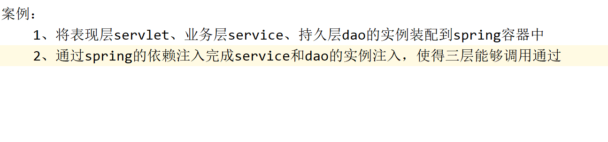
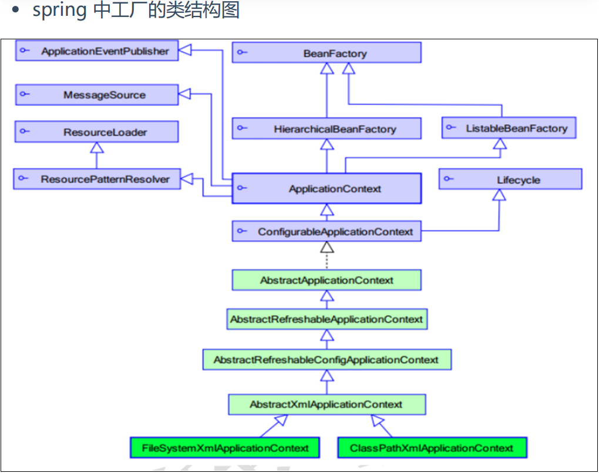

spring官网：http: spring.io/

下载spring开发包地址：

http: repo.springsource.org/libs-release-local/org/spr

ingframework/spring

spring官方文档地址：

https: docs.spring.io/spring/docs/current/spring-frame

work-reference/core.html

# 模拟spring底层基于工厂模式解耦
**定义了如何使用 Spring 的 IoC（控制反转）容器 来管理 Java 对象（称为 Bean），并实现 依赖注入（DI）**



#### `applicationContext.xml` 配置文件

在 `applicationContext.xml` 中配置 Bean 和依赖注入：

```xml
<?xml version="1.0" encoding="UTF-8"?>
<beans xmlns="http://www.springframework.org/schema/beans"
  xmlns:xsi="http://www.w3.org/2001/XMLSchema-instance"
  xsi:schemaLocation="http://www.springframework.org/schema/beans
  http://www.springframework.org/schema/beans/spring-beans.xsd">

  <!-- DAO Bean -->
  <bean id="myDao" class="com.eagles.dao.MyDaoImpl"/>

  <!-- Service Bean -->
  <bean id="myService" class="com.eagles.service.MyServiceImpl">
    <property name="dao" ref="myDao"/>
  </bean>

  <!-- Servlet Bean -->
  <bean id="myServlet" class="com.eagles.servlet.MyServlet">
    <property name="service" ref="myService"/>
  </bean>
</beans>
```

里面的一些细节：

1.<property name="service" ref="myService"/> 表示：

调用Myservlet中setService（...）的方法（setter注入），将之前创建好的Myservice对象传进去，实现表现层对业务层的**依赖注入，**将myservice对象注入到Myservlet的service属性中

**public void setService(MyServiceImpl** **service****) {**

**this.service = service;**

**}**

2.创建一个 `MyServlet` 对象，命名为 `"myServlet"`。

3.想象你组装一台电脑：

- 传统方式：你自己去买 CPU、内存、硬盘，然后手动组装。
- Spring 方式：你告诉 Spring（“装配厂”）你要一台电脑，它自动帮你采购零件并组装好。

XML 配置就像你的“装配说明书”

#### `MyDaoImpl.java` 持久层实现类

```java
package com.eagles.dao;

public class MyDaoImpl {
    public void save() {
        System.out.println("Data saved in database");
    }
}
```

#### `MyServiceImpl.java` 业务层实现类

```java
package com.eagles.service;

import com.eagles.dao.MyDaoImpl;

public class MyServiceImpl {
    private MyDaoImpl dao;

    public void setDao(MyDaoImpl dao) {
        this.dao = dao;
    }

    public void process() {
        System.out.println("Processing business logic...");
        dao.save();
    }
}
```

#### `MyServlet.java` 表现层实现类

```java
package com.eagles.servlet;

import com.eagles.service.MyServiceImpl;

import javax.servlet.ServletException;
import javax.servlet.http.HttpServlet;
import javax.servlet.http.HttpServletRequest;
import javax.servlet.http.HttpServletResponse;
import java.io.IOException;

public class MyServlet extends HttpServlet {
    private MyServiceImpl service;

    public void setService(MyServiceImpl service) {
        this.service = service;
    }

    @Override
    protected void doGet(HttpServletRequest req, HttpServletResponse resp) throws ServletException, IOException {
        doPost(req, resp);
    }

    @Override
    protected void doPost(HttpServletRequest req, HttpServletResponse resp) throws ServletException, IOException {
      
        service.process();
        resp.getWriter().println("Request processed successfully!");
    }
}
```

#### BeanFactory工厂

```java
package com.eagles.spring.factory;

import org.springframework.core.io.ClassPathResource;

import java.io.FileNotFoundException;
import java.io.FileReader;
import java.io.IOException;
import java.util.Enumeration;
import java.util.HashMap;
import java.util.Map;
import java.util.Properties;

public class BeanFactory {

    private  static Map<String,Object> beanMap;

    static {
        beanMap = new HashMap<>();

        //创建properties集合
        Properties properties = new Properties();

        FileReader fileReader =null;

        //创建流对象
        try {
            fileReader = new FileReader("beans.properties");
            //将读取到的配置对象，创建实例
            properties.load(fileReader);

            //获取所有key的集合
            Enumeration<?> enumeration = properties.propertyNames();
            while (enumeration.hasMoreElements()){
                String id = (String)enumeration.nextElement();

                //根据key来获取value
                String value = properties.getProperty(id);

                //基于反射来创建实例
                Object newInstance = Class.forName(value).newInstance();

                //将创建出来的实例添加到容器中
                beanMap.put(id,newInstance);
            }
        } catch (FileNotFoundException e) {
            throw new RuntimeException(e);
        } catch (IOException e) {
            throw new RuntimeException(e);
        } catch (ClassNotFoundException e) {
            throw new RuntimeException(e);
        } catch (InstantiationException e) {
            throw new RuntimeException(e);
        } catch (IllegalAccessException e) {
            throw new RuntimeException(e);
        }finally {
            if (fileReader !=null){
                try {
                    fileReader.close();
                } catch (IOException e) {
                    throw new RuntimeException(e);
                }
            }
        }
    }

    /**
     * 根据id来获取实例
     */
    public  static  Object  getBean(String id){
        return beanMap.get(id);
    }

}
```

```java
Data saved in database
Processing business logic...
Request processed successfully!
```

### 案例2：

#### AccountDao接口

```java
package com.eagles.spring.account.dao;

public interface AccountDao {

    void saveAccount();
}
```

#### AccountDaoImpl 持久层实现类

```java
package com.eagles.spring.account.dao;

public class AccountDaoImpl implements AccountDao {

    @Override
    public void saveAccount() {
        System.out.println("连接数据库完成");
    }
}
```

#### AccountService 接口

```java
package com.eagles.spring.account.service;

public interface AccountService {
    void saveAccount();
}
```

#### AccountServiceImpl业务层实现类

```java
package com.eagles.spring.account.service;	
import com.eagles.spring.account.dao.AccountDao;

public class AccountSerivceImpl implements AccountService{

    private AccountDao accountDao;

    public void setAccountDao(AccountDao accountDao) {
        this.accountDao = accountDao;
    }

    @Override
    public void saveAccount() {
        accountDao.saveAccount();
    }
}
```

#### AccountServlet 表现层实现类

```java
package com.eagles.spring.account.servlet;
import com.eagles.spring.account.service.AccountService;

public class AccountServlet {

    private AccountService accountService;

    public void saveAccount() {
        accountService.saveAccount();
    }

    public void setAccountService(AccountService accountService) {

        this.accountService = accountService;
    }
}
```

#### BeanFactory工厂

```java
package com.eagles.spring.factory;
import java.io.FileNotFoundException;
import java.io.FileReader;
import java.io.IOException;
import java.util.Enumeration;
import java.util.HashMap;
import java.util.Map;
import java.util.Properties;

public class BeanFactory {

    private  static Map<String,Object> beanMap;

    static {
        beanMap = new HashMap<>();

        //创建properties集合
        Properties properties = new Properties();

        FileReader fileReader =null;

        //创建流对象
        try {
            fileReader = new FileReader("beans.properties");
            //将读取到的配置对象，创建实例
            properties.load(fileReader);

            //获取所有key的集合
            Enumeration enumeration = properties.propertyNames();
            while (enumeration.hasMoreElements()){
                String id = (String)enumeration.nextElement();

                //根据key来获取value
                String value = properties.getProperty(id);

                //基于反射来创建实例
                Object newInstance = Class.forName(value).newInstance();

                //将创建出来的实例添加到容器中
                beanMap.put(id,newInstance);
            }
        } catch (FileNotFoundException e) {
            throw new RuntimeException(e);
        } catch (IOException e) {
            throw new RuntimeException(e);
        } catch (ClassNotFoundException e) {
            throw new RuntimeException(e);
        } catch (InstantiationException e) {
            throw new RuntimeException(e);
        } catch (IllegalAccessException e) {
            throw new RuntimeException(e);
        }finally {
            if (fileReader !=null){
                try {
                    fileReader.close();
                } catch (IOException e) {
                    throw new RuntimeException(e);
                }
            }
        }
    }

    /**
     * 根据id来获取实例
     */
    public  static  Object  getBean(String id){
        return beanMap.get(id);
    }

}
```

#### FactoryTest测试类

```java
package com.eagles.spring.test;
import com.eagles.spring.account.dao.AccountDaoImpl;
import com.eagles.spring.account.service.AccountSerivceImpl;
import com.eagles.spring.account.servlet.AccountServlet;
import com.eagles.spring.factory.BeanFactory;
import org.springframework.context.support.ClassPathXmlApplicationContext;

public class FactoryTest {
    public static void main(String[] args) {
        //获取表现层实例
        AccountServlet accountServlet =(AccountServlet) BeanFactory.getBean("accoutServlet");

        //获取业务层实例
        AccountSerivceImpl accountSerivce =(AccountSerivceImpl) BeanFactory.getBean("accountSerivce");

        //获取持久层实例
        AccountDaoImpl accountDao =(AccountDaoImpl) BeanFactory.getBean("accountDao");

        //完成注入
        accountServlet.setAccountService(accountSerivce);
        accountSerivce.setAccountDao(accountDao);

        //调用方法
        accountServlet.saveAccount();
    }

  
```

#### `beans.properties` 配置文件

```properties
accoutServlet=com.eagles.spring.account.servlet.AccountServlet
accountSerivce=com.eagles.spring.account.service.AccountSerivceImpl
accountDao=com.eagles.spring.account.dao.AccountDaoImpl
```

```java
连接数据库完成
```

#### 核心思想

|  |  |
| --- | --- |
| **概念** | **说明** |
| **IoC（控制反转）** | 对象的创建不再由程序员控制，而是交给 Spring 容器管理 |
| **DI（依赖注入）** | Spring 自动把依赖的对象“注入”到目标类中（通过 setter 或构造器） |
| **解耦** | 各层之间不直接 `new`  对象，降低了模块间的耦合度 |
| **可维护性高** | 修改实现类时，只需改配置，无需改代码 |

这样的好处就是你可以不再去选择new的方式创建实例，**让开发者专注于业务逻辑，而不是对象的创建和管理**。

# Spring的框架，如何使用容器完成对象的建立和依赖注入
#### Animal** **动物类
```java
package com.eagles.beans;

public class Animal {
    private int id;
    private String name;

    public Animal(int id, String name) {
        this.id = id;
        this.name = name;
    }

    public Animal(String name) {
        this.name = name;
    }

    public Animal(int id) {
        this.id = id;
    }
    
   @Override
    public String toString() {
        return "Aniaml{" +
        "id=" + id +
        ", name='" + name + '\'' +
        '}';
    }

}
```

#### Student 学生类

```java
package com.eagles.beans;

public class Student {
}
```

#### Person 人类类

```java
package com.eagles.beans;

import java.util.Arrays;
import java.util.Date;
import java.util.List;
import java.util.Map;

public class Person {
    private   String name;
    private   int  age;
    private   String address;
    private Object[] string;
    private   List list;
    private   Map map;
    private Date date;

    public Person() {
    }

    public Person(String name, int age, String address, Object[] string, List list, Map map, Date date) {
        this.name = name;
        this.age = age;
        this.address = address;
        this.string = string;
        this.list = list;
        this.map = map;
        this.date = date;
    }

    public void setName(String name) {
        this.name = name;
    }

    public void setAge(int age) {
        this.age = age;
    }

    public void setAddress(String address) {
        this.address = address;
    }

    public void setString(Object[] string) {
        this.string = string;
    }

    public void setList(List list) {
        this.list = list;
    }

    public void setMap(Map map) {
        this.map = map;
    }

    public void setDate(Date date) {
        this.date = date;
    }

    @Override
    public String toString() {
        return "Person{" +
        "name='" + name + '\'' +
        ", age=" + age +
        ", address='" + address + '\'' +
        ", string=" + Arrays.toString(string) +
        ", list=" + list +
        ", map=" + map +
        ", date=" + date +
        '}';
    }
}
```

#### SpringTest01测试类

```java
package com.eagles.spring;

import com.eagles.beans.Person;
import com.eagles.beans.Student;
import org.springframework.context.annotation.ClassPathBeanDefinitionScanner;
import org.springframework.context.support.ClassPathXmlApplicationContext;

public class SpringTest01 {
    public static void main(String[] args) {

        //创建spring的容器对象
        ClassPathXmlApplicationContext classPathXmlApplicationContext = new ClassPathXmlApplicationContext("/xml/beans.xml");

        Person person = classPathXmlApplicationContext.getBean("person", Person.class);
        System.out.println(person);

        //        //从容器中取出实例
        //        Object obj = classPathXmlApplicationContext.getBean("student");

        //        Student student = classPathXmlApplicationContext.getBean("student", Student.class);
        //        System.out.println(student);

        //        if (obj instanceof Student){
        //            Student student = (Student) obj;
        //            System.out.println(student);
        //        }

        
    }
}
```

**关键步骤解释：**

1. `new ClassPathXmlApplicationContext("...")`

- 启动 Spring 容器。
- 加载 `beans.xml` 文件。
- 解析所有 `<bean>` 标签，创建对应的对象并完成依赖注入。
- 所有 Bean 都准备好了！

2. `ctx.getBean("person", Person.class)`

- 从 Spring 容器中获取 id 为 `"person"` 的 Bean，并强转为 `Person` 类型。
- 此时的 `person` 对象已经是 **属性全部赋值完成、依赖也注入好了** 的完整对象。

3. `System.out.println(person)`

- 打印对象，验证是否成功注入了 `name`, `age`, `list`, `map`, `date` 等属性。

**第一段：使用** `instanceof` **+ 类型转换（不推荐）**

```java
// 从容器中取出实例
Object obj = classPathXmlApplicationContext.getBean("student");

if (obj instanceof Student){
    Student student = (Student) obj;
    System.out.println(student);
}
```

**逐行解析：**

1. `Object obj = ...getBean("student");`

- `getBean("student")` 返回的是一个 `Object` 类型的对象（因为 Spring 不知道你要什么类型）。
- 所以你只能先用 `Object` 接收。
- 此时 `obj` 指向的是 Spring 容器中 id 为 `"student"` 的那个对象。

相当于：我从仓库取了个东西，但不知道它是什么，先当“普通物品”拿着。

---

2. `if (obj instanceof Student)`

- 使用 `instanceof` 关键字判断：`obj` 实际上是不是 `Student` 类型的对象？
- 如果是，返回 `true`，进入 `if` 块；
- 如果不是（比如你写错了名字，取到了别的对象），就跳过，避免出错。

安全检查：防止类型转换异常。

**第二段：直接指定返回类型（推荐** **✅****）**

```java
Student student = classPathXmlApplicationContext.getBean("student", Student.class);
System.out.println(student);
```

**逐行解析：**

`getBean("student", Student.class)`

- 这是 Spring 提供的 **泛型重载方法**。
- 第一个参数：bean 的 id（`"student"`）
- 第二个参数：你期望返回的类型（`Student.class`）

Spring 会：

1. 找到 id 为 `"student"` 的 bean
2. 自动检查它是不是 `Student` 类型
3. 是的话，直接返回 `Student` 类型的对象
4. 不是的话，抛出异常（更早发现问题）

#### beans.xml 配置文件

```xml
<?xml version="1.0" encoding="UTF-8"?>
<beans xmlns="http://www.springframework.org/schema/beans"
  xmlns:xsi="http://www.w3.org/2001/XMLSchema-instance"
  xsi:schemaLocation="http://www.springframework.org/schema/beans
  http://www.springframework.org/schema/beans/spring-beans.xsd">

  <!--将student的实例配置在spring的容器中-->
  <!--
  id属性：组件的唯一标识
  class属性：类的全类名，spring在底层会通过反射的方式来创建实例
  -->
  <bean id="student" class="com.eagles.beans.Student"></bean>

  这些都是person里面的方法和属性以及对应的value值
  <!--将person的实例添加到spring的容器中-->
  <bean id="person" class="com.eagles.beans.Person">
    
    <!--基于set方法的依赖注入-->
    <property name="name" value="jack"></property>
    <property name="age" value="20"></property>
    <property name="address" value="镇江市"></property>
    
    <!--注入数组类型的数据-->
    <property name="string">
      <array>
        <value>123</value>
        <value>456</value>
        <value>789</value>
      </array>
    </property>
    
    <!--注入list集合类型的数据-->
    <property name="list">
      <list>
        <value>123</value>
        <value>456</value>
        <value>789</value>
      </list>
    </property>
   
    <!--注入map集合类型的数据-->
    <property name="map">
      <map>
        <entry key="key1" value="value1"></entry>
        <entry key="key2" value="value2"></entry>
        <entry key="key3" value="value3"></entry>
      </map>
    </property>

    <!--
    ref:引入当前容器中别的实例（通过id进行引入）
    -->
    <property name="date" ref="date"></property>

  </bean>

  <!--装配日期类型的实例-->
  <bean id="date" class="java.util.Date"></bean>

  <!--装配animal实例到容器中-->
  <bean id="animal" class="com.eagles.beans.Animal">
    <!--通过构造方法完成实例的注入-->
    <constructor-arg name="id" value="1001" ></constructor-arg>
    <constructor-arg name="name" value="老虎" ></constructor-arg>
  </bean>

</beans>
```

- `ref="date"` 表示把 id 为 `date` 的 Bean 注入到当前对象的 `date` 属性中。
- 这体现了 **对象之间的依赖关系**。

相当于：

```java
Date date = new Date();
person.setDate(date); // 把 date 对象注入到 person 中
```

---

- 使用 `<property>` 标签进行 **setter 注入**（基于 set 方法）。
- Spring 会自动调用 `person.setName("jack")`、`person.setAge(20)` 等方法。

相当于：

```java
Person person = new Person();
person.setName("jack");
person.setAge(20);
person.setAddress("镇江市");
```

---

- 使用 `<constructor-arg>` 调用有参构造函数来创建对象。
- 相当于：`new Animal(1001, "老虎")`

前提是 `Animal` 类必须有一个匹配的构造方法。

```xml
<bean id="animal" class="com.eagles.beans.Animal">
  <constructor-arg name="id" value="1001"/>
  <constructor-arg name="name" value="老虎"/>
</bean>
```

---

```java
Person{name='jack', age=20, address='镇江市', string=[123, 456, 789], list=[123, 456, 789], map={key1=value1, key2=value2, key3=value3}, date=Wed Aug 06 22:36:39 GMT+08:00 2025}
```

通俗地说：

- 以前我们创建对象是手动 `new Student()`。
- 现在我们把对象的创建交给 **Spring 容器**。
- 我们只需要写一个 XML 配置文件，告诉 Spring：“你要帮我创建哪些对象，它们之间有什么依赖关系。”
- Spring 启动后，会自动根据配置创建这些对象，并把它们之间的关系“组装好”。
- 我们只需要从 Spring 容器中“取”出来用就行了。

这叫 **控制反转（Inversion of Control, IoC）** —— 控制权从程序员转移到了框架。

#### 完整流程

1. 启动程序 → 创建 Spring 容器（加载 XML）
2. Spring 解析 XML：

- 发现要创建 `student`, `person`, `date`, `animal` 四个 Bean
- 先创建 `date`（因为 `person` 依赖它）
- 再创建 `person`，并注入 `name`, `age`, `list`, `map`, `date` 等属性

3. 程序从容器中取出 `person` 对象
4. 打印输出，看到所有属性都已正确设置

**基于**XML**配置**Spring**容器对象**

导入配置文件的约束：

```java
<?xml version="1.0" encoding="UTF-8"?>
<beans xmlns="http://www.springframework.org/schema/beans"
xmlns:xsi="http://www.w3.org/2001/XMLSchema-instance"
xsi:schemaLocation="http://www.springframework.org/schema/beans
http://www.springframework.org/schema/beans/springbeans.xsd">
< beans>
```



*BeanFactory 才是 Spring 容器中的顶层接口，*

*ApplicationContext 是它的子接口。*

**BeanFactory 和 ApplicationContext 的区别：**

**创建对象的时间点不一样。**

**1.** `BeanFactory`**：按需加载（懒加载）**什么使用什么时候创建对象

```java
// 使用 BeanFactory（手动加载）
AccountServlet accountServlet = (AccountServlet) BeanFactory.getBean("accoutServlet");

// 使用 ApplicationContext（自动加载）
ClassPathXmlApplicationContext ctx = new ClassPathXmlApplicationContext("/xml/beans.xml");
```

**2.** `ApplicationContext`**：启动即加载** 只要一读取配置文件，默认情况下就会创建对象。

```java
// 容器一创建，就会解析 XML，创建所有 singleton Bean
ClassPathXmlApplicationContext ctx = new ClassPathXmlApplicationContext("/xml/beans.xml");
// 此时所有 singleton Bean 已经初始化完成
```

**核心区别总结**

`BeanFactory` **是 Spring 的“底层内核”，延迟加载 Bean；**

`ApplicationContext` **是它的“高级封装”，在启动时就预加载所有单例 Bean，并提供更多企业级功能。**

|  |  |  |
| --- | --- | --- |
| **特性** | `BeanFactory` | `ApplicationContext` |
| 加载时机 | **懒加载（Lazy）**：用到时才创建 Bean | **预加载（Eager）**：容器一启动就创建所有单例 Bean |
| 功能 | 基础 IoC 容器，只负责 Bean 的创建和装配 | 在 `BeanFactory`  基础上扩展了 AOP、事件发布、国际化、资源访问等 |
| 使用场景 | 资源敏感环境（如 Applet、手机端） | **绝大多数项目都用它（推荐）** |
| 性能 | 启动快，但第一次获取 Bean 可能慢 | 启动慢（要初始化所有单例），但运行时更快 |
| 常用实现类 | `DefaultListableBeanFactory` | `ClassPathXmlApplicationContext`  , `FileSystemXmlApplicationContext`  , `AnnotationConfigApplicationContext` |

**ApplicationContext 接口的实现类**

- ClassPathXmlApplicationContext：它是从类的根路径下加载配置文件 推荐使用这种

- FileSystemXmlApplicationContext:它是从磁盘路径上加载配置文件，配置文件可以在磁盘的任意位置。

- AnnotationConfigApplicationContext: 当我们使用注解配置容器对象时，需要使用此类来创建spring 容器。它用来读取注解

**XML中的Bean标签**

**1.bean 标签作用：**

- 用于配置对象让 spring 来创建的。默认情况下它调用的是类中的无参构造函数。如果没有无参构造函数则不能创建成功。

**2.属性：**

id：给对象在容器中提供一个唯一标识。用于获取对象。

class：指定类的全限定类名。用于反射创建对象。默认情况下调用无参构造函数。

scope：指定对象的作用范围。

- **singleton** :默认值，单例的
- **prototype** :多例的
- request :Web项目中,Spring 创建一个 Bean 的对象,将对象存入到 request 域中
- session :Web项目中,Spring 创建一个 Bean 的对象,将对象存入到 session 域中
- global session :Web 项目中,应用在 Portlet 环境.如果没有 Portlet 环境那么globalSession 相当于 session

# Spring中Bean的生命周期

#### 1. `Student` 类

```java
public class Student {
    public Student() {
        System.out.println("实例创建了~");  // 构造方法
    }

     public void init(){
        System.out.println("实例初始化了~");
    }

    public void destroy(){
        System.out.println("实例被销毁了~");
    }

   
}
```

#### 2.`beans.xml` Spring 配置文件

如下配置：

```xml
<bean id="student" 
  class="com.eagles.spring.beans.Student"
  init-method="init"
  destroy-method="destroy"/>
```

**关键点**：必须在 XML 中配置 `init-method="init"` 和 `destroy-method="destroy"`，Spring 才会调用这两个方法。

#### 3.SpringTest02 测试类

```java
package com.eagles.spring.test;

import com.sun.xml.internal.bind.v2.util.XmlFactory;
import org.springframework.beans.factory.BeanFactory;
import org.springframework.beans.factory.xml.XmlBeanFactory;
import org.springframework.context.support.ClassPathXmlApplicationContext;
import org.springframework.core.io.ClassPathResource;

public class SpringTest02 {
    public static void main(String[] args) {
        //创建spring的容器对象
        ClassPathXmlApplicationContext applicationContext = new ClassPathXmlApplicationContext("/xml/beans.xml");

        //        BeanFactory beanFactory = new XmlBeanFactory(new ClassPathResource("xml/beans.xml"));
        //
        //        Object student = beanFactory.getBean("student");

        Object student1 = applicationContext.getBean("student");
        Object student2 = applicationContext.getBean("student");

        //        System.out.println(student1==student2); //单例的显示true

        //关闭容器
        applicationContext.close();

    }
}
```

---

**完整执行流程（带打印顺序）**

```java
ClassPathXmlApplicationContext applicationContext = 
new ClassPathXmlApplicationContext("/xml/beans.xml");
```

此时打印：

```plain
实例创建了~
//当 Spring 容器创建 Student 实例时（第一次 getBean 或容器启动时）
实例初始化了~
//在构造方法执行完、属性注入完成后，自动调用 init-method="init" 指定的方法
```

```java
Object student1 = applicationContext.getBean("student");
Object student2 = applicationContext.getBean("student");
```

不再打印（因为是单例，已经创建好了）

```java
applicationContext.close();
```

此时打印：

```plain
实例被销毁了~
//只有在调用 applicationContext.close() 时才会触发！
```

---

## 案例2

#### MyBeanJava 类：

```java
public class MyBean implements InitializingBean, customDestroy {
    public MyBean() {
        System.out.println("Constructor called.");
    }

    @Override
    public void afterPropertiesSet() throws Exception {
        System.out.println("Initializing...");
    }

    @Override
    public void destroy() throws Exception {
        System.out.println("Destroying...");
    }

    public void customInit() {
        System.out.println("customInit() called.");
    }

    public void customDestroy() {
        System.out.println("customDestroy() called.");
    }
}
```

`afterPropertiesSet()` **是** `InitializingBean` **接口里的方法**。

- 这个接口是 Spring 提供的**生命周期回调接口**。
- 任何实现了它的 Bean，在 **所有属性被设置完毕后**，会自动调用 `afterPropertiesSet()` 方法。

`destroy()` **方法**：

- 如果一个类实现了 `DisposableBean` 接口，那么它必须实现 `destroy()` 方法。这个方法会在 Bean 被销毁之前由 Spring 容器自动调用。

#### beans.xmlXML 配置：

```xml
<bean 
  id="myBean" class="com.example.MyBean"
  init-method="customInit" destroy-method="customDestroy"/>
</beans>
```

---

#### 完整执行流程（含打印顺序）
假设你这样使用：

```java
ClassPathXmlApplicationContext context = 
new ClassPathXmlApplicationContext("beans.xml");

// 使用 Bean
MyBean myBean = (MyBean) context.getBean("myBean");

// 关闭容器
context.close();
```

---

#### 第一阶段：容器启动 → 创建 Bean

当 `new ClassPathXmlApplicationContext(...)` 执行时，Spring 开始创建 `myBean` 实例，按顺序执行以下步骤：

|  |  |
| --- | --- |
| **执行内容** | **是否打印** |
| 调用构造方法 | `Constructor called.` |
| 依赖注入（DI） | （无输出） |
| 调用 `InitializingBean.afterPropertiesSet()` | `Initializing...` |
| 调用 `init-method="customInit"` | `customInit() called.` |

**所以容器启动时打印：**

```plain
Constructor called.
Initializing...
customInit() called.
```

注意：`afterPropertiesSet()` 在 `init-method` 之前执行！

---

#### 第二阶段：使用 Bean

```java
MyBean myBean = (MyBean) context.getBean("myBean");
```

- 此时 Bean 已经创建并初始化完成。
- 不会再有任何打印。

---

#### 第三阶段：`context.close()` → 销毁 Bean

当你调用 `context.close();` 时，Spring 容器开始关闭流程，并**依次执行所有单例 Bean 的销毁方法**：

|  |  |
| --- | --- |
| **执行内容** | **是否打印** |
| 调用 `destroy-method="customDestroy"` | `customDestroy() called.` |
| 调用 `DisposableBean.destroy()` | `Destroying...` |

**所以** `close()` **调用后打印：**

```plain
customDestroy() called.
Destroying...
```

---

#### 最终完整输出

```plain
Constructor called.
Initializing...
customInit() called.
customDestroy() called.
Destroying...
```

#### 总结：生命周期完整流程

|  |  |  |
| --- | --- | --- |
| **阶段** | **执行内容** | **打印内容** |
| **创建** | 构造方法 | `Constructor called.` |
| **初始化** | `afterPropertiesSet()` | `Initializing...` |
|  | `init-method` | `customInit() called.` |
| **使用** | `getBean()` | （无打印） |
| **销毁** | `destroy-method` | `customDestroy() called.` |
|  | `DisposableBean.destroy()` | `Destroying...` |

---

### 关键问题解答

#### ❓ `destroy()` 方法什么时候运行？

**在** `context.close()` **被调用时运行**，并且是在 `destroy-method` 之后执行。

#### ❓ `customDestroy()` 是什么时候运行的？

也是在 `context.close()` 时运行，但它在 `destroy()` 方法**之前**执行。

#### ❓ `close()` 到底做了什么？

`context.close()` 不是“单纯关闭”，它会触发以下关键操作：

|  |  |
| --- | --- |
| **操作** | **说明** |
| 停止容器 | 不再创建新 Bean |
| 调用销毁方法 | 按顺序执行 `destroy-method`  和 `DisposableBean.destroy()` |
| 释放资源 | 如数据库连接、线程池、文件句柄等 |
| 发布关闭事件 | 通知监听器 |

所以：**不调用** `close()`**，**`destroy()` **和** `customDestroy()` **都不会执行！**

---

#### 销毁顺序总结（重要！）

|  |  |
| --- | --- |
| **方法** | **来源** |
| `destroy-method="customDestroy"` | XML 配置 |
| `DisposableBean.destroy()` | 接口实现 |

**先执行配置的** `destroy-method`**，再执行接口的** `destroy()`

类似初始化顺序：先 `afterPropertiesSet()`，再 `init-method`

---

#### 推荐写法（避免混淆）

如果你同时用了 `InitializingBean` 和 `init-method`，建议：

- `afterPropertiesSet()`：用于**校验属性是否设置正确**
- `init-method`：用于**实际资源初始化**（如启动线程、连接数据库）

```java
@Override
public void afterPropertiesSet() {
    if (this.url == null) throw new IllegalArgumentException("URL is required");
}

public void customInit() {
    this.connection = connectToDatabase(); // 真正初始化

    //调用一个名为 connectToDatabase() 的方法来建立数据库连接，并将返回的连接对象赋值给当前对象的 connection 成员变量。
    
    //“我要连接数据库了，请把连上之后得到的‘连接通道’保存到我自己的 connection 变量里，以后我就可以用它来执行 SQL 语句了。”
}
```

销毁时同理：

- `destroy-method`：关闭外部资源
- `destroy()`：清理内部状态

---

#### 最佳实践建议

1. **永远记得调用**`close()`（或使用 try-with-resources）
2. 使用 `@PostConstruct` 和 `@PreDestroy` 替代接口更简洁（推荐 Spring Boot）
3. 单例 Bean 的销毁只在容器关闭时发生
4. Web 应用中容器会自动调用 `close()`（如 Tomcat 停止时），但 main 方法中必须手动调用

---

## Spring Bean 的销毁顺序是
### 一、核心原则：**“约定优于配置” + “接口是基础，配置是扩展”**

Spring 的设计哲学是：

- **接口（如**`InitializingBean`**）是底层契约**
- **XML/注解配置（如**`init-method`**）是上层扩展**

所以：

- 接口方法代表“Bean 自身的生命周期逻辑”
- 配置方法代表“容器对 Bean 的管理动作”

**销毁时：先执行“容器指令”（**`destroy-method`**），再执行“Bean 自身逻辑”（**`destroy()`**）**

---

### 二、底层逻辑：从源码角度看执行顺序

虽然我们不直接看源码，但可以还原 Spring 的执行流程。

##### 初始化顺序：`afterPropertiesSet()` → `init-method`

```java
// 伪代码：Spring 初始化 Bean 的过程
if (bean instanceof InitializingBean) {
    ((InitializingBean) bean).afterPropertiesSet();  // 先调用接口
}
if (hasInitMethod) {
    invokeCustomInitMethod();  // 再调用配置的方法
}
```

**为什么这样设计？**

- `afterPropertiesSet()` 是接口方法，**Bean 自己知道什么时候初始化完成**
- `init-method` 是容器配置的，**代表外部对 Bean 的进一步初始化要求**

举例：先检查属性（接口逻辑），再启动服务（配置逻辑）

---

##### 销毁顺序：`destroy-method` → `DisposableBean.destroy()`

```java
// 伪代码：Spring 销毁 Bean 的过程
if (hasDestroyMethod) {
    invokeCustomDestroyMethod();  // 先调用配置的方法
}
if (bean instanceof DisposableBean) {
    ((DisposableBean) bean).destroy();  // 最后调用接口
}
```

**为什么反过来？**

这是 **资源释放的安全顺序**！

##### 举个真实例子：数据库连接池

```java
public class DatabaseManager implements DisposableBean {

    private ConnectionPool pool;

    public void closePool() {
        pool.shutdown(); // 停止接收新连接
    }

    @Override
    public void destroy() {
        pool.clearAllConnections(); // 清理所有已存在的连接
    }
}
```

配置：

```xml
<bean destroy-method="closePool"/>
```

销毁顺序：

1. `closePool()`：停止新连接（容器管理动作）
2. `destroy()`：清理残留连接（Bean 自身清理）

如果反过来：先 `destroy()` 再 `closePool()`，可能 `destroy()` 中还想操作 pool，但 pool 已被关闭，会出错！

---

### 三、类比理解：关电脑的顺序

想象你要关闭一台服务器：

```plain
1. 执行 shutdown.sh（相当于 destroy-method） ← 容器配置的脚本
2. 操作系统调用 service.destroy() ← Bean 自己的清理逻辑
```

正确顺序：

1. 先运行“关闭脚本”（`destroy-method`）—— 停止应用、保存数据
2. 再调用“操作系统级清理”（`DisposableBean.destroy()`）—— 释放内存、关闭驱动

如果反过来：

- 先释放内存 → 应用还在运行 → 崩溃！

---

# 基于注解的** IOC **配置
**实例装配的注解**

@Component

把资源让 spring 来管理。相当于在 xml 中配置一个 bean

@Controller：一般用于表现层的注解

@Service：一般用于业务层的注解@Repository：一般用于持久层的注解

**依赖注入的注解**

**@Autowired（根据类型注入）**

作用：根据类型自动注入依赖。

示例：@Autowired private Book book1;

解释：Spring会查找所有类型为Book的Bean，并将它们注入到book1中。如果有多个Book类型的Bean，Spring会抛出异常。

-根据当前容器中实例的类型完成注入

-如果当前容器中有2份或者2份以上实例可以完成匹配的时候，那么程序会报错

-1、如果某一个实例的唯一标识跟变量的变量名称一样的话，那么也可以注入当前组件的实例

-2、使用@Qualifier注解，通过唯一标识（id）来指定某一个实例完成注入

**@Resource（根据id注入的）**

作用：根据名称（ID）注入依赖。

示例：@Resource(name = "book2") private Book book2;

解释：Spring会查找ID为book2的Bean，并将其注入到book2中。如果找不到对应的Bean，Spring会抛出异常。

**@Qualifier（不能单独使用）**

作用：与@Autowired一起使用，用于指定具体的Bean。

示例：@Qualifier("novel") @Autowired private Book novelBook;

解释：当有多个相同类型的Bean时，可以使用@Qualifier指定具体的Bean。例如，这里指定了ID为novel的Book Bean。

**@Value（用于注入基本数据类型和String类型）**

作用：用于注入基本数据类型和String类型。

示例：@Value("Spring in Action") private String favoriteBookTitle;

解释：直接将字符串值Spring in Action注入到favoriteBookTitle变量中。

通过这个案例，你可以看到每个注解在实际应用中的具体用法和区别。希望这能帮助你更好地理解和使用这些注解！

**改变作用范围的注解**

@Scope

指定 bean 的作用范围。

取值：

**singleton**

**prototype**

request

session

globalsession

**生命周期相关注解**

@PostConstruct用于指定初始化的方法

@PreDestroy用于指定销毁的方法

**Spring 基于注解的组件扫描（Component Scan）示例**

```java
package com.eagles.spring.beans;
import org.springframework.beans.factory.annotation.Value;
import org.springframework.stereotype.Component;

@Component("aaa")
public class Person { //默认情况下 唯一标识是类名首字母小写

    @Value("jack")
    private String name;

    @Value("20")
    private int age;

    @Override
    public String toString() {
        return "Person{" +
        "name='" + name + '\'' +
        ", age=" + age +
        '}';
    }
}
```

```java
package com.eagles.spring.test;

import org.springframework.context.support.ClassPathXmlApplicationContext;

public class SpringTest03 {
    public static void main(String[] args) {
        //创建spring的容器对象
        ClassPathXmlApplicationContext applicationContext =
        new ClassPathXmlApplicationContext("/xml/beans02.xml");

        Object person = applicationContext.getBean("aaa");
        //        AccountServlet accountServlet = (AccountServlet)applicationContext.getBean("accountServlet");
        //        accountServlet.saveAccount();

        System.out.println(person);

    }
}
```

```xml
<?xml version="1.0" encoding="UTF-8"?>
<beans xmlns="http://www.springframework.org/schema/beans"
  xmlns:xsi="http://www.w3.org/2001/XMLSchema-instance"
  xmlns:context="http://www.springframework.org/schema/context"
  xsi:schemaLocation="http://www.springframework.org/schema/beans
  http://www.springframework.org/schema/beans/spring-beans.xsd
  http://www.springframework.org/schema/context
  http://www.springframework.org/schema/context/spring-context.xsd">

  <!--开启spring的包扫描-->
  <context:component-scan base-package="com.eagles"></context:component-scan>

</beans>
```

**Spring 如何通过** `@Component` **注解和** `<context:component-scan>` **自动将 Java 类注册为 Spring 容器中的 Bean，并通过 ID 获取它们。**

---

#### 逐部分解析

##### 1. 实体类 `Person` —— 被注册为 Spring Bean

```java
@Component("aaa")
public class Person {
    @Value("jack")
    private String name;

    @Value("20")
    private int age;
}
```

- `@Component("aaa")`：

- 表示这个类是一个 Spring 管理的组件（Bean）。
- `"aaa"` 是这个 Bean 的 **唯一标识（ID）**。如果不写，默认是 `person`（类名首字母小写）。

- `@Value("jack")` 和 `@Value("20")`：

- 表示在创建 Bean 时，Spring 会自动给 `name` 赋值 `"jack"`，`age` 赋值 `20`。
- 这是 **属性注入** 的一种方式。

所以：`Person` 类会被 Spring 自动创建成一个 Bean，ID 是 `aaa`，并且字段已经被初始化。

---

##### 2. 配置文件 `beans02.xml` —— 开启组件扫描

```java
<context:component-scan base-package="com.eagles"/>
```

- 这行配置告诉 Spring：

“请去 `com.eagles` 包及其子包下，查找所有带有 `@Component`、`@Service`、`@Repository`、`@Controller` 等注解的类，并把它们注册为 Bean。”

- 因为 `Person` 类在 `com.eagles.spring.beans` 包下，属于 `com.eagles` 的子包，所以它会被扫描到并注册。

---

##### 3. 测试类 `SpringTest03` —— 从容器获取 Bean

```java
ClassPathXmlApplicationContext applicationContext =
new ClassPathXmlApplicationContext("/xml/beans02.xml");

Object person = applicationContext.getBean("aaa");
System.out.println(person);
```

- 创建 Spring 容器，加载 `beans02.xml`。
- 容器启动时，会自动扫描 `com.eagles` 包，发现 `@Component("aaa")`，于是创建一个 `Person` 实例并放入容器。
- `getBean("aaa")`：从容器中取出 ID 为 `aaa` 的 Bean。

```plain
Person{name='jack', age=20}
```

---

##### 这段代码想表达的几个核心知识点

|  |  |
| --- | --- |
| **知识点** | **说明** |
| **组件自动扫描** | 使用 `<context:component-scan>`  可以让 Spring 自动发现 Bean，无需在 XML 中手动 `<bean>`  定义 |
| **@Component 注解** | 标记一个类为 Spring Bean，可指定 ID（value 属性） |
| **@Value 注解** | 实现属性的直接赋值（常用于注入字面量、配置项） |
| **Spring 容器管理对象生命周期** | `Person`  对象由 Spring 创建和管理，开发者通过 `getBean()`  获取 |
| **解耦** | 业务代码不再 `new Person()`  ，而是从容器获取，实现控制反转（IoC） |

---

##### 对比：没有 Spring 时怎么做？

```java
// 手动创建对象（硬编码，耦合度高）
Person person = new Person();
person.setName("jack");
person.setAge(20);
```

而 Spring 的方式是：

```java
// 从容器获取对象（解耦，配置驱动）
Person person = (Person) applicationContext.getBean("aaa");
```

---

##### 可扩展思考

1. 如果去掉 `@Component("aaa")`，还能获取到 Bean 吗？  
    不能，除非使用其他方式注册。
2. 如果不写 `base-package="com.eagles"`，而是写 `com.eagles.service`，能扫描到 `Person` 吗？  
    不能，因为 `Person` 在 `beans` 包下，不在 `service` 包下。

# Spring底层如何创建实例，解析注解原理分析

```plain
                        ┌─────────────────┐
                        │   Test (main)   │
                        └────────┬────────┘
                                 ▼
                   调用 ComponentScan.componentScan()
                                 ▼
           ┌─────────────────────────────────────────┐
           │        ComponentScan（包扫描器）          │
           │  扫描 com.eagles 包下的所有 .class 文件    │
           │  找出带有 @Controller/@Service/@Repository│
           │  的类，创建实例，放入 BeanFactory 容器     │
           │  再处理 @Autowired，完成依赖注入           │
           └─────────────────────────────────────────┘
                                 ▼
                    ┌───────────────────────┐
                    │    BeanFactory        │
                    │ Map<String, Object>   │
                    │ 存放所有创建的 Bean    │
                    └───────────────────────┘
```

```java
package com.eagles.spring.ioc.account.dao;

public interface AccountDao {

    void saveAccount();

}
```

```java
package com.eagles.spring.ioc.account.dao;
import com.eagles.spring.ioc.annotation.Repository;

@Repository("ccc")
public class AccountDaoImpl implements AccountDao {

    @Override
    public void saveAccount() {
        System.out.println("成功连接了数据库，保存了账户~");
    }
}
```

```java
package com.eagles.spring.ioc.account.service;

public interface AccountService {

    void saveAccount();

}
```

```java
package com.eagles.spring.ioc.account.service;
import com.eagles.spring.ioc.account.dao.AccountDao;
import com.eagles.spring.ioc.annotation.Autowired;
import com.eagles.spring.ioc.annotation.Service;

@Service("bbb")
public class AccountServiceImpl implements AccountService {

    @Autowired
    private AccountDao accountDao;

    @Override
    public void saveAccount() {
        accountDao.saveAccount();
    }
}
```

```java
package com.eagles.spring.ioc.account.servlet;
import com.eagles.spring.ioc.account.service.AccountService;
import com.eagles.spring.ioc.annotation.Autowired;
import com.eagles.spring.ioc.annotation.Controller;

@Controller
public class AccountServlet {

    @Autowired
    private AccountService accountService;

    public void saveAccount() {
        accountService.saveAccount();
    }

}
```

```plain
AccountServlet (@Controller)
     ↓ (@Autowired)
AccountServiceImpl (@Service) 
     ↓ (@Autowired)
AccountDaoImpl (@Repository)
```

- **AccountServlet**：控制层，接收请求
- **AccountService**：业务层，处理逻辑
- **AccountDao**：数据层，操作数据库

```java
package com.eagles.spring.ioc.annotation;
import java.lang.annotation.ElementType;
import java.lang.annotation.Retention;
import java.lang.annotation.RetentionPolicy;
import java.lang.annotation.Target;

@Retention(RetentionPolicy.RUNTIME)
@Target(ElementType.FIELD)
public @interface Autowired {
}
```

```java
package com.eagles.spring.ioc.annotation;
import java.lang.annotation.ElementType;
import java.lang.annotation.Retention;
import java.lang.annotation.RetentionPolicy;
import java.lang.annotation.Target;

@Retention(RetentionPolicy.RUNTIME)
@Target(ElementType.TYPE)
public @interface Controller {

    String value() default "";

}
```

```java
package com.eagles.spring.ioc.annotation;
import java.lang.annotation.ElementType;
import java.lang.annotation.Retention;
import java.lang.annotation.RetentionPolicy;
import java.lang.annotation.Target;

@Retention(RetentionPolicy.RUNTIME)
@Target(ElementType.TYPE)
public @interface Repository {
    String value() default "";
}
```

```java
package com.eagles.spring.ioc.annotation;
import java.lang.annotation.ElementType;
import java.lang.annotation.Retention;
import java.lang.annotation.RetentionPolicy;
import java.lang.annotation.Target;

@Retention(RetentionPolicy.RUNTIME)
@Target(ElementType.TYPE)
public @interface Service {

    String value() default "";

}
```

#### BeanFactory IoC 容器 类比Spring 的 ApplicationContext

```java
package com.eagles.spring.ioc.factory;
import java.util.HashMap;
import java.util.Map;

public class BeanFactory {

    public static Map<String,Object> beanMap;

    static {
        beanMap = new HashMap<>();
    }

    public static Map<String, Object> getBeanMap() {
        return beanMap;
    }

    public static void setBeanMap(Map<String, Object> beanMap) {
        BeanFactory.beanMap = beanMap;
    }

    public static Object getBean(String id){
        return beanMap.get(id);
    }

}
```

- 这是一个 **全局 Map**，key 是 Bean 名称（如 `"accountServlet"`），value 是对象实例。
- 所有由框架创建的对象都存在这里。
- 你可以通过 `BeanFactory.getBean("xxx")` 从容器中获取对象。

#### Test 测试类

```java
package com.eagles.spring.ioc;

import com.eagles.spring.ioc.account.servlet.AccountServlet;
import com.eagles.spring.ioc.component.ComponentScan;
import com.eagles.spring.ioc.factory.BeanFactory;

import java.util.Map;

public class Test {
    public static void main(String[] args) {
        //开启包扫描
        ComponentScan.componentScan("com.eagles");

        AccountServlet accountServlet = (AccountServlet)BeanFactory.getBean("accountServlet");
        accountServlet.saveAccount();

    }
}
```

#### ComponentScan 类比核心引擎

```java
package com.eagles.spring.ioc.component;
import com.eagles.spring.ioc.annotation.Autowired;
import com.eagles.spring.ioc.annotation.Controller;
import com.eagles.spring.ioc.annotation.Repository;
import com.eagles.spring.ioc.annotation.Service;
import com.eagles.spring.ioc.factory.BeanFactory;
import java.io.File;
import java.io.FileFilter;
import java.lang.annotation.Annotation;
import java.lang.reflect.Field;
import java.util.ArrayList;
import java.util.List;
import java.util.Map;

public class ComponentScan {

    //该集合存放全类名
    private static List<String> classNameList = new ArrayList<>();

    public static void componentScan(String basePackage){

        //获取当前工程的绝对路径
        String path = ComponentScan.class.getResource("/").getPath()+basePackage.replace(".","/");

        //创建一个file对象
        File file = new File(path);

        isFile(file);

        //遍历全类名的集合
        for (String className : classNameList) {

            try {
                //创建字节码文件
                Class aClass = Class.forName(className);
                //获取类上有没有注解
                Controller controller = (Controller)aClass.getAnnotation(Controller.class);
                Service service = (Service)aClass.getAnnotation(Service.class);

                Repository repository = (Repository)aClass.getAnnotation(Repository.class);

                if (controller != null){

                    //通过反射创建实例
                    Object instance = aClass.newInstance();

                    String id = "";

                    //如果没有自定义id，那就取默认值
                    if (controller.value().equals("")){

                        String simpleName = aClass.getSimpleName();
                        Character c = simpleName.toCharArray()[0];
                        String s = c.toString().toLowerCase();
                        id = s + simpleName.substring(1);

                    }else {
                        id = controller.value();
                    }
                    BeanFactory.getBeanMap().put(id,instance);

                }

                if (service != null){
                    //通过反射创建实例
                    Object instance = aClass.newInstance();

                    String id = "";

                    if (service.value().equals("")){

                        String simpleName = aClass.getSimpleName();
                        Character c = simpleName.toCharArray()[0];
                        String s = c.toString().toLowerCase();
                        id = s + simpleName.substring(1);

                    }else {
                        id = service.value();
                    }
                    BeanFactory.getBeanMap().put(id,instance);
                }

                if ( repository != null){

                    //通过反射创建实例
                    Object instance = aClass.newInstance();

                    String id = "";

                    if (repository.value().equals("")){

                        String simpleName = aClass.getSimpleName();
                        Character c = simpleName.toCharArray()[0];
                        String s = c.toString().toLowerCase();
                        id = s + simpleName.substring(1);

                    }else {
                        id = repository.value();
                    }

                    BeanFactory.getBeanMap().put(id,instance);
                }

            } catch (ClassNotFoundException e) {
                throw new RuntimeException(e);
            } catch (InstantiationException e) {
                throw new RuntimeException(e);
            } catch (IllegalAccessException e) {
                throw new RuntimeException(e);
            }
        }

        //依赖注入
        for (String className : classNameList) {

            //创建字节码文件
            Class aClass = null;
            try {
                aClass = Class.forName(className);
                //获取类上有没有注解
                Controller controller = (Controller)aClass.getAnnotation(Controller.class);
                Service service = (Service)aClass.getAnnotation(Service.class);
                Repository repository = (Repository)aClass.getAnnotation(Repository.class);

                if (controller != null || service != null || repository != null){

                    String id = "";

                    if (controller != null){
                           id = controller.value();
                        if (controller.value().equals("")){
                            String simpleName = aClass.getSimpleName();
                            Character c = simpleName.toCharArray()[0];
                            String s = c.toString().toLowerCase();
                            id = s + simpleName.substring(1);
                        }
                    }
                    if (service != null){
                        id = service.value();
                        if (service.value().equals("")){
                            String simpleName = aClass.getSimpleName();
                            Character c = simpleName.toCharArray()[0];
                            String s = c.toString().toLowerCase();
                            id = s + simpleName.substring(1);
                        }
                    }
                    if (repository != null){
                        id = repository.value();
                        if (repository.value().equals("")){
                            String simpleName = aClass.getSimpleName();
                            Character c = simpleName.toCharArray()[0];
                            String s = c.toString().toLowerCase();
                            id = s + simpleName.substring(1);
                        }
                    }

                    //获取类中所有的属性字节码对象
                    Field[] declaredFields = aClass.getDeclaredFields();
                    for (Field declaredField : declaredFields) {
                        //判断属性上有没有注解
                        Autowired autowired = declaredField.getAnnotation(Autowired.class);
                        if (autowired != null){
                            //打破封装
                            declaredField.setAccessible(true);

                            for (Map.Entry<String, Object> entry : BeanFactory.getBeanMap().entrySet()) {
                                Object entryValue = entry.getValue();
                                Class[] interfaces = entryValue.getClass().getInterfaces();
                                for (Class anInterface : interfaces) {
                                    if (anInterface == declaredField.getType()){
                                        //给属性赋值
                                        declaredField.set(BeanFactory.getBean(id),entryValue);
                                    }
                                }
                            }
                        }
                    }
                }

            } catch (ClassNotFoundException e) {
                throw new RuntimeException(e);
            } catch (IllegalAccessException e) {
                throw new RuntimeException(e);
            }

        }

    }
    
//类路径扫描（Classpath Scanning）。
    public static void isFile(File file){

        File[] files = file.listFiles(new FileFilter() {
            @Override
            public boolean accept(File f) {

                if (f.isDirectory()){
                    isFile(f);
                }

                return f.getPath().endsWith(".class");
            }
        });

        //遍历数组，将所有的路径切割成全类名
        for (File f : files) {
            String path = f.getPath().replace("\\",".");//   （\\而不是\是因为\在java里面是转义字符）
             //com.eagles.spring.account.dao.AccountDaoImpl
            path = path.replace(".class","");

            String className = path.substring(path.indexOf("com"),path.length());
            classNameList.add(className);
        }

    }

}
```

## path的获取

```java
String path = ComponentScan.class.getResource("/").getPath() + basePackage.replace(".","/");
```

这行代码的**目的**是：**找到项目编译后** `.class` **文件的根路径，并拼接上你要扫描的包名，形成一个完整的扫描起始路径。**

---

我们把它拆成三部分来理解：

---

#### 第一部分：`ComponentScan.class`

- 这是你的 `ComponentScan` 类的 **Class 对象**。
- Java 中每个类都有一个 `.class` 属性，可以获取它的元信息（反射用）。

相当于：“以 `ComponentScan` 这个类为基准点”。

---

#### 第二部分：`.getResource("/")`

这是最关键的部分！

##### `getResource()` 是什么？

- 这是 `Class` 类的一个方法，用于**获取类路径（classpath）下的资源文件或目录**。
- 它可以用来找配置文件、图片、`.class` 文件等。

##### 为什么传 `/`？

- `/` 表示 **类路径的根目录（classpath root）**
- 也就是项目编译后生成的 `target/classes/` 目录（Maven/Gradle 项目）

举个例子：

你的项目结构：

```plain
your-project/
  ├── src/
  │    └── com/eagles/spring/ioc/component/ComponentScan.java
  └── target/
       └── classes/
            └── com/eagles/spring/ioc/component/ComponentScan.class
```

`ComponentScan.class.getResource("/")` 返回的就是：

```plain
/your-project/target/classes/
```

---

#### 第三部分：`.getPath()`

- `getResource()` 返回的是一个 `URL` 对象（比如：`file:/your-project/target/classes/`）
- `.getPath()` 是把它转换成**字符串形式的路径**。

比如：

```java
URL url = ComponentScan.class.getResource("/");
System.out.println(url); 
// 输出：file:/C:/project/my-spring/target/classes/

String path = url.getPath();
// 输出：/C:/project/my-spring/target/classes/
```

注意：`getPath()` 返回的路径开头可能有个 `/`，Windows 下可能是 `/C:/...`，但不影响使用。

---

#### 拼接：`+ basePackage.replace(".","/")`

- `basePackage` 是你传进来的包名，比如 `"com.eagles"`
- `.replace(".","/")` 把包名中的 `.` 换成 `/`，变成路径格式：

- `"com.eagles"` → `"com/eagles"`

为什么要替换？

因为：

- Java 包名用 `.` 分隔：`com.eagles.spring.ioc`
- 文件系统路径用 `/`（或 `\`）分隔：`com/eagles/spring/ioc`

所以必须转换！

---

#### 最终拼接结果

假设：

- `getResource("/").getPath()` → `/Users/abc/project/target/classes/`
- `basePackage` = `"com.eagles"`

那么：

```java
String path = "/Users/abc/project/target/classes/" + "com/eagles"
= "/Users/abc/project/target/classes/com/eagles"
```

这个 `path` 就是你要扫描的**起始目录**！

## ComponentScan中（String basePackage）是哪来的

`basePackage` 是 **由你自己在** `Test` **类的** `main` **方法中手动传入的**。

#### 具体来源：`Test.java` 类

我们回顾一下你的 `Test` 类：

```java
public class Test {
    public static void main(String[] args) {
        // 开启包扫描
        ComponentScan.componentScan("com.eagles");

        AccountServlet accountServlet = (AccountServlet) BeanFactory.getBean("accountServlet");
        accountServlet.saveAccount();
    }
}
```

看到了吗？这一行：

```java
ComponentScan.componentScan("com.eagles");
```

就是调用 `componentScan` 方法，并把字符串 `"com.eagles"` 作为参数传进去。

所以：

- `basePackage = "com.eagles"`

---

#### 为什么传 `"com.eagles"`？

因为你的所有代码都放在 `com.eagles` 这个包（package）下面，结构大概是这样：

```plain
src/
 └── com.eagles
      ├── spring
      │    ├── ioc
      │    │    ├── account
      │    │    │    ├── servlet
      │    │    │    │     └── AccountServlet.java
      │    │    │    ├── service
      │    │    │    │     └── AccountServiceImpl.java
      │    │    │    └── dao
      │    │    │          └── AccountDaoImpl.java
      │    ├── annotation
      │    ├── factory
      │    └── component
      └── Test.java
```

你想让框架扫描**所有这些类**，所以你要告诉 `ComponentScan`：

“请从 `com.eagles` 这个包开始，把下面所有子包里的 `.class` 文件都扫描一遍！”

---

#### 类比理解

你可以把 `basePackage` 想象成：

- **地图上的起点坐标**
- **搜索的根目录**
- **扫地机器人的起始位置**

就像你在 Spring Boot 项目中写的：

```java
@SpringBootApplication
// 默认扫描当前类所在包及其子包
public class Application {
    public static void main(String[] args) {
        SpringApplication.run(Application.class, args);
    }
}
```

Spring 也会从 `Application` 所在的包开始扫描。

---

#### `basePackage` 在代码中怎么被使用的？

回到 `componentScan` 方法：

```java
public static void componentScan(String basePackage){
// 1. 把包名转成文件路径
String path = ComponentScan.class.getResource("/") + 
basePackage.replace(".", "/"); 
// 结果：/target/classes/com/eagles

// 2. 创建 File 对象指向这个路径
File file = new File(path);

// 3. 开始递归扫描这个路径下的所有 .class 文件
isFile(file);
}
```

所以：

- `basePackage` → 决定了**从哪里开始扫描**
- 它是整个包扫描的“**入口点**”

## 类路径扫描

```java
//创建一个file对象
File file = new File(path);

isFile(file);
```

---

#### 总体目标：

这两行代码的**核心目的**是：**启动对指定包路径下所有** `.class` **文件的扫描过程**，为后续创建对象（Bean）和依赖注入做准备。

你可以把它们理解为整个“手写 Spring 框架”的“**寻宝地图启动按钮**”。

---

#### 逐行解析

##### 第 1 行：`File file = new File(path);`

- `path` 是前面通过 `getResource("/") + basePackage` 构造出来的路径，比如：

```plain
/Users/xxx/your-project/target/classes/com/eagles
```

这个路径指向项目编译后 `.class` 文件存放的根目录下的 `com.eagles` 包。

- `new File(path)`：

- 创建一个 `java.io.File` 对象。
- 这个对象**不代表文件内容**，而是代表**文件系统中的一个位置（路径）**。
- 它可以是一个文件（file），也可以是一个目录（directory）。

所以，`file` 现在代表的是 `com.eagles` 这个包对应的**文件夹**。

---

##### 第 2 行：`isFile(file);`

- 调用了一个叫 `isFile()` 的**递归方法**，把刚才创建的 `File` 对象传进去。
- 这个方法的作用是：**深入这个目录（以及它所有的子目录），找出所有以**`.class`**结尾的文件，并记录它们的全类名。**

---

#### `isFile(File file)` 方法内部发生了什么？

我们回顾一下这个方法的逻辑：

```java
public static void isFile(File file){
File[] files = file.listFiles(new FileFilter() {
    @Override
    public boolean accept(File f) {
        if (f.isDirectory()) {
            isFile(f); // 如果是文件夹，递归进入
        }
        return f.getPath().endsWith(".class"); // 只保留 .class 文件
    }
});

// 遍历所有 .class 文件，提取全类名
for (File f : files) {
    String path = f.getPath().replace("\\", ".");
    path = path.replace(".class", "");
    String className = path.substring(path.indexOf("com"), path.length());
    classNameList.add(className);
}
}
```

因为在 **Windows 系统**中，文件路径的分隔符是反斜杠 `\`（如：`C:\Users\abc\project`），而 Java 包名使用的是 **点号** `.`（如：`com.eagles.spring.ioc`）。

所以我们需要把路径中的 `\` 替换成 `.`，才能得到正确的**全类名（fully qualified class name）**。

#### 它做了两件事：

1. **递归遍历所有子目录**

- `file.listFiles()` 获取当前目录下的所有文件和子目录。
- `FileFilter.accept()` 判断：

- 如果是**目录**（`f.isDirectory()`），就调用 `isFile(f)`，**递归进入该目录继续扫描**。
- 如果是**文件**，并且以 `.class` 结尾，就保留它。

- 这样就能扫描到 `com.eagles` 包下的**所有层级**的 `.class` 文件，比如：

- `com/eagles/spring/ioc/account/dao/AccountDaoImpl.class`
- `com/eagles/spring/ioc/account/service/AccountServiceImpl.class`
- `com/eagles/spring/ioc/account/servlet/AccountServlet.class`

2. **提取全类名并存入** `classNameList`

- 把 `.../com/eagles/spring/ioc/AccountDaoImpl.class` 转成 `com.eagles.spring.ioc.AccountDaoImpl`
- 存入 `classNameList`，供后续使用 `Class.forName()` 加载类。

---

#### 为什么需要这两行？

因为 Java 程序运行时，**并不会自动知道某个包下有哪些类**。我们必须：

1. **找到**`.class`**文件的位置**（通过 `path`）
2. **创建**`File`**对象来操作这个路径**
3. **调用**`isFile()`**开始递归扫描，收集所有类名**

这就像 Spring 启动时做的 `Component Scan`：它必须先“发现”所有被 `@Component`、`@Service` 等注解标记的类，才能创建对象。

## ComponentScan 主要实现了什么

#### 第一步：注册 Bean（创建对象）

1. 扫描包路径下所有 `.class` 文件
2. 转换成全类名（如 `com.eagles.spring.ioc.account.service.AccountServiceImpl`）
3. 用 `Class.forName()` 加载类
4. 检查是否有 `@Controller`、`@Service`、`@Repository`
5. 有 → `newInstance()` 创建对象 → 放入 `BeanFactory.beanMap`

并且支持自定义 ID：

```java
@Service("bbb") → id = "bbb"
@Service        → id = "accountServiceImpl"（首字母小写）
```

#### 第二步：依赖注入（DI）

遍历所有字段，检查是否有 `@Autowired`：

```java
@Autowired
private AccountDao accountDao;
```

- 框架发现这个字段类型是 `AccountDao`（接口）
- 遍历容器中所有 Bean，找到实现了 `AccountDao` 接口的类（`AccountDaoImpl`）
- 使用反射 `field.set(对象, 实例)` 把 `AccountDaoImpl` 赋值给 `accountDao` 字段

同理，`AccountServlet` 中的 `AccountService` 也被注入

### 一句话总结：

`ComponentScan.componentScan("com.eagles")` 就像启动了 Spring 的 `@ComponentScan` 功能，它会：

1. **扫描指定包下的所有类**
2. **找出带有**`@Controller`**、**`@Service`**、**`@Repository`**注解的类，创建对象并注册到容器（BeanFactory）**
3. **自动注入带有** `@Autowired` **的字段（依赖注入）**

### 一、核心成员变量

```java
private static List<String> classNameList = new ArrayList<>();
```

- **作用**：用来存放扫描到的所有 `.class` 文件对应的**全限定类名**（如：`com.eagles.spring.ioc.account.dao.AccountDaoImpl`）
- **为什么用 static？** 因为 `isFile()` 是递归调用的，需要共享这个集合。
- **为什么不直接存 Class？** 因为一开始只是扫描路径，还没加载类，先存字符串更轻量。

---

### 二、主入口方法：`componentScan(String basePackage)`

#### 1. 构建扫描路径

```java
String path = ComponentScan.class.getResource("/").getPath() + 
basePackage.replace(".", "/");
```

- `getResource("/")`：获取类路径（classpath）的根目录，通常是 `target/classes/`
- `basePackage.replace(".","/")`：把包名 `com.eagles` 转成路径 `com/eagles`
- 最终路径：`/your_project/target/classes/com/eagles`

这是获取项目 class 文件路径的标准方式。

---

#### 2. 创建 File 对象并开始扫描

```java
File file = new File(path);
isFile(file); // 递归扫描所有 .class 文件
```

- 把路径包装成 `File` 对象
- 调用 `isFile()` 方法，开始递归遍历目录

---

#### 3. 遍历 `classNameList`，创建 Bean 实例（注册阶段）

```java
for (String className : classNameList) {
    Class aClass = Class.forName(className); // 加载类
    Controller controller = (Controller) aClass.getAnnotation(Controller.class);
    Service service = (Service) aClass.getAnnotation(Service.class);
    Repository repository = (Repository) aClass.getAnnotation(Repository.class);
}
```

- 使用反射加载每个类
- 检查类上是否有三大注解之一

---

#### 注册 Bean：`@Controller` / `@Service` / `@Repository`

以 `@Controller` 为例：

```java
if (controller != null){
    Object instance = aClass.newInstance(); // 创建实例
    String id = "";

    if (controller.value().equals("")){
        // 自动生成 id：首字母小写
        String simpleName = aClass.getSimpleName(); // AccountServlet
        Character c = simpleName.toCharArray()[0];
        String s = c.toString().toLowerCase(); // a
        id = s + simpleName.substring(1); // accountServlet
    } else {
        id = controller.value(); // 自定义 id，如 @Controller("myServlet")
    }

    BeanFactory.getBeanMap().put(id, instance); // 放入容器
}
```

**实现了：对象创建 + 命名策略 + 容器注册**

---

#### 4. 依赖注入阶段：处理 `@Autowired`

```java
// 再次遍历所有类名
for (String className : classNameList) {
    Class aClass = Class.forName(className);
    // 检查是否有三大注解（说明它是 Bean）
    if (controller != null || service != null || repository != null) {
        // 获取该 Bean 在容器中的 id
        String id = ... // 同上，生成或取自定义值
    }
}
```

注意：这里**再次遍历了** `classNameList`，是为了确保所有 Bean 都已经创建完毕，才能进行注入。

---

#### 注入逻辑：`@Autowired`

```java
Field[] declaredFields = aClass.getDeclaredFields(); // 获取所有字段
for (Field declaredField : declaredFields) {
    Autowired autowired = declaredField.getAnnotation(Autowired.class);
    if (autowired != null) {
        declaredField.setAccessible(true); // 打破私有访问限制

        // 遍历容器中所有 Bean
        for (Map.Entry<String, Object> entry : BeanFactory.getBeanMap().entrySet()) {
            Object entryValue = entry.getValue(); // 某个 Bean 实例
            Class[] interfaces = entryValue.getClass().getInterfaces(); // 它实现的接口

            // 判断：该 Bean 是否实现了当前字段的类型？
            if (anInterface == declaredField.getType()) {
                // 给目标对象的字段赋值
                declaredField.set(BeanFactory.getBean(id), entryValue);
            }
        }
    }
}
```

**实现了依赖注入的核心逻辑：按类型匹配（byType）**

---

### 三、辅助方法：`isFile(File file)` —— 递归扫描

```java
File[] files = file.listFiles(new FileFilter() {
    @Override
    public boolean accept(File f) {
        if (f.isDirectory()) {
            isFile(f); // 如果是目录，递归进入
        }
        return f.getPath().endsWith(".class"); // 只保留 .class 文件
    }
});
```

- `listFiles()` 返回当前目录下所有文件
- `FileFilter` 过滤出 `.class` 文件，同时对目录递归扫描

---

#### 提取全类名

```java
for (File f : files) {
    String path = f.getPath().replace("\\", "."); // Windows 路径转 .
    path = path.replace(".class", ""); // 去掉后缀

    // 截取从 "com" 开始的部分
    String className = path.substring(path.indexOf("com"), path.length());
    classNameList.add(className);
}
```

最终得到：`com.eagles.spring.ioc.account.dao.AccountDaoImpl`

---

### 四、完整流程图解

```plain
componentScan("com.eagles")
        ↓
获取 classpath + 包路径 → /target/classes/com/eagles
        ↓
isFile() 递归扫描所有 .class 文件
        ↓
classNameList = [ "com.eagles.xxx.AccountDaoImpl", ... ]
        ↓
第一轮遍历：创建 Bean
   → 找到 @Controller/@Service/@Repository
   → newInstance() 创建对象
   → 生成 id（默认首字母小写 或 自定义）
   → put 到 BeanFactory.beanMap
        ↓
第二轮遍历：依赖注入
   → 找到字段上的 @Autowired
   → 获取字段类型（如 AccountService）
   → 遍历容器中所有 Bean
   → 找到实现了 AccountService 接口的实现类（AccountServiceImpl）
   → 使用反射 field.set(对象, 实例) 完成注入
        ↓
完成！容器就绪，可以 getBean()
```

---

### 五、当前实现的优缺点

#### 优点

|  |  |
| --- | --- |
| **优点** | **说明** |
| 核心功能完整 | 扫描、注册、注入都实现了 |
| 支持自定义 ID | `@Service("xxx")` |
| 支持接口注入 | 按接口类型匹配实现类 |
| 真正理解 Spring 原理 | 手写一遍胜过看十遍源码 |

---

### 六、建议优化代码片段（可选）

#### 1. 更健壮的路径处理

```java
String path = ComponentScan.class.getResource("/").getPath();
path = path + basePackage.replace(".", File.separator); // 使用系统分隔符
```

#### 2. 支持字段为具体类的注入

```java
// 不只是接口，也检查是否是父类或相同类型
if (anInterface == declaredField.getType() || 
    declaredField.getType().isAssignableFrom(entryValue.getClass())) {
    declaredField.set(BeanFactory.getBean(id), entryValue);
}
```

#### 3. 使用 Map 缓存 Class -> id 映射

避免重复生成 id。

---

# @Autowired与@Bean的区别

### @Autowired

- **用途**：用于自动装配Spring容器中的Bean。
- **作用位置**：可以应用于构造函数、字段（成员变量）、或者 setter 方法上。
- **工作原理**：当Spring启动时，它会尝试根据类型或名称（如果使用了`@Qualifier`）来匹配并注入合适的Bean实例到标记了`@Autowired`的地方。如果没有找到匹配的Bean，Spring会抛出异常，除非设置了`required=false`。
- **适用场景**：当你需要在类中引入其他组件（如服务、仓库等），而不想手动创建这些组件的实例时使用。

```java
@Service
public class MyService {
    private final UserRepository userRepository;

    // 使用构造器注入
    @Autowired
    public MyService(UserRepository userRepository) {
        this.userRepository = userRepository;
    }

    public void performAction() {
        userRepository.doSomething();
    }
}
```

### @Bean

- **用途**：用于方法上，指示该方法将返回一个对象，这个对象应该注册为Spring应用上下文中的一个Bean。
- **作用位置**：通常与`@Configuration`注解一起使用，标注在方法级别上。
- **工作原理**：在Spring启动过程中，所有标注了`@Configuration`的类都会被处理，其中标注了`@Bean`的方法会被调用，并且其返回值会被注册为Spring容器中的一个Bean。
- **适用场景**：当你需要更细粒度地控制Bean的创建过程，比如需要通过复杂的逻辑来创建一个Bean，或者是想要将第三方库中的类作为Spring管理的Bean时使用。

```java
@Configuration
public class AppConfig {

    @Bean
    public MyService myService() {
        return new MyServiceImpl(userRepository());
    }

    @Bean
    public UserRepository userRepository() {
        return new UserRepositoryImpl();
    }
}
```

### 主要区别总结

1. **功能不同**：

- `@Autowired` 用于自动装配已经存在于Spring容器中的Bean。
- `@Bean` 用于定义新的Bean并将它们添加到Spring容器中。

2. **使用位置不同**：

- `@Autowired` 可以用于构造函数、字段或setter方法。
- `@Bean` 仅用于方法上，特别是那些在配置类（带有`@Configuration`注解的类）内的方法。

3. **目的不同**：

- `@Autowired` 的主要目的是简化对象之间的依赖关系建立。
- `@Bean` 提供了一种方式来明确声明哪些对象应该作为Spring管理的Bean存在。

# 关于** Spring **注解和** XML **的选择问题
|  |  |  |
| --- | --- | --- |
| **配置方式** | **基于XML配置** | **基于注解配置** |
| Bean定义 | `<bean id="..." class="..." />` | `@Component`  衍生类`@Repository`  `@Service`  `@Controller` |
| Bean名称 | 通过`id`或`name`指定 | `@Component("person")` |
| Bean注入 | `<property>`或者通过p命名空间 | `@Autowired`  按类型注入  `@Qualifier`  按名称注入 |
| 生命过程、Bean作用范围 | `init-method`  `destroy-method`  范围`scope`属性 | `@PostConstruct`  初始化  `@PreDestroy`  销毁  `@Scope`  设置作用范围 |
| 适合场景 | Bean来自第三方，使用其它 | Bean的实现类由用户自己开发 |

Spring**基于配置类创建容器**

**在**spring**中，可以完全脱离**XML**配置文件（**springBoot**就是用的这**

**种方式）**

@Configuration

@ComponentScan

@Bean

@PropertySource

@Import
