# 一、Spring Boot 简介

**Spring Boot** 是由 Pivotal 团队提供的基于 Spring 框架的快速开发框架，其核心目标是：

- 简化 Spring 应用的初始搭建和开发过程
- 实现“开箱即用”
- 内嵌 Web 服务器（如 Tomcat、Jetty）
- 提供生产级监控

一句话：**Spring Boot = Spring + 自动配置 + 内嵌容器 + 生产监控**

# 二、Spring Boot 的使用方法

### 1. 创建项目（推荐方式）

#### 使用 Spring Initializr

在线生成项目模板，支持 Maven 或 Gradle。

#### 方式二：使用 IDEA 插件创建

IntelliJ IDEA → New Project → Spring Initializr → 填写信息 → 添加依赖 → 自动生成项目结构。

Server URL：<https://start.aliyun.com>

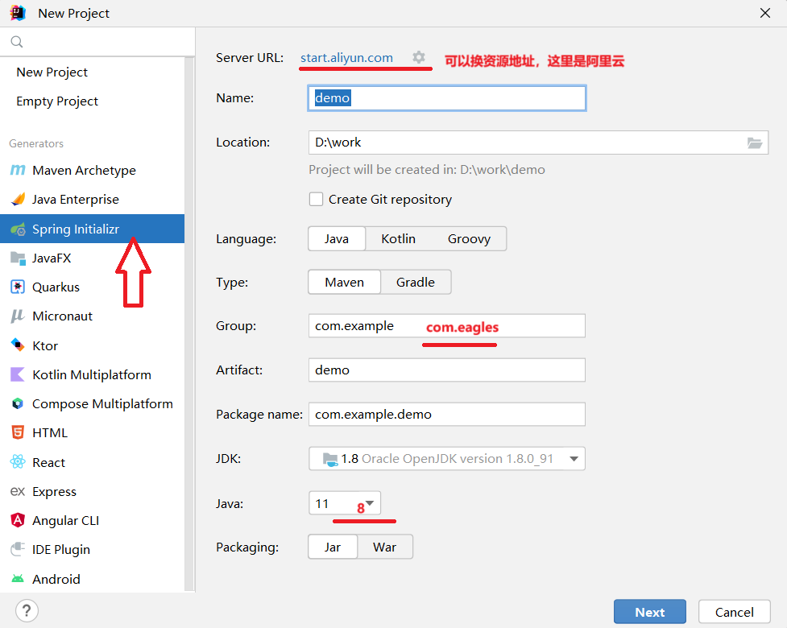

---

### 2. 项目结构示例

```plain
src/
├── main/
│   ├── java/
│   │   └── com/example/demo/
│   │       ├── DemoApplication.java     # 主启动类
│   │       ├── controller/              # 控制器
│   │       ├── service/                 # 业务逻辑
│   │       ├── repository/              # 数据访问
│   │       └── model或者pojo /                   # 实体类
│   └── resources/
│       ├── application.properties       # 配置文件
│       ├── static/                      # 静态资源（CSS/JS/图片）
│       └── templates/                   # 模板文件（HTML）
└── test/                                # 单元测试
```

### 3. 核心注解说明

|  |  |
| --- | --- |
| **注解** | **说明** |
| `@SpringBootApplication` | 主类注解，包含 `@SpringBootConfiguration`+ `@EnableAutoConfiguration`+ `@ComponentScan` |
| `@RestController` | 控制器，返回 JSON 数据（等价于 `@Controller + @ResponseBody`） |
| `@RequestMapping` | 映射请求路径 |
| `@Autowired` | 自动注入 Bean |
| `@Service` | 标记业务层类 |
| `@Repository` | 标记数据访问层类 |
| `@Component` | 通用组件 |
| `@Configuration` | 配置类 |
| `@Bean` | 方法级别，注册一个 Bean |

## 1.在浏览器显示信息

一、控制器概述

UserController 是基于 Spring MVC 的控制器类，负责处理前端发起的 HTTP 请求，协调业务逻辑（如数据库查询、用户登录验证），并返回响应结果（视图或数据）。

#### UserController 表现层实例

```plain
package com.eagles.demo.controller;
import com.eagles.demo.mapper.UserMapper;
import com.eagles.demo.pojo.User;
import org.springframework.beans.factory.annotation.Autowired;
import org.springframework.data.redis.core.RedisTemplate;
import org.springframework.web.bind.annotation.RequestMapping;
import org.springframework.web.bind.annotation.ResponseBody;
import org.springframework.web.bind.annotation.RestController;

/**
 * @RestController  = Controller + ResponseBody
 */
@RestController
public class UserController {
    @Autowired
    private UserMapper userMapper;

    @Autowired
    private RedisTemplate redisTemplate;

    @RequestMapping("/login")
    @ResponseBody
    public String login(User user){

        User userLogin = userMapper.login(user);
        return userLogin != null ? "登录成功":"登录失败";
       }
    }
```

###### 1. 登录验证接口（/login）

功能：验证用户登录信息。

流程：

前端传递 User 对象（包含 username 和 password）；

通过 UserMapper.login(user) 从数据库查询匹配的用户；

根据查询结果返回 "登录成功" 或 "登录失败" 字符串。

注意：@ResponseBody 确保返回值直接作为响应体，不经过视图解析器。

#### UserMapper 持久层接口

```plain
package com.eagles.demo.mapper;
import com.eagles.demo.pojo.User;
import org.springframework.stereotype.Repository;

@Repository
public interface UserMapper {

     User login(User user);
   }
```

#### User 对象实例

```plain
package com.eagles.demo.pojo;

import java.io.Serializable;

public class User implements Serializable {
    private  int id;

    private  String username;
    private  String password;

    @Override
    public String toString() {
        return "User{" +
                "id=" + id +
                ", username='" + username + '\'' +
                ", password='" + password + '\'' +
                '}';
    }

    public int getId() {
        return id;
    }

    public void setId(int id) {
        this.id = id;
    }

    public String getUsername() {
        return username;
    }

    public void setUsername(String username) {
        this.username = username;
    }

    public String getPassword() {
        return password;
    }

    public void setPassword(String password) {
        this.password = password;
    }

    public User() {
    }

    public User(int id, String username, String password) {
        this.id = id;
        this.username = username;
        this.password = password;
    }
}
```

#### SpringbootDemoApplication Spring Boot 项目的**主启动类** 整个应用的入口点

```plain
package com.eagles.demo;
import org.springframework.boot.SpringApplication;
import org.springframework.boot.autoconfigure.SpringBootApplication;

/**
 * @SpringBootApplication 声明当前的工程为springboot工程
 */
 
@SpringBootApplication
public class SpringbootDemoApplication {

    public static void main(String[] args) {

        SpringApplication.run(SpringbootDemoApplication.class, args);
    }

}
```

#### UserMapper.xml 配置文件

```plain
<?xml version="1.0" encoding="UTF-8" ?>
<!DOCTYPE mapper
        PUBLIC "-//mybatis.org//DTD Mapper 3.0//EN"
        "https://mybatis.org/dtd/mybatis-3-mapper.dtd">

<mapper namespace="com.eagles.demo.mapper.UserMapper">

    <select id="login" parameterType="com.eagles.demo.pojo.User" resultType="com.eagles.demo.pojo.User">
        select * from tb_user where username=#{username} and password=#{password}
    </select>
</mapper>
```

#### application.properties 配置文件

```plain
server.port=8082
#\u914D\u7F6E\u6570\u636E\u6E90
spring.datasource.driver-class-name=com.mysql.cj.jdbc.Driver
spring.datasource.url=jdbc:mysql://localhost:3306/database1?serverTimezone=GMT&characterEncoding=utf-8
spring.datasource.username=root
spring.datasource.password=
#\u914D\u7F6Emapper\u6620\u5C04\u6587\u4EF6\u7684\u4F4D\u7F6E
mybatis.mapper-locations=classpath:com/eagles/demo/mapper/*.xml
```

#### pom.xml 配置文件

```plain
<?xml version="1.0" encoding="UTF-8"?>
<project xmlns="http://maven.apache.org/POM/4.0.0" xmlns:xsi="http://www.w3.org/2001/XMLSchema-instance"
         xsi:schemaLocation="http://maven.apache.org/POM/4.0.0 https://maven.apache.org/xsd/maven-4.0.0.xsd">
    <modelVersion>4.0.0</modelVersion>

    <groupId>com.eagles</groupId>
    <artifactId>springboot-demo</artifactId>
    <version>0.0.1-SNAPSHOT</version>
    <name>springboot-demo</name>
    <description>springboot-demo</description>

    <properties>
        <java.version>1.8</java.version>
        <project.build.sourceEncoding>UTF-8</project.build.sourceEncoding>
        <project.reporting.outputEncoding>UTF-8</project.reporting.outputEncoding>
        <spring-boot.version>2.6.13</spring-boot.version>
    </properties>

    <dependencies>
        <dependency>
            <groupId>org.springframework.boot</groupId>
            <artifactId>spring-boot-starter</artifactId>
        </dependency>

        <!--导入springWeb相关的资源-->
        <dependency>
            <groupId>org.springframework.boot</groupId>
            <artifactId>spring-boot-starter-web</artifactId>
        </dependency>

        <!--导入mybatis的启动器-->
        <dependency>
            <groupId>org.mybatis.spring.boot</groupId>
            <artifactId>mybatis-spring-boot-starter</artifactId>
            <version>1.3.2</version>
        </dependency>

        <!--导入mysql的驱动-->
        <dependency>
            <groupId>mysql</groupId>
            <artifactId>mysql-connector-java</artifactId>
            <version>8.0.28</version>
        </dependency>

        <!--freemarker模版引擎-->
        <dependency>
            <groupId>org.springframework.boot</groupId>
            <artifactId>spring-boot-starter-freemarker</artifactId>
        </dependency>

        <!--导入redis启动器-->
        <dependency>
            <groupId>org.springframework.boot</groupId>
            <artifactId>spring-boot-starter-redis</artifactId>
            <version>1.4.0.RELEASE</version>
        </dependency>

        <dependency>
            <groupId>org.springframework.boot</groupId>
            <artifactId>spring-boot-starter-test</artifactId>
            <scope>test</scope>
        </dependency>
    </dependencies>

    <dependencyManagement>
        <dependencies>
            <dependency>
                <groupId>org.springframework.boot</groupId>
                <artifactId>spring-boot-dependencies</artifactId>
                <version>${spring-boot.version}</version>
                <type>pom</type>
                <scope>import</scope>
            </dependency>
        </dependencies>
    </dependencyManagement>

    <build>
        <plugins>
            <plugin>
                <groupId>org.apache.maven.plugins</groupId>
                <artifactId>maven-compiler-plugin</artifactId>
                <version>3.8.1</version>
                <configuration>
                    <source>1.8</source>
                    <target>1.8</target>
                    <encoding>UTF-8</encoding>
                </configuration>
            </plugin>
            <plugin>
                <groupId>org.springframework.boot</groupId>
                <artifactId>spring-boot-maven-plugin</artifactId>
                <version>${spring-boot.version}</version>
                <configuration>
                    <mainClass>com.eagles.demo.SpringbootDemoApplication</mainClass>
                    <skip>true</skip>
                </configuration>
                <executions>
                    <execution>
                        <id>repackage</id>
                        <goals>
                            <goal>repackage</goal>
                        </goals>
                    </execution>
                </executions>
            </plugin>
        </plugins>
    </build>

</project>
```

@Controller

标记当前类为 Spring MVC 控制器，用于处理 HTTP 请求。

@Autowired

自动注入依赖对象（如 UserMapper、RedisTemplate），无需手动创建实例。

@RequestMapping

映射 HTTP 请求路径到控制器方法（如 /login 对应 login() 方法）。

@ResponseBody

将方法返回值直接转换为 JSON/字符串响应给前端，而非跳转视图。

#### 运行

打开核心入口

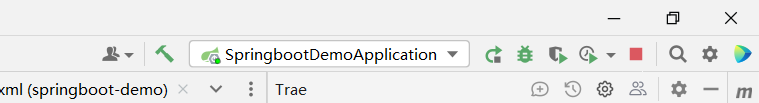

在浏览器端输入URL：[http://localhost:8082/login?username=李四&password=Li@456](http://localhost:8082/login?username=%E6%9D%8E%E5%9B%9B&password=Li@456)

http://localhost:8082/login 没有传入数据 即显示登录失败

（原本端口号是8080，但是人为改成了8082）

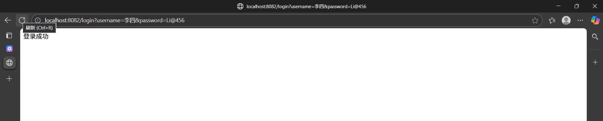

## 2.前端页面的显示

#### UserController 表现层实例

```plain
package com.eagles.demo.controller;

import com.eagles.demo.mapper.UserMapper;
import com.eagles.demo.pojo.User;
import org.springframework.beans.factory.annotation.Autowired;
import org.springframework.data.redis.core.BoundListOperations;
import org.springframework.data.redis.core.RedisTemplate;
import org.springframework.stereotype.Controller;
import org.springframework.ui.Model;
import org.springframework.web.bind.annotation.RequestMapping;
import org.springframework.web.bind.annotation.ResponseBody;
import org.springframework.web.bind.annotation.RestController;

import java.util.List;

/**
 * @RestController  = Controller + ResponseBody
 */
@Controller
public class UserController {
    @Autowired
    private UserMapper userMapper;

    @Autowired
    private RedisTemplate redisTemplate;

    @RequestMapping("/login")
    @ResponseBody
    public String login(User user){

        User userLogin = userMapper.login(user);
        return userLogin != null ? "登录成功":"登录失败";
    }
@RequestMapping("/user")
public String list(User user, Model model){

    List<User> users = userMapper.findUsers();
    model.addAttribute("users",users);

    return "user";
 }
}
```

2. 用户列表查询（/user）

功能：查询用户列表并渲染到页面。

流程：

调用 UserMapper.findUsers() 从数据库查询所有用户数据；

通过 Model.addAttribute() 将用户列表 users 传递给视图；

返回视图名称 "user"（Spring MVC 会自动查找 user.html 或 user.jsp 等模板文件）。

这里将RestController转换成Controller是因为要进行页面的跳转，不再是单纯的数据显示

注意事项

视图渲染：

list() 方法返回 "user" 时，需确保项目中存在对应的视图文件（如 src/main/resources/templates/user.html，需配合 Thymeleaf 等模板引擎）。

请求与响应：

@ResponseBody 适用于 API 接口（返回 JSON/字符串），无该注解时返回视图名称（用于页面跳转）。

UserController

├─ 依赖注入：UserMapper（数据库访问）、RedisTemplate（缓存，已注释）

├─ 接口 1：/login → 处理登录请求，返回成功/失败字符串

└─ 接口 2：/user → 查询用户列表，返回视图并传递数据

#### UserMapper 持久层接口

```plain
package com.eagles.demo.mapper;

import com.eagles.demo.pojo.User;
import org.springframework.stereotype.Repository;

import java.util.List;

@Repository
public interface UserMapper {

     User login(User user);

    List<User> findUsers();
}
```

UserMapper：

数据访问层接口（MyBatis），通过 @Autowired 注入，提供 login(user) 和 findUsers() 方法，用于数据库查询。

需配合对应的 Mapper XML 文件（如 UserMapper.xml）实现 SQL 逻辑。

#### SpringbootDemoApplication Spring Boot 项目的**主启动类** 整个应用的入口点

```plain
package com.eagles.demo;

import org.mybatis.spring.annotation.MapperScan;
import org.springframework.boot.SpringApplication;
import org.springframework.boot.autoconfigure.SpringBootApplication;

/**
 * @SpringBootApplication 声明当前的工程为springboot工程
 */
@SpringBootApplication
@MapperScan("com.eagles.demo.mapper")
public class SpringbootDemoApplication {

    public static void main(String[] args) {

        SpringApplication.run(SpringbootDemoApplication.class, args);
    }

}
```

#### 这个类的作用是什么？

|  |  |
| --- | --- |
| **作用** | **说明** |
| **项目启动入口** | `main`方法是 Java 程序的入口，调用 `SpringApplication.run()`启动 Spring Boot 应用。 |
| `@SpringBootApplication` | 复合注解，包含：  • `@SpringBootConfiguration`：标识为配置类  • `@EnableAutoConfiguration`：启用自动配置  • `@ComponentScan`：自动扫描当前包及其子包下的组件（如 `@Controller`, `@Service`, `@Repository`等） |

---

**关键点**：`UserController` 在启动类的**同一包或子包**下，所以 `@ComponentScan` 能自动扫描到它。

#### UserMapper.xml 配置文件

```plain
<?xml version="1.0" encoding="UTF-8" ?>
<!DOCTYPE mapper
        PUBLIC "-//mybatis.org//DTD Mapper 3.0//EN"
        "https://mybatis.org/dtd/mybatis-3-mapper.dtd">

<mapper namespace="com.eagles.demo.mapper.UserMapper">

    <select id="login" parameterType="com.eagles.demo.pojo.User" resultType="com.eagles.demo.pojo.User">
        select * from tb_user where username=#{username} and password=#{password}
    </select>

    <select id="findUsers" resultType="com.eagles.demo.pojo.User">
        select * from tb_user
    </select>
</mapper>
```

#### user.ftl 前端页面

```plain
<!DOCTYPE html>
<html lang="en">
<head>
    <meta charset="UTF-8">
    <title>user</title>
    <style>
        body {
            font-family: Arial, sans-serif;
            background-color: #f4f4f9;
            margin: 0;
            padding: 20px;
            line-height: 1.6;
        }

        h1 {
            color: #333;
            text-align: center; /* 替代 align 属性 */
            margin-bottom: 30px;
            font-size: 2.5em;
        }

        .user-list {
            background-color: #fff;
            padding: 20px;
            border-radius: 8px;
            box-shadow: 0 0 10px rgba(0, 0, 0, 0.1);
            width: 80%;
            max-width: 800px;
            margin: 0 auto;
        }

        .user-item {
            padding: 15px;
            border-bottom: 1px solid #eee;
            font-size: 1.1em;
        }

        .user-item:last-child {
            border-bottom: none;
        }

        .user-item:hover {
            background-color: #f9f9f9;
        }
    </style>
</head>
<script src="../js/jquery-1.7.2.js"></script>
<script>
    alert($)
</script>
<body>
<h1>用户信息</h1>
<div class="user-list">
    <#list users as user>
        <div class="user-item">${user}</div>
    </#list>
</div>
```

##### 为什么是 .ftl 而不是 .html？

- .ftl 是 FreeMarker Template Language（FreeMarker 模板语言）的文件扩展名，它是一种 动态模板引擎，而非静态 HTML 文件。
- 在 Spring Boot 项目中，若需实现 动态页面渲染（如从后端传递数据到前端页面展示），需使用模板引擎（如 FreeMarker、Thymeleaf 等）。.ftl 文件就是 FreeMarker 的模板文件，它允许在 HTML 基础上嵌入 动态语法（如变量、循环、条件判断等），最终由 Spring Boot 渲染为静态 HTML 响应给浏览器。

一、.ftl 文件的核心作用

- 动态数据绑定： 通过 FreeMarker 语法（如 ${变量名}）接收后端传递的数据。例如，在 user.ftl 中：

```plain
<#list users as user>  <!-- FreeMarker 循环语法：遍历后端传递的 users 列表 -->
    <div class="user-item">${user}</div>  <!-- ${user}：输出单个用户对象 -->
</#list>
```

这里的 users 是后端 UserController 通过 Model.addAttribute("users", users) 传递的用户列表数据，.ftl 文件通过 FreeMarker 语法动态渲染列表。

- 逻辑处理能力： 支持循环（<#list>）、条件判断（<#if>）、变量赋值等逻辑操作，而静态 .html 文件无法直接实现这些功能。例如：

```plain
<#if users??>  <!-- 判断 users 是否存在且非空 -->
    <#list users as user>
        <div>${user.username}</div>  <!-- 输出用户的 username 属性 -->
    </#list>
<#else>
    <div>暂无用户数据</div>  <!-- 无数据时显示提示 -->
</#if>
```

- 与 Spring Boot 的集成： Spring Boot 默认支持 FreeMarker 模板引擎，约定将 .ftl 文件放在 src/main/resources/templates 目录下。当控制器方法返回视图名称（如 return "user"）时，Spring Boot 会自动查找 templates/user.ftl 文件，使用 FreeMarker 引擎解析动态语法并渲染为 HTML 页面。

二、.ftl 与 .html 的关键区别

|  |  |  |
| --- | --- | --- |
| **特性** | `.ftl`  **（FreeMarker 模板）** | `.html`  **（静态 HTML）** |
| **动态语法** | 支持 `${变量}`、`<#list>`、`<#if>`  等动态指令 | 仅支持静态 HTML/CSS/JS，无法直接嵌入动态逻辑 |
| **数据交互** | 可接收后端传递的 Java 对象（如 `users`列表） | 无法直接接收后端数据，需通过 JS/AJAX 间接获取 |
| **渲染方式** | 由 Spring Boot 后端渲染为 HTML 后返回给浏览器 | 直接作为静态文件传输，浏览器直接解析 |
| **文件位置** | 通常放在 `resources/templates/`目录下 | 通常放在 `resources/static/` 或前端工程中 |
| **适用场景** | 服务端渲染（SSR），适合内容依赖后端数据的页面 | 静态页面、前端单页应用（SPA）、资源文件（如官网） |

三、结合你的 user.ftl 文件实例分析

你的 user.ftl 文件中包含典型的 FreeMarker 动态语法，这也是必须使用 .ftl 扩展名的直接原因：

```plain
<!-- 1. FreeMarker 循环指令：遍历后端传递的 users 列表 -->
<#list users as user>  
    <!-- 2. FreeMarker 变量输出：显示单个 user 对象 -->
    <div class="user-item">${user}</div>  
</#list>
```

- 后端数据传递：users 列表由 UserController 的 list 方法通过 Model 传递：

```plain
@RequestMapping("/user")
public String list(Model model) {
    List<User> users = userMapper.findUsers(); 
    // 从数据库查询用户列表
    model.addAttribute("users", users); 
    // 将列表存入 Model，传递给 .ftl 模板
    return "user"; 
    // 返回视图名称，对应 templates/user.ftl
}
```

- 渲染流程：Spring Boot 调用 FreeMarker 引擎解析 user.ftl，将 <#list users as user> 转换为 HTML 循环结构，将 ${user} 替换为实际的用户数据，最终生成完整的 HTML 页面响应给浏览器。

四、总结

.ftl 是 FreeMarker 模板文件的标志，它扩展了静态 HTML 的能力，允许通过动态语法与后端数据交互，实现页面的动态渲染。在你的项目中，user.ftl 通过 <#list> 循环和 ${user} 变量展示用户列表，这正是 FreeMarker 模板的核心作用，而静态 .html 文件无法直接支持这些动态功能。

关键点：.ftl 不是替代 .html，而是在 HTML 基础上增加了动态逻辑处理能力，由 Spring Boot 结合后端数据渲染为最终的 HTML 页面。

##### 为什么不是JSP？

因为spring-boot与JSP不兼容

#### application.properties 配置文件

```plain
server.port=8082
#\u914D\u7F6E\u6570\u636E\u6E90
spring.datasource.driver-class-name=com.mysql.cj.jdbc.Driver
spring.datasource.url=jdbc:mysql://localhost:3306/database1?serverTimezone=GMT&characterEncoding=utf-8
spring.datasource.username=root
spring.datasource.password=
#\u914D\u7F6Emapper\u6620\u5C04\u6587\u4EF6\u7684\u4F4D\u7F6E
mybatis.mapper-locations=classpath:com/eagles/demo/mapper/*.xml
#视图的位置
spring.freemarker.template-loader-path=classpath:/templates
#视图的后缀
spring.freemarker.suffix=.ftl
```

#### 运行

在浏览器端输入URL：[http：//localhost：8082/user](http://localhost:8082/login?username=%E6%9D%8E%E5%9B%9B&password=Li@456)

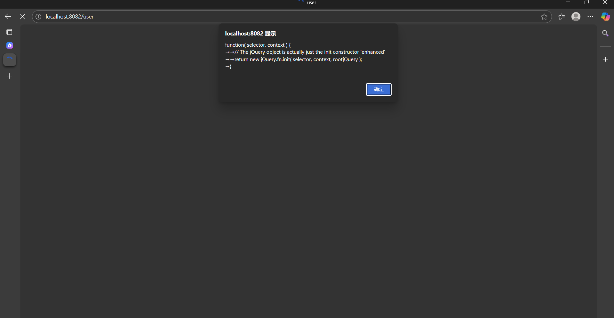

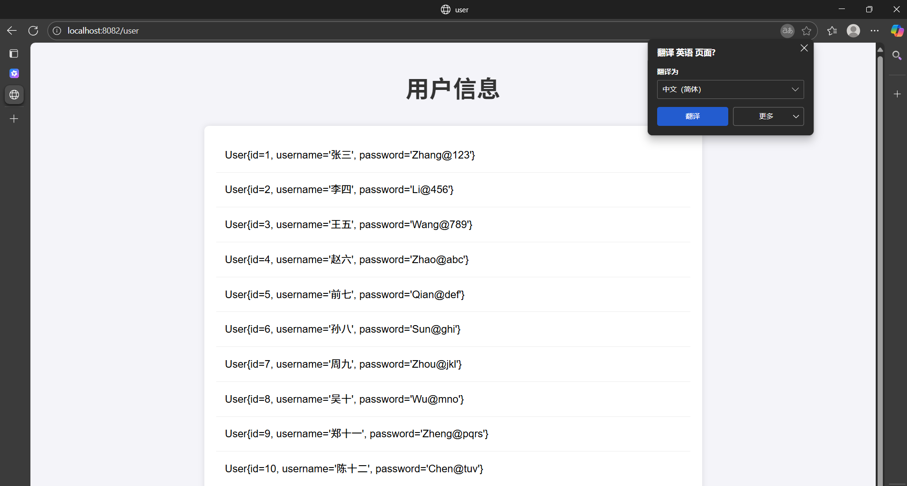

# 3.Redis缓存原理

#### UserController 表现层实例

```plain
package com.eagles.demo.controller;

import com.eagles.demo.mapper.UserMapper;
import com.eagles.demo.pojo.User;
import org.springframework.beans.factory.annotation.Autowired;
import org.springframework.data.redis.core.BoundListOperations;
import org.springframework.data.redis.core.RedisTemplate;
import org.springframework.stereotype.Controller;
import org.springframework.ui.Model;
import org.springframework.web.bind.annotation.RequestMapping;
import org.springframework.web.bind.annotation.ResponseBody;
import org.springframework.web.bind.annotation.RestController;

import java.util.List;

/**
 * @RestController  = Controller + ResponseBody
 */
@Controller
public class UserController {
    @Autowired
    private UserMapper userMapper;

    @Autowired
    private RedisTemplate redisTemplate;

    /**
     * 使用缓存的流程：
     *      1、先从数据库中查询数据
     *      2、将数据存入缓存
     *      3、后面在查询相同数据的时候，直接从缓存中取数据
     *      -降低数据库的访问压力，提高程序的执行效率
     * @param user
     * @param model
     * @return
     */
    @RequestMapping("/user")
    @ResponseBody
    public List<User> list(User user, Model model){

        List<User> users = null;

        BoundListOperations boundListOperations = redisTemplate.boundListOps("userList");

        if (boundListOperations.size() > 0){

            System.out.println("从redis缓存中取的数据~~~");
            users = boundListOperations.range(0,-1); //取出缓存中所有的数据

        }else {
            System.out.println("从mysql数据库中取的数据~~~");

            //从mysql数据库中查询数据
            users = userMapper.findUsers();
            //将数据存储到缓存中
            boundListOperations.rightPush(users);
        }

        return users;
    }
}
```

#### application.properties 配置文件

```plain
server.port=8082
#\u914D\u7F6E\u6570\u636E\u6E90
spring.datasource.driver-class-name=com.mysql.cj.jdbc.Driver
spring.datasource.url=jdbc:mysql://localhost:3306/database1?serverTimezone=GMT&characterEncoding=utf-8
spring.datasource.username=root
spring.datasource.password=
#\u914D\u7F6Emapper\u6620\u5C04\u6587\u4EF6\u7684\u4F4D\u7F6E
mybatis.mapper-locations=classpath:com/eagles/demo/mapper/*.xml
#视图的位置
spring.freemarker.template-loader-path=classpath:/templates
#视图的后缀
spring.freemarker.suffix=.ftl
#redis的配置
spring.redis.host=127.0.0.1
spring.redis.port=6379
```

#### 运行

在浏览器端输入URL：[http：//localhost：8082/user](http://localhost:8082/login?username=%E6%9D%8E%E5%9B%9B&password=Li@456)

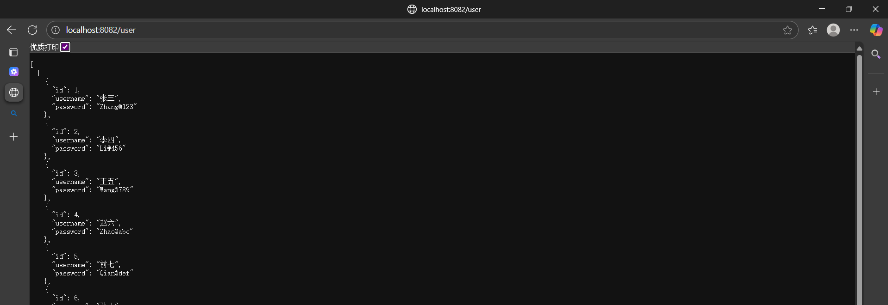

打印台显示

```plain
从mysql数据库中取的数据~~~
从redis缓存中取的数据~~~
从redis缓存中取的数据~~~
从redis缓存中取的数据~~~
```

RedisTemplate：

用于操作 Redis 缓存的工具类。

注释代码中曾实现缓存逻辑：先查 Redis，若缓存不存在则查数据库并将结果存入 Redis（优化数据库访问压力），目前已临时禁用。

注意事项

缓存逻辑（注释代码）：

若需重新启用 Redis 缓存，需确保 User 类实现 Serializable 接口（避免序列化异常），并配置 Redis 服务器连接。

Redis打开方式是

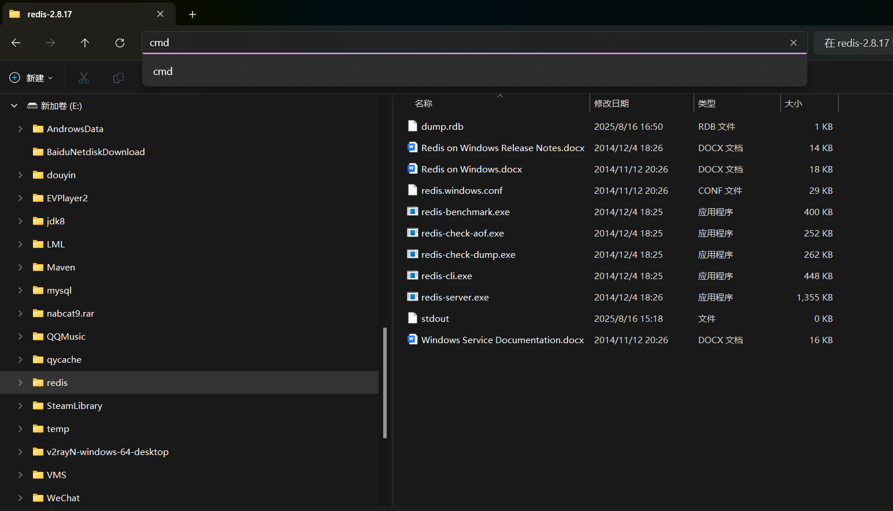

进入页面

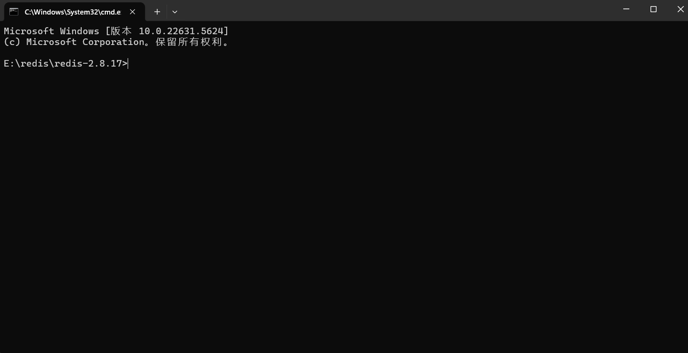

输入：redis-server.exe redis.windows.conf --maxheap 1gb

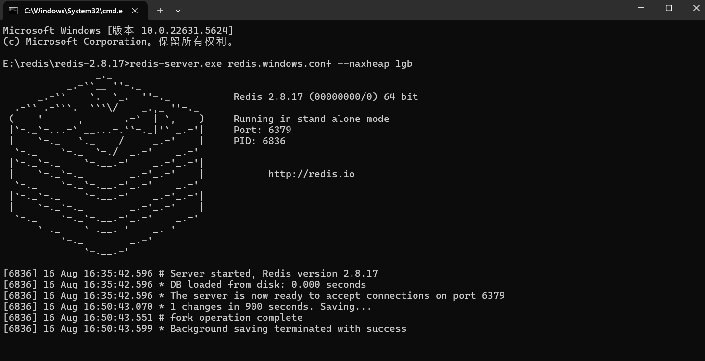

最小化上面页面，在点击redis-cli.exe

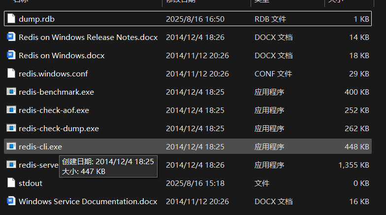

进入该页面 就可以进行存储，取值的一些操作（输入对应的语句）

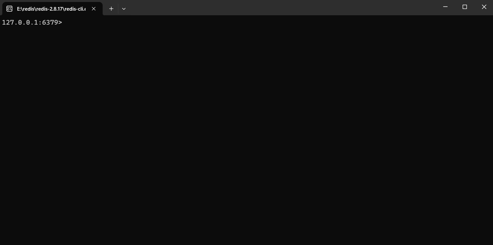
