#### TestController（控制器） 测试类：

```java
package com.eagles.controller;

import org.springframework.web.servlet.ModelAndView;
import org.springframework.web.servlet.mvc.Controller;

public class TestController implements Controller {
    @Override
    public ModelAndView handleRequest(javax.servlet.http.HttpServletRequest httpServletRequest, javax.servlet.http.HttpServletResponse httpServletResponse) throws Exception {

        ModelAndView modelAndView = new ModelAndView();
        modelAndView.addObject("message","hello springmvc~~");
        modelAndView.setViewName("test");
        /**
         * /jsp/test.jsp
         */

        return modelAndView;
    }
}
```

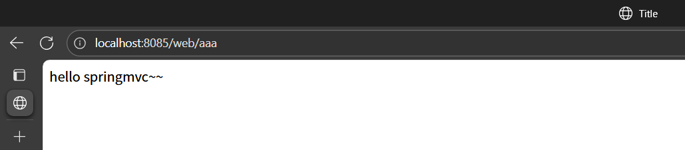

#### TestServlet 测试类

```java
package com.eagles.servlet;

import javax.servlet.ServletException;
import javax.servlet.annotation.WebServlet;
import javax.servlet.http.HttpServlet;
import javax.servlet.http.HttpServletRequest;
import javax.servlet.http.HttpServletResponse;
import java.io.IOException;
@WebServlet("/test")
public class TestServlet  extends  HttpServlet{

    @Override
    protected void service(HttpServletRequest request, HttpServletResponse response) throws ServletException, IOException {

        String name = request.getParameter("name");
        response.getWriter().print(name);
    }
}
```

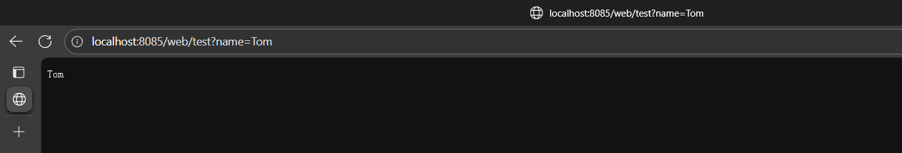

#### spingmvc.xml 配置文件

```xml
<?xml version="1.0" encoding="UTF-8"?>
<beans xmlns="http://www.springframework.org/schema/beans"
  xmlns:mvc="http://www.springframework.org/schema/mvc"
  xmlns:xsi="http://www.w3.org/2001/XMLSchema-instance"
  xsi:schemaLocation="
  http://www.springframework.org/schema/beans
  http://www.springframework.org/schema/beans/spring-beans.xsd
  http://www.springframework.org/schema/mvc
  http://www.springframework.org/schema/mvc/spring-mvc.xsd">

  <!--配置视图解析器-->
  <bean id="viewResolver" class="org.springframework.web.servlet.view.InternalResourceViewResolver">
    <!--注入视图的前缀和后缀-->

    <!--前缀-->
    <property name="prefix" value="/jsp/"></property>
    <!--后缀-->
    <property name="suffix" value=".jsp"></property>

  </bean>
  <!--将后端资源的controller添加到sprin的容器中-->
  <bean id="/aaa" class="com.eagles.controller.TestController"></bean>
  <!--这里类似servlet配置资源路径，/aaa是后端资源路径的地址，必须写/ 这样才能识别到-->

</beans>
```

#### test.xml 配置文件

```html
<%--
  Created by IntelliJ IDEA.
  User: HP
  Date: 2025/8/8
  Time: 11:31
  To change this template use File | Settings | File Templates.
  --%>
  <%@ page contentType="text/html;charset=UTF-8" language="java" %>
    <html>
      <head>
        <title>Title</title>
      </head>
      <body>
        ${message}
      </body>
    </html>
```

#### web.xml配置文件

```xml
<?xml version="1.0" encoding="UTF-8"?>
<web-app xmlns="http://xmlns.jcp.org/xml/ns/javaee"
  xmlns:xsi="http://www.w3.org/2001/XMLSchema-instance"
  xsi:schemaLocation="http://xmlns.jcp.org/xml/ns/javaee http://xmlns.jcp.org/xml/ns/javaee/web-app_4_0.xsd"
  version="4.0">

  <!--配置springmvc的前端总控制器dispatcherServlet-->
  <servlet>
    <servlet-name>dispatcherServlet</servlet-name>
    <servlet-class>org.springframework.web.servlet.DispatcherServlet</servlet-class>

    <!--绑定spring的配置文件-->
    <init-param>
      <param-name>contextConfigLocation</param-name>
      <param-value>classpath:springmvc.xml</param-value>
    </init-param>

    <!--设置启动级别-->
    <load-on-startup>1</load-on-startup>

  </servlet>

  <servlet-mapping>
    <servlet-name>dispatcherServlet</servlet-name>
    <!--拦截客户端所有请求-->
    <url-pattern>/</url-pattern>
  </servlet-mapping>

</web-app>
```

#### pom.xml配置文件

```xml
<?xml version="1.0" encoding="UTF-8"?>
<project xmlns="http://maven.apache.org/POM/4.0.0"
  xmlns:xsi="http://www.w3.org/2001/XMLSchema-instance"
  xsi:schemaLocation="http://maven.apache.org/POM/4.0.0 http://maven.apache.org/xsd/maven-4.0.0.xsd">
  <modelVersion>4.0.0</modelVersion>

  <groupId>com.eagles</groupId>
  <artifactId>maven-demo</artifactId>
  <version>1.0-SNAPSHOT</version>

  <properties>
    <maven.compiler.source>8</maven.compiler.source>
    <maven.compiler.target>8</maven.compiler.target>
  </properties>

  <dependencies>
    <dependency>
      <groupId>org.springframework.boot</groupId>
      <artifactId>spring-boot</artifactId>
      <version>2.3.0.RELEASE</version>
    </dependency>

    <dependency>
      <groupId>org.springframework</groupId>
      <artifactId>spring-webmvc</artifactId>
      <version>5.2.1.RELEASE</version>
    </dependency>

    <dependency>
      <groupId>org.springframework</groupId>
      <artifactId>spring-beans</artifactId>
      <version>5.2.1.RELEASE</version>
    </dependency>

    <dependency>
      <groupId>javax.servlet</groupId>
      <artifactId>javax.servlet-api</artifactId>
      <version>3.1.0</version>
    </dependency>

  </dependencies>

</project>
```

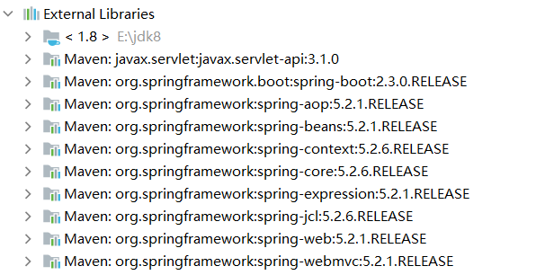

```plain
1、浏览器发起访问，该请求会由DispatcherServlet进行拦截
2、DispatcherServlet会去调用资源映射器HandlerMapping，会去解析地址中的资源路径，找到对应的后端Controller实体
3、HandlerMapping会将处理的结果反馈给DispatcherServlet，然后DispatcherServlet会根据HandlerMapping的处理结果，调用HandlerAdapter资源适配器
4、HandlerAdapter会根据HandlerMapping的处理结果，找到对应的后端资源调用Controller的方法
5、Controller的方法会返回一个ModelAndView对象（视图模型对象）
6、HandlerAdapter会根据ModelAndView对象，调用ViewResolver来进行处理
7、ViewResolver会根据ModelAndView对象，调用Model装配数据，View来进行处理
8、View会将数据渲染到页面上，Model会将数据装配到View中
9、DispatcherServlet会将页面返回给浏览器
10、浏览器会将页面展示给用户
```

## 案例2：

#### UserVo 实现类

```java
package com.eagles.beans;

public class UserVo {
    private  int id;
    private  String username;
    private  String address;
    private  int age;
    private  String email;

    @Override
    public String toString() {
        return "UserVo{" +
        "id=" + id +
        ", username='" + username + '\'' +
        ", address='" + address + '\'' +
        ", age=" + age +
        ", email='" + email + '\'' +
        '}';
    }

    public int getId() {
        return id;
    }

    public void setId(int id) {
        this.id = id;
    }

    public String getUsername() {
        return username;
    }

    public void setUsername(String username) {
        this.username = username;
    }

    public String getAddress() {
        return address;
    }

    public void setAddress(String address) {
        this.address = address;
    }

    public int getAge() {
        return age;
    }

    public void setAge(int age) {
        this.age = age;
    }

    public String getEmail() {
        return email;
    }

    public void setEmail(String email) {
        this.email = email;
    }

    public UserVo() {
    }

    public UserVo(int id, String username, String address, int age, String email) {
        this.id = id;
        this.username = username;
        this.address = address;
        this.age = age;
        this.email = email;
    }
}
```

#### TestContrller（控制器） 测试类：

```java
package com.eagles.controller;

import com.eagles.beans.UserVo;
import org.springframework.stereotype.Controller;
import org.springframework.ui.Model;
import org.springframework.web.bind.annotation.RequestMapping;
import org.springframework.web.bind.annotation.ResponseBody;
import org.springframework.web.servlet.ModelAndView;

/**@RequestMapping 资源映射的注解，我们一般会通过注解来指定资源的资源路径
 * @PostMapping  只能接收客户端post请求
 * @GetMapping  只能接收客户端get请求
 */
@Controller
@RequestMapping("/test")
public class TestController {

    @RequestMapping("/01")
    public ModelAndView test01(){
        //创建视图数据对象
        ModelAndView modelAndView = new ModelAndView();
        //往model中添加数据
        modelAndView.addObject("date","hello");
        //设置视图名称
        modelAndView.setViewName("list");

        return modelAndView;
    }

    /**
     * 在controller资源中，一个方法的返回值是string，并且该方法+@RequstMapping等相关注释，
     * 那么该方法的返回值会被看成是视图名称
     * @param model
     * @return
     */
    @RequestMapping("/aaa")
    public String test02(Model model){

        model.addAttribute("name","Tom");

        return  "list";  //  /jsp.list.jsp
    }

    /**
     * @ResponseBody 用于响应数据给浏览器，方法return的内容，就是响应的内容
     * @return
     */
    @RequestMapping("/bbb")
    @ResponseBody
    public String test03(){

        return "hello world";
    }

    /**
     * 在springmvc中，可以直接通过参数进行接收值，参数可以是实体类
     */
    @RequestMapping("/ccc")
    public void test04(String name,int age,String address){

        System.out.println(name);
        System.out.println(age);
        System.out.println(address);
    }

    /**
     * 参数可以是实体类
     * @param userVo
     */
    @RequestMapping("/ddd")
    public  void test05(UserVo userVo){

        System.out.println(userVo);

    }

    @RequestMapping("/eee")
    public String test06(){
        return "test";  //转发
    }

    /**
     * 请求重定向的关键词 redirect 地址会发生变化
     * 请求转发的关键词  forward   地址不会发生变化
     *  -默认情况下，程序会基于转发的方式跳转资源
     * @return
     */
    @RequestMapping("/www")
    public String  test07(){
        return "redirect:/test/eee";
    }
}
```

#### springmvc.xml 配置文件

```xml
<?xml version="1.0" encoding="UTF-8"?>
<beans xmlns="http://www.springframework.org/schema/beans"
  xmlns:mvc="http://www.springframework.org/schema/mvc"
  xmlns:context="http://www.springframework.org/schema/context"
  xmlns:xsi="http://www.w3.org/2001/XMLSchema-instance"
  xsi:schemaLocation="
  http://www.springframework.org/schema/beans
  http://www.springframework.org/schema/beans/spring-beans.xsd
  http://www.springframework.org/schema/context
  http://www.springframework.org/schema/context/spring-context.xsd
  http://www.springframework.org/schema/mvc
  http://www.springframework.org/schema/mvc/spring-mvc.xsd">

  <!--开启包扫描-->
  <context:component-scan base-package="com.eagles"></context:component-scan>

  <!--开启springmvc对注解的支持-->
  <mvc:annotation-driven></mvc:annotation-driven>

  <!--过滤静态资源-->
  <mvc:default-servlet-handler></mvc:default-servlet-handler>

  <!--配置视图解析器-->
  <bean id="viewResolver" class="org.springframework.web.servlet.view.InternalResourceViewResolver">

    <!--注入视图的前缀和后缀-->

    <!--前缀-->
    <property name="prefix" value="/jsp/"></property>
    <!--后缀-->
    <property name="suffix" value=".jsp"></property>

  </bean>

</beans>
```

#### list.xml 配置文件

```xml
<%--
  Created by IntelliJ IDEA.
  User: HP
  Date: 2025/8/8
  Time: 16:52
  To change this template use File | Settings | File Templates.
  --%>
  <%@ page contentType="text/html;charset=UTF-8" language="java" %>
    <html>
      <head>
        <title>Title</title>
      </head>
      <body>
        ${date}
        ${name}
      </body>
    </html>
```

#### test.jsp 配置文件

```html
<%--
  Created by IntelliJ IDEA.
  User: HP
  Date: 2025/8/8
  Time: 16:52
  To change this template use File | Settings | File Templates.
  --%>
  <%@ page contentType="text/html;charset=UTF-8" language="java" %>
    <html>
      <head>
        <title>Title</title>
      </head>
      <body>
        success!!!
      </body>
    </html>
```

#### web.xml配置文件

```xml
<?xml version="1.0" encoding="UTF-8"?>
<web-app xmlns="http://xmlns.jcp.org/xml/ns/javaee"
  xmlns:xsi="http://www.w3.org/2001/XMLSchema-instance"
  xsi:schemaLocation="http://xmlns.jcp.org/xml/ns/javaee http://xmlns.jcp.org/xml/ns/javaee/web-app_4_0.xsd"
  version="4.0">

  <servlet>
    <servlet-name>dispatcherServlet</servlet-name>
    <servlet-class>org.springframework.web.servlet.DispatcherServlet</servlet-class>

    <!--绑定spring核心配置文件-->
    <init-param>
      <param-name>contextConfigLocation</param-name>
      <param-value>classpath:springmvc.xml</param-value>
    </init-param>

    <!--设置启动级别-->
    <load-on-startup>1</load-on-startup>

  </servlet>

  <servlet-mapping>
    <servlet-name>dispatcherServlet</servlet-name>
    <url-pattern>/</url-pattern>
  </servlet-mapping>

</web-app>
```

#### pm.xml 配置文件

```xml
<?xml version="1.0" encoding="UTF-8"?>
<project xmlns="http://maven.apache.org/POM/4.0.0"
  xmlns:xsi="http://www.w3.org/2001/XMLSchema-instance"
  xsi:schemaLocation="http://maven.apache.org/POM/4.0.0 http://maven.apache.org/xsd/maven-4.0.0.xsd">
  <modelVersion>4.0.0</modelVersion>

  <groupId>org.example</groupId>
  <artifactId>springmvc-annotation</artifactId>
  <version>1.0-SNAPSHOT</version>

  <properties>
    <maven.compiler.source>8</maven.compiler.source>
    <maven.compiler.target>8</maven.compiler.target>
  </properties>

  <dependencies>
    <dependency>
      <groupId>org.springframework</groupId>
      <artifactId>spring-beans</artifactId>
      <version>5.2.1.RELEASE</version>
    </dependency>

    <dependency>
      <groupId>org.springframework</groupId>
      <artifactId>spring-webmvc</artifactId>
      <version>5.2.1.RELEASE</version>
    </dependency>

    <dependency>
      <groupId>javax.servlet</groupId>
      <artifactId>javax.servlet-api</artifactId>
      <version>3.1.0</version>
    </dependency>
  </dependencies>

</project>
```

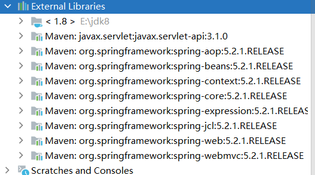

“/01”

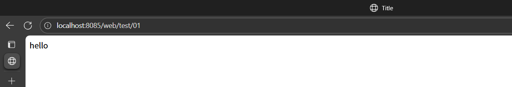

"/aaa"

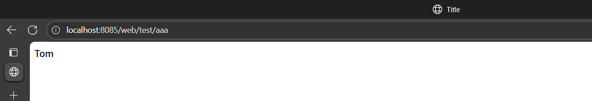

"/bbb"

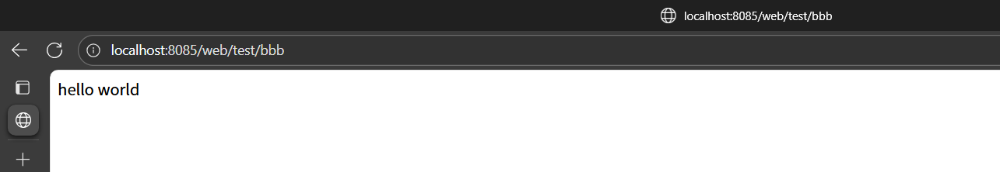

"/ccc"

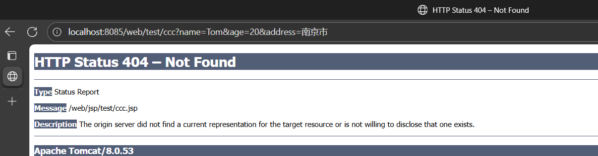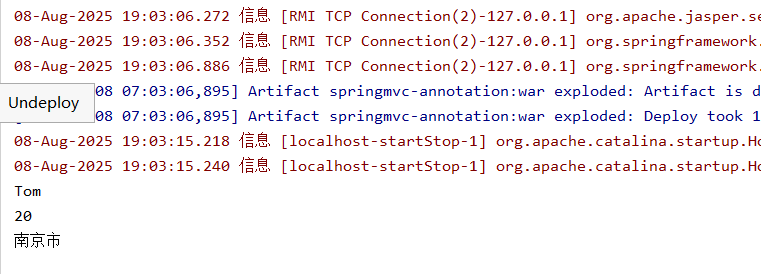

"/ddd"

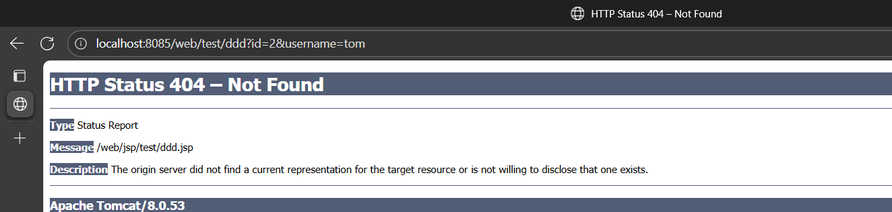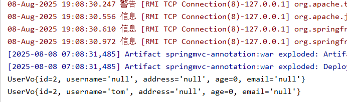

"/eee"

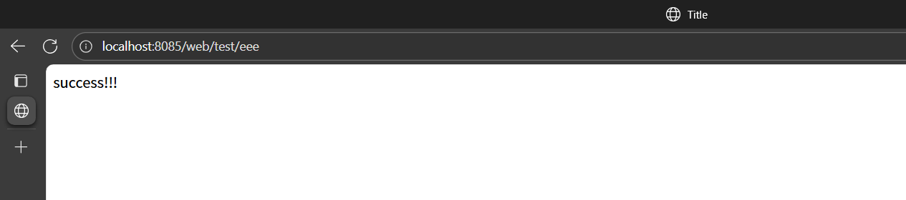

"/www"==>重定向跳转为“/eee”

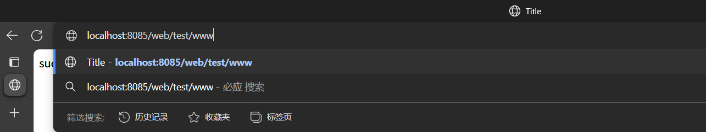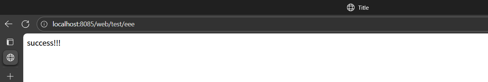
