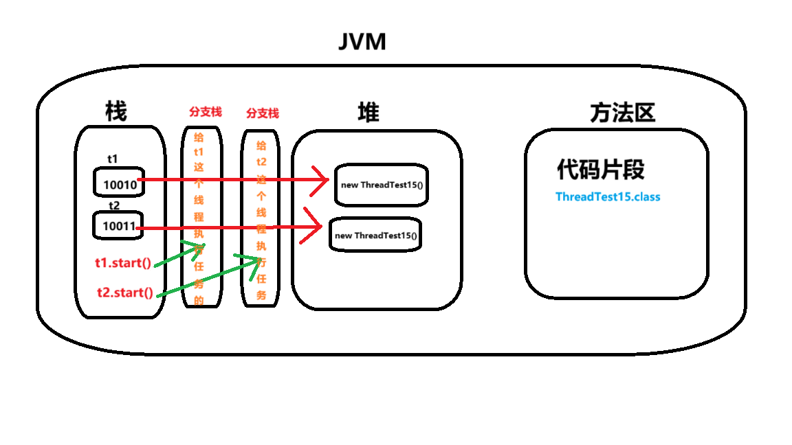

# 案例：

```java
public class ThreadTest15 extends Thread {
    //主线程==>用户线程 由jvm直接调用 当前类会被生成字节码文件
    public static void main(String[] args) {
        //创建线程对象
        ThreadTest15 t1 = new ThreadTest15();//创建状态
        ThreadTest15 t2 = new ThreadTest15();

        t1.setName("t1");
        t2.setName("t2");

        //开启线程
        t1.start();//就绪状态 拥有争夺cpu时间片的权利
        t2.start();
        //开启线程之后才会去执行run方法
```

主线程==>用户线程 由jvm直接调用

当前类会被生成字节码文件，代码片段放在方法区里面ThreadTest15.class

局部变量需要在栈中开辟空间 第一份空间t1（栈中）指向堆内存中的一份实例new ThreadTest15（）;第一份空间t2（栈中）指向堆内存中的另一份实例new ThreadTest15（）

t1.start(); 当他调用了这个方法之后，他会开辟出来一个分支栈，这个栈开辟出来主要是给t1这个线程执行任务的

t2.start(); 当他调用了这个方法之后，他也会开辟出来另一个分支栈，这个栈开辟出来主要是给t2这个线程执行任务的

主栈和分支栈，栈与栈之间资源是不共享的，互不干扰，是一个并发的状态


