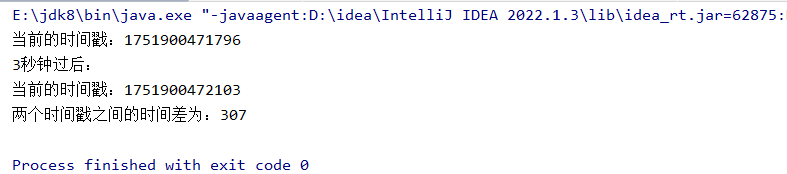

### 时间戳：

```java
package com.handover;

public class Test {
    public static void main(String[] args) {
        long l = System.currentTimeMillis();
        System.out.println("当前的时间戳："+l);

        try {
            Thread.sleep(300);
        } catch (InterruptedException e) {
            throw new RuntimeException(e);
        }
        System.out.println("3秒钟过后：");

        long l2 = System.currentTimeMillis();
        System.out.println("当前的时间戳："+l2);

        System.out.println("两个时间戳之间的时间差为："+(l2-l)); //输出的结果是以毫秒的新式输出

    }
}
```



307是以毫秒为计算单位，换算成秒为3秒

# 接力赛**：**

接力比赛场景如下：

在接力比赛当中，比赛的不仅仅是奔跑的速度，而且比的也是交接的技巧，只有两项都很优秀才能取得好的的成绩。

现在A、B、C、D、E、F六个比赛队伍，他们的比赛平均速度分别是9.2米/秒，9.3米/秒，9.4米/秒，9.5米/秒，9.3米/秒，

9.2米/秒，平均交接棒的时间分别为0.3，0.4，0.2，0.5，0.4，0.3秒。现在运用线程技术模拟该比赛过程。

比赛为（4X100米）。

1、创建工程。

2、使用线程，每个线程模拟一个队伍

3、时刻记录每个队伍当前共计跑了多少米，用控制台输出

4、输出每个队伍每次交接棒的起始和结束时间

5、需要所有队伍都到达终点。

6、所有队伍都到达终点后计算排名。

7、创建主函数启动该模拟过程。

8、启动后每个队伍使用自己的线程，并打印线程的id。

```java
package com.handover;

import java.text.SimpleDateFormat;
import java.util.Date;
import java.util.concurrent.Callable;
//继承Callable接口，这个接口会有返回值
public class TeamThread implements Callable {
    //每只队伍的速度
    private  double speed;
    //交接棒的时间
    private double handoverTime;

    public TeamThread(double speed, double handoverTime) {
        this.speed = speed;
        this.handoverTime = handoverTime;
    }

    @Override
    public Object call() throws Exception {
        //得到一个起始时间
        Long timeStart = System.currentTimeMillis();//获取当前时间的时间戳
        //拿来装总长
        double count = 0 ;

        //模拟4*100米
        for (int i = 1; i <=4 ; i++) {
            for (int j = 0; j <=100 ; j+=speed) { //模拟每秒的一个速度
                Thread.sleep(1000);
                //跑了多少米
                //System.out.println(Thread.currentThread().getName()+"跑了"+(speed)+"米");

                //总共跑了多少米
                System.out.println(Thread.currentThread().getName()+"一共跑了"+(count+=speed)+"米");
                //获取当前的线程，这边不能用this
                // 因为这边实现的是一个Callable，没有去继承Thread，所以用Thread.currentThread()

            }
            //获取交接棒开始的时间（创建一个格式化对象）
            SimpleDateFormat simpleDateFormat = new SimpleDateFormat("yyyy-MM-dd hh:mm:ss");
            String handoverStartTime = simpleDateFormat.format(new Date());//去new一个当前的时间
            System.out.println(Thread.currentThread().getName()+"交接棒开始的时间"+handoverStartTime);

            //交接棒所花费的时间
            System.out.println(Thread.currentThread().getName()+"正在交接棒~~~~~~~~~~");
            Thread.sleep((int)handoverTime*1000);
            //handoverTime交接棒的时间计算单位是秒*1000换算成毫秒，上面时间戳的计算单位就是毫秒
            // 又因为sleep只能放整形不能放double类型，所以再进行强转

            //获取交接棒结束的时间
            String handoverEndTime = simpleDateFormat.format(new Date());//去new一个当前的日期,前面 那一排可以不用再写了
            System.out.println(Thread.currentThread().getName()+"交接棒结束的一个时间："+handoverEndTime);
        }
        //获取比赛结束的时间戳
        long timeEnd = System.currentTimeMillis();
        //返回值（总时间）
        return timeEnd-timeStart;
    }
}
```

```java
package com.handover;

import java.util.*;
import java.util.concurrent.ExecutionException;
import java.util.concurrent.FutureTask;

public class HandoverTest {
    public static void main(String[] args) {
        //创建未来任务类对象
        FutureTask futureTaskA = new FutureTask(new TeamThread(9.2,0.3)); //new FutureTask();()里面需要填入Callable的子类实例填入进去
        FutureTask futureTaskB = new FutureTask(new TeamThread(9.3,0.4));
        FutureTask futureTaskC = new FutureTask(new TeamThread(9.4,0.2));
        FutureTask futureTaskD = new FutureTask(new TeamThread(9.5,0.5));
        FutureTask futureTaskE = new FutureTask(new TeamThread(9.3,0.4));
        FutureTask futureTaskF = new FutureTask(new TeamThread(9.2,0.3));

        //创建线程对象
        Thread thread01 = new Thread(futureTaskA);
        thread01.setName("A");

        Thread thread02 = new Thread(futureTaskB);
        thread02.setName("B");

        Thread thread03 = new Thread(futureTaskC);
        thread03.setName("C");

        Thread thread04 = new Thread(futureTaskD);
        thread04.setName("D");

        Thread thread05 = new Thread(futureTaskE);
        thread05.setName("E");

        Thread thread06 = new Thread(futureTaskF);
        thread06.setName("F");

        //开启线程
        thread01.start();
        thread02.start();
        thread03.start();
        thread04.start();
        thread05.start();
        thread06.start();

        try {
            //获取每个线程的返回值
            Long timeA = (Long)futureTaskA.get();
            Long timeB = (Long)futureTaskB.get();
            Long timeC = (Long)futureTaskC.get();
            Long timeD = (Long)futureTaskD.get();
            Long timeE = (Long)futureTaskE.get();
            Long timeF = (Long)futureTaskF.get();

            System.out.println("--------------------每只队伍用到的时间--------------------------");

            //            //创建一个Map集合做到一一对应的关系,因为TreeMap这个集合是通过key进行排列的所以将time放前面
            //            //后来发现有相同的时间差，TreeMap里面不允许有相同的时间，所以不能用TreeMap
            //            TreeMap<Long, String> treeMap = new TreeMap<>();
            //
            //            treeMap.put(timeA,thread01.getName());
            //            treeMap.put(timeB,thread02.getName());
            //            treeMap.put(timeC,thread03.getName());
            //            treeMap.put(timeD,thread04.getName());
            //            treeMap.put(timeE,thread05.getName());
            //            treeMap.put(timeF,thread06.getName());
            //
            //            System.out.println("队伍排名为：");
            //            Set<Map.Entry<Long, String>> entries = treeMap.entrySet();
            //            for (Map.Entry<Long, String> entry : entries) {
            //                System.out.println(entry.getValue()+" ==> "+entry.getKey());
            //            }

            //创造一个HashMap
            HashMap<String,Long> hashMap = new HashMap<>();//因为下面for循环要用Long类型 所以这里进行了一个强转
            hashMap.put(thread01.getName(),timeA);
            hashMap.put(thread02.getName(),timeB);
            hashMap.put(thread03.getName(),timeC);
            hashMap.put(thread04.getName(),timeD);
            hashMap.put(thread05.getName(),timeE);
            hashMap.put(thread06.getName(),timeF);

            //写一个数组，因为发现下面sort（）里面不能直接放数组
           Long[]  times   = {timeA,timeB,timeC,timeD,timeE,timeF};
            //调用排列函数 将数组中的数据进行排序(升序排列)
            Arrays.sort(times);

           //还有一个方法 可以将你排序之后的这个数组进行一个转化，转化成一个List集合，直接将排序之后的数组放进去就好了
            //将排序之后的数组进行转化为集合
            List<Long> asList = Arrays.asList(times); //同样因为下面for循环要用Long类型 所以这里进行了一个强转
            for (Long time: asList) {
                for (Map.Entry<String, Long> entry : hashMap.entrySet()) {
                      if (time ==  entry.getValue()){
                          System.out.println(entry.getKey()+ " ==> "+entry.getValue());
                      }
                }
            }

        } catch (InterruptedException e) {
            throw new RuntimeException(e);
        } catch (ExecutionException e) {
            throw new RuntimeException(e);
        }

    }
}
```

```java
E:\jdk8\bin\java.exe "-javaagent:D:\idea\IntelliJ IDEA 2022.1.3\lib\idea_rt.jar=54075:D:\idea\IntelliJ IDEA 2022.1.3\bin" -Dfile.encoding=UTF-8 -classpath E:\jdk8\jre\lib\charsets.jar;E:\jdk8\jre\lib\deploy.jar;E:\jdk8\jre\lib\ext\access-bridge-64.jar;E:\jdk8\jre\lib\ext\cldrdata.jar;E:\jdk8\jre\lib\ext\dnsns.jar;E:\jdk8\jre\lib\ext\jaccess.jar;E:\jdk8\jre\lib\ext\jfxrt.jar;E:\jdk8\jre\lib\ext\localedata.jar;E:\jdk8\jre\lib\ext\nashorn.jar;E:\jdk8\jre\lib\ext\sunec.jar;E:\jdk8\jre\lib\ext\sunjce_provider.jar;E:\jdk8\jre\lib\ext\sunmscapi.jar;E:\jdk8\jre\lib\ext\sunpkcs11.jar;E:\jdk8\jre\lib\ext\zipfs.jar;E:\jdk8\jre\lib\javaws.jar;E:\jdk8\jre\lib\jce.jar;E:\jdk8\jre\lib\jfr.jar;E:\jdk8\jre\lib\jfxswt.jar;E:\jdk8\jre\lib\jsse.jar;E:\jdk8\jre\lib\management-agent.jar;E:\jdk8\jre\lib\plugin.jar;E:\jdk8\jre\lib\resources.jar;E:\jdk8\jre\lib\rt.jar;D:\work\day1-project\out\production\day1-project com.handover.HandoverTest
C一共跑了9.4米
A一共跑了9.2米
F一共跑了9.2米
E一共跑了9.3米
B一共跑了9.3米
D一共跑了9.5米
B一共跑了18.6米
E一共跑了18.6米
D一共跑了19.0米
A一共跑了18.4米
C一共跑了18.8米
F一共跑了18.4米
E一共跑了27.900000000000002米
A一共跑了27.599999999999998米
F一共跑了27.599999999999998米
C一共跑了28.200000000000003米
D一共跑了28.5米
B一共跑了27.900000000000002米
D一共跑了38.0米
B一共跑了37.2米
F一共跑了36.8米
A一共跑了36.8米
C一共跑了37.6米
E一共跑了37.2米
A一共跑了46.0米
E一共跑了46.5米
F一共跑了46.0米
C一共跑了47.0米
B一共跑了46.5米
D一共跑了47.5米
D一共跑了57.0米
F一共跑了55.2米
A一共跑了55.2米
B一共跑了55.8米
C一共跑了56.4米
E一共跑了55.8米
E一共跑了65.1米
B一共跑了65.1米
C一共跑了65.8米
D一共跑了66.5米
A一共跑了64.4米
F一共跑了64.4米
B一共跑了74.39999999999999米
D一共跑了76.0米
C一共跑了75.2米
F一共跑了73.60000000000001米
A一共跑了73.60000000000001米
E一共跑了74.39999999999999米
F一共跑了82.80000000000001米
D一共跑了85.5米
B一共跑了83.69999999999999米
E一共跑了83.69999999999999米
A一共跑了82.80000000000001米
C一共跑了84.60000000000001米
F一共跑了92.00000000000001米
D一共跑了95.0米
E一共跑了92.99999999999999米
C一共跑了94.00000000000001米
B一共跑了92.99999999999999米
A一共跑了92.00000000000001米
C一共跑了103.40000000000002米
F一共跑了101.20000000000002米
D一共跑了104.5米
E一共跑了102.29999999999998米
A一共跑了101.20000000000002米
B一共跑了102.29999999999998米
C一共跑了112.80000000000003米
E一共跑了111.59999999999998米
D一共跑了114.0米
F一共跑了110.40000000000002米
B一共跑了111.59999999999998米
A一共跑了110.40000000000002米
E交接棒开始的时间2025-07-11 12:09:24
E正在交接棒~~~~~~~~~~
C交接棒开始的时间2025-07-11 12:09:24
C正在交接棒~~~~~~~~~~
D交接棒开始的时间2025-07-11 12:09:24
D正在交接棒~~~~~~~~~~
F交接棒开始的时间2025-07-11 12:09:24
F正在交接棒~~~~~~~~~~
B交接棒开始的时间2025-07-11 12:09:24
B正在交接棒~~~~~~~~~~
D交接棒结束的一个时间：2025-07-11 12:09:24
C交接棒结束的一个时间：2025-07-11 12:09:24
E交接棒结束的一个时间：2025-07-11 12:09:24
A交接棒开始的时间2025-07-11 12:09:24
A正在交接棒~~~~~~~~~~
B交接棒结束的一个时间：2025-07-11 12:09:24
F交接棒结束的一个时间：2025-07-11 12:09:24
A交接棒结束的一个时间：2025-07-11 12:09:24
A一共跑了119.60000000000002米
F一共跑了119.60000000000002米
B一共跑了120.89999999999998米
D一共跑了123.5米
C一共跑了122.20000000000003米
E一共跑了120.89999999999998米
A一共跑了128.8米
D一共跑了133.0米
B一共跑了130.2米
F一共跑了128.8米
E一共跑了130.2米
C一共跑了131.60000000000002米
F一共跑了138.0米
B一共跑了139.5米
C一共跑了141.00000000000003米
E一共跑了139.5米
D一共跑了142.5米
A一共跑了138.0米
D一共跑了152.0米
B一共跑了148.8米
C一共跑了150.40000000000003米
E一共跑了148.8米
A一共跑了147.2米
F一共跑了147.2米
F一共跑了156.39999999999998米
C一共跑了159.80000000000004米
B一共跑了158.10000000000002米
D一共跑了161.5米
E一共跑了158.10000000000002米
A一共跑了156.39999999999998米
B一共跑了167.40000000000003米
D一共跑了171.0米
E一共跑了167.40000000000003米
A一共跑了165.59999999999997米
C一共跑了169.20000000000005米
F一共跑了165.59999999999997米
E一共跑了176.70000000000005米
D一共跑了180.5米
B一共跑了176.70000000000005米
C一共跑了178.60000000000005米
A一共跑了174.79999999999995米
F一共跑了174.79999999999995米
E一共跑了186.00000000000006米
F一共跑了183.99999999999994米
A一共跑了183.99999999999994米
C一共跑了188.00000000000006米
B一共跑了186.00000000000006米
D一共跑了190.0米
D一共跑了199.5米
B一共跑了195.30000000000007米
C一共跑了197.40000000000006米
E一共跑了195.30000000000007米
F一共跑了193.19999999999993米
A一共跑了193.19999999999993米
F一共跑了202.39999999999992米
D一共跑了209.0米
C一共跑了206.80000000000007米
E一共跑了204.60000000000008米
B一共跑了204.60000000000008米
A一共跑了202.39999999999992米
B一共跑了213.9000000000001米
E一共跑了213.9000000000001米
A一共跑了211.5999999999999米
F一共跑了211.5999999999999米
D一共跑了218.5米
C一共跑了216.20000000000007米
B一共跑了223.2000000000001米
D一共跑了228.0米
A一共跑了220.7999999999999米
E一共跑了223.2000000000001米
C一共跑了225.60000000000008米
D交接棒开始的时间2025-07-11 12:09:36
D正在交接棒~~~~~~~~~~
F一共跑了220.7999999999999米
A交接棒开始的时间2025-07-11 12:09:36
A正在交接棒~~~~~~~~~~
C交接棒开始的时间2025-07-11 12:09:36
A交接棒结束的一个时间：2025-07-11 12:09:36
C正在交接棒~~~~~~~~~~
D交接棒结束的一个时间：2025-07-11 12:09:36
B交接棒开始的时间2025-07-11 12:09:36
C交接棒结束的一个时间：2025-07-11 12:09:36
B正在交接棒~~~~~~~~~~
F交接棒开始的时间2025-07-11 12:09:36
F正在交接棒~~~~~~~~~~
E交接棒开始的时间2025-07-11 12:09:36
E正在交接棒~~~~~~~~~~
F交接棒结束的一个时间：2025-07-11 12:09:36
B交接棒结束的一个时间：2025-07-11 12:09:36
E交接棒结束的一个时间：2025-07-11 12:09:36
B一共跑了232.5000000000001米
C一共跑了235.00000000000009米
F一共跑了229.9999999999999米
D一共跑了237.5米
A一共跑了229.9999999999999米
E一共跑了232.5000000000001米
F一共跑了239.19999999999987米
C一共跑了244.4000000000001米
A一共跑了239.19999999999987米
E一共跑了241.80000000000013米
B一共跑了241.80000000000013米
D一共跑了247.0米
B一共跑了251.10000000000014米
C一共跑了253.8000000000001米
D一共跑了256.5米
E一共跑了251.10000000000014米
A一共跑了248.39999999999986米
F一共跑了248.39999999999986米
D一共跑了266.0米
E一共跑了260.40000000000015米
B一共跑了260.40000000000015米
C一共跑了263.2000000000001米
A一共跑了257.59999999999985米
F一共跑了257.59999999999985米
D一共跑了275.5米
E一共跑了269.70000000000016米
C一共跑了272.6000000000001米
B一共跑了269.70000000000016米
A一共跑了266.79999999999984米
F一共跑了266.79999999999984米
F一共跑了275.99999999999983米
A一共跑了275.99999999999983米
C一共跑了282.00000000000006米
B一共跑了279.00000000000017米
E一共跑了279.00000000000017米
D一共跑了285.0米
F一共跑了285.1999999999998米
A一共跑了285.1999999999998米
C一共跑了291.40000000000003米
B一共跑了288.3000000000002米
D一共跑了294.5米
E一共跑了288.3000000000002米
A一共跑了294.3999999999998米
F一共跑了294.3999999999998米
C一共跑了300.8米
B一共跑了297.6000000000002米
D一共跑了304.0米
E一共跑了297.6000000000002米
E一共跑了306.9000000000002米
B一共跑了306.9000000000002米
D一共跑了313.5米
C一共跑了310.2米
F一共跑了303.5999999999998米
A一共跑了303.5999999999998米
A一共跑了312.7999999999998米
F一共跑了312.7999999999998米
C一共跑了319.59999999999997米
D一共跑了323.0米
B一共跑了316.2000000000002米
E一共跑了316.2000000000002米
C一共跑了328.99999999999994米
D一共跑了332.5米
A一共跑了321.9999999999998米
F一共跑了321.9999999999998米
E一共跑了325.5000000000002米
B一共跑了325.5000000000002米
B一共跑了334.80000000000024米
A一共跑了331.19999999999976米
F一共跑了331.19999999999976米
E一共跑了334.80000000000024米
F交接棒开始的时间2025-07-11 12:09:48
F正在交接棒~~~~~~~~~~
C一共跑了338.3999999999999米
C交接棒开始的时间2025-07-11 12:09:48
C正在交接棒~~~~~~~~~~
A交接棒开始的时间2025-07-11 12:09:48
A正在交接棒~~~~~~~~~~
A交接棒结束的一个时间：2025-07-11 12:09:48
E交接棒开始的时间2025-07-11 12:09:48
E正在交接棒~~~~~~~~~~
B交接棒开始的时间2025-07-11 12:09:48
B正在交接棒~~~~~~~~~~
D一共跑了342.0米
D交接棒开始的时间2025-07-11 12:09:48
D正在交接棒~~~~~~~~~~
F交接棒结束的一个时间：2025-07-11 12:09:48
E交接棒结束的一个时间：2025-07-11 12:09:48
B交接棒结束的一个时间：2025-07-11 12:09:48
C交接棒结束的一个时间：2025-07-11 12:09:48
D交接棒结束的一个时间：2025-07-11 12:09:48
A一共跑了340.39999999999975米
C一共跑了347.7999999999999米
F一共跑了340.39999999999975米
D一共跑了351.5米
E一共跑了344.10000000000025米
B一共跑了344.10000000000025米
D一共跑了361.0米
C一共跑了357.1999999999999米
E一共跑了353.40000000000026米
B一共跑了353.40000000000026米
F一共跑了349.59999999999974米
A一共跑了349.59999999999974米
E一共跑了362.7000000000003米
A一共跑了358.7999999999997米
D一共跑了370.5米
C一共跑了366.59999999999985米
B一共跑了362.7000000000003米
F一共跑了358.7999999999997米
E一共跑了372.0000000000003米
C一共跑了375.99999999999983米
A一共跑了367.9999999999997米
D一共跑了380.0米
B一共跑了372.0000000000003米
F一共跑了367.9999999999997米
B一共跑了381.3000000000003米
D一共跑了389.5米
C一共跑了385.3999999999998米
A一共跑了377.1999999999997米
F一共跑了377.1999999999997米
E一共跑了381.3000000000003米
F一共跑了386.3999999999997米
C一共跑了394.7999999999998米
D一共跑了399.0米
A一共跑了386.3999999999997米
B一共跑了390.6000000000003米
E一共跑了390.6000000000003米
C一共跑了404.19999999999976米
D一共跑了408.5米
A一共跑了395.5999999999997米
E一共跑了399.9000000000003米
B一共跑了399.9000000000003米
F一共跑了395.5999999999997米
F一共跑了404.79999999999967米
B一共跑了409.20000000000033米
C一共跑了413.59999999999974米
E一共跑了409.20000000000033米
A一共跑了404.79999999999967米
D一共跑了418.0米
B一共跑了418.50000000000034米
F一共跑了413.99999999999966米
D一共跑了427.5米
A一共跑了413.99999999999966米
C一共跑了422.9999999999997米
E一共跑了418.50000000000034米
F一共跑了423.19999999999965米
B一共跑了427.80000000000035米
D一共跑了437.0米
A一共跑了423.19999999999965米
E一共跑了427.80000000000035米
C一共跑了432.3999999999997米
F一共跑了432.39999999999964米
B一共跑了437.10000000000036米
C一共跑了441.79999999999967米
E一共跑了437.10000000000036米
D一共跑了446.5米
A一共跑了432.39999999999964米
F一共跑了441.5999999999996米
F交接棒开始的时间2025-07-11 12:10:00
F正在交接棒~~~~~~~~~~
B一共跑了446.4000000000004米
F交接棒结束的一个时间：2025-07-11 12:10:00
B交接棒开始的时间2025-07-11 12:10:00
B正在交接棒~~~~~~~~~~
B交接棒结束的一个时间：2025-07-11 12:10:00
A一共跑了441.5999999999996米
D一共跑了456.0米
A交接棒开始的时间2025-07-11 12:10:00
A正在交接棒~~~~~~~~~~
C一共跑了451.19999999999965米
A交接棒结束的一个时间：2025-07-11 12:10:00
D交接棒开始的时间2025-07-11 12:10:00
D正在交接棒~~~~~~~~~~
C交接棒开始的时间2025-07-11 12:10:00
C正在交接棒~~~~~~~~~~
D交接棒结束的一个时间：2025-07-11 12:10:00
C交接棒结束的一个时间：2025-07-11 12:10:00
E一共跑了446.4000000000004米
E交接棒开始的时间2025-07-11 12:10:00
E正在交接棒~~~~~~~~~~
E交接棒结束的一个时间：2025-07-11 12:10:00
--------------------每只队伍用到的时间--------------------------
B ==> 48584
F ==> 48584
A ==> 48595
D ==> 48601
C ==> 48602
E ==> 48605	
```

## 场景分析

### ✅ 比赛规则：

- 一共 **6 支队伍（A~F）**
- 每支队伍由 **4 名选手组成**
- 每名选手跑 **100 米**
- 每位选手的 **奔跑速度** 和 **交接棒时间** 不同
- 使用多线程模拟每个队伍的比赛过程
- 输出：

- 每个队伍当前总共跑了多少米；
- 每次交接棒的起始和结束时间；
- 所有队伍都到达终点后输出比赛排名。

---

## 队伍数据

|  |  |  |
| --- | --- | --- |
| **队伍** | **平均速度（m/s）** | **交接棒时间（s）** |
| A | 9.2 | 0.3 |
| B | 9.3 | 0.4 |
| C | 9.4 | 0.2 |
| D | 9.5 | 0.5 |
| E | 9.3 | 0.4 |
| F | 9.2 | 0.3 |

---

## 实现思路

1. 创建 `Team` 类，继承 `Thread`，表示一支队伍；
2. 每个队伍线程中模拟四名选手依次跑步 + 交接棒；
3. 使用 `System.nanoTime()` 记录时间；
4. 使用共享的 `CountDownLatch` 来等待所有队伍完成比赛；
5. 比赛结束后统计总用时并排序输出名次。

---

## 完整代码实现

```java
import java.util.*;
import java.util.concurrent.CountDownLatch;
import java.util.concurrent.TimeUnit;

public class RelayRaceSimulation {

    // 共享变量：记录各队完成时间
    private static final Map<String, Long> finishTimes = new HashMap<>();
    private static final Object lock = new Object();  // 同步锁
    private static final CountDownLatch latch = new CountDownLatch(6);  // 等待6个队伍完成

    public static void main(String[] args) throws InterruptedException {
        System.out.println("🏁 接力比赛开始！");

        // 初始化6支队伍
        Team teamA = new Team("A", 9.2, 0.3);
        Team teamB = new Team("B", 9.3, 0.4);
        Team teamC = new Team("C", 9.4, 0.2);
        Team teamD = new Team("D", 9.5, 0.5);
        Team teamE = new Team("E", 9.3, 0.4);
        Team teamF = new Team("F", 9.2, 0.3);

        // 启动线程
        teamA.start();
        teamB.start();
        teamC.start();
        teamD.start();
        teamE.start();
        teamF.start();

        // 等待所有队伍完成
        latch.await();

        System.out.println("\n🔚 所有队伍已完成比赛，以下是排名：");

        // 按照完成时间排序
        List<Map.Entry<String, Long>> sorted = new ArrayList<>(finishTimes.entrySet());
        sorted.sort(Map.Entry.comparingByValue());

        int rank = 1;
        for (Map.Entry<String, Long> entry : sorted) {
            long seconds = entry.getValue() / 1_000_000_000;
            long millis = (entry.getValue() % 1_000_000_000) / 1_000;
            System.out.printf("%d. 队伍 %s，总用时：%d秒 %d毫秒\n", rank++, entry.getKey(), seconds, millis);
        }
    }

    // 队伍类，继承 Thread
    static class Team extends Thread {
        private final String name;
        private final double speed;      // 跑步速度 m/s
        private final double handoverTime; // 交接棒时间 秒
        private final double distancePerRunner = 100;  // 每人跑100米

        public Team(String name, double speed, double handoverTime) {
            this.name = name;
            this.speed = speed;
            this.handoverTime = handoverTime;
        }

        @Override
        public void run() {
            System.out.println("🧵 队伍 " + name + " 线程 ID：" + getId());
            long totalStartTime = System.nanoTime();

            double totalDistance = 0;

            for (int i = 1; i <= 4; i++) {
                System.out.printf("🏃 队伍 %s 第 %d 棒开始跑\n", name, i);

                long startRunTime = System.nanoTime();

                // 模拟跑步时间：距离 / 速度
                double runTimeSeconds = distancePerRunner / speed;
                long runTimeNanos = (long) (runTimeSeconds * 1_000_000_000);
                try {
                    sleep(runTimeNanos / 1_000_000, (int) (runTimeNanos % 1_000_000));
                } catch (InterruptedException e) {
                    e.printStackTrace();
                }

                totalDistance += distancePerRunner;
                System.out.printf("✅ 队伍 %s 已累计跑 %.0f 米\n", name, totalDistance);

                // 如果不是最后一棒，进行交接棒
                if (i < 4) {
                    long handoverStart = System.nanoTime();
                    System.out.printf("🔄 队伍 %s 开始交接第 %d → %d 棒\n", name, i, i + 1);

                    long handoverNanos = (long) (handoverTime * 1_000_000_000);
                    try {
                        sleep(handoverNanos / 1_000_000, (int) (handoverNanos % 1_000_000));
                    } catch (InterruptedException e) {
                        e.printStackTrace();
                    }

                    long handoverEnd = System.nanoTime();
                    long durationMs = (handoverEnd - handoverStart) / 1_000_000;
                    System.out.printf("🔚 队伍 %s 第 %d 棒交接完成，耗时：%d 毫秒\n", name, i, durationMs);
                }
            }

            long totalEndTime = System.nanoTime();
            long totalTimeNs = totalEndTime - totalStartTime;

            synchronized (lock) {
                finishTimes.put(name, totalTimeNs);
                latch.countDown();
            }

            System.out.printf("🏅 队伍 %s 到达终点，总耗时: %.3f 秒\n",
                    name, totalTimeNs / 1_000_000_000.0);
        }
    }
}
```

---

## ✅ 控制台输出示例（简化版）

```plain
🧵 队伍 A 线程 ID：12
🏃 队伍 A 第 1 棒开始跑
✅ 队伍 A 已累计跑 100 米
🔄 队伍 A 开始交接第 1 → 2 棒
🔚 队伍 A 第 1 棒交接完成，耗时：300 毫秒
...
🏅 队伍 A 到达终点，总耗时: 43.872 秒

...

🔚 所有队伍已完成比赛，以下是排名：
1. 队伍 D，总用时：41秒 500毫秒
2. 队伍 C，总用时：42秒 100毫秒
3. 队伍 B，总用时：42秒 800毫秒
4. 队伍 E，总用时：42秒 900毫秒
5. 队伍 A，总用时：43秒 872毫秒
6. 队伍 F，总用时：44秒 200毫秒
```

---

## 补充说明

- 使用 `sleep()` 模拟跑步时间和交接时间；
- 通过 `System.nanoTime()` 精确计算时间；
- 使用 `CountDownLatch` 等待所有线程执行完毕；
- 使用 `synchronized` 确保多个线程安全地写入 `finishTimes`；
- 最终按总时间排序输出名次。

# 公司年会：
某公司组织年会,会议入场时有两个入口,在入场时每位员工都能获取一张双色球彩票,假设公司有100个员工,利用多线程模拟年会入场过程,  
并分别统计每个入口入场的人数,以及每个员工拿到的彩票的号码（号码从01到32之间）。线程运行后打印格式如下：  
编号为: 2 的员工 从后门 入场! 拿到的双色球彩票号码是: [17, 24, 29, 30, 31, 32, 07]  
编号为: 1 的员工 从后门 入场! 拿到的双色球彩票号码是: [06, 11, 14, 22, 29, 32, 15]  
  
从后门入场的员工总共: 13 位员工  
从前门入场的员工总共: 87 位员工

1、产生1到32之间的彩票号码

2、创建线程类。

3、启动线程。

4、统计前后门入场人数。

## 功能需求总结

1. 公司有 **100 名员工**；
2. 有两个入口：**前门 和 后门**；
3. 每位员工进入时随机选择一个入口；
4. 每位员工领取一张双色球彩票，号码范围是 `01~32`，共 **7 个号码（6个红球 + 1个蓝球）**；
5. 所有员工都用线程模拟；
6. 输出每位员工的入场信息和彩票号码；
7. 最终统计从 **前门 和 后门** 入场的人数。

---

## 实现思路

- 创建一个 `Employee` 线程类，代表一名员工；
- 使用 `Random` 随机决定员工从哪个门入场；
- 使用集合或共享变量统计前后门人数；
- 使用线程安全机制（如 `synchronized` 或 `AtomicInteger`）确保并发访问安全；
- 每个线程运行后输出格式：

```java
编号为: 2 的员工 从后门 入场! 拿到的双色球彩票号码是: [17, 24, 29, 30, 31, 32, 07]
```

---

## 完整代码实现如下：

```java
import java.util.*;
import java.util.concurrent.atomic.AtomicInteger;

public class CompanyPartySimulation {

    // 共享计数器，用于统计前后门入场人数
    private static final AtomicInteger frontDoorCount = new AtomicInteger(0);
    private static final AtomicInteger backDoorCount = new AtomicInteger(0);

    // 锁对象，用于同步打印操作
    private static final Object lock = new Object();

    public static void main(String[] args) throws InterruptedException {
        int totalEmployees = 100;
        Thread[] employees = new Thread[totalEmployees];

        System.out.println("🎉 年会开始，员工陆续入场...");

        for (int i = 1; i <= totalEmployees; i++) {
            employees[i - 1] = new Employee(i);
            employees[i - 1].start();
        }

        // 等待所有线程执行完成
        for (Thread thread : employees) {
            thread.join();
        }

        // 打印最终统计结果
        System.out.println("\n🔚 所有员工已入场，统计结果如下：");
        System.out.println("从前门入场的员工总共: " + frontDoorCount.get() + " 位员工");
        System.out.println("从后门入场的员工总共: " + backDoorCount.get() + " 位员工");
    }

    static class Employee extends Thread {
        private final int id;

        public Employee(int id) {
            this.id = id;
        }

        @Override
        public void run() {
            Random random = new Random();
            String entrance = random.nextBoolean() ? "后门" : "前门";

            // 更新对应入口人数
            if ("前门".equals(entrance)) {
                frontDoorCount.incrementAndGet();
            } else {
                backDoorCount.incrementAndGet();
            }

            // 生成双色球号码：6个红球（1~32），1个蓝球（1~16）
            List<Integer> lotteryNumbers = generateLotteryNumbers();

            // 输出员工入场信息
            synchronized (lock) {
                System.out.printf("编号为: %2d 的员工 从%s 入场! 拿到的双色球彩票号码是: %s\n",
                                  id, entrance, lotteryNumbers);
            }
        }

        // 生成双色球号码的方法
        private List<Integer> generateLotteryNumbers() {
            Random random = new Random();
            Set<Integer> redBalls = new HashSet<>();
            while (redBalls.size() < 6) {
                redBalls.add(random.nextInt(32) + 1); // 1 ~ 32
            }

            List<Integer> result = new ArrayList<>(redBalls);
            Collections.sort(result); // 排序红球
            result.add(random.nextInt(16) + 1); // 添加蓝球（1~16）

            return result;
        }
    }
}
```

---

## ✅ 示例输出（部分）

```plain
编号为:  2 的员工 从后门 入场! 拿到的双色球彩票号码是: [5, 12, 18, 21, 27, 31, 14]
编号为:  1 的员工 从前门 入场! 拿到的双色球彩票号码是: [3, 7, 14, 22, 25, 29, 3]
...
🔚 所有员工已入场，统计结果如下：
从前门入场的员工总共: 53 位员工
从后门入场的员工总共: 47 位员工
```

---

## 关键技术点说明

|  |  |
| --- | --- |
| **技术** | **描述** |
| `AtomicInteger` | 线程安全的计数器，用于统计前后门人数 |
| `synchronized` | 保证多线程下输出不混乱 |
| `Thread.join()` | 等待所有线程执行完毕再输出统计结果 |
| `HashSet<Integer>` | 保证红球号码不重复 |
| `Collections.sort()` | 对红球进行排序更符合实际彩票习惯 |

---
