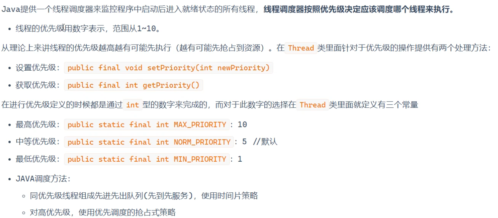
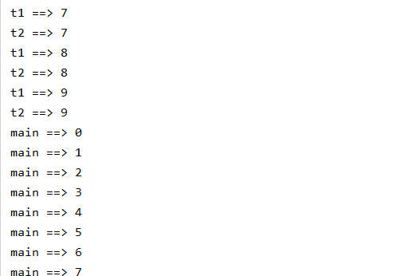
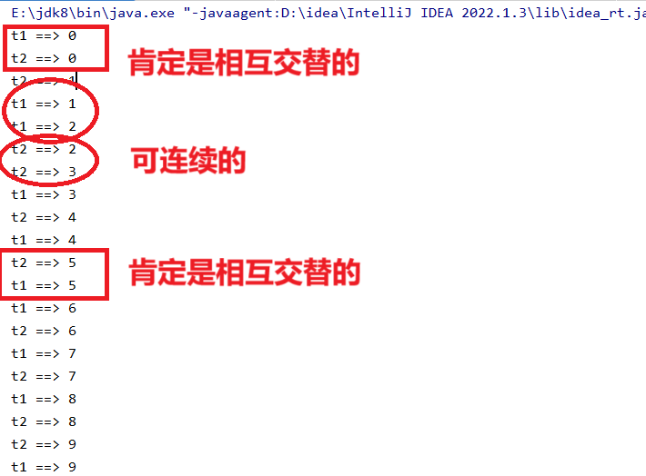
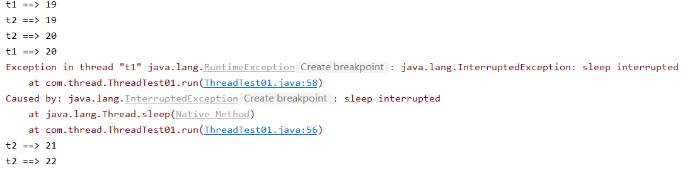
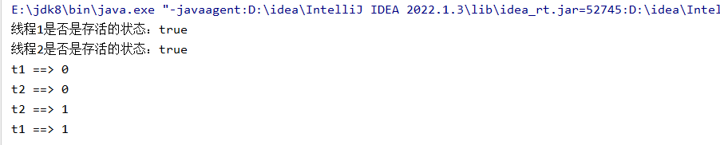

# 多线程的常用方法：

# 一、setPriority（）--优先级



```java
//设置优先级
t1.setPriority(10);
t2.setPriority(1);
```

当主线程和用户线程出现相同执行任务时

```java
package com.thread;

import com.map.TreeMapTest01;

/*
    创建线程的第一个方法：继承Thread类
     */
public class ThreadTest01 extends Thread {
    //主线程
    public static void main(String[] args) {
        //创建线程对象
        ThreadTest01 t1 = new ThreadTest01();//创建状态
        ThreadTest01 t2 = new ThreadTest01();

        //开启线程
        t1.start();//就绪状态 拥有争夺cpu时间片的权利
        t2.start();
        //开启线程之后才会去执行run方法

        t1.setName("t1");
        t2.setName("t2");

        for (int i = 0; i < 10 ; i++) {
            System.out.println(Thread.currentThread().getName()+ " ==> " +i);
            //睡眠的方法  阻塞状态
            try {
                Thread.sleep(1000);
            } catch (InterruptedException e) {
                throw new RuntimeException(e);
            }
        }
    }

    /*
        run方法是的作用：执行线程的任务
         */
    //运行状态
    @Override
    public void run() {
        for (int i = 0; i < 10 ; i++) {
            System.out.println(Thread.currentThread().getName()+ " ==> " +i);
            //睡眠的方法  阻塞状态
            try {
                Thread.sleep(1000);
            } catch (InterruptedException e) {
                throw new RuntimeException(e);
            }
        }
    }
    //执行完所有任务之后  死亡状态
}
```


# 二、join ()--线程合并 主线程和用户线程进行合并

线程合并之后主线程只能等用户线程运行完之后才会被执行

```java
try {
    t1.join();
    t2.join();
} catch (InterruptedException e) {
    throw new RuntimeException(e);
}
```



# 三、yield（） --线程礼让

###### 执行到5的时候，t1暂停一下，变为就绪转状态，让t2去争夺cpu的资源，所以在这种情况下t1或者t2不会是连续的而是相互交替的

```java
@Override
public void run() {
    for (int i = 0; i < 10 ; i++) {
        if (i % 5 ==0){
            //线程让位
            Thread.yield();//(随机性也不一定成功，只是概率会比较大) 让当前正在执行任务的线程回到就绪状态
        }
        System.out.println(Thread.currentThread().getName()+ " ==> " +i);
        //睡眠的方法  阻塞状态
        try {
            Thread.sleep(1000);
        } catch (InterruptedException e) {
            throw new RuntimeException(e);
        }
    }
}
```



# 四、interrupt（）/stop（） -- 关闭线程

## 1、stop（）

```java
@Override
public void run() {
    for (int i = 0; i < 100 ; i++) {
        if (i ==20 && Thread.currentThread().getName().equals("t1")){
            //关闭线程
            Thread.currentThread().stop(); 

        }
        System.out.println(Thread.currentThread().getName()+ " ==> " +i);
        //睡眠的方法  阻塞状态
        try {
            Thread.sleep(100);
        } catch (InterruptedException e) {
            throw new RuntimeException(e);
        }
    }
}
```

### 20之后全是t2在执行：


## 2、interrupt（）

```java
@Override
public void run() {
    for (int i = 0; i < 100 ; i++) {
        if (i ==20 && Thread.currentThread().getName().equals("t1")){
            //关闭线程
            Thread.currentThread().interrupt();//通过异常机制来关闭线程的

        }
        System.out.println(Thread.currentThread().getName()+ " ==> " +i);
        //睡眠的方法  阻塞状态
        try {
            Thread.sleep(100);
        } catch (InterruptedException e) {
            throw new RuntimeException(e);
        }
    }
}
```

### 是通过异常关闭线程的，20之后只执行t2线程：



# 五、isAlive（）--检测线程是否存活

```java
//检测存活状态
boolean alive = t1.isAlive();
boolean alive1 = t2.isAlive();

System.out.println("线程1是否是存活的状态："+alive);
System.out.println("线程2是否是存活的状态："+alive1);
```


