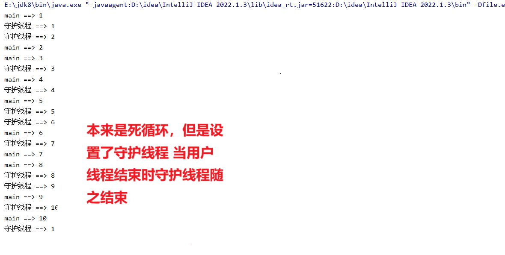

### 守护线程概述

守护线程是一种特殊的线程，其主要特点是：**当 JVM 中只剩下守护线程时，程序将会退出，JVM 将会关闭**。这意味着，守护线程的存在与否不影响 JVM 的生命周期。它们通常用于执行后台任务，比如垃圾回收、日志记录等。

与之相对的是用户线程（User Thread），这些线程的运行状态会影响 JVM 的生命周期——只要还有用户线程在运行，JVM 就不会退出。

---

### 关键特性

1. **自动终止**：

- 当所有的用户线程结束后，即使守护线程仍在运行，JVM 也会退出，并终止所有守护线程。

2. **适合执行非关键性任务**：

- 因为守护线程随时可能被中断，所以它们适合执行一些不那么重要的任务，如监控、清理工作等。

3. **设置方式**：

- 可以通过 `setDaemon(boolean on)` 方法来指定一个线程是否为守护线程。必须在调用 `start()` 方法之前设置。

4. **检查是否为守护线程**：

- 使用 `isDaemon()` 方法可以检查某个线程是否为守护线程。

---

### 示例代码

以下是一个简单的例子，演示了如何创建和使用守护线程：

```java
public class DaemonThreadExample {

    public static void main(String[] args) throws InterruptedException {
        // 创建一个守护线程
        Thread daemonThread = new Thread(() -> {
            while (true) {
                System.out.println("守护线程正在运行...");
                try {
                    Thread.sleep(500);
                } catch (InterruptedException e) {
                    e.printStackTrace();
                }
            }
        });

        daemonThread.setDaemon(true); // 设置为守护线程
        daemonThread.start();

        System.out.println("主线程结束前的准备工作...");
        Thread.sleep(2000); // 主线程等待2秒后结束
        System.out.println("主线程结束了，守护线程将被终止...");

        // 注意：这里不需要显式地停止守护线程，
        // 当main方法结束，即没有其他用户线程运行时，JVM会自动退出并终止所有守护线程。
    }
}
```

### 输出示例：

```java
主线程结束前的准备工作...
守护线程正在运行...
守护线程正在运行...
守护线程正在运行...
守护线程正在运行...
主线程结束了，守护线程将被终止...
```

在这个例子中，主线程结束之后，尽管守护线程还在运行，但由于没有其他用户线程存活，JVM 选择退出，从而终止了守护线程。

---

### 注意事项

- **启动前设置**：确保在调用 `start()` 方法之前调用 `setDaemon(true)` 来设置守护线程。如果在线程启动后再尝试设置守护状态，则会抛出 `IllegalThreadStateException` 异常。
- **不适合长期任务**：由于守护线程会在最后一个用户线程完成后立即被终止，因此不适合用来执行需要长时间运行的任务或者那些必须完成的任务。
- **资源释放**：守护线程可能突然被终止，所以在设计守护线程时要考虑资源释放的问题，避免因为线程突然终止导致资源泄漏或其他问题。

---

### 实际应用场景

- **后台服务**：例如服务器应用中，可能会有专门的线程负责监控系统状态、收集日志等。
- **定时任务**：虽然大多数情况下我们会使用专业的调度框架（如 Quartz），但在某些简单场景下，也可以利用守护线程实现定时任务。
- **内存管理**：如 JVM 内部使用的垃圾回收器就是典型的守护线程，它负责回收不再使用的对象所占用的内存。


```java
package com.thread;

public class ThreadTest02  {

    public static void main(String[] args) {
        //创建用户线程（main主线程也是用户线程的一种）
        Thread thread1 = new Thread(new MyRunnable1());
        Thread thread2 = new Thread(new MyRunnable1());
        Thread thread3 = new Thread(new MyRunnable1());

        //设置守护线程 守护线程专门来守护用户线程 特点：只要用户线程已结束那么守护线程也会随机结束
        //是守护线程设置为 true
        thread3.setDaemon(true);

        //        //设置线程名字
        //        thread1.setName("t1");
        //        thread2.setName("t2");
        thread3.setName("守护线程");
        //        //开启线程
        //        thread1.start();
        //        thread2.start();
        thread3.start();

        for (int i = 1; i <= 10 ; i++) {

            System.out.println(Thread.currentThread().getName()+ " ==> " +i);
            try {
                Thread.sleep(500);
            } catch (InterruptedException e) {
                throw new RuntimeException(e);
            }
        }
    }

}

class MyRunnable1 implements Runnable{
    @Override
    public void run() {

        //守护线程默认情况下是一个死循环 永远不可能去间断

        //下面只为证明一件事情，不写while结束的条件  用户线程结束守护线程就结束
        while (true){
            for (int i = 1; i <= 10 ; i++) {

                System.out.println(Thread.currentThread().getName()+ " ==> " +i);
                try {
                    Thread.sleep(500);
                } catch (InterruptedException e) {
                    throw new RuntimeException(e);
                }
            } 
        }
    }
}
```


