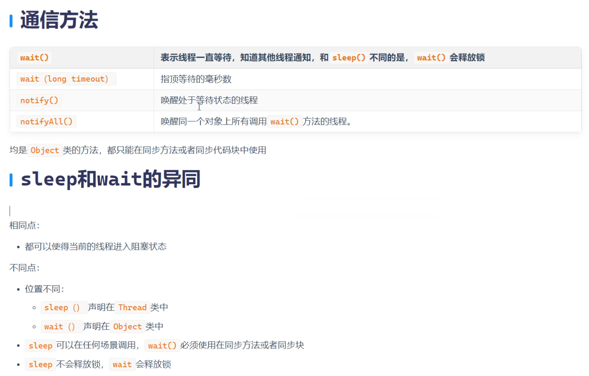

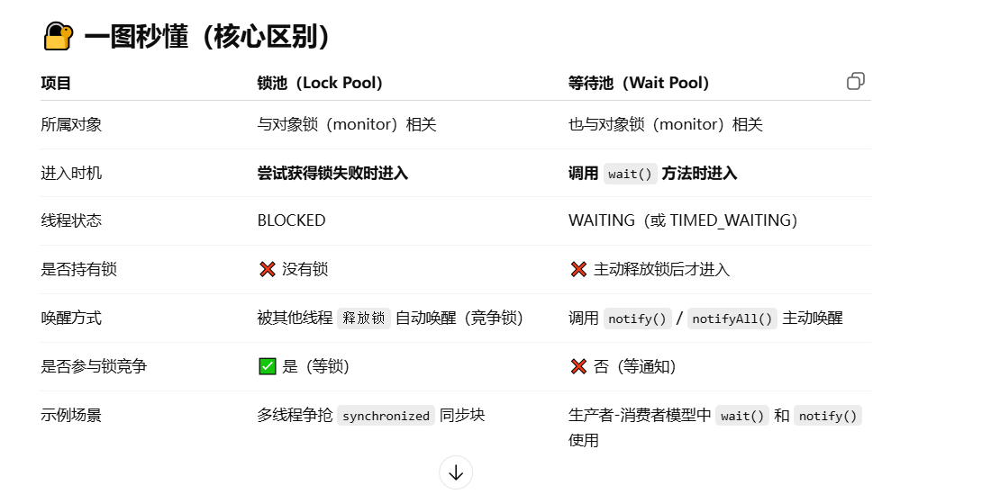

### 锁池：多线程争夺synchronized对象锁，失败的线程进入锁池等待（未被选中的进程直接进入池内下一次资源的抢夺）

### 等待池：对象调用wait方法，该对象上活跃的线程进入等待池等待（被用wait方法后线程进入等待池内，等待notify（）/notifyAll对线程进行唤醒，进入到跟锁的竞争中【唤醒不参与锁之间的竞争，唤醒之后线程是否运行则参与锁之间的竞争，争夺失败则进入锁池】）

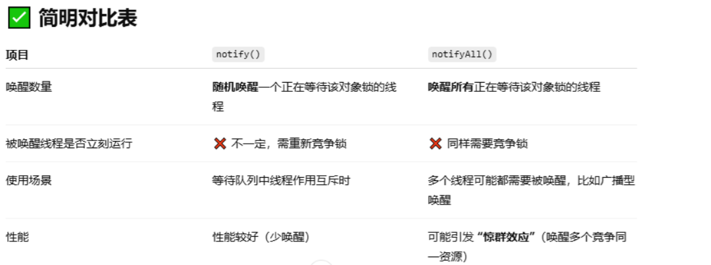

### notify（）：随机唤醒一个在等待该对象锁的线程

### notifyAll（）：唤醒所有等待该对象锁的线程

# 银行取钱案例分析：

# 案例1：

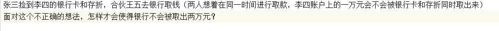

```java
package com.thread;

public class Account {
    private  String accountName;
    private  Double balance;

    public Account(String accountName, Double balance) {
        this.accountName = accountName;
        this.balance = balance;
    }

    public String getAccountName() {
        return accountName;
    }

    public void setAccountName(String accountName) {
        this.accountName = accountName;
    }

    public Double getBalance() {
        return balance;
    }

    public void setBalance(Double balance) {
        this.balance = balance;
    }

    @Override
    public String toString() {
        return "Account{" +
        "accountName='" + accountName + '\'' +
        ", balance=" + balance +
        '}';
    }

    //创建取款的方法
    public void getMoney(double money){
        // t1 t2  加锁
        synchronized (this){
            if (money > this.getBalance()){
                System.out.println("余额不足");
            }else {
                //先获取账户余额
                double getBalance = this.getBalance();

                //进行扣款
                this.setBalance(getBalance - money);

                System.out.println(Thread.currentThread().getName()+"取走了"+money+"元，当前账户剩余："+this.getBalance());

            }

            //模拟网络延时
            try {
                Thread.sleep(500);
            } catch (InterruptedException e) {
                throw new RuntimeException(e);
            }

        }

    }

}
```

```java
package com.thread;

public class MyThread implements Runnable {
    private Account account;

    public  MyThread(Account account){
        this.account = account;
    }

    @Override
    public void run() {
        //调用取钱的方法
        account.getMoney(5000);
    }
}
```

```java
package com.thread;

public class Test {
    public static void main(String[] args) {

        //创建共享对象
        Account account = new Account("李四", 10000.0);

        //创建线程对象
        Thread thread1 = new Thread(new MyThread(account));
        Thread thread2 = new Thread(new MyThread(account));

        //设置线程名称
        thread1.setName("张三");
        thread2.setName("王五");
        //开启线程
        thread1.start();
        thread2.start();

    }
}
```

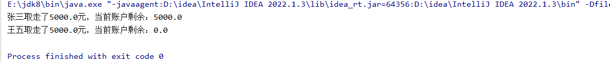

# 生产者与消费者案例分析：

# 案例1：

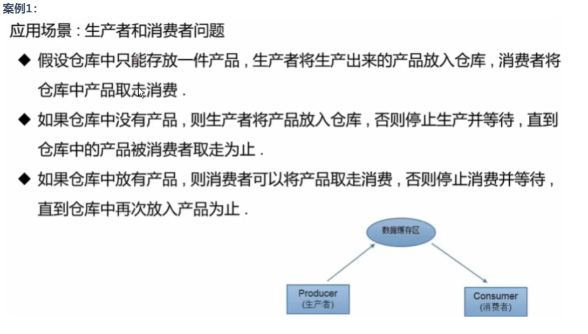

```java
package com.wait;

public class Comsumer extends Thread{
    private  House house;
    public  Comsumer(House house ){
        this.house = house;
    }

    @Override
    public void run() {

        while (true){

            synchronized (this.house){
                if (this.house.getList().size() > 0){

                    //消费实例 删除对应的产品实例
                    Object obj = this.house.getList().remove(0);//0是数组角标
                    System.out.println(Thread.currentThread().getName()+" 消费者消费了一个实例==>"+obj);

                    //唤醒锁池中的生产者进行生产
                    this.house.notify();

                    //睡眠
                    try {
                        Thread.sleep(200);
                    } catch (InterruptedException e) {
                        throw new RuntimeException(e);
                    }

                }else {

                    //如果仓库中没有产品，消费者不需要消费，直接去锁池等待
                    try {
                        this.house.wait();//进入等待池中永远等待
                    } catch (InterruptedException e) {
                        throw new RuntimeException(e);
                    }
                }
            }
        }

    }
}
```

```java
package com.wait;
//生产者线程
public class Producer extends Thread{
    private  House house;
    public  Producer(House house ){
        this.house = house;
    }

    @Override
    public void run() {

        while (true){

            synchronized (this.house){
                if (this.house.getList().size() == 0){
                    //创建Object实例
                    Object obj = new Object();

                    //将生产出来的产品实例添加到仓库中
                    this.house.getList().add(obj);
                    System.out.println(Thread.currentThread().getName()+"生产者生产了一个实例==>"+obj);

                    //唤醒锁池中的消费者进行消费
                    this.house.notify();

                    //睡眠
                    try {
                        Thread.sleep(5000);
                    } catch (InterruptedException e) {
                        throw new RuntimeException(e);
                    }

                }else {

                    //如果仓库中有产品，生产者不需要生产，直接去锁池等待
                    try {
                        this.house.wait();
                    } catch (InterruptedException e) {
                        throw new RuntimeException(e);
                    }
                }
            }
        }

    }
}
```

```java
package com.wait;

import java.util.List;
//仓库 共享对象
public class House {
    private List list;

    public House(List list) {
        this.list = list;
    }

    public List getList() {
        return list;
    }

    public void setList(List list) {
        this.list = list;
    }

    public void out() {
    }
}
```

```java
package com.wait;

import java.util.ArrayList;

public class Test {
    public static void main(String[] args) {
        //创建共享对象
        House house = new House(new ArrayList());

        //创建生产者线程和消费者线程
        Producer producer = new Producer(house);
        Comsumer comsumer = new Comsumer(house);

        //设置线程名称
        producer.setName("生产者");
        comsumer.setName("消费者");

        //开启线程
        producer.start();
        comsumer.start();

    }
}
```

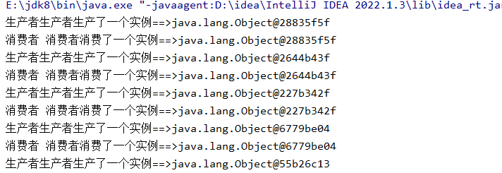

# 案例2：

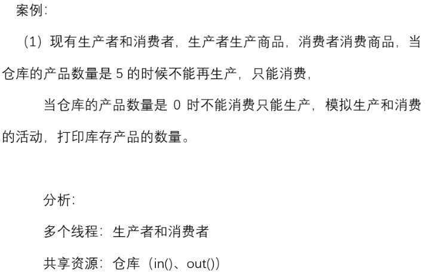

```java
package com.wait;

public class Comsumer2 extends Thread {
    private House2 house2;

    public Comsumer2(House2 house2) {
        this.house2 = house2;
    }

    @Override
    public void run() {

        while (true) {

            this.house2.out();

        }
    }
}
```

```java
package com.wait;
//生产者线程
public class Producer2 extends Thread{
    private  House2 house2;

    public Producer2(House2 house2) {
        this.house2 = house2;
    }

    @Override
    public void run() {

        while (true){
            this.house2.in();
        }

    }
}
```

```java
package com.wait;

import java.util.LinkedList;

//仓库 共享对象
public class House2 {

    private LinkedList list;

    public House2(LinkedList list) {
        this.list = list;
    }

    public LinkedList getList() {
        return list;
    }

    public void setList(LinkedList list) {
        this.list = list;
    }
    //创建一个生产的方法
    public synchronized void in(){

        if (this.getList().size() < 5){
            //创建object实例
            Object obj = new Object();

            //将生产出来的产品实例添加到仓库中
            this.getList().offer(obj);

            System.out.println(Thread.currentThread().getName()+"生产了一个实例===》"+obj);

            try {
                Thread.sleep(500);
            } catch (InterruptedException e) {
                throw new RuntimeException(e);
            }

        }else {

            try {
                notifyAll();
            } catch (Exception e) {
                throw new RuntimeException(e);
            }
        }

    }

    //销售的方法
    public synchronized void out(){

        if (this.getList().size() >= 5){

            //消费实例 删除对应的产品实例
            Object obj = this.getList().poll();

            System.out.println(Thread.currentThread().getName()+"消费了一个产品===》"+obj);

            try {
                Thread.sleep(500);
            } catch (InterruptedException e) {
                throw new RuntimeException(e);
            }

        }else {

            try {
                //进入等待池的线程一定会释放对象锁
                //如果仓库中没有产品，消费者不需要消费，直接去锁池等待
                wait();
            } catch (InterruptedException e) {
                throw new RuntimeException(e);
            }
        }

    }

}
```

```java
package com.wait;

import java.util.LinkedList;

public class Test2 {
    public static void main(String[] args) {
        //创建共享对象
        House2 house2 = new House2(new LinkedList<>());

        //创建生产者线程和消费者线程
        Producer2 producer2 = new Producer2(house2);
        Comsumer2 comsumer2 = new Comsumer2(house2);

        //设置线程名称
        producer2.setName("生产者");
        comsumer2.setName("消费者");

        //开启线程
        producer2.start();
        comsumer2.start();

    }
}
```

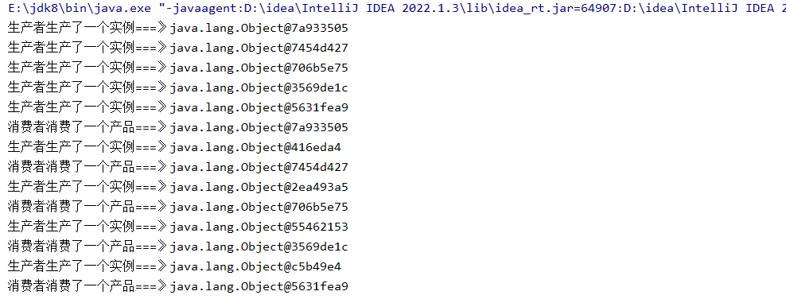

# 案例3：

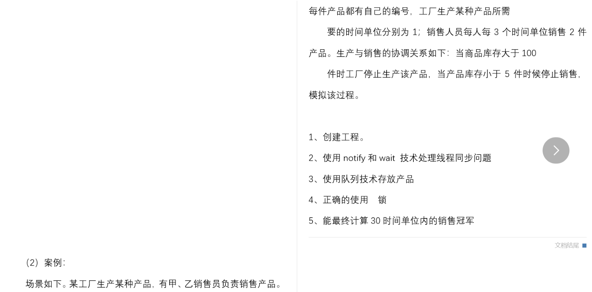

### 商品：

```java
package com.sell;

public class Phone {
    private  static int data =10000;
    private  String name;
    private   int id;

    public Phone(String name) {
        this.name = name;
        this.id = data++;
    }

    public Phone() {
        this.id = data++;
    }

    public String getName() {
        return name;
    }

    public void setName(String name) {
        this.name = name;
    }

    public int getId() {
        return id;
    }

    public void setId(int id) {
        this.id = id;
    }

    @Override
    public String toString() {
        return "Phone{" +
        "name='" + name + '\'' +
        ", id=" + id +
        '}';
    }
}
```

### 工厂：

```java
package com.sell;
/*
生产者线程
 */
public class Factory  extends  Thread {
    private House house;

    //甲
    private Sell sell01;
    //已
    private Sell sell02;

    public Factory(String name, House house, Sell sell01, Sell sell02) {
        super(name);
        this.house = house;
        this.sell01 = sell01;
        this.sell02 = sell02;
    }

    @Override
    public void run() {
        //模拟一直生产
        while (true){
            if (!sell01.isAlive() && !sell02.isAlive()){
                break;
            }

            try {
                Thread.sleep(200);
            } catch (InterruptedException e) {
                throw new RuntimeException(e);
            }

            house.in();

        }
    }
}
```

### 仓库：

```java
package com.sell;

import java.util.LinkedList;

//共享对象 ==>仓库
public class House {
    //存放手机实例
    private LinkedList<Phone> phoneLinkedList;

    //甲销售员的计数
    private Integer count1 = 0;
    //已销售员的计数
    private Integer count2 = 0;
    //get方法
    public Integer getCount1() {
        return count1;
    }

    public Integer getCount2() {
        return count2;
    }

    public House(LinkedList<Phone> phoneLinkedList) {
        this.phoneLinkedList = phoneLinkedList;

    }
    //生产
    public  synchronized  void in()  {
        if (this.phoneLinkedList.size() < 5){
            //创建产品实例
            Phone phone1 = new Phone("iPhone200");
            //将产品添加到仓库中
            this.phoneLinkedList.offer(phone1);//linkedList的添加方法是offer（）

            System.out.println(Thread.currentThread().getName()+"生产了一件商品："+phone1+"编号为："+phone1.getId());
        }else {
            //当产品大于等于5件时，生产者线程会进入锁池中等待
            try {
                wait();
            } catch (InterruptedException e) {
                throw new RuntimeException(e);
            }
        }
    }

    //销售
    public  synchronized  void out(){
        if (this.phoneLinkedList.size() >= 5){
            //销售产品 出队
            Phone phone2 = this.phoneLinkedList.poll();//linkedList的删除方式是poll（）

            System.out.println(Thread.currentThread().getName()+"销售了一件商品："+phone2+"编号为："+phone2.getId());

            //销售员销售商品数量的计数
            if (Thread.currentThread().getName().equals("甲销售员")){
                count1++;
            }else {
                count2++;
            }
        }else {
            //当产品小于5件时，消费者需要唤醒生产者进行生产
            try {
                notifyAll();
            } catch (Exception e) {
                throw new RuntimeException(e);
            }
        }
    }
}
```

### 销售：

```java
package com.sell;
/*
销售线程
 */
public class Sell extends  Thread{
    private  House house;

    public Sell(String name, House house) {
        super(name);
        this.house = house;
    }

    //3个时间单元销售2个产品
    @Override
    public void run() {
        for (int i = 1; i <=10 ; i++) {
            try {
                Thread.sleep(200*3);//3个时间单元
            } catch (InterruptedException e) {
                throw new RuntimeException(e);
            }
            this.house.out();
            this.house.out();
        }
    }
}
```

### 测试：

```java
package com.sell;

import java.util.LinkedList;

public class Test {
    public static void main(String[] args) {

        //创建仓库对象
        House house = new House(new LinkedList<>());
        //创建甲乙销售员的线程对象
        Sell sell1 = new Sell("甲销售员", house);
        Sell sell2 = new Sell("已销售员", house);

        //创建工厂线程
        Factory factory = new Factory("手机工厂", house, sell1, sell2);

        //开启线程
        factory.start();
        sell1.start();
        sell2.start();

        //线程合并
        try {
            sell1.join();
            sell2.join();
            factory.join();
        } catch (InterruptedException e) {
            throw new RuntimeException(e);
        }
        //打印每个销售员的销售数量
        System.out.println("甲销售员的销售数量为："+house.getCount1());
        System.out.println("已销售员的销售数量为："+house.getCount2());

        //判断谁是冠军
        if (house.getCount1() >house.getCount2()){
            System.out.println("甲是冠军");
        } else if (house.getCount1() ==house.getCount2()) {
            System.out.println("并列冠军");
        }else {
            System.out.println("已是冠军");
        }

    }
}
```

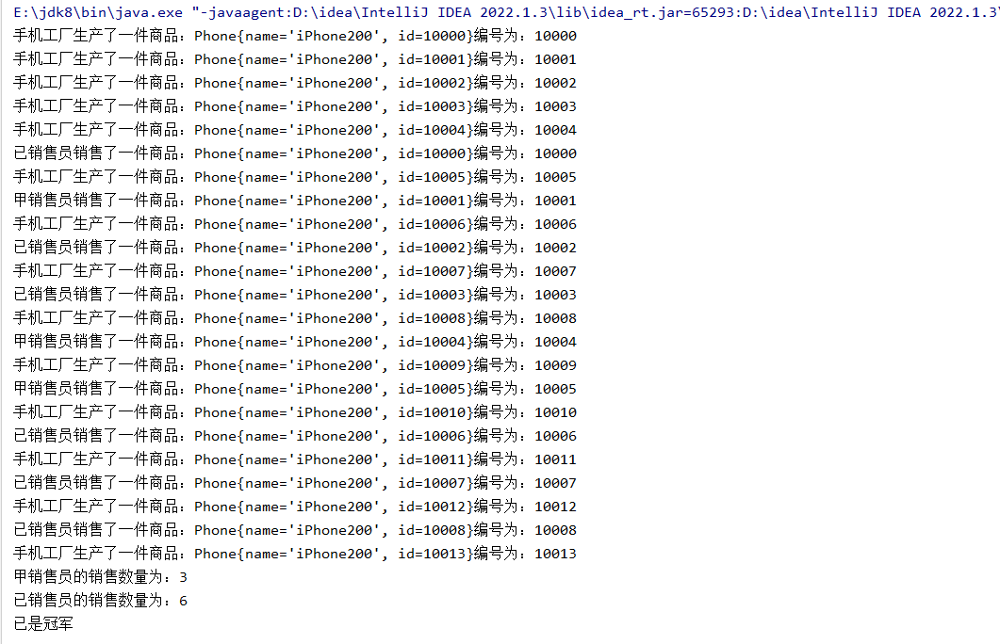

### 这个结果是随机的，因为进程是否是否竞争成功是不确定的
