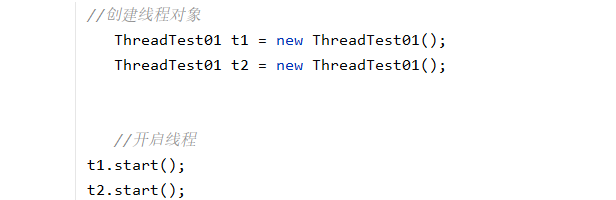
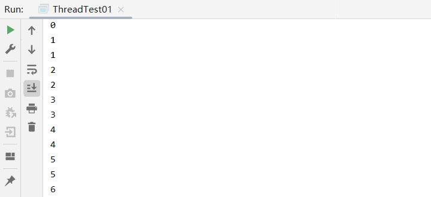
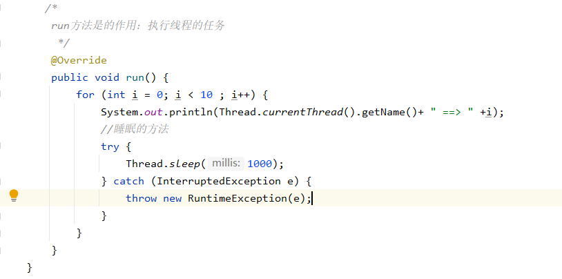
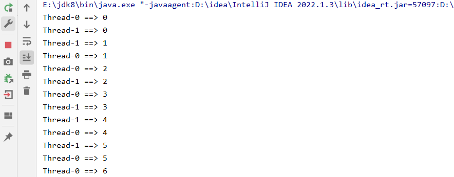
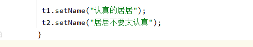
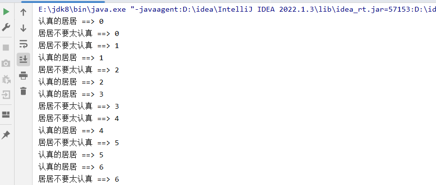
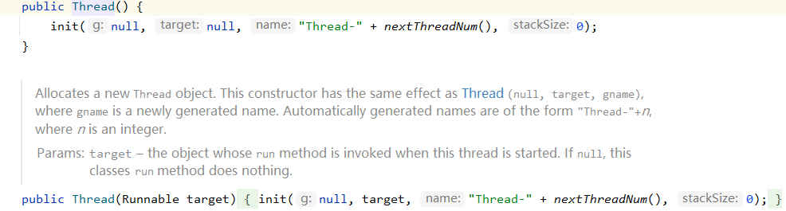
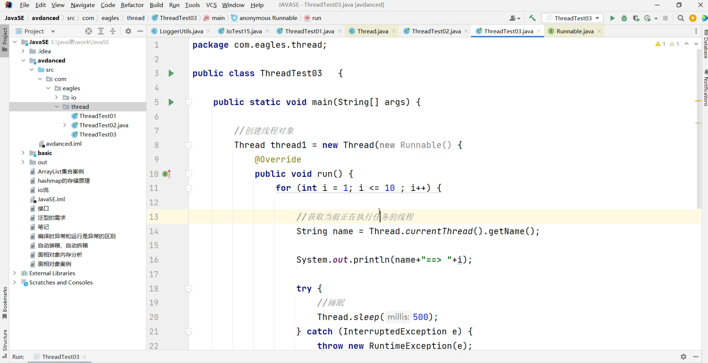

# 线程的实现方式1：


### 你会发现我们并没有专门去调用run方法，而是通过线程的方式去调用到run方法

```java
package com.thread;

/*
    创建线程的第一个方法：继承Thread类
     */
public class ThreadTest01 extends Thread {
    //主线程
    public static void main(String[] args) {
        //创建线程对象
        ThreadTest01 t1 = new ThreadTest01();
        //开启线程
        t1.start();
        //开启线程之后才会去执行run方法

    }

    /*
        run方法是的作用：执行线程的任务
         */
    @Override
    public void run() {
        for (int i = 0; i < 10 ; i++) {
            System.out.println(i);
            //睡眠的方法
            try {
                Thread.sleep(1000);
            } catch (InterruptedException e) {
                throw new RuntimeException(e);
            }
        }
    }
}
```

### 当多线程同时运行时，你不知道对应输出的内容是哪个线程运行的，你可以单独调用主线程：



### 我们将每个线程对应运行的内容进行打印：System.out.println(Thread.currentThread().getName()+ " ==> " +i);





### 还可以自定义线程的名称：



# 线程的实现方式2：

### 这个Tread里面有一个Runnable方法，刚好可以实现方法的重载，所以在Tread里创一个Runnablr的实例

### （好处较于直接实现Runnable，在MyRunable实现Runnable的同时还可以实现其他接口）

### （但是一个类继承一个类之后不可以在继承其他类，类似于第一个方法，继承了Tread之后就不可以继承其他类）

```java
package com.thread;

public class TreadTest02 {
    public static void main(String[] args) {
        //创建线程
        Thread thread1 = new Thread(new MyRunnable());
        //开启线程
        thread1.start();
    }

}
//创建线程的第二个方法 实现Runnable类
//这个Runnable不是一个真的线程，里面只是有一个run方法，只是让程序可以跑起来
class MyRunnable implements Runnable{
    @Override
    public void run() {
        for (int i = 0; i < 10  ; i++) {
            //获取当前正在执行任务的线程
            System.out.println(Thread.currentThread().getName()+" ==> "+ i);
            //睡眠
            try {
                Thread.sleep(500);
            } catch (InterruptedException e) {

            }

        }
    }
}
```



### 直接塞入一个Runnable，重写run方法



# 线程的实现方式3：
