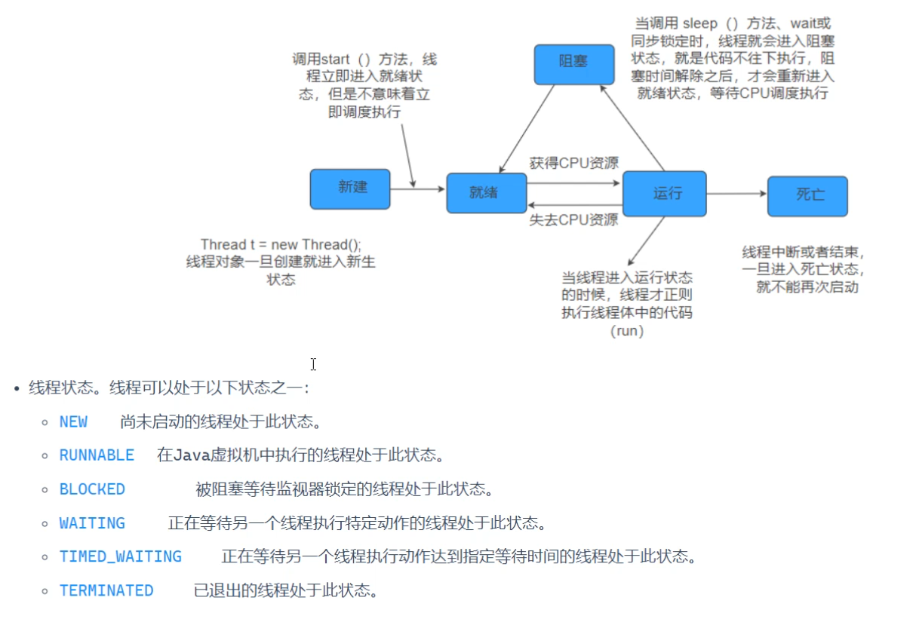
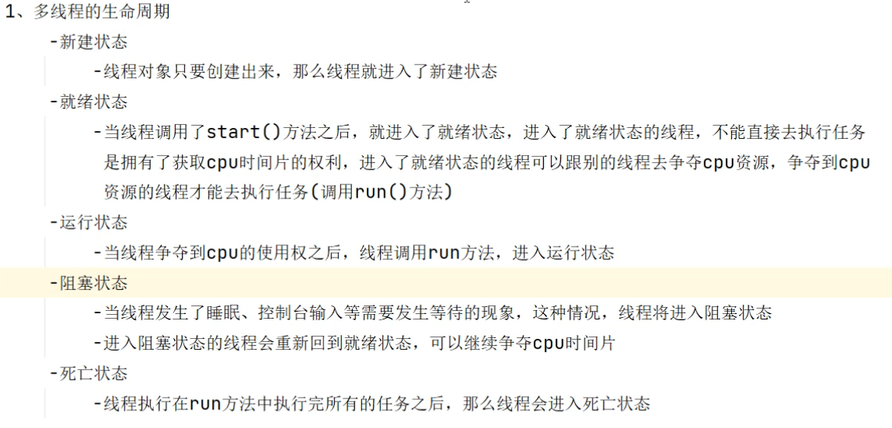

```java
package com.thread;

/*
    创建线程的第一个方法：继承Thread类
     */
public class ThreadTest01 extends Thread {
    //主线程
    public static void main(String[] args) {
        //创建线程对象
        ThreadTest01 t1 = new ThreadTest01();//创建状态

        //开启线程
        t1.start();//就绪状态 拥有争夺cpu时间片的权利

        //开启线程之后才会去执行run方法

        t1.setName("t1");

    }

    /*
        run方法是的作用：执行线程的任务
         */
    //运行状态
    @Override
    public void run() {
        for (int i = 0; i < 10 ; i++) {
            System.out.println(Thread.currentThread().getName()+ " ==> " +i);
            //睡眠的方法  阻塞状态
            try {
                Thread.sleep(1000);
            } catch (InterruptedException e) {
                throw new RuntimeException(e);
            }
        }
    }
    //执行完所有任务之后  死亡状态
}
```
