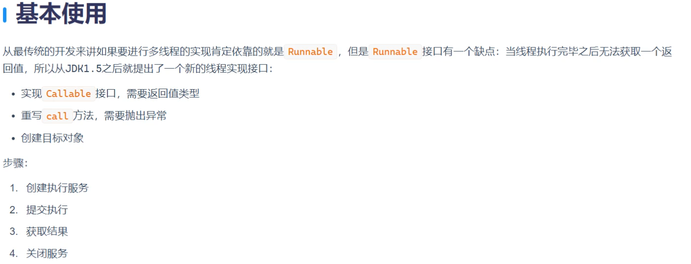
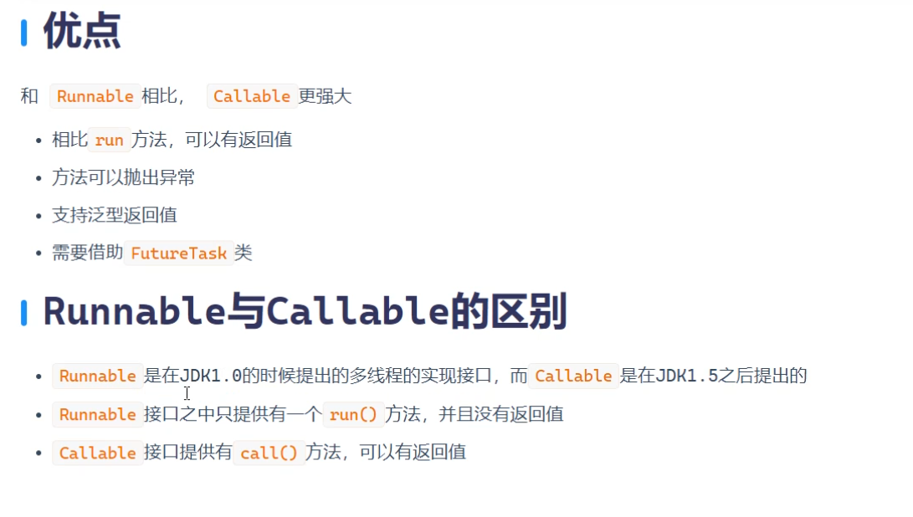
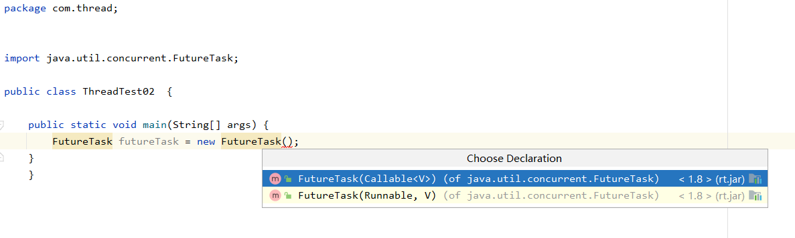
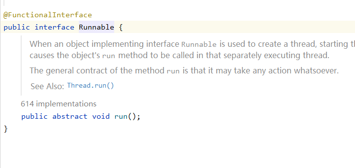
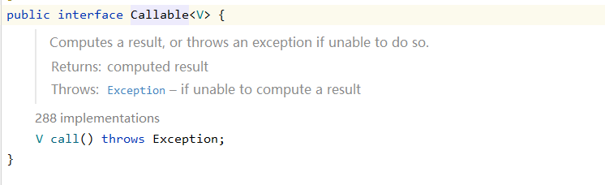
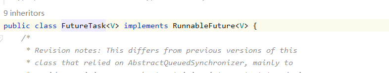
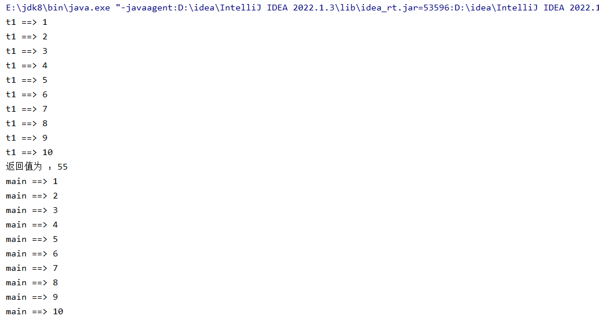

## FutureTask对应的两个参数



### Runnable



### Callable

#### call方法 是有返回值的



```java
//创建未来任务类对象  也不是线程对象
FutureTask futureTask = new FutureTask(new Callable{

}
```

#### FutureTask实现了Runnable 所有可以放进去

```java
//创建线程对象
Thread thread = new Thread(futureTask);
```



```java
package com.thread;

import java.util.concurrent.Callable;
import java.util.concurrent.ExecutionException;
import java.util.concurrent.FutureTask;

public class ThreadTest02 {

    public static void main(String[] args) {
        //创建未来任务类对象  也不是线程对象
        FutureTask futureTask = new FutureTask(new Callable() {
            //call执行任务的方法
            @Override
            public Object call() throws Exception {
                int sum = 0;
                for (int i = 1; i <= 10; i++) {
                    sum += i;
                    System.out.println(Thread.currentThread().getName() + " ==> " + i);
                    Thread.sleep(500);
                }
                return sum; //可以获取线程的返回值
            }
        });
        //创建线程对象
        Thread thread = new Thread(futureTask);

        thread.setName("t1");

        thread.start();
        //获取线程返回值
        try {
            Object obj = futureTask.get();
            System.out.println("返回值为 ：" + obj);
        } catch (InterruptedException e) {
            throw new RuntimeException(e);
        } catch (ExecutionException e) {
            throw new RuntimeException(e);
        }
        //缺点 造成主线程的阻塞
        //在线程返回值没有被获取到之前 主线程的这个任务可能不会被触发，可能一直是阻塞的状态
        for (int i = 1; i <= 10; i++) {

            System.out.println(Thread.currentThread().getName() + " ==> " + i);
            try {
                Thread.sleep(100);
            } catch (InterruptedException e) {
                throw new RuntimeException(e);
            }
        }
    }
}
```


