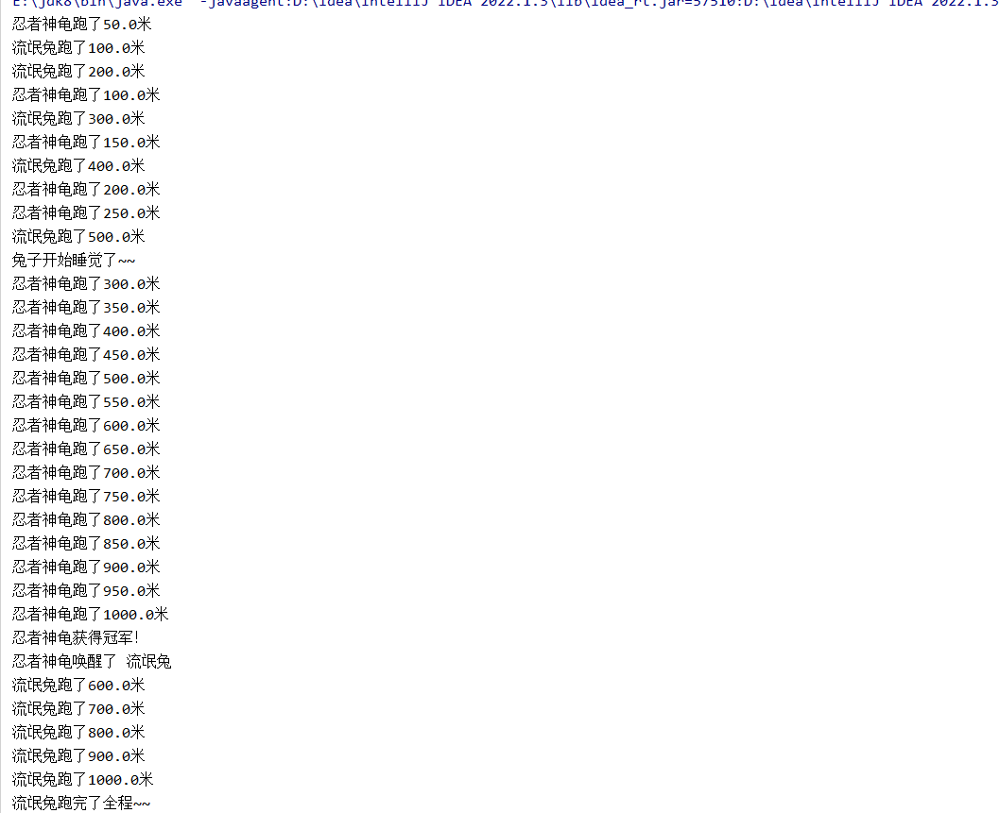
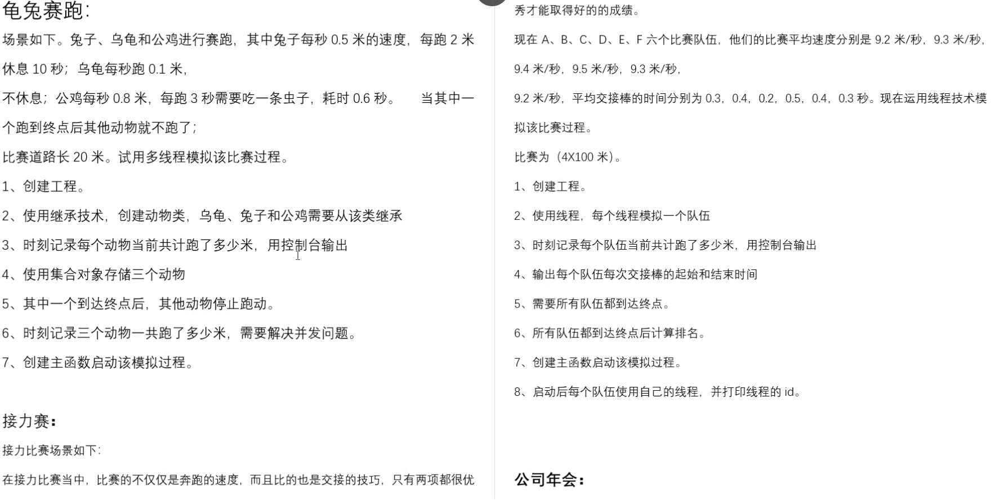

### 案例:

```java
-乌龟每秒50米，兔子每秒100米，赛道总长1000米
-兔子在跑到900米时自己把自己挂起，乌龟跑完全程，唤醒兔子，兔子继续跑完剩下的赛道！
```

```java
package com.thread;

public class Rabbit extends Thread {

    private String name;

    private double speed;

    public Rabbit(String name, double speed) {
        super(name);
        this.speed = speed;
    }

    @Override
    public void run() {

        for (double i = 100; i <= 1000 ; i += speed) {

            //模拟1s
            try {
                Thread.sleep(1000);
            } catch (InterruptedException e) {
                throw new RuntimeException(e);
            }

            System.out.println(this.getName()+"跑了"+(i) +"米");

            if (i == 500){

                System.out.println("兔子开始睡觉了~~");

                //线程自己把自己挂起 将进入永久的阻塞
                Thread.currentThread().suspend();

            }

        }

        System.out.println(this.getName()+"跑完了全程~~");

    }
}
```

```java
package com.thread;

public class Turtle extends Thread {

    private String name;

    private double speed;

    private Rabbit rabbit;

    public Turtle(String name, double speed) {
        super(name);
        this.speed = speed;
    }

    public void setRabbit(Rabbit rabbit) {
        this.rabbit = rabbit;
    }

    @Override
    public void run() {

        for (double i = 50; i <= 1000 ; i += speed) {

            //模拟1s
            try {
                Thread.sleep(1000);
            } catch (InterruptedException e) {
                throw new RuntimeException(e);
            }

            System.out.println(this.getName()+"跑了"+(i) +"米");

        }

        System.out.println(this.getName()+"获得冠军！");

        System.out.println(this.getName()+"唤醒了 "+this.rabbit.getName());

        //唤醒兔子
        this.rabbit.resume();

    }
}
```

```java
package com.thread;
/*
     龟兔赛跑：
     -乌龟每秒50米，兔子每秒100米，赛道总长1000米
     -兔子在跑到900米时自己把自己挂起，乌龟跑完全程，唤醒兔子，兔子继续跑完剩下的赛道！
 */
public class ThreadTest03 {

    public static void main(String[] args) {

        //创建线程对象
        Rabbit rabbit = new Rabbit("流氓兔", 100);
        Turtle turtle = new Turtle("忍者神龟", 50);
        turtle.setRabbit(rabbit);

        //开启线程
        rabbit.start();
        turtle.start();

    }
}
```

### 运行结果：



### 龟兔赛跑续集案例：



```java
package com.run;

public class Animal extends Thread {

    private String name;

    private double speed;
    //赛道总长
    public  static  final double LENGTH =20.0;
    //volatile 禁止指令重排 在多线程的场景下，可以保证线程的可见性（线程发生变化 可以去告诉其他线程 线程之间数据是共享的透明的以至于得到最新数据）
    //static的作用是为了使信息共享 类级别都可以调用
    protected static volatile double count = 0.0;//用来记录三个线程一共跑了多少米

    public Animal( String name, double speed) {
        super(name);
        this.name = name;
        this.speed = speed;
    }

    public Animal() {

    }

    public double getSpeed() {
        return speed;
    }

    public void setSpeed(double speed) {
        this.speed = speed;
    }

    public static double getCount() {
        return count;
    }

    public static void setCount(double count) {
        Animal.count = count;
    }
}
```

```java
package com.run;

import java.math.BigDecimal;

/*
   公鸡每秒0.8米，每跑3秒需要吃一条虫子，耗时0.6秒
    */
public class Cook extends Animal {
    //引用
    private Turtle turtle;

    private Rabbit rabbit;

    public Cook(String name, double speed) {
        super(name, speed);
    }

    public void setTurtle(Turtle turtle) {
        this.turtle = turtle;
    }

    public void setRabbit(Rabbit rabbit) {
        this.rabbit = rabbit;
    }

    private  Integer time =0;

    @Override
    public void run() {                   //Speed不能直接获得但是可以通过getSpeed

        for (double i = 1.0; i <= LENGTH ; i+=getSpeed()) {

            if (time%3 == 0){
                try {
                    System.out.println(this.getName()+"开始吃虫子！耗时0.6s~");
                    Thread.sleep(600);
                } catch (InterruptedException e) {
                    throw new RuntimeException(e);
                }
            }

            try {
                //模拟1s
                Thread.sleep(1000);
            } catch (InterruptedException e) {
                throw new RuntimeException(e);

            }
            //算时间
            time++;

            System.out.println(this.getName()+"跑了"+(new BigDecimal(i+=getSpeed()).setScale(2,BigDecimal.ROUND_DOWN))+"米");
            count +=getSpeed();
            System.out.println("三个线程一共跑了："+(new BigDecimal(count).setScale(2,BigDecimal.ROUND_DOWN))+"米");
        }
        //如果一个线程获得了冠军，那么宁外两个线程应该要结束掉
        System.out.println(this.getName() + "获得了冠军！！");
        if (turtle.isAlive()){
            turtle.stop();
        }
        if (rabbit.isAlive()){
            rabbit.stop();
        }
    }
}
```

```java
package com.run;

import java.math.BigDecimal;

/*
兔子每秒0.5米的速度，每跑2米休息10秒
 */
public class Rabbit extends Animal{
    //引用
    private Turtle turtle;

    private Cook cook;

    public Rabbit(String name, double speed) {
        super(name, speed);
    }
    public void setTurtle(Turtle turtle) {
        this.turtle = turtle;
    }

    public void setCook(Cook cook) {
        this.cook = cook;
    }

    @Override
    public void run() {                   //Speed不能直接获得但是可以通过getSpeed

        for (double i = 1.0; i <= LENGTH ; i+=getSpeed()) {
            //用2米来算，不像公鸡用时间time来算
            if (i%2 == 0){
                try {
                    System.out.println(this.getName()+"开始睡觉了！耗时10s~");
                    Thread.sleep(1000 * 10);
                } catch (InterruptedException e) {
                    throw new RuntimeException(e);
                }
            }

            try {
                //模拟1s
                Thread.sleep(1000);
            } catch (InterruptedException e) {
                throw new RuntimeException(e);

            }

            System.out.println(this.getName()+"跑了"+(new BigDecimal(i+=getSpeed()).setScale(2,BigDecimal.ROUND_DOWN))+"米");
            count +=getSpeed();
            System.out.println("三个线程一共跑了："+(new BigDecimal(count).setScale(2,BigDecimal.ROUND_DOWN))+"米");
        }
        //如果一个线程获得了冠军，那么宁外两个线程应该要结束掉
        System.out.println(this.getName() + "获得了冠军！！");
        if (turtle.isAlive()){
            turtle.stop();
        }
        if (cook.isAlive()){
            cook.stop();
        }
    }
}
```

```java
package com.run;

import java.math.BigDecimal;

/*
每秒跑0.1米，不休息
 */
public class Turtle extends Animal{
    //引用
    private Rabbit rabbit;

    private Cook cook;

    public Turtle(String name, double speed) {
        super(name, speed);
    }

    public void setRabbit(Rabbit rabbit) {
        this.rabbit = rabbit;
    }

    public void setCook(Cook cook) {
        this.cook = cook;
    }

    @Override
    public void run() {                   //Speed不能直接获得但是可以通过getSpeed

        for (double i = 1.0; i <= LENGTH ; i+=getSpeed()) {

            try {
                //模拟1s
                Thread.sleep(1000);
            } catch (InterruptedException e) {
                throw new RuntimeException(e);

            }

            System.out.println(this.getName()+"跑了"+(new BigDecimal(i+=getSpeed()).setScale(2,BigDecimal.ROUND_DOWN))+"米");
            count +=getSpeed();
            System.out.println("三个线程一共跑了："+(new BigDecimal(count).setScale(2,BigDecimal.ROUND_DOWN))+"米");
        }
        //如果一个线程获得了冠军，那么宁外两个线程应该要结束掉
        System.out.println(this.getName() + "获得了冠军！！");
        if (rabbit.isAlive()){
            rabbit.stop();
        }
        if (cook.isAlive()){
            cook.stop();
        }
    }

}
```

```java
package com.run;

import java.util.ArrayList;

public class Test {

    public static void main(String[] args) {

        //创建线程对象
        Rabbit rabbit = new Rabbit("兔子", 0.5);
        Cook cook = new Cook("公鸡", 0.8);
        Turtle turtle = new Turtle("乌龟", 0.1);

        rabbit.setCook(cook);
        rabbit.setTurtle(turtle);

        cook.setRabbit(rabbit);
        cook.setTurtle(turtle);

        turtle.setRabbit(rabbit);
        turtle.setCook(cook);

        //创建动物的集合对象
        ArrayList<Animal> animals = new ArrayList<>();

        //将所有线程对象添加到集合中
        animals.add(rabbit);
        animals.add(turtle);
        animals.add(cook);

        //遍历集合
        for (Animal animal : animals) {
            //开启线程
            animal.start();
        }
    }

}
```

```java
兔子跑了1.50米
公鸡跑了1.80米
乌龟跑了1.10米
三个线程一共跑了：0.50米
三个线程一共跑了：1.40米
三个线程一共跑了：1.30米
兔子跑了2.50米
乌龟跑了1.30米
三个线程一共跑了：1.90米
公鸡跑了3.40米
三个线程一共跑了：2.00米
三个线程一共跑了：2.79米
兔子跑了3.50米
公鸡跑了5.00米
乌龟跑了1.50米
三个线程一共跑了：3.29米
三个线程一共跑了：4.09米
公鸡开始吃虫子！耗时0.6s~
三个线程一共跑了：4.19米
兔子跑了4.50米
乌龟跑了1.70米
三个线程一共跑了：4.79米
三个线程一共跑了：4.69米
公鸡跑了6.59米
三个线程一共跑了：5.59米
兔子跑了5.50米
乌龟跑了1.90米
三个线程一共跑了：6.09米
三个线程一共跑了：6.19米
公鸡跑了8.19米
三个线程一共跑了：6.99米
兔子跑了6.50米
三个线程一共跑了：7.49米
乌龟跑了2.10米
三个线程一共跑了：7.59米
公鸡跑了9.80米
三个线程一共跑了：8.39米
公鸡开始吃虫子！耗时0.6s~
兔子跑了7.50米
乌龟跑了2.30米
三个线程一共跑了：8.89米
三个线程一共跑了：8.99米
兔子跑了8.50米
乌龟跑了2.50米
三个线程一共跑了：9.59米
三个线程一共跑了：9.49米
公鸡跑了11.40米
三个线程一共跑了：10.39米
兔子跑了9.50米
乌龟跑了2.70米
三个线程一共跑了：10.99米
三个线程一共跑了：10.89米
公鸡跑了13.00米
三个线程一共跑了：11.79米
兔子跑了10.50米
乌龟跑了2.90米
三个线程一共跑了：11.89米
三个线程一共跑了：12.39米
公鸡跑了14.60米
三个线程一共跑了：13.19米
公鸡开始吃虫子！耗时0.6s~
乌龟跑了3.10米
三个线程一共跑了：13.29米
兔子跑了11.50米
三个线程一共跑了：13.79米
公鸡跑了16.20米
三个线程一共跑了：14.59米
兔子跑了12.50米
乌龟跑了3.30米
三个线程一共跑了：15.19米
三个线程一共跑了：15.09米
公鸡跑了17.80米
三个线程一共跑了：16.00米
兔子跑了13.50米
乌龟跑了3.50米
三个线程一共跑了：16.10米
三个线程一共跑了：16.60米
公鸡跑了19.40米
三个线程一共跑了：17.40米
公鸡开始吃虫子！耗时0.6s~
兔子跑了14.50米
三个线程一共跑了：17.90米
乌龟跑了3.70米
三个线程一共跑了：18.00米
公鸡获得了冠军！！
```
