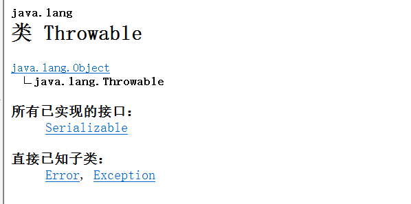
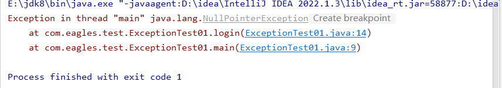
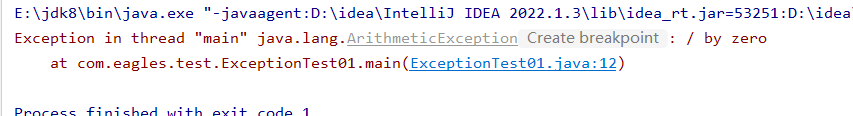
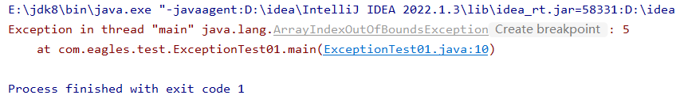
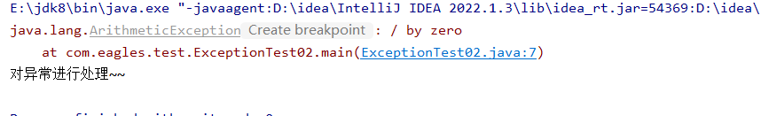
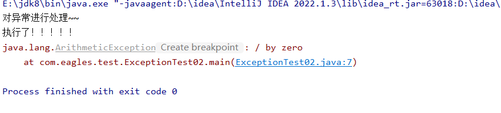
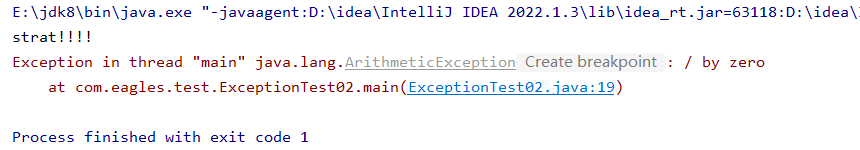
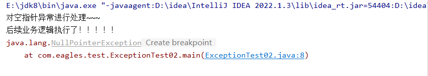

# 异能机制：

java中拥有十分强大的异常机制

java中将程序中所有可能的出现的异常全部封装成了异常类

Exception、Error

Exception 可处理异常（\*\*\*\*）

Error 不可以处理异常

-java中检测到程序出现异常后，会立即创建异常对象，并且通过throw进行抛出

具体：throw new 异常对象（);

### 空指针异常：

```java
package com.exception;

public class ExceptionTest01 {
   public ExceptionTest01() {
   }

    public static void main(String[] args) {
        ExceptionTest01 exceptionTest01 = new ExceptionTest01();
        String login = exceptionTest01.login((String)null, "123456");
        System.out.println(login);
    }

    public String login(String username, String password) {
        return username.equals("jack") && password.equals("123456") ? "登录成功" : "登录失败";
    
    /* public static void main(String[] args) {
        ExceptionTest01 exceptionTest01 = new ExceptionTest01();
       exceptionTest01.login(null,"123456");
    }

    public String login(String username, String password) {

        if (username.equals("jack") && password.equals("123456")) {
            System.out.println("登录成功");
        } else {
            System.out.println("登录失败");
        }
        return username;
    }
    
    }*/
}
```



### 数学算数异常：

```java
package com.eagles.test;

public class ExceptionTest01 {

    public static void main(String[] args) {

        System.out.println(1 / 0);

    }
}
```



### 下标索引越界异常：

```java
package com.eagles.test;

public class ExceptionTest01 {
    public ExceptionTest01() {
    }

    public static void main(String[] args) {

        int[] its = new int[5];
        System.out.println(its[5]);

    }
}
```



```java
package com.eagles.test;

public class   {
    public static void main(String[] args) {

        try{//检测异常
            System.out.println( 1 / 0);
            //（）里写入算数异常的参数
        }catch(ArithmeticException arithmeticException){//捕获异常

            System.out.println("对异常进行处理~~");
            arithmeticException.printStackTrace();//把异常对象打印在控制台上面，具体操作是引用.输出日志方法
}

     

    }
}
```



使用try catch的好处在于：不会影响下面代码的执行

```java
package com.eagles.test;

public class   {
    public static void main(String[] args) {

        try{//检测异常
            System.out.println( 1 / 0);
            //（）里写入算数异常的参数
        }catch(ArithmeticException arithmeticException){//捕获异常

            System.out.println("对异常进行处理~~");
            arithmeticException.printStackTrace();//把异常对象打印在控制台上面，具体操作是引用.输出日志方法
}
     //在下面输出
     System.out.println("执行了！！！！！");

    }
}
```



```java
package com.eagles.test;

public class ExceptionTest02 {
    public static void main(String[] args) {

        System.out.println("strat!!!!");
        System.out.println(1/0);
        System.out.println("执行了！！！！！");

    }
}
```



数学算数异常将会被抛出，程序将不再往下面执行，即只执行第一行！！！

```java
package com.eagles.test;

public class ExceptionTest02 {
    public static void main(String[] args) {

        try{//检测异常
            String str  =null;
            System.out.println(str.equals("jack"));
            //（）里写入算数异常的参数
        }catch(ArithmeticException arithmeticException){//捕获异常

            System.out.println("对异常进行处理~~");
            arithmeticException.printStackTrace();  //把异常对象打印在控制台上面，具体操作是引用.输出日志方法

        }

        System.out.println("执行了！！！！！");

    }
}
```

直接抛出了空指针异常，但是没有进入catch语句块

```java
package com.eagles.test;

public class ExceptionTest02 {
    public static void main(String[] args) {

        try{//检测异常
            String str  =null;
            System.out.println(str.equals("jack"));
            //（）里写入算数异常的参数
        }catch(ArithmeticException arithmeticException){//捕获异常

            System.out.println("对异常进行处理~~");
            arithmeticException.printStackTrace();  //把异常对象打印在控制台上面，具体操作是引用.输出日志方法

        }//重新加一副catch语句块，将空指针异常抛出
        catch (NullPointerException e){

        }

        System.out.println("后续业务逻辑执行了！！！！！");

    }
}
```

第七行String str =null;空指针异常的问题，算数异常进行抛出不可完成，在后面加入catch语句重新对空指针异常进行抛出，会发现空指针异常正常抛出，且继续执行后面语句！

简而言之，如果是算数异常进入第一个catch语句块，如果是空指针异常进入第二个catch语句块！！

```java
package com.eagles.test;

public class ExceptionTest02 {
    public static void main(String[] args) {

        try{//检测异常
            String str  =null;
            System.out.println(str.equals("jack"));
            //（）里写入算数异常的参数
        }catch(ArithmeticException arithmeticException){//捕获异常

            System.out.println("对数学算数异常进行处理~~");
            arithmeticException.printStackTrace();  //把异常对象打印在控制台上面，具体操作是引用.输出日志方法

        }//重新加一副catch语句块，将空指针异常抛出
        catch (NullPointerException e){
            System.out.println("对空指针异常进行处理~~~");
            e.printStackTrace();
        }

        System.out.println("后续业务逻辑执行了！！！！！");

    }
}
```



## 运行流程：

## 在哪一行发生异常行为，直接跳转到相应的ctach语句块行，catch将对异常进行捕获。且下面其他的catch语句块不会执行

# Finally：

```java
package com.eagles.test;

import java.io.FileNotFoundException;
import java.io.FileReader;
import java.io.IOException;

public class ExceptionTest02 {
    public static void main(String[] args) {
        FileReader fileReader = null;
        try{//检测异常

            fileReader = new FileReader("这里面写的就是具体的路径，读取文件的内径");
            //流对象，作用就是读取当前计算机上面的文件信息
            //这是一个系统的对象，他会去获取系统的资源，所以运行完需要对系统的资源进行回收

            System.out.println(1/0);//这是一个算数异常，出现该异常会导致后面代码无法执行，后续资源无法回收，没有回收成功就是资源的一个损耗
            //所有可以把回收资源的语句放在finally语句块里面
            try {
                fileReader.close();//回收资源的方法是close
            } catch (IOException e) {
                throw new RuntimeException(e);
            }

        } catch (FileNotFoundException e) {
            throw new RuntimeException(e);
        } finally { // 在任何情况下都会去执行的语句块，通常通过语句块进行资源的回收

        }

        System.out.println("后续业务逻辑执行了！！！！！");
        System.out.println("在任何情况下都会执行的！！！");
    }
}
```

# 待弄明白：

！！！！！！！！！！！！！！！！！！！！！！！！！！！！！！！！！！！！！！！！！！！！！！！！！！！！！！！！！！！！！！！！！！！！！！！！！！！！！！！！！！！！！！！！！！！！！！！！！！！！！！！！！！！！！！！！！！！！！！！！！！！！！

```java
package com.eagles.test;

import java.io.FileInputStream;
import java.io.FileNotFoundException;
import java.io.IOException;

public class ExceptionTest02 {
    public ExceptionTest02() {
    }

    public static void main(String[] args) {
        System.out.println("逻辑1");
        System.out.println("逻辑2");
        FileInputStream fileInputStream = null;

        try {
            fileInputStream = new FileInputStream("C:\\temp\\Demo.java");
            String str2 = null;
            System.out.println(((String) str2).trim());
            System.out.println("----flag-----------");
            System.out.println(1 / 0);
        } catch (NullPointerException var17) {
            var17.printStackTrace();
            System.out.println("空指针异常的处理1");
            System.out.println("空指针异常的处理2");
            System.out.println("空指针异常的处理3");
        } catch (FileNotFoundException var18) {
            var18.printStackTrace();
        } catch (ArithmeticException var19) {
            var19.printStackTrace();
            System.out.println("数学异常的处理1");
            System.out.println("数学异常的处理2");
            System.out.println("数学异常的处理3");
        } catch (IOException var20) {
            var20.printStackTrace();
        } finally {
            System.out.println("finally~~语句块中的内容无论如何都会执行~~~~~");

            try {
                fileInputStream.close();
            } catch (IOException var16) {
                throw new RuntimeException(var16);
            }
        }

        System.out.println("逻辑3");
        System.out.println("逻辑4");
    }
}
```

```java
package com.eagles.test;

import java.io.FileNotFoundException;

public class ExceptionTest03 {
    public ExceptionTest03() {
    }

    public static void main(String[] args) throws Exception {
        ExceptionTest03 exceptionTest03 = new ExceptionTest03();
        System.out.println(exceptionTest03.login("jack", "123"));
        exceptionTest03.findFile();
    }

    public String login(String name, String password) throws NullPointerException {
        return name.equals("jack") && password.equals("123") ? "yes" : "no";
    }

    public void findFile() throws FileNotFoundException {
    }
}
```

# 总结：

-异常处理机制

-异常一旦产生，程序将不会往下执行

-try catch 语句块

try{ //用于检测的代码（检测代码会不会出现异常）

异常语句块

}catch（用于接收异常的实例）{  //捕获异常

对异常的具体处理

}

-finally语句块：无论如何都会执行的语句块

-资源的回收

- 运行时异常和编译时异常的区别：

-运行时异常

-程序在运行时才会报错

-如果一个异常类，直接或者间接的继承了RunException，那么该异常就是运行时异常

-编译时异常

-程序在编译时就会报错

-如果一个异常类，直接或者间接的继承了Exception（没有继承RunException），那么该异常就是编译时异常

- 为什么有编译时异常和运行时异常

-如果一个异常出现的概率特别大，那么会把该异常设为编译时异常

-编译时异常要求开发者一定要进行处理，不然程序会报错

-如果一个异常出现的概率特别低，那么会把该异常设为运行时异常

-可处理可不处理

-throw和throws的区别：

-throw关键字，用于抛出异常对象，抛出之后，程序不会往下执行 （try catch）

-throws关键字，用于声明在方法后面，如果一个方法由极大的概率出现某一种异常，那么可以通过throws关键词抛出该异常
