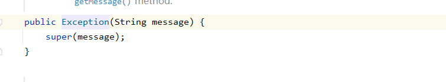
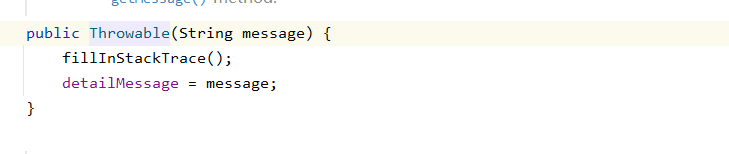
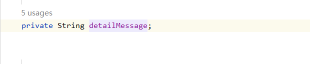
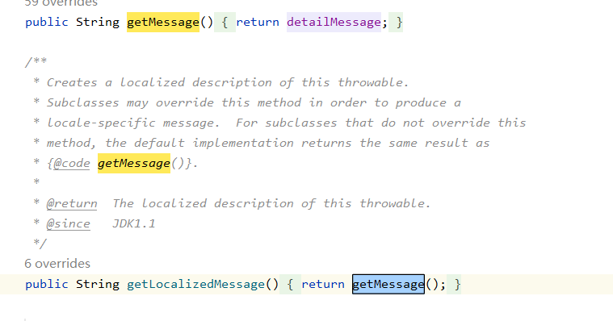
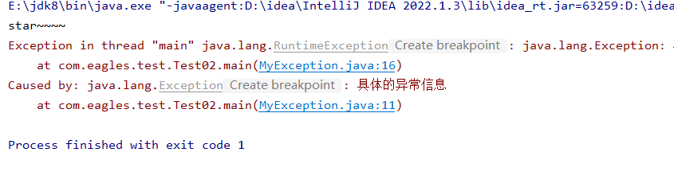
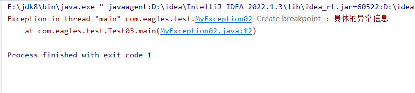
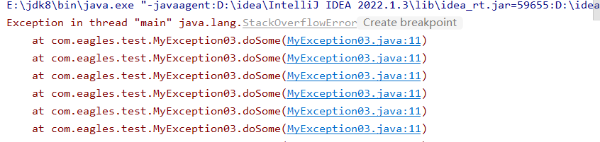

# 自定义异常：

创建对应的异常子类，继承Exception或者RuntimeException



在按Ctal点进super



拿到异常信息之后，做了一个信息的传递。message传递给了detailMessage，这个是Throwable里面的一个成员变量



Ctrl+f 搜索getMessage，找到Throwable里面的这个方法

方法作用：这个方法可以去获取异常信息是什么



# 编译时异常Exception：

```java
package com.eagles.test;
//如果想继承编译异常就Exception 取决你觉得你的自定义类想继承哪种异常
public class MyException extends Exception{
    public MyException(String message) {
        super(message);//创建这个构造的作用是传递一个信息，日常报错信息
    }
}
class Test02{
    public static void main(String[] args) {
        System.out.println("star~~~~");
        Exception exception = new Exception("具体的异常信息");

        try {
            throw  exception; //编译时异常，必须解决（继续向上抛，在主函数上抛给jvm虚拟机（throws Exception）；或者用try catch语句）
        } catch (Exception e) {
            throw new RuntimeException(e);
        }
    }
}
```



# 运行时异常RunException：

```java
package com.eagles.test;

public class MyException02 extends RuntimeException{
    public MyException02(String message) {
        super(message);
    }
}
class Test03{

    public static void main(String[] args) {

        MyException02 myException02 = new MyException02("具体的异常信息");
        throw  myException02;
        //不报错，因为是运行时异常 
    }

}
```



# Error：

不可处理异常 通常像栈内存溢出，堆内存溢出

```java
package com.eagles.test;

public class MyException03 {
    public static void main(String[] args) {
        MyException03 myException03 = new MyException03();
        myException03.doSome();

    }
    //方法递归
    public void doSome() {
        doSome();
    }
}
```


