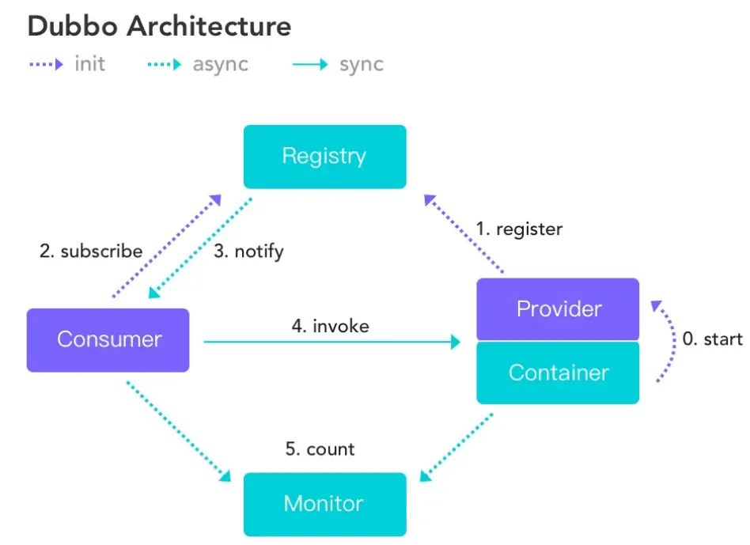
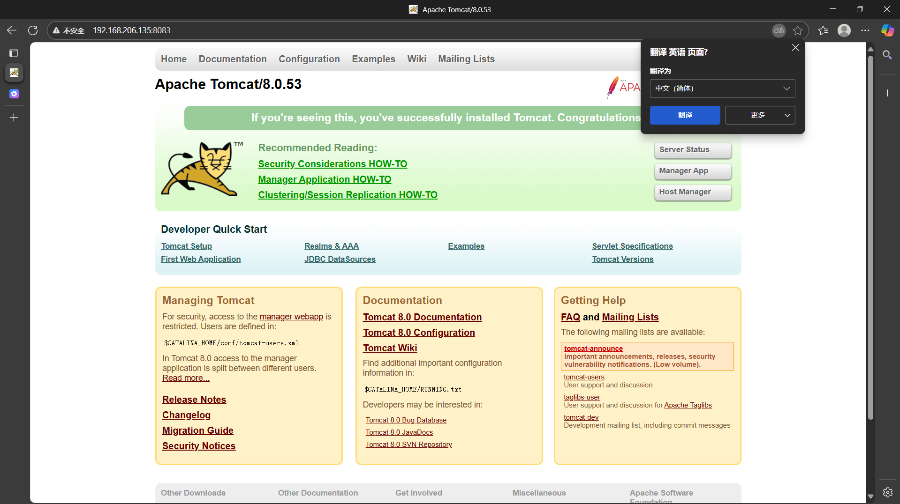
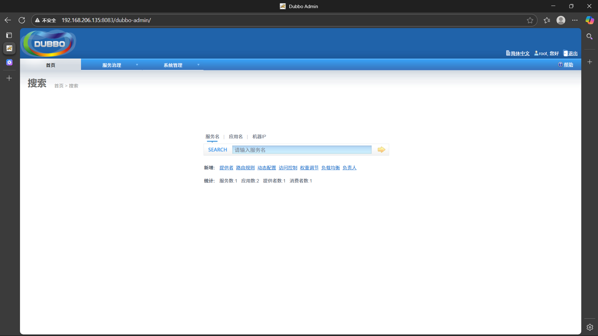
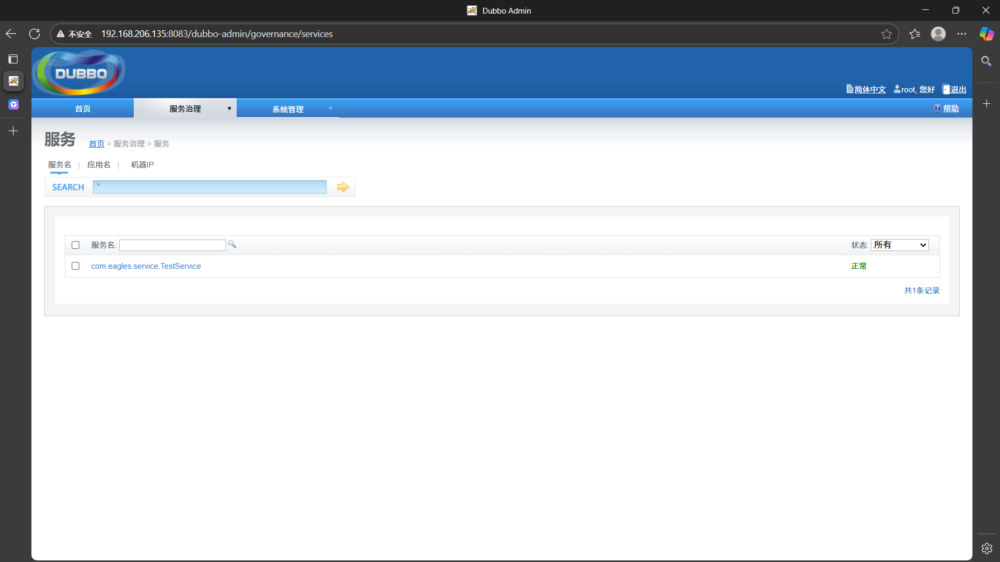

## 什么是 Dubbo？

**Dubbo（读作 “打波”）** 是由阿里巴巴开源的一款 **高性能、轻量级的 Java RPC 框架**，后来捐赠给 Apache 软件基金会，现在叫 **Apache Dubbo**。

## Dubbo 有什么用？（核心作用）

Dubbo 的核心用途是：**让不同的服务之间可以远程调用，就像调用本地方法一样简单。**

举个生活中的例子：

想象你在点外卖：

- 你（消费者） → 点餐 → 商家（提供者）
- 商家做好饭 → 骑手 → 送到你家

在系统中：

- 用户服务（消费者） → 调用 → 订单服务（提供者）
- 订单服务处理完 → 返回结果 → 用户服务

Dubbo 就是那个“骑手 + 调度中心”，负责把请求**安全、高效、可靠地传递过去**，并把结果带回来。

## Dubbo 能解决哪些问题？（实际作用）

|  |  |
| --- | --- |
| 问题 | Dubbo 如何解决 |
| 服务之间怎么通信？ | 提供 **RPC 远程调用**，A 服务可以直接调用 B 服务的方法 |
| 服务太多，怎么管理？ | 提供 **服务注册与发现**，所有服务都注册到“通讯录”（如 Nacos） |
| 某个服务挂了怎么办？ | 支持 **负载均衡、容错、重试、熔断**，自动避开故障机器 |
| 流量太大，怎么分配？ | 支持 **负载均衡策略**（轮询、随机、一致性哈希等） |
| 怎么做灰度发布？ | 支持 **标签路由、条件路由**，让特定用户访问新版本 |
| 怎么监控调用情况？ | 支持 **链路追踪、监控、统计**（配合 Sentinel、SkyWalking） |

---

## Dubbo 在微服务架构中的位置

调用和运行的顺序



```plain
+----------------+     +----------------+     +----------------+
|   用户服务     |     |   订单服务     |     |   支付服务     |
| (Consumer)     |<--->| (Provider)     |<--->| (Provider)     |
+----------------+  R  +----------------+  P  +----------------+
       ↑            P        ↑            C        ↑
       |            C        |            |        |
       +------------+--------+------------+--------+
                    |        |
              +-----v--------v-----+
              |   注册中心        |
              |   (Nacos/ZooKeeper) |
              +--------------------+

              +--------------------+
              |   Dubbo 框架        | ← 隐藏在服务内部
              +--------------------+
```

- **RPC**：远程过程调用（Remote Procedure Call）
- **Provider**：服务提供者（实现功能）
- **Consumer**：服务消费者（调用功能）
- **注册中心**：服务的“通讯录”，记录谁提供了什么服务

## 举个通俗例子：电商系统

假设你开发一个电商网站，拆分成多个服务：

|  |  |  |
| --- | --- | --- |
| 服务 | 功能 | Dubbo 的作用 |
| 用户服务 | 登录、注册 | 调用订单服务创建订单 |
| 订单服务 | 下单、查订单 | 调用库存服务扣库存 |
| 库存服务 | 扣库存、查库存 | 调用支付服务付款 |
| 支付服务 | 支付、退款 | 返回支付结果 |

如果没有 Dubbo：

- 你要自己写 HTTP 请求（麻烦、易错）
- 服务挂了不知道
- 流量不均，某些机器压力大

有了 Dubbo：

- 调用就像写 `orderService.createOrder(...)`
- 自动发现服务、负载均衡
- 故障自动切换，系统更稳定

## 部署Dubbo的环境

部署环境和塞入zookeeper都是在linux系统完成的

```plain
#lunix 安装java环境：

yum list java*
yum install java-1.8.0-openjdk* -y

# 关闭防火墙
systemctl stop firewalld

#开机关闭防火墙
systemctl disable firewalld

#解压zookeeper压缩包
tar -zxvf zookeeper-3.4.13.tar.gz 

#copyzookeeper配置文件
cd conf---->>> cp ./zoo_sample.cfg ./zoo.cfg

#查看配置文件内容
more 文件名称

#回到zookeeper主目录，创建输出文件夹
mkdir data （创建完进入该文件夹）

pwd 查看输出文件夹的绝对路径  /root/zookeeper/zookeeper-3.4.13/data（copy）
#编辑核心配置文件
进入conf 
vi zoo.cfg 按‘I’键，让当前处于可编辑状态  
dataDir=/root/zookeeper/zookeeper-3.4.13/data（替换）
按esc ：wq 保存且退出

#启动zookeeper服务（首先cd bin）
./zkServer.sh strat

#部署dubbo的注册中心的客户端

1、需要安装一个tomcat

#创建tomcat文件夹
mkdir tomcat 

#解压tomcat
tar -zxvf apache-tomcat-8.0.53.tar.gz

#启动tomcat服务
cd bin ----->>>>> ./startup.sh

在浏览器访问tomcat主页面，出现异常可以尝试修改端口号

#将dubbo客户端项目拖入根目录，然后将项目移动到tomcat的webapps下面
mv ./dubbo-admin.war ./tomcat/apache-tomcat-8.0.53/webapps/

#重启tomcat 重启zookeeper

在浏览器访问dubbo的注册中心
http://192.168.120.130:8080/dubbo-admin/  用户名和密码全是root
```

#### 在没有将zookeeper注入前，开启服务器，访问服务器，观察是否可以访问成功



#### 将zookeeper注入到Tomcat之后



#### 查看服务，观察是否有线程处于待机情况



## 相关的配置

```plain
#dubbo场景启动器

<dependency>
  <groupId>io.dubbo.springboot</groupId>
  <artifactId>spring-boot-starter-dubbo</artifactId>
  <version>1.0.0</version>
</dependency>

#日志

<dependency>
  <groupId>log4j</groupId>
  <artifactId>log4j</artifactId>
  <version>1.2.17</version>
</dependency>

#dubbo提供者配置
spring.dubbo.application.name=dubbo-server
spring.dubbo.registry.address=zookeeper://ip:2181
spring.dubbo.protocol.name=dubbo
spring.dubbo.protocol.port=20880
spring.dubbo.scan=com.*.impl

#dubbo消费者配置
spring.dubbo.application.name=dubbo-client
spring.dubbo.registry.address=zookeeper://ip:2181
spring.dubbo.scan=com.*.controller
```

# Dubbo 项目使用笔记（基于 Spring Boot）

项目目标：实现一个简单的 Dubbo 分布式服务调用系统，包含服务提供者（Server）和服务消费者（Client），通过 Zookeeper 作为注册中心进行服务注册与发现。

---

## 一、项目结构

```plain
dubbo-project/
├── dobbo-beans/               # 公共接口模块（API）
│   └── TestService.java
├── dubbo-server/              # 服务提供者（Provider）
│   ├── TestServiceImpl.java
│   ├── application.yml
│   └── pom.xml
└── dubbo-client/              # 服务消费者（Consumer）
    ├── TestController.java
    ├── application.yml
    └── pom.xml
```

---

## 二、核心模块说明

### 1. `dobbo-beans` 模块（公共接口）

```java
package com.eagles.service;

public interface TestService {
    String getMessage();
}
```

作用：定义远程服务接口，被 Provider 实现，被 Consumer 引用。  
🔗 必须打包成 jar 并被双方依赖。

这里存在的作用不仅是为了一个实现一个调用，更重要的是理解。不同板块和项目之间，是可以打成jar包或者war放在其他程序里面，只需要配置一下，即可作为第三方的资源，被调用或者使用

`dubbo-beans` 通常是 **一个独立的 Maven 模块**，被所有 provider 和 consumer **共同依赖**。**可以放对象，接口等等，不放逻辑。**

“Beans” 是 Java 社区对 **普通 Java 对象（POJO）** 的俗称，尤其是那些符合 JavaBean 规范的对象（有 getter/setter、无参构造等）。

避免使用模糊的 `beans`，建议用 `api` 或 `contract` 表达其“契约”本质。

---

### 2. 服务提供者（`dubbo-server`）

#### 实现类：`TestServiceImpl.java`

```java
package com.eagles.server.service;

import com.alibaba.dubbo.config.annotation.Service; // 注意是 Dubbo 的 @Service
import com.eagles.service.TestService;

@Service // 暴露为 Dubbo 服务
public class TestServiceImpl implements TestService {
    @Override
    public String getMessage() {
        return "成功获取了数据~~";
    }
}
```

注意：

- 使用的是 `com.alibaba.dubbo.config.annotation.Service`，不是 Spring 的 `@Service`。
- 该注解会自动将服务注册到注册中心。

---

#### 配置文件：`application.yml`

注意：要重写端口号，防止与消费者冲突（默认情况都为8080）

```yaml
server.port=8082

# Dubbo 提供者配置
spring.dubbo.application.name=dubbo-server
spring.dubbo.registry.address=zookeeper://192.168.206.135:2181
spring.dubbo.protocol.name=dubbo
spring.dubbo.protocol.port=20880
spring.dubbo.scan=com.eagles.server.service
```

配置说明：

- `application.name`: 应用名称
- `registry.address`: Zookeeper 注册中心地址 （虚拟机地址）
- `protocol`: 使用 Dubbo 协议，端口 20880
- `scan`: 扫描带有 `@Service` 的服务实现类包路径

---

#### 启动类（需添加）

```java
@SpringBootApplication
@EnableDubbo // 启用 Dubbo（虽然旧版本可能自动扫描，但建议显式添加）
public class DubooServerApplication {
    public static void main(String[] args) {
        SpringApplication.run(DubooServerApplication.class, args);
    }
}
```

---

### 3. 服务消费者（`dubbo-client`）

#### 控制器：`TestController.java`

```java
package com.eagles.client.controller;

import com.alibaba.dubbo.config.annotation.Reference;
import com.eagles.service.TestService;
import org.springframework.stereotype.Controller;
import org.springframework.web.bind.annotation.RequestMapping;
import org.springframework.web.bind.annotation.ResponseBody;

@Controller
public class TestController {

    @Reference // 订阅远程服务
    private TestService testService;

    @RequestMapping("/message")
    @ResponseBody
    public String getMessage() {
        return testService.getMessage(); // 远程调用
    }
}
```

`@Reference` 由 Dubbo 注入远程服务代理对象。

---

#### 配置文件：`application.yml`

注意：要重写端口号，防止与提供者冲突（默认情况都为8080）

```yaml
server.port=8081

# Dubbo 消费者配置
spring.dubbo.application.name=dubbo-client
spring.dubbo.registry.address=zookeeper://192.168.206.135:2181
spring.dubbo.scan=com.eagles.client.controller
```

注意：消费者不需要 `protocol` 配置，只需注册中心和扫描路径。

---

## 三、Maven 依赖分析（`pom.xml`）

### 共同依赖

|  |  |
| --- | --- |
| 依赖 | 说明 |
| `io.dubbo.springboot:spring-boot-starter-dubbo:1.0.0` | Dubbo 与 Spring Boot 集成启动器（**已过时**） |
| `log4j:log4j:1.2.17` | 日志框架 |
| `com.eagles:doboo-beans:1.0-SNAPSHOT` | 公共接口模块 |

**重大问题**：`io.dubbo.springboot` 是第三方非官方包，**已废弃**，不推荐使用！

---

## 存在的问题与修复建议

### 1. 使用了过时的 Dubbo 启动器

```xml
<!--  错误 -->
<dependency>
  <groupId>io.dubbo.springboot</groupId>
  <artifactId>spring-boot-starter-dubbo</artifactId>
  <version>1.0.0</version>
</dependency>
```

**修复：替换为官方推荐的** `dubbo-spring-boot-starter`

```xml
<!--  正确 -->
<dependency>
  <groupId>org.apache.dubbo</groupId>
  <artifactId>dubbo-spring-boot-starter</artifactId>
  <version>3.2.0</version>
</dependency>

<!-- 注册中心依赖（Nacos 或 Zookeeper） -->
<dependency>
  <groupId>org.apache.dubbo</groupId>
  <artifactId>dubbo-dependencies-zookeeper</artifactId>
  <version>3.2.0</version>
  <type>pom</type>
</dependency>
```

官方文档：https://dubbo.apache.org/zh/docs/references/spring-boot/

---

### 2. 配置方式过时（使用 `spring.dubbo.*`）

你当前使用的是旧版配置（`spring.dubbo.application.name`），这是 Dubbo 2.7 之前的风格。

**建议改为标准** `dubbo.*` **配置**（Dubbo 2.7+ 支持）

```yaml
dubbo:
  application:
    name: dubbo-server
  registry:
    address: zookeeper://192.168.206.135:2181
  protocol:
    name: dubbo
    port: 20880
  scan:
    base-packages: com.eagles.server.service
```

---

### 3. 缺少 `@EnableDubbo` 注解

虽然旧版本可能自动启用，但建议显式添加：

```java
@SpringBootApplication
@EnableDubbo
public class DubboServerApplication { ... }
```

---

### 4. 日志中文乱码问题

你的 `log4j.properties` 中有 `\u63D0\u4F9B\u8005` 等 Unicode 编码，说明文件保存为 ASCII，应改为 UTF-8 编码保存。

---

## 正确的依赖配置（推荐）

```xml
<dependencies>
  <!--  官方 Dubbo Spring Boot Starter -->
  <dependency>
    <groupId>org.apache.dubbo</groupId>
    <artifactId>dubbo-spring-boot-starter</artifactId>
    <version>3.2.0</version>
  </dependency>

  <!-- Zookeeper 注册中心 -->
  <dependency>
    <groupId>org.apache.curator</groupId>
    <artifactId>curator-framework</artifactId>
    <version>5.2.0</version>
  </dependency>
  <dependency>
    <groupId>org.apache.curator</groupId>
    <artifactId>curator-recipes</artifactId>
    <version>5.2.0</version>
  </dependency>

  <!-- 公共接口 -->
  <dependency>
    <groupId>com.eagles</groupId>
    <artifactId>dobbo-beans</artifactId>
    <version>1.0-SNAPSHOT</version>
  </dependency>

  <!-- Spring Boot 基础 -->
  <dependency>
    <groupId>org.springframework.boot</groupId>
    <artifactId>spring-boot-starter</artifactId>
  </dependency>

  <!-- 消费者需要 Web 支持 -->
  <dependency>
    <groupId>org.springframework.boot</groupId>
    <artifactId>spring-boot-starter-web</artifactId>
  </dependency>

  <!-- 日志 -->
  <dependency>
    <groupId>log4j</groupId>
    <artifactId>log4j</artifactId>
    <version>1.2.17</version>
  </dependency>
</dependencies>
```

---

## 测试流程

1. 启动 Zookeeper：`./zkServer.sh start`
2. 启动 `duboo-server` 项目
3. 启动 `dubbo-client` 项目
4. 访问：`http://localhost:8081/message`
5. 预期输出：`成功获取了数据~~`

---

## 总结：关键点

|  |  |
| --- | --- |
| 项目 | 说明 |
| 接口共享 | 通过独立模块（API）定义服务接口 |
| 服务暴露 | `@Service`  （Dubbo 注解）实现类 |
| 服务引用 | `@Reference`  注入远程服务 |
| 注册中心 | Zookeeper 存储服务地址 |
| 避免使用 | `io.dubbo.springboot`  （已废弃） |
| 推荐使用 | `org.apache.dubbo:dubbo-spring-boot-starter` |

## 后续建议

1. 使用 **Nacos** 替代 Zookeeper（更易用，支持配置中心）
2. 添加 **Dubbo Admin** 管理界面，查看服务状态
3. 引入 **Sentinel** 实现限流降级
4. 使用 **Dubbo 3.x** 的 Triple 协议（兼容 gRPC）

**-----------------------------------------------------------------------------------------**

**完整的 Dubbo 3 + Nacos + Spring Boot 项目模板**，包含：

- 项目结构说明
- 公共 API 模块
- 服务提供者（Provider）
- 服务消费者（Consumer）
- Nacos 作为注册中心
- 使用官方 `dubbo-spring-boot-starter`
- 支持 Dubbo Triple 协议（gRPC 兼容）
- Maven 多模块配置
- 可直接运行的代码和配置

---

# 完整的 Dubbo 3 + Nacos + Spring Boot 项目模板

技术栈：Dubbo 3.x | Nacos 2.x | Spring Boot 3.x | Java 17 | Maven

---

## 项目结构

```bash
dubbo3-nacos-demo/
├── dubbo-api/                  # 公共接口模块
│   └── src/main/java/com/eagles/api/TestService.java
├── dubbo-provider/             # 服务提供者
│   ├── src/main/java/com/eagles/provider/ProviderApplication.java
│   ├── src/main/java/com/eagles/provider/service/TestServiceImpl.java
│   └── src/main/resources/application.yml
├── dubbo-consumer/             # 服务消费者
│   ├── src/main/java/com/eagles/consumer/ConsumerApplication.java
│   ├── src/main/java/com/eagles/consumer/controller/TestController.java
│   └── src/main/resources/application.yml
└── pom.xml                     # 根 POM（聚合项目）
```

---

## 1. 根 `pom.xml`（父工程）

```xml
<?xml version="1.0" encoding="UTF-8"?>
<project xmlns="http://maven.apache.org/POM/4.0.0"
  xmlns:xsi="http://www.w3.org/2001/XMLSchema-instance"
  xsi:schemaLocation="http://maven.apache.org/POM/4.0.0 http://maven.apache.org/xsd/maven-4.0.0.xsd">
  <modelVersion>4.0.0</modelVersion>

  <groupId>com.eagles</groupId>
  <artifactId>dubbo3-nacos-demo</artifactId>
  <version>1.0.0</version>
  <packaging>pom</packaging>

  <name>Dubbo3 Nacos Demo</name>
  <modules>
    <module>dubbo-api</module>
    <module>dubbo-provider</module>
    <module>dubbo-consumer</module>
  </modules>

  <properties>
    <project.build.sourceEncoding>UTF-8</project.build.sourceEncoding>
    <maven.compiler.source>17</maven.compiler.source>
    <maven.compiler.target>17</maven.compiler.target>
    <spring-boot.version>3.1.5</spring-boot.version>
    <dubbo.version>3.2.9</dubbo.version>
    <nacos.version>2.2.3</nacos.version>
  </properties>

  <dependencyManagement>
    <dependencies>
      <!-- Spring Boot BOM -->
      <dependency>
        <groupId>org.springframework.boot</groupId>
        <artifactId>spring-boot-dependencies</artifactId>
        <version>${spring-boot.version}</version>
        <type>pom</type>
        <scope>import</scope>
      </dependency>

      <!-- Dubbo BOM -->
      <dependency>
        <groupId>org.apache.dubbo</groupId>
        <artifactId>dubbo-bom</artifactId>
        <version>${dubbo.version}</version>
        <type>pom</type>
        <scope>import</scope>
      </dependency>
    </dependencies>
  </dependencyManagement>

</project>
```

---

## 2. `dubbo-api` 模块

### `pom.xml`

```xml
<?xml version="1.0" encoding="UTF-8"?>
<project xmlns="http://maven.apache.org/POM/4.0.0"
  xmlns:xsi="http://www.w3.org/2001/XMLSchema-instance"
  xsi:schemaLocation="http://maven.apache.org/POM/4.0.0 http://maven.apache.org/xsd/maven-4.0.0.xsd">
  <modelVersion>4.0.0</modelVersion>
  <parent>
    <groupId>com.eagles</groupId>
    <artifactId>dubbo3-nacos-demo</artifactId>
    <version>1.0.0</version>
  </parent>

  <artifactId>dubbo-api</artifactId>
  <packaging>jar</packaging>

  <!-- 无其他依赖，纯接口 -->
</project>
```

### `TestService.java`

```java
package com.eagles.api;

public interface TestService {
    String sayHello(String name);
}
```

---

## 3. `dubbo-provider` 服务提供者

### `pom.xml`

```xml
<?xml version="1.0" encoding="UTF-8"?>
<project xmlns="http://maven.apache.org/POM/4.0.0"
  xmlns:xsi="http://www.w3.org/2001/XMLSchema-instance"
  xsi:schemaLocation="http://maven.apache.org/POM/4.0.0 http://maven.apache.org/xsd/maven-4.0.0.xsd">
  <modelVersion>4.0.0</modelVersion>
  <parent>
    <groupId>com.eagles</groupId>
    <artifactId>dubbo3-nacos-demo</artifactId>
    <version>1.0.0</version>
  </parent>

  <artifactId>dubbo-provider</artifactId>

  <dependencies>
    <dependency>
      <groupId>com.eagles</groupId>
      <artifactId>dubbo-api</artifactId>
      <version>1.0.0</version>
    </dependency>

    <!-- Dubbo Spring Boot Starter -->
    <dependency>
      <groupId>org.apache.dubbo</groupId>
      <artifactId>dubbo-spring-boot-starter</artifactId>
    </dependency>

    <!-- Nacos 注册中心 -->
    <dependency>
      <groupId>org.apache.dubbo</groupId>
      <artifactId>dubbo-registry-nacos</artifactId>
    </dependency>

    <!-- Spring Boot Web（可选，用于健康检查） -->
    <dependency>
      <groupId>org.springframework.boot</groupId>
      <artifactId>spring-boot-starter-web</artifactId>
    </dependency>

    <!-- Spring Boot Actuator -->
    <dependency>
      <groupId>org.springframework.boot</groupId>
      <artifactId>spring-boot-starter-actuator</artifactId>
    </dependency>
  </dependencies>

  <build>
    <plugins>
      <plugin>
        <groupId>org.springframework.boot</groupId>
        <artifactId>spring-boot-maven-plugin</artifactId>
      </plugin>
    </plugins>
  </build>
</project>
```

### `TestServiceImpl.java`

```java
package com.eagles.provider.service;

import com.eagles.api.TestService;
import org.apache.dubbo.config.annotation.DubboService;

@DubboService  // 暴露为 Dubbo 服务（Triple 协议默认）
public class TestServiceImpl implements TestService {
    @Override
    public String sayHello(String name) {
        return "Hello, " + name + " from Dubbo 3!";
    }
}
```

### `ProviderApplication.java`

```java
package com.eagles.provider;

import org.apache.dubbo.config.spring.context.annotation.EnableDubbo;
import org.springframework.boot.SpringApplication;
import org.springframework.boot.autoconfigure.SpringBootApplication;

@SpringBootApplication
@EnableDubbo
public class ProviderApplication {
    public static void main(String[] args) {
        SpringApplication.run(ProviderApplication.class, args);
    }
}
```

### `application.yml`

```yaml
server:
  port: 8082

spring:
  application:
    name: dubbo-provider

dubbo:
  application:
    name: ${spring.application.name}
  protocol:
    name: tri  # Triple 协议（gRPC 兼容，推荐 Dubbo 3）
    port: 20880
  registry:
    address: nacos://127.0.0.1:8848
    # 可选：用户名密码
    # parameters:
    #   username: nacos
    #   password: nacos
  config-center:
    address: nacos://127.0.0.1:8848
  metadata-report:
    address: nacos://127.0.0.1:8848

# Actuator
management:
  endpoints:
    web:
      exposure:
        include: '*'
```

---

## 4. `dubbo-consumer` 服务消费者

### `pom.xml`

```xml
<?xml version="1.0" encoding="UTF-8"?>
<project xmlns="http://maven.apache.org/POM/4.0.0"
  xmlns:xsi="http://www.w3.org/2001/XMLSchema-instance"
  xsi:schemaLocation="http://maven.apache.org/POM/4.0.0 http://maven.apache.org/xsd/maven-4.0.0.xsd">
  <modelVersion>4.0.0</modelVersion>
  <parent>
    <groupId>com.eagles</groupId>
    <artifactId>dubbo3-nacos-demo</artifactId>
    <version>1.0.0</version>
  </parent>

  <artifactId>dubbo-consumer</artifactId>

  <dependencies>
    <dependency>
      <groupId>com.eagles</groupId>
      <artifactId>dubbo-api</artifactId>
      <version>1.0.0</version>
    </dependency>

    <dependency>
      <groupId>org.apache.dubbo</groupId>
      <artifactId>dubbo-spring-boot-starter</artifactId>
    </dependency>

    <dependency>
      <groupId>org.apache.dubbo</groupId>
      <artifactId>dubbo-registry-nacos</artifactId>
    </dependency>

    <dependency>
      <groupId>org.springframework.boot</groupId>
      <artifactId>spring-boot-starter-web</artifactId>
    </dependency>
  </dependencies>

  <build>
    <plugins>
      <plugin>
        <groupId>org.springframework.boot</groupId>
        <artifactId>spring-boot-maven-plugin</artifactId>
      </plugin>
    </plugins>
  </build>
</project>
```

### `TestController.java`

```java
package com.eagles.consumer.controller;

import com.eagles.api.TestService;
import org.apache.dubbo.config.annotation.DubboReference;
import org.springframework.web.bind.annotation.GetMapping;
import org.springframework.web.bind.annotation.PathVariable;
import org.springframework.web.bind.annotation.RestController;

@RestController
public class TestController {

    @DubboReference
    private TestService testService;

    @GetMapping("/hello/{name}")
    public String hello(@PathVariable String name) {
        return testService.sayHello(name);
    }
}
```

### `ConsumerApplication.java`

```java
package com.eagles.consumer;

import org.apache.dubbo.config.spring.context.annotation.EnableDubbo;
import org.springframework.boot.SpringApplication;
import org.springframework.boot.autoconfigure.SpringBootApplication;

@SpringBootApplication
@EnableDubbo
public class ConsumerApplication {
    public static void main(String[] args) {
        SpringApplication.run(ConsumerApplication.class, args);
    }
}
```

### `application.yml`

```yaml
server:
  port: 8081

spring:
  application:
    name: dubbo-consumer

dubbo:
  application:
    name: ${spring.application.name}
  registry:
    address: nacos://127.0.0.1:8848
  config-center:
    address: nacos://127.0.0.1:8848
  metadata-report:
    address: nacos://127.0.0.1:8848
```

---

## 5. 启动 Nacos（本地测试）

### 方式一：Docker 启动（推荐）

```bash
docker run -d \
  --name nacos-standalone \
  -p 8848:8848 \
  -e MODE=standalone \
  -e PREFER_HOST_MODE=ip \
  nacos/nacos-server:v2.2.3
```

访问：`http://127.0.0.1:8848/nacos`  
默认账号密码：`nacos/nacos`

---

## 6. 启动顺序

1. 启动 Nacos
2. 启动 `dubbo-provider`
3. 启动 `dubbo-consumer`
4. 访问测试：`http://localhost:8081/hello/World`

预期输出：

```plain
Hello, World from Dubbo 3!
```

---

## 项目优势（Dubbo 3 + Nacos）

|  |  |
| --- | --- |
| 特性 | 说明 |
| Triple 协议 | 兼容 gRPC，支持 HTTP/2，性能更好 |
| Nacos 注册中心 | 支持服务发现、配置管理、健康检查 |
| 配置中心 | 动态更新路由、权重等 |
| 可视化 | Nacos 控制台查看服务列表 |
| 高性能 | Dubbo 3 性能提升 30%+ |
| 服务治理 | 支持熔断、限流、负载均衡 |

---

## 学习资源

- Dubbo 官网：https://dubbo.apache.org/
- Nacos 官网：https://nacos.io/
- GitHub 模板仓库（可 Fork）：https://github.com/yourname/dubbo3-nacos-demo（你可以创建自己的）

---

## 可扩展功能

- 添加 **Dubbo Admin** 管理界面
- 集成 **Sentinel** 实现限流降级
- 使用 **SkyWalking** 做链路追踪
- 支持 **多协议**（Dubbo、REST、gRPC）
- 配置 **TLS 安全通信**
