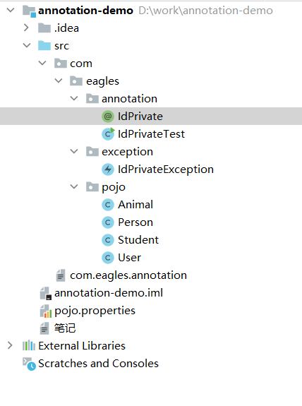
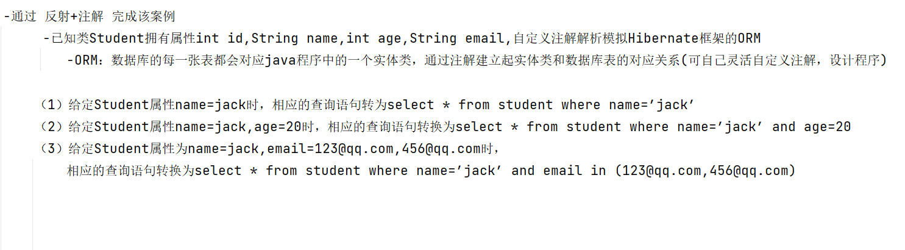

# 案例：

编写一个程序，通过反射机制检测一个类中是否有注解@IdPrivate（注解自定义）,如果有，则该类中必须包含私有的id属性，没有私有id属性则 抛出异常！（类的信息需要存储在配置文件中）



```java
package com.eagles.annotation;

import java.lang.annotation.ElementType;
import java.lang.annotation.Retention;
import java.lang.annotation.RetentionPolicy;
import java.lang.annotation.Target;

@Target(ElementType.TYPE)//检测一个类中是否有注解@IdPrivate（注解自定义）
@Retention(RetentionPolicy.RUNTIME)
public @interface IdPrivate {
}
```

```java
package com.eagles.annotation;

import com.eagles.exception.IdPrivateException;
import com.sun.corba.se.impl.presentation.rmi.IDLTypeException;
import com.sun.xml.internal.bind.v2.schemagen.xmlschema.Annotated;

import java.io.FileNotFoundException;
import java.io.FileReader;
import java.io.IOException;
import java.lang.reflect.Field;
import java.lang.reflect.Modifier;
import java.util.Properties;

public class IdPrivateTest {
    public static void main(String[] args) {

        //创建集合对象
        Properties properties = new Properties();
        FileReader fileReader = null;

        try {
            //创建一个流对象
            fileReader = new FileReader("pojo.properties");
            properties.load(fileReader);  //写进去

            String value = properties.getProperty("classNames");//读取key，获得value
            String[] classNameArray = value.split(";");//分割

            //遍历
            for (String className : classNameArray) {
                //创建字节码对象
                Class<?> aClass = Class.forName(className);
                //通过反射机制来检测类上有没有注解
                IdPrivate idPrivate = aClass.getAnnotation(IdPrivate.class);

                boolean flag = false;
                if (idPrivate != null) {
                    //获取类中所有的属性
                    Field[] declaredFields = aClass.getDeclaredFields();

                    flag = false;
                    //遍历属性
                    for (Field declaredField : declaredFields) {
                        //判断是否包含私有的id属性
                        if (Modifier.toString(declaredField.getModifiers()).contains("private")) ;
                        flag = true;
                    }
                }
                if (flag) {
                    System.out.println(aClass.getName() + "符合要求，检测通过~~");
                }else {
                    try {
                        //抛出异常
                        throw  new IdPrivateException(aClass.getName()+"没有包含私有的Id属性");
                    } catch (IdPrivateException exception) {
                        //打印异常信息
                        exception.printStackTrace();
                    }
                }

            }

        } catch (FileNotFoundException e) {
            throw new RuntimeException(e);
        } catch (IOException e) {
            throw new RuntimeException(e);
        } catch (ClassNotFoundException e) {
            throw new RuntimeException(e);
        }finally {
            if (fileReader!= null){
                try {
                    fileReader.close();
                } catch (IOException e) {
                    throw new RuntimeException(e);
                }
            }
        }
    }
}
```

```java
classNames=com.eagles.pojo.Animal;com.eagles.pojo.Person;com.eagles.pojo.Student;com.eagles.pojo.User
```

```java
package com.eagles.exception;

//自定义一个异常

public class IdPrivateException extends RuntimeException{
    public IdPrivateException(String message){
        super(message);
        
    }
}
```

```java
package com.eagles.pojo;

import com.eagles.annotation.IdPrivate;

@IdPrivate
public class Animal {
    private  int id;
}
```

```java
package com.eagles.pojo;

import com.eagles.annotation.IdPrivate;

@IdPrivate
public class Person {
    public  int id;
}
```

```java
package com.eagles.pojo;

import com.eagles.annotation.IdPrivate;

@IdPrivate
public class Student {
    private  final int id = 100;
}
```

```java
package com.eagles.pojo;

public class User {

    private  String id;
}
```

```java
com.eagles.pojo.Animal符合要求，检测通过~~
com.eagles.pojo.Person符合要求，检测通过~~
com.eagles.pojo.Student符合要求，检测通过~~
com.eagles.exception.IdPrivateException: com.eagles.pojo.User没有包含私有的Id属性
	at com.eagles.annotation.IdPrivateTest.main(IdPrivateTest.java:54)
```

# 案例2：

通过反射机制+注解来模拟spring框架执行流程

程序执行过程中，检测配置文件中的类有没有加注解controller(白定义注解)

如果有，需要将该类的实例添加到容器(map集合)中

从容器中取出来的实例必须是单例的!

```java
package com.eagles.factory;

import com.eagles.annotation.Controller;

import java.io.FileNotFoundException;
import java.io.FileReader;
import java.io.IOException;
import java.util.Enumeration;
import java.util.HashMap;
import java.util.Properties;

public class BeanFactory {

    //创建一个集合，通过该集合储存实例
    private  static HashMap<String,Object> beanMap;

    static{
        beanMap = new HashMap<>();
        Properties properties = new Properties();
        //创建流对象
        FileReader fileReader = null;

        try {
            fileReader = new FileReader("pojo.properties");

            properties.load(fileReader);

            //获取所有key的结果集
            Enumeration<?> enumeration = properties.propertyNames();
            //遍历结果集，判断容器中是否存在下一个元素
            while (enumeration.hasMoreElements()){
                //取到每一个key
                String key =(String) enumeration.nextElement();

                //根据key来获取value
                String value = properties.getProperty(key);
                //properties.getProperty(); 括号里的参数类型是String 所以前面强转成String了

                //检测对应的类上有没有注解
                Class<?> aClass = Class.forName(value);//Class.forName();这个后面跟的是全类名

                //下面annotation.value() 要用@Ccontroller里面的方法，又因为Annotation是注释的父类，所以得进行向下转型
                Controller annotation =(Controller) aClass.getAnnotation(Controller.class);//aClass.getAnnotation(Controller.class);检测

                //基于反射创建实例
                Object instance = aClass.newInstance();

                if (annotation != null){
                    if (!annotation.value().equals("")){
                        key =annotation.value();//如果对@Controller写了注解，key将转化成所写的注解
                    }
                }
                //然后将唯一标识和对应的实例添加到容器中
                beanMap.put(key,instance);
            }

        } catch (FileNotFoundException e) {
            throw new RuntimeException(e);
        } catch (IOException e) {
            throw new RuntimeException(e);
        } catch (ClassNotFoundException e) {
            throw new RuntimeException(e);
        } catch (InstantiationException e) {
            throw new RuntimeException(e);
        } catch (IllegalAccessException e) {
            throw new RuntimeException(e);
        }finally {
            if (fileReader!= null){
                try {
                    fileReader.close();
                } catch (IOException e) {
                    throw new RuntimeException(e);
                }
            }

        }

    }
    /*
    根据id来获取实例
    beanId 实例的唯一标识
     */
    public static Object getBean(String beanId){
        return beanMap.get(beanId);
    }

}
```

```java
package com.eagles.annotation;

import java.lang.annotation.ElementType;
import java.lang.annotation.Retention;
import java.lang.annotation.RetentionPolicy;
import java.lang.annotation.Target;

@Target(ElementType.TYPE)
@Retention(RetentionPolicy.RUNTIME)
public @interface Controller {
    String value() default  " ";

}
```

```java
package com.eagles.pojo;

import com.eagles.annotation.Controller;
import com.eagles.annotation.IdPrivate;

@Controller
public class Animal {
    private  int id;
}
```

```plain
package com.eagles.pojo;

import com.eagles.annotation.Controller;
import com.eagles.annotation.IdPrivate;

@Controller("per")
public class Person {
    public  int id;
}
```

```java
package com.eagles.pojo;

import com.eagles.annotation.Controller;
import com.eagles.annotation.IdPrivate;

@Controller("stu")
public class Student {
    private  final int id = 100;
}
```

```java
package com.eagles.pojo;

import com.eagles.annotation.Controller;
import com.eagles.annotation.IdPrivate;

@Controller
public class User {

    private  String id;
}
```

```java
package com.eagles.annotation 	;

import com.eagles.factory.BeanFactory;
import com.eagles.pojo.Animal;
import com.eagles.pojo.Person;
import com.sun.xml.internal.bind.v2.schemagen.xmlschema.Annotated;

public class BeanFactoryTest {
    public static void main(String[] args) {
        //获取两个实例，观察是否出于一处空间
        Animal animal01 = (Animal)BeanFactory.getBean("animal");
        Animal animal02 = (Animal)BeanFactory.getBean("animal");
        System.out.println(animal01==animal02);
        //Person类里注解写入"per" 所以person不能再被调取到，应该用per
        Person person =(Person) BeanFactory.getBean("per");
        System.out.println(person);

    }

}
```

```plain
true
com.eagles.pojo.Person@610455d6
```

# 案例3：



1. **定义自定义注解**：用于标记类和字段，建立实体类与数据库表之间的映射关系。
2. **创建实体类**：使用自定义注解标记类和字段。
3. **编写工具类**：利用反射获取注解信息，并根据注解生成 SQL 查询语句。

### 1. 定义自定义注解

首先，我们需要定义一些自定义注解来模拟 Hibernate 的功能。例如，`@Table` 注解用于指定实体类对应的数据库表名，`@Column` 注解用于指定字段对应的数据库列名。

```java
import java.lang.annotation.ElementType;
import java.lang.annotation.Retention;
import java.lang.annotation.RetentionPolicy;
import java.lang.annotation.Target;

// 定义 @Table 注解，用于指定实体类对应的数据库表名
@Retention(RetentionPolicy.RUNTIME)
@Target(ElementType.TYPE)
public @interface Table {
    String value();
}

// 定义 @Column 注解，用于指定字段对应的数据库列名
@Retention(RetentionPolicy.RUNTIME)
@Target(ElementType.FIELD)
public @interface Column {
    String value();
}
```

### 2. 创建实体类

接下来，我们创建一个 `Student` 实体类，并使用自定义注解进行标记。

```java
@Table("student")
public class Student {
    @Column("id")
    private int id;

    @Column("name")
    private String name;

    @Column("age")
    private int age;

    @Column("email")
    private String email;

    // Getters and Setters
    public int getId() { return id; }
    public void setId(int id) { this.id = id; }

    public String getName() { return name; }
    public void setName(String name) { this.name = name; }

    public int getAge() { return age; }
    public void setAge(int age) { this.age = age; }

    public String getEmail() { return email; }
    public void setEmail(String email) { this.email = email; }
}
```

### 3. 编写工具类

最后，我们需要编写一个工具类，该类将使用反射机制读取注解信息，并根据给定的条件生成相应的 SQL 查询语句。

```java
import java.lang.reflect.Field;
import java.util.Arrays;
import java.util.List;

public class QueryBuilder {

    public static String buildQuery(Object entity, String... conditions) throws IllegalAccessException {
        StringBuilder query = new StringBuilder("select * from ");

        // 获取实体类上的 @Table 注解值作为表名
        Class<?> clazz = entity.getClass();
！！！！ Table tableAnnotation = clazz.getAnnotation(Table.class);！！！
        if (tableAnnotation != null) {
            query.append(tableAnnotation.value());
        } else {
            throw new IllegalArgumentException("Entity class must be annotated with @Table");
        }

        query.append(" where ");

        // 遍历所有字段，检查是否需要添加到查询条件中
        Field[] fields = clazz.getDeclaredFields();
        List<String> conditionList = Arrays.asList(conditions);

        for (Field field : fields) {
            field.setAccessible(true);

            Column columnAnnotation = field.getAnnotation(Column.class);
            if (columnAnnotation != null) {
                String columnName = columnAnnotation.value();
                Object fieldValue = field.get(entity);

                if (fieldValue != null && conditionList.contains(field.getName())) {
                    if (query.toString().endsWith("where ")) {
                        query.append(columnName).append(" = '").append(fieldValue).append("'");
                    } else {
                        query.append(" and ").append(columnName).append(" = '").append(fieldValue).append("'");
                    }
                }
            }
        }

        return query.toString();
    }
}
```

### 4. 测试代码

现在我们可以编写测试代码来验证我们的实现是否正确。

```java
public class Main {
    public static void main(String[] args) throws IllegalAccessException {
        Student student = new Student();
        student.setName("jack");
        student.setAge(20);
        student.setEmail("123@qq.com");

        System.out.println(QueryBuilder.buildQuery(student, "name")); // 输出: select * from student where name='jack'
        System.out.println(QueryBuilder.buildQuery(student, "name", "age")); // 输出: select * from student where name='jack' and age='20'

        // 处理多个 email 条件的情况
        Student studentWithMultipleEmails = new Student();
        studentWithMultipleEmails.setName("jack");
        studentWithMultipleEmails.setEmail("123@qq.com");

        System.out.println(QueryBuilder.buildQuery(studentWithMultipleEmails, "name", "email")); // 输出: select * from student where name='jack' and email='123@qq.com'
    }
}
```

```plain
select * from student where name='jack'
 select * from student where name='jack' and age='20'
 select * from student where name='jack' and email='123@qq.com'   
```

！！！！！

#### Table tableAnnotation = clazz.getAnnotation(Table.class);这条红色代码的解析和理解：

`clazz.getAnnotation(Table.class);` 这行代码的作用是：

**从一个类（Class 对象）中获取指定类型的注解（Annotation）。**

具体来说，它会返回你**在该类上使用** `@Table` **注解时设置的信息**。

---

### ✅ 示例说明

假设你有如下自定义的 `@Table` 注解和实体类：

#### 1. 自定义注解：`@Table`

```java
import java.lang.annotation.*;

@Retention(RetentionPolicy.RUNTIME)  // 注解在运行时依然可用
@Target(ElementType.TYPE)            // 只能用于类、接口或枚举上
public @interface Table {
    String value();  // 表名
}
```

#### 2. 实体类：`Student`

```java
@Table("student")  // 使用了 @Table 注解，并传入值为 "student"
public class Student {
    // ...
}
```

#### 3. 获取注解信息

```java
Class<?> clazz = Student.class;
Table tableAnnotation = clazz.getAnnotation(Table.class);
System.out.println(tableAnnotation.value());  // 输出: student
```

---

### 所以 `clazz.getAnnotation(Table.class)` 的结果是什么？

- 如果类上有 `@Table(...)` 注解，就返回这个注解对象；
- 然后你可以通过 `.value()` 方法拿到你设置的值（比如 `"student"`）；
- 如果类上**没有**这个注解，则返回 `null`。

---

### 常见结构图示

|  |  |  |
| --- | --- | --- |
| **Java 类** | **对应注解** | `getAnnotation(Table.class)`  **返回值** |
| `@Table("user") class User {...}` | 有注解 | `Table`  注解对象，`.value() == "user"` |
| `class Product {...}`  （无注解） | 无 | `null` |
