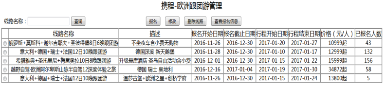
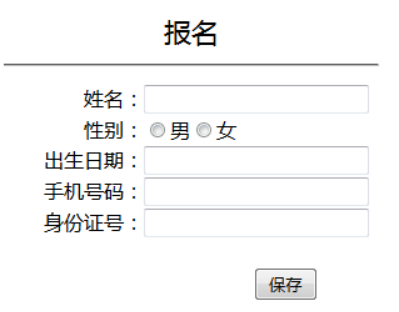
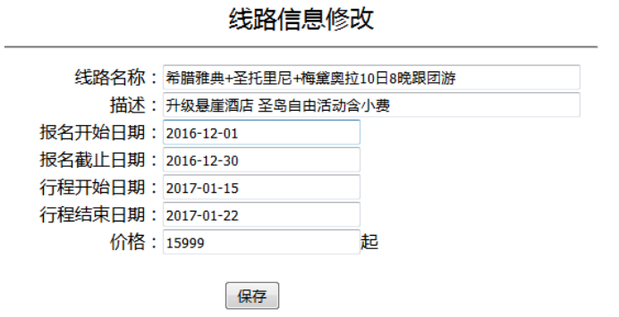
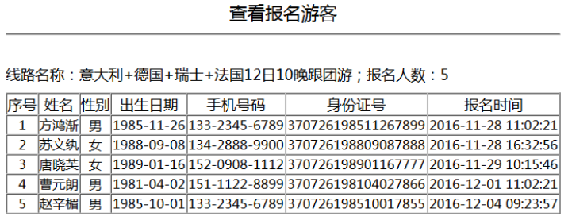

**需求描述：**请实现《携程-欧洲跟团游管理》功能。

1. **线路列表**

1. . 列表如图1所示
2. . 支持按线路模糊查询

图1 ：列表页面

2. **报名（****15****分）**

点击图1中的【报名】按钮，进入图2页面。

填写完信息后，点击图2的【保存】按钮，提交报名信息，如果保存成功，点击提示框的【确定】按钮，跳转到图1的列表页面，该线路的已报名人数增加1位。

图2 ：报名页面

3. **修改（****20****分）**

选中某条线路信息，点击图1中的【修改】按钮，进入图3页面。点击“保存”按钮后，提交请求，如果修改成功，跳转到图1页面。

图3 ：查看统计信息页面

4. **删除线路（****15****分）**

全选全不选在一个复选框上实现，支持批量删除。

选中图1页面某条或者多条线路信息，点击图1中的【删除线路】按钮。

若其中线路已有游客报名，则不能删除，页面弹出提示框。

如果所选线路没有游客报名，页面弹出确认框“确定要删除选中线路吗？”，如果点击“确定”，提交信息，后台处理结束页面弹出“删除成功”提示框。

5. **查看报名信息（****15****分）**

选中图1页面某条线路信息，点击图1中的【查看报名信息】按钮。进入图4页面。

图4 ：报名游客列表页面
