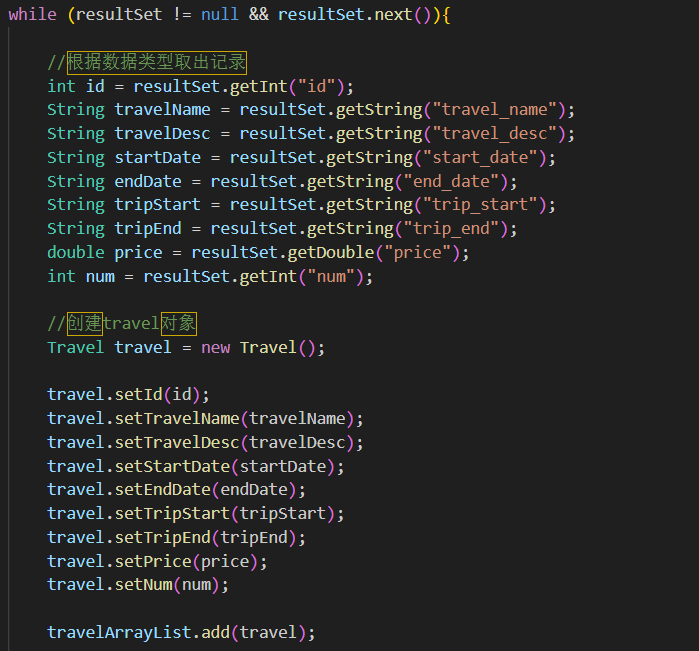
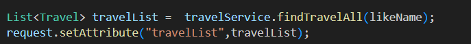
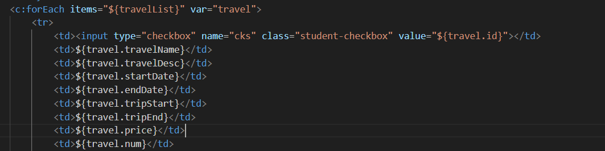

### 1. 前端实现

#### 1.1 HTML （结构+JSTL+表单）

- **线路列表展示**
- **模糊查询（按线路名称）**
- **单选操作：报名、修改、查看报名信息**
- **批量删除线路**
- **全选/全不选功能**

```html
<%@ page contentType="text/html;charset=UTF-8" language="java" %>
  <%@ taglib prefix="c" uri="http://java.sun.com/jsp/jstl/core" %>
    <%
      String path = request.getContextPath();
      %>
      <!DOCTYPE html>
      <html lang="zh">
        <head>
          <title>travel列表</title>
          <%--
            <style>
              ------这里面放CSS代码---------
            </stlyle>
          --%>
              <link rel="stylesheet" href="<%=path%>/css/travel-list.css">
            </head>
          <%--
              <script>
              ---------这里放JavaScript代码-------------
              </script>
          --%>
              <body>
              <div class="container">
              <h1>携程-欧洲跟团游管理</h1>

              <!-- 操作按钮和搜索框 -->
              <form action="http://localhost:8083/web/travel?flag=list" method="post">
              <div class="search-box">
              <input type="text" class="search-input" name="likeName" value="${likeName}" placeholder="线路名称模糊查询">
              <button type="submit" class="btn btn-primary">查询</button>
              <a onclick="toAdd()" class="btn btn-primary">报名</a>
              <button type="button" onclick="findTravelById()" class="btn btn-danger">修改</button>
              <button type="button" onclick="deleteById()" class="btn btn-danger">删除线路</button>
              <button type="button" onclick="findPassenger()" class="btn btn-danger">报名信息</button>
            </div>
            </form>

              <table>
              <thead>
              <tr>
              <th><input type="checkbox" id="selectAll"></th>
              <th>线路名称</th>
              <th>描述</th>
              <th>报名开始日期</th>
              <th>报名结束日期</th>
              <th>行程开始日期</th>
              <th>行程结束日期</th>
              <th>价格(元/人)</th>
              <th>已报名人数</th>
              <th>操作</th>
            </tr>
            </thead>
              <tbody>
              <c:forEach items="${travelList}" var="travel">
              <tr>
              <td><input type="checkbox" name="cks" class="student-checkbox" value="${travel.id}"></td>
              <td>${travel.travelName}</td>
              <td>${travel.travelDesc}</td>
              <td>${travel.startDate}</td>
              <td>${travel.endDate}</td>
              <td>${travel.tripStart}</td>
              <td>${travel.tripEnd}</td>
              <td>${travel.price}</td>
              <td>${travel.num}</td>
              <td>
              <a class="btn btn-warning">编辑</a>
              <button onclick="deleteById(${travel.id})" class="btn btn-danger">删除</button>
            </td>
            </tr>
            </c:forEach>
            </tbody>
            </table>
            </div>

              <!-- 引入 jQuery 和 JS 文件 -->
              <script src="<%=path%>/jquery/jquery-1.7.2.js"></script>
              <script src="<%=path%>/js/travel-list.js"></script>
            </body>
            </html>
```

#### 1.2 CSS 样式

美化页面样式。

```css
body {
  font-family: 'Segoe UI', Tahoma, Geneva, Verdana, sans-serif;
  background-color: #f4f4f9;
  margin: 0;
  padding: 20px;
}

h1 {
  color: #333;
  text-align: center;
  margin-bottom: 30px;
}

table {
  width: 100%;
  border-collapse: collapse;
  box-shadow: 0 0 20px rgba(0, 0, 0, 0.1);
  background-color: white;
}

th, td {
  padding: 12px 15px;
  text-align: left;
  border-bottom: 1px solid #ddd;
}

th {
  background-color: #007BFF;
  color: white;
}

tr:hover {
  background-color: #f5f5f5;
}

.container {
  max-width: 1200px;
  margin: 0 auto;
}

/* 按钮样式 */
.btn {
  display: inline-block;
  padding: 8px 16px;
  border: none;
  border-radius: 4px;
  cursor: pointer;
  text-decoration: none;
  font-size: 14px;
  margin-right: 10px;
  transition: background-color 0.3s ease;
}

.btn-primary {
  background-color: #007BFF;
  color: white;
}

.btn-primary:hover {
  background-color: #0056b3;
}

.btn-danger {
  background-color: #dc3545;
  color: white;
}

.btn-danger:hover {
  background-color: #c82333;
}

.btn-warning {
  background-color: #ffc107;
  color: #212529;
}

.btn-warning:hover {
  background-color: #e0a800;
}

/* 搜索框样式 */
.search-box {
  margin-bottom: 20px;
  display: flex;
  gap: 10px;
  align-items: center;
}

.search-input {
  padding: 8px;
  border: 1px solid #ddd;
  border-radius: 4px;
  font-size: 14px;
  width: 60%;
}
```

#### 1.3 JavaScript 功能（交互逻辑）

处理数据请求和展示。

```javascript
因为第一个需求没有交互的需求，只是简单的查表展示，所以暂时没有代码
```

|  |  |
| --- | --- |
| 代码 | 作用 |
| //获取当前工程的绝对路径  String path = request.getContextPath(); | 是因为jquery和js的引入有时候使用相对路径容易报错或者无法引用，所以引入当前工程的绝对路径即：/web |
| contentType="text/html;charset=UTF-8" | 设置响应内容为 HTML，编码为 UTF-8，支持中文。 |
| <%@ taglib ... %> | 引入 JSTL 核心标签库，用于在 JSP 中使用 `<c:forEach>` 等标签。 |
| request.getContextPath() | 获取当前 Web 应用的上下文路径（如 `/web`），用于构建相对路径，避免硬编码。 |
| name="likeName"    value="${likeName}" | 提交的查询关键词。  回显上次输入的搜索词（由后端通过 `request.setAttribute("likeName", ...)` 设置）。   - 提交到 `Servlet` 的 `travel` 路径，`flag=list` 表示执行“查询线路列表”操作。 |
| travelList | 由后端 `Servlet` 查询数据库后，放入 `request` 域中，通过 JSTL 遍历展示 |
| `value="${travel.id}"` | 存储线路 ID，供后续操作使用。 |
| <a onclick="toAdd()">报名</a>  <button onclick="findTravelById()">修改</button>  <button onclick="deleteById()">删除线路</button>  <button onclick="findPassenger()">报名信息</button> | 按钮操作 |
| 使用 `<c:forEach>` | JSTL 遍历 |

### 2. 后端实现 (Java)

#### 2.1 创建实体类 `Travel`

定义线路实体类。

```java
package com.eagles.pojo;
import java.util.List;

public class Travel {

    private int id;
    private String travelName;
    private String travelDesc;
    private String startDate;
    private String endDate;
    private String tripStart;
    private String tripEnd;
    private double price;
    private int num;

    private List<Passenger> passengerList;

    public List<Passenger> getPassengerList() {
        return passengerList;
    }

    public void setPassengerList(List<Passenger> passengerList) {
        this.passengerList = passengerList;
    }

    public Travel(int id, String travelName, String travelDesc, String startDate, String endDate, String tripStart, String tripEnd, double price, int num) {
        this.id = id;
        this.travelName = travelName;
        this.travelDesc = travelDesc;
        this.startDate = startDate;
        this.endDate = endDate;
        this.tripStart = tripStart;
        this.tripEnd = tripEnd;
        this.price = price;
        this.num = num;
    }

    public Travel() {
    }

    public int getId() {
        return id;
    }

    public void setId(int id) {
        this.id = id;
    }

    public String getTravelName() {
        return travelName;
    }

    public void setTravelName(String travelName) {
        this.travelName = travelName;
    }

    public String getTravelDesc() {
        return travelDesc;
    }

    public void setTravelDesc(String travelDesc) {
        this.travelDesc = travelDesc;
    }

    public String getStartDate() {
        return startDate;
    }

    public void setStartDate(String startDate) {
        this.startDate = startDate;
    }

    public String getEndDate() {
        return endDate;
    }

    public void setEndDate(String endDate) {
        this.endDate = endDate;
    }

    public String getTripStart() {
        return tripStart;
    }

    public void setTripStart(String tripStart) {
        this.tripStart = tripStart;
    }

    public String getTripEnd() {
        return tripEnd;
    }

    public void setTripEnd(String tripEnd) {
        this.tripEnd = tripEnd;
    }

    public double getPrice() {
        return price;
    }

    public void setPrice(double price) {
        this.price = price;
    }

    public int getNum() {
        return num;
    }

    public void setNum(int num) {
        this.num = num;
    }

    @Override
    public String toString() {
        return "Travel{" +
        "id=" + id +
        ", travelName='" + travelName + '\'' +
        ", travelDesc='" + travelDesc + '\'' +
        ", startDate='" + startDate + '\'' +
        ", endDate='" + endDate + '\'' +
        ", tripStart='" + tripStart + '\'' +
        ", tripEnd='" + tripEnd + '\'' +
        ", price=" + price +
        ", num=" + num +
        ", passengerList=" + passengerList +
        '}';
    }
}
```

|  |  |
| --- | --- |
| 代码 | 作用 |
| private List<Passenger> passengerList; | 有一个主表有一个从表，一般会在主表的实现类里面聚合一个从表的实例  **核心意义：**  建立“一对多”关系   - 这行代码的核心作用是 表示一条旅游线路（`Travel`）与多个乘客（`Passenger`）之间的“一对多”关系。  - 一个 `Travel` 对象（一条旅游线路）可以有 多个 `Passenger` 对象（报名该线路的乘客）。  - `List<Passenger>` 正是用来存储这些“多个乘客”的容器。 |

**业务场景**

|  |  |
| --- | --- |
| **业务操作** | **如何体现** |
| **乘客报名** | 将 `Passenger`  对象添加到 `travel.passengerList`  中 |
| **查看报名信息** | 遍历 `travel.getPassengerList()`  显示所有乘客 |
| **统计人数** | `travel.getPassengerList().size()`  就是已报名人数（可与 `num`  字段同步） |
| **取消报名** | 从 `passengerList`  中移除某个乘客 |

#### 2.2 创建服务层 `TravelServlet`

处理业务逻辑。

```java
package com.eagles.servlet;
import com.eagles.pojo.Travel;
import com.eagles.service.TravelService;
import com.eagles.service.TravelServiceImpl;
import javax.servlet.ServletException;
import javax.servlet.http.HttpServlet;
import javax.servlet.http.HttpServletRequest;
import javax.servlet.http.HttpServletResponse;
import java.io.IOException;
import java.util.List;

public class TravelServlet extends HttpServlet {

    private TravelService travelService = new TravelServiceImpl();
    

    @Override
    protected void doPost(HttpServletRequest request, HttpServletResponse response) throws ServletException, IOException {

        //中文乱码的处理
        request.setCharacterEncoding("utf-8");
        response.setContentType("text/html;charset=utf-8");

        String flag = request.getParameter("flag");

        if (flag != null && flag.equals("list")){
            this.findTravelAll(request,response);
        }
    }

    

    public void findTravelAll(HttpServletRequest request, HttpServletResponse response) {

        String likeName = request.getParameter("likeName");

        if (likeName != null && !likeName.trim().equals("")){
            request.setAttribute("likeName",likeName);
        }

        List<Travel> travelList =  travelService.findTravelAll(likeName);
        request.setAttribute("travelList",travelList);
        try {
            request.getRequestDispatcher("/jsp/travel-list.jsp").forward(request,response);
        } catch (ServletException e) {
            throw new RuntimeException(e);
        } catch (IOException e) {
            throw new RuntimeException(e);
        }

    }

    @Override
    protected void doGet(HttpServletRequest req, HttpServletResponse resp) throws ServletException, IOException {
       doPost(req,resp);
    }
}
```

#### 2.3 创建业务层 `TravelService`

```java
package com.eagles.service;
import com.eagles.pojo.Travel;
import java.util.List;

public interface TravelService {

    /**
     * 查询线路列表
     * @param likeName
     * @return
     */
    List<Travel> findTravelAll(String likeName);

}
```

#### 创造业务层 TravelServiceImpl

```java
package com.eagles.service;
import com.eagles.dao.TravelDao;
import com.eagles.dao.TravelDaoImpl;
import com.eagles.pojo.Travel;
import java.text.SimpleDateFormat;
import java.util.List;

public class TravelServiceImpl implements TravelService {

    private TravelDao travelDao = new TravelDaoImpl();
    

    @Override
    public List<Travel> findTravelAll(String likeName) {
        return travelDao.findTravelAll(likeName);
    }

}
```

#### 2.4 创建业务层 `TravelDao`

```java
package com.eagles.dao;
import com.eagles.pojo.Travel;
import java.util.List;

public interface TravelDao {

    List<Travel> findTravelAll(String likeName);

}
```

#### 创建业务层 `TravelDaoImpl`

```java
package com.eagles.dao;
import com.eagles.pojo.Passenger;
import com.eagles.pojo.Travel;
import com.eagles.utils.JDBCUtils;
import java.sql.Connection;
import java.sql.PreparedStatement;
import java.sql.ResultSet;
import java.sql.SQLException;
import java.util.ArrayList;
import java.util.List;

public class TravelDaoImpl implements TravelDao {

    @Override
    public List<Travel> findTravelAll(String likeName) {

        Connection connection = null;
        PreparedStatement preparedStatement = null;
        ResultSet resultSet = null;
        ArrayList<Travel> travelArrayList = new ArrayList<>();

        try {
            connection = JDBCUtils.getConnection();

            String sql = "";

            if (likeName != null && !likeName.trim().equals("")){
                sql = "select * from tb_travel where travel_name like '%"+likeName.trim()+"%'";
            }else {
                sql = "select * from tb_travel";
            }

            preparedStatement = connection.prepareStatement(sql);

            resultSet = preparedStatement.executeQuery();

            while (resultSet != null && resultSet.next()){

                //根据数据类型取出记录
                int id = resultSet.getInt("id");
                String travelName = resultSet.getString("travel_name");
                String travelDesc = resultSet.getString("travel_desc");
                String startDate = resultSet.getString("start_date");
                String endDate = resultSet.getString("end_date");
                String tripStart = resultSet.getString("trip_start");
                String tripEnd = resultSet.getString("trip_end");
                double price = resultSet.getDouble("price");
                int num = resultSet.getInt("num");

                //创建travel对象
                Travel travel = new Travel();

                travel.setId(id);
                travel.setTravelName(travelName);
                travel.setTravelDesc(travelDesc);
                travel.setStartDate(startDate);
                travel.setEndDate(endDate);
                travel.setTripStart(tripStart);
                travel.setTripEnd(tripEnd);
                travel.setPrice(price);
                travel.setNum(num);

                travelArrayList.add(travel);

            }

        } catch (SQLException e) {
            throw new RuntimeException(e);
        }finally {
            JDBCUtils.close(resultSet,preparedStatement,connection);
        }

        return travelArrayList;
    }

}
```

### 3. 数据库设计

设计数据库表结构以存储线路和报名用户信息。

#### 3.1 线路表 `tb_travel`

```plain
1	俄罗斯+莫斯科+谢尔吉耶夫+圣彼得堡8日6晚跟团游	  不坐夜车含小费无购物	           2016/11/26	2016/12/30	2017/1/20	2017/1/27	10999	43	1
2	意大利+德国+瑞士+法国12日10晚跟团游	            德国深度 新天鹅堡	             2016/11/28	2016/12/30	2017/1/10	2017/1/17	12999	132	2
3	希腊瑞典+圣托里尼+梅黛奥拉10日8晚跟团游	        升级悬崖酒店 圣岛自由活动含小费	 2016/12/1	2016/12/30	2017/1/15	2017/1/22	15999	156	3
4	越野自驾-欧洲阿尔卑斯山脉半自驾12深度体验之旅	  德国 瑞士 奥地利	               2016/12/16	2017/1/4	  2017/1/19	2017/1/30	34872	58	4
5	意大利+德国+瑞士+法国12日10晚跟团游	            温莎古堡+欧洲之星+剑桥学府	     2016/11/26	2016/12/30	2017/1/15	2017/1/24	13800	5	  5
```

#### 3.2 报名用户表 `tb_passenger`

```plain
1	方鸿渐	男	1985-11-26	133-2345-6789	370726198577267899	2016-11-28 11:02:21	1
2	苏文纨	女	1988-09-08	134-2888-9900	370726198809087888	2016-11-28 16:32:56	2
3	汤晓芙	女	1989-01-16	152-0908-1112	370726198901167777	2016-11-29 10:15:46	3
4	曹元朗	男	1981-04-02	151-1122-8899	370726198104027866	2016-12-01 11:02:21	5
5	赵辛楣	男	1985-10-01	133-2345-6789	370726198510017855	2016-12-04 09:23:57	2
```

#### 列表展示的细节：

从数据库根据定义的名字循环的将每一行的每一个数据给取出来，创建一个Travel对象，将数据全部存进对象里面，再把对象存进一个集合里面travelArrayList



在TravelServlet页面，将接收的数组接收并重新起了一个名字，travelList，并将这个数列存到作用域中，给前端接收



前端也通过jquery接收后端传过来的travelList，通过var重命名，通过遍历将值一一取出进行显示



#### var是什么意思：

##### 一、完整语法回顾

```plain
jsp

深色版本

<c:forEach items="${travelList}" var="travel">
    <!-- 在这里可以使用 ${travel} 来访问当前遍历到的对象 -->
</c:forEach>
```

|  |  |
| --- | --- |
| **属性** | **作用** |
| `items="${travelList}"` | 指定要遍历的**数据集合**（比如 List、数组） |
| `var="travel"` | 指定集合中**每个元素的变量名** |

---

##### 二、`var="travel"` 的详细解释

###### 1. `var` 是什么？

- `var` 是 **variable（变量）** 的缩写。
- 它声明了一个 **JSP 页面范围内的变量**。
- 这个变量的作用域仅限于 `<c:forEach>` 标签内部。

###### 2. `"travel"` 是什么？

- `"travel"` 是你**给这个变量起的名字**。
- 你可以把它想象成 Java 中的循环变量：

```java
for (Travel travel : travelList) {
    // 在这里，travel 就是当前遍历到的对象
}
```

###### 3. `${travel}` 怎么用？

在 `<c:forEach>` 标签内部，你可以使用 `${travel}` 来访问当前这个对象的**属性**。

---

##### 三、举个具体例子

假设后端传来的 `travelList` 是一个包含 3 条线路的 `List<Travel>`：

```java
[
{ tid: 1, travelName: "海南三亚游", price: 4999 },
{ tid: 2, travelName: "北京故宫游", price: 1200 },
{ tid: 3, travelName: "西安兵马俑游", price: 2800 }
]
```

使用 JSTL 遍历：

```html
<c:forEach items="${travelList}" var="travel">
  <tr>
    <td>${travel.tid}</td>
    <td>${travel.travelName}</td>
    <td>${travel.price}</td>
  </tr>
</c:forEach>
```

###### 执行过程：

|  |  |  |  |  |
| --- | --- | --- | --- | --- |
| **循环次数** | `var="travel"`  **的值** | `${travel.tid}` | `${travel.travelName}` | `${travel.price}` |
| 第1次 | `travel = {tid:1, travelName:"海南三亚游", price:4999}` | 1 | 海南三亚游 | 4999 |
| 第2次 | `travel = {tid:2, travelName:"北京故宫游", price:1200}` | 2 | 北京故宫游 | 1200 |
| 第3次 | `travel = {tid:3, travelName:"西安兵马俑游", price:2800}` | 3 | 西安兵马俑游 | 2800 |
