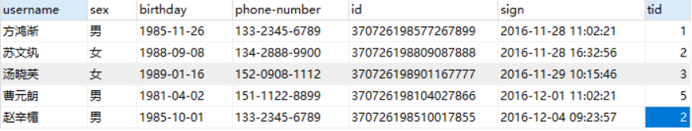
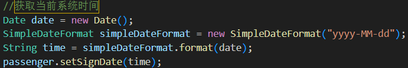
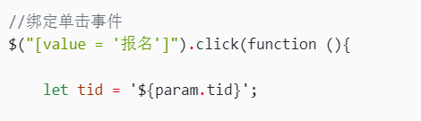
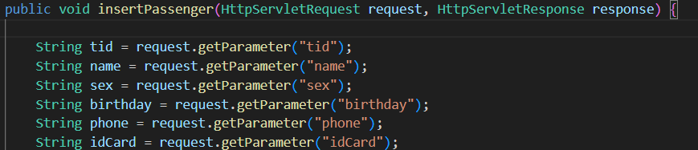

### 1.前端实现

#### 1.1. 报名的前端页面（passenger-add）

```java
<%@ page contentType="text/html;charset=UTF-8" language="java" %>
<%--引入jstl的标签库--%>
<%@ taglib prefix="c" uri="http://java.sun.com/jsp/jstl/core" %>
<%
    //获取当前工程的绝对路径
    String path = request.getContextPath();
%>
<html>
<head>
    <title>报名</title>
    <style>
        html, body {
            height: 100%;
            margin: 0;
        }

        body {
            font-family: 'Segoe UI', Tahoma, Geneva, Verdana, sans-serif;
            background-color: #f4f4f9;
            display: flex;
            justify-content: center;
            align-items: center;
        }

        .form-container {
            background-color: white;
            padding: 2rem;
            border-radius: 0.5rem;
            box-shadow: 0 0.5rem 1rem rgba(0, 0, 0, 0.1);
            width: 90%;
            max-width: 600px;
        }

        h1 {
            color: #333;
            text-align: center;
            margin-bottom: 2rem;
        }

        table {
            width: 100%;
            border-collapse: separate;
            border-spacing: 0 1rem;
        }

        td {
            padding: 0.5rem;
        }

        label {
            color: #666;
            font-weight: 500;
        }

        input[type="text"],
        input[type="number"],
        input[type="date"] {
            width: 100%;
            padding: 0.6rem;
            border: 1px solid #ddd;
            border-radius: 0.3rem;
            font-size: 0.9rem;
            box-sizing: border-box;
            transition: border-color 0.3s ease;
        }

        input[type="text"]:focus,
        input[type="number"]:focus,
        input[type="date"]:focus {
            outline: none;
            border-color: #007BFF;
            box-shadow: 0 0 0 2px rgba(0, 123, 255, 0.25);
        }

        /* 单选框和多选框样式 */
        .radio-group, .checkbox-group {
            display: flex;
            gap: 1rem;
        }

        .radio-group label, .checkbox-group label {
            display: flex;
            align-items: center;
            gap: 0.5rem;
            cursor: pointer;
        }

        input[type="radio"], input[type="checkbox"] {
            appearance: none;
            -webkit-appearance: none;
            -moz-appearance: none;
            width: 1.2rem;
            height: 1.2rem;
            border: 2px solid #ddd;
            border-radius: 50%; /* 单选框为圆形 */
            transition: all 0.3s ease;
            position: relative;
        }

        input[type="checkbox"] {
            border-radius: 0.2rem; /* 多选框为方形 */
        }

        input[type="radio"]:checked, input[type="checkbox"]:checked {
            border-color: #007BFF;
            background-color: #007BFF;
        }

        input[type="radio"]:checked::after, input[type="checkbox"]:checked::after {
            content: "";
            position: absolute;
            top: 50%;
            left: 50%;
            transform: translate(-50%, -50%);
            width: 0.6rem;
            height: 0.6rem;
            background-color: white;
            border-radius: 50%; /* 单选框选中标记为圆形 */
        }

        input[type="checkbox"]:checked::after {
            border-radius: 0.1rem; /* 多选框选中标记为方形 */
            width: 0.8rem;
            height: 0.4rem;
            border-left: 2px solid white;
            border-bottom: 2px solid white;
            transform: translate(-50%, -60%) rotate(-45deg);
        }

        .btn {
            display: inline-block;
            padding: 0.7rem 1.5rem;
            border: none;
            border-radius: 0.3rem;
            cursor: pointer;
            text-decoration: none;
            font-size: 0.9rem;
            transition: background-color 0.3s ease;
        }

        .btn-primary {
            background-color: #007BFF;
            color: white;
            width: 100%;
        }

        .btn-primary:hover {
            background-color: #0056b3;
        }

        /* 优化下拉框样式，增加宽度 */
        select {
            appearance: none;
            -webkit-appearance: none;
            -moz-appearance: none;
            background-image: url('data:image/svg+xml;utf8,<svg xmlns="http://www.w3.org/2000/svg" width="10" height="6" viewBox="0 0 10 6"><path fill="%23666" d="M5 6L0 0h10z"/></svg>');
            background-repeat: no-repeat;
            background-position: right 0.8rem center;
            background-size: 10px 6px;
            /* 增加宽度 */
            width: 100%;
            padding: 0.6rem;
            border: 1px solid #ddd;
            border-radius: 0.3rem;
            font-size: 0.9rem;
            box-sizing: border-box;
            transition: border-color 0.3s ease;
        }

        select:focus {
            outline: none;
            border-color: #007BFF;
            box-shadow: 0 0 0 2px rgba(0, 123, 255, 0.25);
        }
    </style>
</head>

    <%--引入jquery的控件--%>
    <script src="<%=path%>/jquery/jquery-1.7.2.js"></script>

    <script>
        //文本就绪函数
        $(function (){

            //绑定单击事件
            $("[value = '报名']").click(function (){

                let tid = '${param.tid}';

                $.ajax({

                    //提交的地址
                    url:"http://localhost:8083/web/travel?flag=insertPassenger&tid="+tid,
                    //提交到后端的数据
                    data : $("form").serialize(),
                    //提交的方式
                    type:"post",
                    //回调函数
                    success:function (obj){
                            if (obj == "true"){
                                alert('报名成功！')
                                location.href = "http://localhost:8083/web/travel?flag=list";
                            }else {
                                alert('报名失败！有问题请联系管理员！')
                            }
                    },
                    //服务器返回的数据类型
                    dataType:"text"

                })

            })

        })

    </script>

<body>
<div class="form-container">
    <h1>报名</h1>
    <form>
        <table>
            <tr>
                <td><label for="name">姓名</label></td>
                <td><input type="text" id="name" name="name" required></td>
            </tr>
            <tr>
                <td><label>性别</label></td>
                <td>
                    <div class="radio-group">
                        <label>
                            <input type="radio" name="sex" value="1" required> 男
                        </label>
                        <label>
                            <input type="radio" name="sex" value="2" required> 女
                        </label>
                    </div>
                </td>
            </tr>
            <tr>
                <td><label for="birthday">出生日期</label></td>
                <td><input type="date" id="birthday" name="birthday" required></td>
            </tr>
            <tr>
            <tr>
                <td><label for="phone">手机号码</label></td>
                <td><input type="text" id="phone" name="phone"></td>
            </tr>

            <tr>
                <td><label for="idCard">身份证号</label></td>
                <td><input type="text" id="idCard" name="idCard"></td>
            </tr>

        </table>
        <button value="报名" class="btn btn-primary">报名</button>
    </form>
</div>
</body>
</html>
```

#### 1.2..写在travel-List前端里面的报名函数

#### toadd：报名功能

```java
<script>

        //报名
        function toAdd(){

            let length = $("[name = 'cks']:checked").length;

            if (length == 1){
                let id = $("[name = 'cks']:checked").val()
                location.href = "http://localhost:8083/web/jsp/passenger-add.jsp?tid="+id;

            }else {
                alert("只能选择一条线路进行报名~")
            }

        }
</script>
```

- 只允许选择 **一条线路**。
- 跳转到报名页面，并携带线路 ID（`tid`）作为参数。

### 2.后端实现（java）

#### 2.1创建实体类 Passenger

```java
package com.eagles.pojo;

public class Passenger {

    private int pid;
    private String name;
    private int sex;
    private String birthday;
    private String phone;
    private String idCard;
    private String signDate;
    private int tid;

    public Passenger(int pid, String name, int sex, String birthday, String phone, String idCard, String signDate, int tid) {
        this.pid = pid;
        this.name = name;
        this.sex = sex;
        this.birthday = birthday;
        this.phone = phone;
        this.idCard = idCard;
        this.signDate = signDate;
        this.tid = tid;
    }

    public Passenger() {
    }

    public int getPid() {
        return pid;
    }

    public void setPid(int pid) {
        this.pid = pid;
    }

    public String getName() {
        return name;
    }

    public void setName(String name) {
        this.name = name;
    }

    public int getSex() {
        return sex;
    }

    public void setSex(int sex) {
        this.sex = sex;
    }

    public String getBirthday() {
        return birthday;
    }

    public void setBirthday(String birthday) {
        this.birthday = birthday;
    }

    public String getPhone() {
        return phone;
    }

    public void setPhone(String phone) {
        this.phone = phone;
    }

    public String getIdCard() {
        return idCard;
    }

    public void setIdCard(String idCard) {
        this.idCard = idCard;
    }

    public String getSignDate() {
        return signDate;
    }

    public void setSignDate(String signDate) {
        this.signDate = signDate;
    }

    public int getTid() {
        return tid;
    }

    public void setTid(int tid) {
        this.tid = tid;
    }

    @Override
    public String toString() {
        return "Passenger{" +
                "pid=" + pid +
                ", name='" + name + '\'' +
                ", sex=" + sex +
                ", birthday='" + birthday + '\'' +
                ", phone='" + phone + '\'' +
                ", idCard='" + idCard + '\'' +
                ", signDate='" + signDate + '\'' +
                ", tid=" + tid +
                '}';
    }
}
```

#### 2.2创建表现层travelServlet

```java
private TravelService travelService = new TravelServiceImpl();
private PassengerService passengerService = new PassengerServiceImpl();

else if (flag != null && flag.equals("insertPassenger")){
            insertPassenger(request,response);
        }

//报名的请求和响应
public void insertPassenger(HttpServletRequest request, HttpServletResponse response) {

        String tid = request.getParameter("tid");
        String name = request.getParameter("name");
        String sex = request.getParameter("sex");
        String birthday = request.getParameter("birthday");
        String phone = request.getParameter("phone");
        String idCard = request.getParameter("idCard");

        //创建旅客对象
        Passenger passenger = new Passenger();
        passenger.setName(name);
        passenger.setTid(Integer.parseInt(tid));
        passenger.setSex(Integer.parseInt(sex));
        passenger.setBirthday(birthday);
        passenger.setPhone(phone);
        passenger.setIdCard(idCard);

        String flag = passengerService.insertPassenger(passenger);

        try {
            response.getWriter().print(flag);
        } catch (IOException e) {
            throw new RuntimeException(e);
        }
  }
```

浏览器点击的页面是travel-list的页面，点击按钮里面的点击事件进入toAdd( )函数，进入转换到报名的页面，travelServlrt表现层书写请求和响应的逻辑，并在tarvelServlet层集合了一个PassengerService，将与后端交互的数据交给passengerService去书写，这样就可以通过travel-list表调取到tb\_passenger的数据

##### 聚合 `PassengerService` 的好处

|  |  |
| --- | --- |
| **好处** | **说明** |
| ✅ **职责清晰** | Servlet 只负责 HTTP 交互，Service 负责业务逻辑 |
| ✅ **复用性强** | `passengerService.insertPassenger()`  可被多个 Servlet 或接口调用 |
| ✅ **便于维护** | 修改插入逻辑时只需改 `Service`  ，不影响 Controller  **Controller（控制器）就是负责“接收用户请求”并“指挥程序如何响应”的中间协调者。**  `Controller` 通常是 **一个 Servlet**（比如 `TravelServlet`） |
| ✅ **支持事务管理** | 复杂业务（如“报名+减库存”）可在 Service 层统一加事务 |
| ✅ **易于测试** | 可单独测试 `Service`  的业务逻辑，无需启动 Web 容器 |

##### 整的调用链路（数据流向）

```plain
深色版本

前端表单提交
      ↓
TravelServlet.insertPassenger(request, response)  ← 聚合了 passengerService
      ↓
passengerService.insertPassenger(passenger)       ← 业务逻辑（如校验身份证、事务等）
      ↓
passengerDao.insertPassenger(passenger)           ← 执行 SQL 插入数据库
      ↓
返回结果 → Servlet → 响应给前端
```

#### 2.3.创建业务层passengerService

```java
package com.eagles.service;

import com.eagles.pojo.Passenger;

public interface PassengerService {

    /**
     * 报名
     * @param passenger
     * @return
     */

    String insertPassenger(Passenger passenger);

}
```

#### 创建业务层passengerServiceImpl

```java
package com.eagles.service;
import com.eagles.dao.PassengerDao;
import com.eagles.dao.PassengerDaoImpl;
import com.eagles.dao.TravelDao;
import com.eagles.dao.TravelDaoImpl;
import com.eagles.pojo.Passenger;
import java.text.SimpleDateFormat;
import java.util.Date;

public class PassengerServiceImpl implements PassengerService {

    private PassengerDao passengerDao = new PassengerDaoImpl();
    private TravelDao travelDao = new TravelDaoImpl();

    @Override
    public String insertPassenger(Passenger passenger) {

        //获取当前系统时间  获取当前报名时间
        Date date = new Date();
        SimpleDateFormat simpleDateFormat = new SimpleDateFormat("yyyy-MM-dd");
        String time = simpleDateFormat.format(date);
        passenger.setSignDate(time);

        //报名人数+1
        int num = travelDao.updateTravelNum(passenger.getTid());
        //在dao创建一个insert方法，添加旅客信息，返回可变行数的数值
        String flag = passengerDao.insertPassenger(passenger);

        if (num == 1 && flag.equals("true") ){

            return "true";

        }else {

            return "false";
        }
    }
}
```

##### 聚合 `PassengerServiceImpl`（乘客业务实现类）中要聚合一个 `TravelDao`的好处

这是一个非常关键且体现**业务完整性与数据一致性**的设计问题。

##### 一、核心原因：**报名是一个“跨表”的业务操作**

当你新增一名乘客（`Passenger`）报名时，不仅仅是往 `passenger` 表插入一条记录，还必须：

🔗 **同步更新对应的旅游线路（**`Travel`**）的“已报名人数”（**`num`**）字段**

这本质上是一个 **涉及两个数据表的业务操作**：

|  |  |  |
| --- | --- | --- |
| **操作** | **涉及的表** | **谁负责** |
| 插入乘客信息 | `passenger`  表 | `PassengerDao` |
| 增加线路报名人数 | `travel`  表 | `TravelDao` |

所以，`PassengerService` 必须同时依赖这两个 DAO 才能**完整、正确地完成“报名”这个业务**。

##### 二、代码逻辑解析

```java
public String insertPassenger(Passenger passenger) {

// 1. 设置报名日期
Date date = new Date();
SimpleDateFormat simpleDateFormat = new SimpleDateFormat("yyyy-MM-dd");
String time = simpleDateFormat.format(date);
passenger.setSignDate(time);

// 2. 更新线路的报名人数（+1）
int num = travelDao.updateTravelNum(passenger.getTid());

// 3. 插入乘客记录
String flag = passengerDao.insertPassenger(passenger);

// 4. 只有两者都成功，才算报名成功
if (num == 1 && flag.equals("true")) {
    return "true";
} else {
    return "false";
}
}
```

##### 这个流程说明了什么？

- 报名 ≠ 单纯加一个人。
- 它是一个**组合操作**：**“加人 + 加人数”**。
- 如果只做其一，就会导致数据不一致：

- ❌ 只加人不加人数 → 统计错误。
- ❌ 只加人数不加人 → 数据缺失。

---

##### 三、更进一步：为什么不在 DAO 层做这件事？

你可能会问：为什么不把 `updateTravelNum` 写在 `PassengerDao` 里？

答案是：**职责分离（Separation of Concerns）**

|  |  |
| --- | --- |
| **类** | **职责** |
| `PassengerDao` | 只负责 `passenger`  表的 CRUD |
| `TravelDao` | 只负责 `travel`  表的 CRUD |
| `PassengerService` | 负责协调多个 DAO，完成一个完整业务 |

**Service 层是“业务编排者”**，它知道“报名”这件事需要动两个表。

---

##### 四、潜在问题：缺少事务控制（重要！）

虽然当前代码逻辑合理，但有一个**严重缺陷**：**没有使用事务（Transaction）**。

##### 当前风险：

假设：

1. `travelDao.updateTravelNum()` 成功（人数+1）
2. `passengerDao.insertPassenger()` 失败（比如数据库异常）

结果：**人数增加了，但没人报名！数据严重不一致！**

##### 正确做法：加事务

```java
@Override
public String insertPassenger(Passenger passenger) {
try {
    // 开启事务
    Connection conn = JdbcUtils.getConnection();
    conn.setAutoCommit(false);

    // 设置报名日期
    SimpleDateFormat sdf = new SimpleDateFormat("yyyy-MM-dd");
    passenger.setSignDate(sdf.format(new Date()));

    // 更新线路人数
    int num = travelDao.updateTravelNum(passenger.getTid());
    if (num != 1) throw new RuntimeException("更新线路人数失败");

    // 插入乘客
    String flag = passengerDao.insertPassenger(passenger);
    if (!"true".equals(flag)) throw new RuntimeException("插入乘客失败");

    // 提交事务
    conn.commit();
    return "true";

} catch (Exception e) {
    // 回滚事务
    try { conn.rollback(); } catch (SQLException ex) { }
    return "false";
}
}
```

⚠️ 所以：聚合 `TravelDao` 是必要的，但**必须配合事务**才能保证数据安全。

#### 2.4.创建持久层--passengerDao

```java
package com.eagles.dao;
import com.eagles.pojo.Passenger;

import java.util.List;

public interface PassengerDao {

    String insertPassenger(Passenger passenger);

}
```

#### 创建持久层--passengerDaoImpl

```java
package com.eagles.dao;
import com.eagles.pojo.Passenger;
import com.eagles.pojo.Travel;
import com.eagles.utils.JDBCUtils;
import java.sql.Connection;
import java.sql.PreparedStatement;
import java.sql.ResultSet;
import java.sql.SQLException;
import java.util.ArrayList;
import java.util.List;

public class PassengerDaoImpl implements PassengerDao {

    @Override
    public String insertPassenger(Passenger passenger) {

        Connection connection = null;
        PreparedStatement preparedStatement = null;
        ResultSet resultSet = null;

        try {
            connection = JDBCUtils.getConnection();

            String sql = "insert into tb_passenger (name,sex,birthday,phone,idCard,sign_date,tid)values (?,?,?,?,?,?,?)";
            preparedStatement = connection.prepareStatement(sql);

            preparedStatement.setString(1,passenger.getName());
            preparedStatement.setInt(2,passenger.getSex());
            preparedStatement.setString(3,passenger.getBirthday());
            preparedStatement.setString(4,passenger.getPhone());
            preparedStatement.setString(5,passenger.getIdCard());
            preparedStatement.setString(6,passenger.getSignDate());
            preparedStatement.setInt(7,passenger.getTid());

            int executeUpdate = preparedStatement.executeUpdate();

            return executeUpdate == 1 ? "true" : "false";

        } catch (SQLException e) {
            throw new RuntimeException(e);
        }finally {
            JDBCUtils.close(resultSet,preparedStatement,connection);
        }
    }
}
```



数据库有这些内容，所以不仅要把输入的传进去，还得把业务那边设置的报名时间得传给数据库



tid是由前端传过来的



由表现层travelServlet接收并传过来



#### 创建持久层--TravelDao

```java
package com.eagles.dao;
import com.eagles.pojo.Passenger;
import com.eagles.pojo.Travel;
import java.util.List;

public interface TravelDao {

    int updateTravelNum(int tid);
 
}
```

#### 创建持久层--TravelDaoImpl

```java
package com.eagles.dao;
import com.eagles.pojo.Passenger;
import com.eagles.pojo.Travel;
import com.eagles.utils.JDBCUtils;
import java.sql.Connection;
import java.sql.PreparedStatement;
import java.sql.ResultSet;
import java.sql.SQLException;
import java.util.ArrayList;
import java.util.List;

public class TravelDaoImpl implements TravelDao {

    @Override
    public int updateTravelNum(int tid) {

        Connection connection = null;
        PreparedStatement preparedStatement = null;
        ResultSet resultSet = null;

        try {
            connection = JDBCUtils.getConnection();

            String sql = "update tb_travel set num =  num + 1 where id = ?";
            preparedStatement = connection.prepareStatement(sql);
            preparedStatement.setInt(1,tid);

            return preparedStatement.executeUpdate();

        } catch (SQLException e) {
            throw new RuntimeException(e);
        }finally {
            JDBCUtils.close(resultSet,preparedStatement,connection);
        }
    }
}
```

修改数据库中的num属性，执行sql语句进行修改
