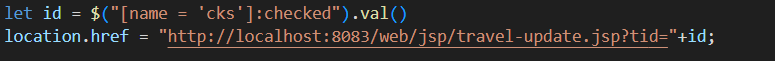
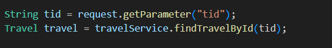
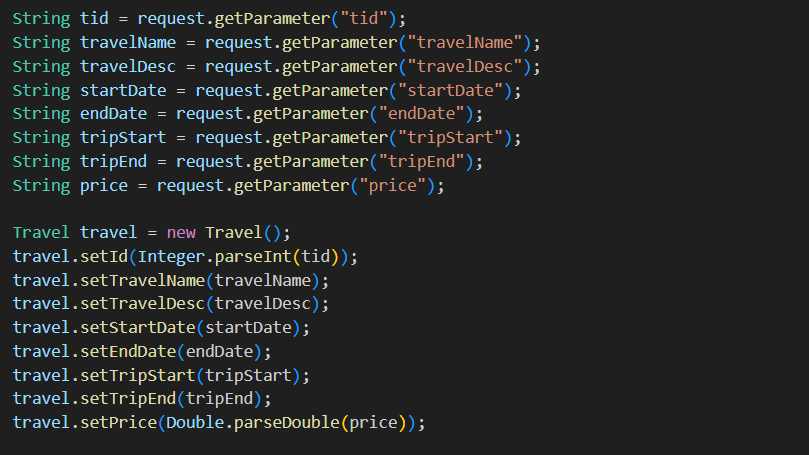
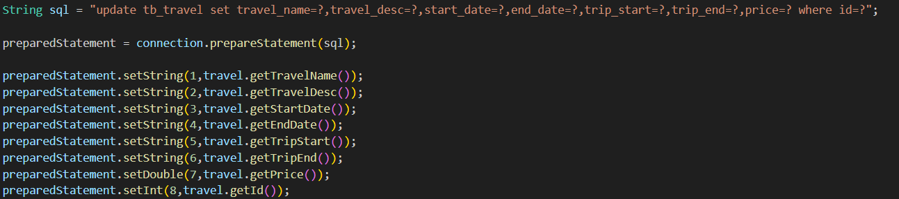

### 1.前端实现

#### 1.1.写在travel-list前端页面的修改函数

findTravelById： 查看是不是点击的单一路线，是的话跳转到修改页面，后面有ajax进行数据的回显

```html
<script>
//修改以及回显的操作
        function findTravelById() {

            let length = $("[name = 'cks']:checked").length;

            if (length == 1){
                let id = $("[name = 'cks']:checked").val()
                location.href = "http://localhost:8083/web/jsp/travel-update.jsp?tid="+id;

            }else {
                alert("只能选择一条线路进行修改~")
            }

        }
</script>  
```

#### 1.2.修改的前端页面（travel-update）

```html
<%@ page contentType="text/html;charset=UTF-8" language="java" %>
<%--引入jstl的标签库--%>
<%@ taglib prefix="c" uri="http://java.sun.com/jsp/jstl/core" %>
<%
    //获取当前工程的绝对路径
    String path = request.getContextPath();
%>
<html>
<head>
    <title>修改</title>
    <style>
        html, body {
            height: 100%;
            margin: 0;
        }

        body {
            font-family: 'Segoe UI', Tahoma, Geneva, Verdana, sans-serif;
            background-color: #f4f4f9;
            display: flex;
            justify-content: center;
            align-items: center;
        }

        .form-container {
            background-color: white;
            padding: 2rem;
            border-radius: 0.5rem;
            box-shadow: 0 0.5rem 1rem rgba(0, 0, 0, 0.1);
            width: 90%;
            max-width: 600px;
        }

        h1 {
            color: #333;
            text-align: center;
            margin-bottom: 2rem;
        }

        table {
            width: 100%;
            border-collapse: separate;
            border-spacing: 0 1rem;
        }

        td {
            padding: 0.5rem;
        }

        label {
            color: #666;
            font-weight: 500;
        }

        input[type="text"],
        input[type="number"],
        input[type="date"] {
            width: 100%;
            padding: 0.6rem;
            border: 1px solid #ddd;
            border-radius: 0.3rem;
            font-size: 0.9rem;
            box-sizing: border-box;
            transition: border-color 0.3s ease;
        }

        input[type="text"]:focus,
        input[type="number"]:focus,
        input[type="date"]:focus {
            outline: none;
            border-color: #007BFF;
            box-shadow: 0 0 0 2px rgba(0, 123, 255, 0.25);
        }

        /* 单选框和多选框样式 */
        .radio-group, .checkbox-group {
            display: flex;
            gap: 1rem;
        }

        .radio-group label, .checkbox-group label {
            display: flex;
            align-items: center;
            gap: 0.5rem;
            cursor: pointer;
        }

        input[type="radio"], input[type="checkbox"] {
            appearance: none;
            -webkit-appearance: none;
            -moz-appearance: none;
            width: 1.2rem;
            height: 1.2rem;
            border: 2px solid #ddd;
            border-radius: 50%; /* 单选框为圆形 */
            transition: all 0.3s ease;
            position: relative;
        }

        input[type="checkbox"] {
            border-radius: 0.2rem; /* 多选框为方形 */
        }

        input[type="radio"]:checked, input[type="checkbox"]:checked {
            border-color: #007BFF;
            background-color: #007BFF;
        }

        input[type="radio"]:checked::after, input[type="checkbox"]:checked::after {
            content: "";
            position: absolute;
            top: 50%;
            left: 50%;
            transform: translate(-50%, -50%);
            width: 0.6rem;
            height: 0.6rem;
            background-color: white;
            border-radius: 50%; /* 单选框选中标记为圆形 */
        }

        input[type="checkbox"]:checked::after {
            border-radius: 0.1rem; /* 多选框选中标记为方形 */
            width: 0.8rem;
            height: 0.4rem;
            border-left: 2px solid white;
            border-bottom: 2px solid white;
            transform: translate(-50%, -60%) rotate(-45deg);
        }

        .btn {
            display: inline-block;
            padding: 0.7rem 1.5rem;
            border: none;
            border-radius: 0.3rem;
            cursor: pointer;
            text-decoration: none;
            font-size: 0.9rem;
            transition: background-color 0.3s ease;
        }

        .btn-primary {
            background-color: #007BFF;
            color: white;
            width: 100%;
        }

        .btn-primary:hover {
            background-color: #0056b3;
        }

        /* 优化下拉框样式，增加宽度 */
        select {
            appearance: none;
            -webkit-appearance: none;
            -moz-appearance: none;
            background-image: url('data:image/svg+xml;utf8,<svg xmlns="http://www.w3.org/2000/svg" width="10" height="6" viewBox="0 0 10 6"><path fill="%23666" d="M5 6L0 0h10z"/></svg>');
            background-repeat: no-repeat;
            background-position: right 0.8rem center;
            background-size: 10px 6px;
            /* 增加宽度 */
            width: 100%;
            padding: 0.6rem;
            border: 1px solid #ddd;
            border-radius: 0.3rem;
            font-size: 0.9rem;
            box-sizing: border-box;
            transition: border-color 0.3s ease;
        }

        select:focus {
            outline: none;
            border-color: #007BFF;
            box-shadow: 0 0 0 2px rgba(0, 123, 255, 0.25);
        }
    </style>
</head>

    <%--引入jquery的控件--%>
    <script src="<%=path%>/jquery/jquery-1.7.2.js"></script>

    <script>
        //文本就绪函数
        $(function (){
            //前端页面信息之间的调取
            let tid = '${param.tid}';

            $.ajax({

                //提交的地址
                url:"http://localhost:8083/web/travel?flag=findTravelById",
                //提交到后端的数据
                data : {tid:tid},
                //提交的方式
                type:"post",
                //回调函数
                success:function (obj){
                    $("#travelName").val(obj.travelName);
                    $("#travelDesc").val(obj.travelDesc);
                    $("#startDate").val(obj.startDate);
                    $("#endDate").val(obj.endDate);
                    $("#tripStart").val(obj.tripStart);
                    $("#tripEnd").val(obj.tripEnd);
                    $("#price").val(obj.price);
                },
                //服务器返回的数据类型
                dataType:"json"
            })

            //绑定单击事件
            $("[value = '保存']").click(function (){

                $.ajax({
                    //提交的地址
                    url:"http://localhost:8083/web/travel?flag=updateTravel&tid="+tid,
                    //提交到后端的数据
                    data : $("form").serialize(),
                    //提交的方式
                    type:"post",
                    //回调函数
                    success:function (obj){
                        if (obj == "true"){
                            alert('编辑成功！')
                            location.href = "http://localhost:8083/web/travel?flag=list";
                        }else {
                            alert('编辑失败！有问题请联系管理员！')
                        }
                    },
                    //服务器返回的数据类型
                    dataType:"text"

                })

            })

        })

    </script>

<body>
<div class="form-container">
    <h1>线路信息修改</h1>
    <form>
        <table>
            <tr>
                <td><label for="travelName">线路名称</label></td>
                <td><input type="text" id="travelName" name="travelName" required></td>
            </tr>

            <tr>
                <td><label for="travelDesc">描述</label></td>
                <td><input type="text" id="travelDesc" name="travelDesc" required></td>
            </tr>
            <tr>
            <tr>
                <td><label for="startDate">报名开始日期</label></td>
                <td><input type="date" id="startDate" name="startDate"></td>
            </tr>

            <tr>
                <td><label for="endDate">报名截止日期</label></td>
                <td><input type="date" id="endDate" name="endDate"></td>
            </tr>

            <tr>
                <td><label for="tripStart">行程开始日期</label></td>
                <td><input type="date" id="tripStart" name="tripStart"></td>
            </tr>

            <tr>
                <td><label for="tripEnd">行程截止日期</label></td>
                <td><input type="date" id="tripEnd" name="tripEnd"></td>
            </tr>

            <tr>
                <td><label for="price">价格</label></td>
                <td><input style="width: 90%" type="text" id="price" name="price">&nbsp;起</td>
            </tr>

        </table>
        <button value="保存" class="btn btn-primary">保存</button>
    </form>
</div>
</body>
</html>
```

#### 功能 1：页面加载时获取数据（回显）

- **作用**：当页面打开时，自动向后端发送请求，获取 `id` 为 `tid` 的线路详情。
- `success`**回调**：将返回的 JSON 数据（`obj`）中的字段值，设置到对应的 `<input>` 框中，实现“回显”。
- `dataType: "json"`：告诉 jQuery，期望服务器返回的是 JSON 格式的数据。

#### 功能 2：点击“保存”按钮提交修改

- `$("form").serialize()`：神奇的一行！它会自动收集表单中所有 `name` 属性的输入框的值，拼接成 `key=value&key2=value2` 的字符串（如：`travelName=海南游&price=5000`），非常方便。
- 将拼接好的数据提交给后端的 `TravelServlet`，并带上 `flag=updateTravel` 和 `tid`。
- **成功回调**：

- 如果服务器返回 `"true"`，提示成功并跳转到线路列表页。
- 如果返回 `"false"`，提示失败。

#### 与后端的交互流程

```plain
用户访问 edit.jsp?tid=123
      ↓
JSP 页面加载完成
      ↓
jQuery 发起 Ajax 请求 → Servlet (flag=findTravelById, tid=123)
      ↓
Servlet 调用 Service/DAO 查询数据库
      ↓
返回 Travel 对象 (JSON 格式)
      ↓
jQuery 将 JSON 数据填充到表单中（回显）
      ↓
用户修改表单并点击“保存”
      ↓
jQuery 收集表单数据，发起 Ajax 请求 → Servlet (flag=updateTravel, tid=123, data=...)
      ↓
Servlet 调用 Service/DAO 更新数据库
      ↓
返回 "true" 或 "false"
      ↓
jQuery 根据返回结果弹出提示并跳转
```

#### 一、组成部分解析

#### 1. `${param.tid}` —— JSP 表达式语言 (EL)

- `${...}`：这是 **JSP 的表达式语言**，用于在页面上输出 Java 对象的值。
- `param`：这是一个 **EL 内置对象**，专门用来获取 **HTTP 请求参数**（即 URL 中 `?` 后面的参数）。
- `param.tid`：表示获取名为 `tid` 的请求参数。

📌 **举例**： 如果用户访问的 URL 是：

```plain
http://localhost:8083/web/edit.jsp?tid=123&name=test
```

那么：

- `${param.tid}` 的值就是 `"123"`
- `${param.name}` 的值就是 `"test"`

#### 2. `'${param.tid}'` —— 被单引号包裹

- 单引号表示这是一个 **JavaScript 字符串**。
- JSP 会在服务器端**先执行** `${param.tid}`，将其替换为实际的值，然后再发送给浏览器。

#### 3. `let tid = ...` —— JavaScript 变量声明

- 声明一个名为 `tid` 的 JavaScript 变量，并把从 URL 获取的值赋给它。

---

#### 二、执行流程（服务器 vs 浏览器）

这个过程发生在**服务器渲染页面时**：

1. **用户请求**：浏览器请求 `edit.jsp?tid=123`
2. **服务器处理 (JSP)**：

- 服务器读取 `edit.jsp` 文件。
- 遇到 `${param.tid}`，JSP 引擎解析它，发现 URL 参数 `tid=123`。
- 将 `${param.tid}` **替换为** `"123"`。
- 最终生成的 HTML/JS 代码变为：

```javascript
let tid = '123';
```

3. **发送给浏览器**：服务器把处理后的 HTML 发送给浏览器。
4. **浏览器执行 (JavaScript)**：

- 浏览器收到页面，执行 JavaScript。
- `let tid = '123';` 这行代码被执行，JavaScript 变量 `tid` 的值就是 `'123'`。

---

#### 三、在你代码中的作用

在你的 `edit.jsp` 页面中，这行代码至关重要：

```javascript
let tid = '${param.tid}';
```

#### 它的作用是：

1. **获取要修改的线路 ID**：

- 用户点击“修改”按钮时，通常会跳转到 `edit.jsp?tid=100`。
- 这个 `tid=100` 就是要修改的线路的唯一标识。

2. **用于后续的 Ajax 请求**：

- **获取数据**：用这个 `tid` 去请求后端获取这条线路的详细信息：

```javascript
data: {tid: tid} // 发送 {tid: "123"} 给后端
```

- **提交更新**：用这个 `tid` 告诉后端“我要更新的是哪一条记录”：

```javascript
url: "...?flag=updateTravel&tid="+tid // 拼接成 updateTravel&tid=123
```

---

#### 四、举个完整的例子

假设用户点击“修改”按钮，跳转到：

```javascript
http://localhost:8083/web/travel-update.jsp?tid=5
```

1. 服务器处理 `travel-update.jsp`：

- 执行 `${param.tid}` → 得到 `"5"`
- 替换代码：`let tid = '5';`

2. 浏览器收到的 JS 代码实际是：

```javascript
let tid = '5';
```

3. 页面加载后，Ajax 请求发送：

```javascript
$.ajax({
  url: "...?flag=findTravelById",
  data: {tid: tid} // 实际发送 {tid: "5"}
  // ...
});
```

4. 后端根据 `tid=5` 查询数据库，返回第 5 条线路的信息。

### 2.后端实现（java）

#### 2.1.创建表现层TravelServlet

```java
package com.eagles.servlet;
import com.alibaba.fastjson.JSON;
import com.eagles.pojo.Passenger;
import com.eagles.pojo.Travel;
import com.eagles.service.PassengerService;
import com.eagles.service.PassengerServiceImpl;
import com.eagles.service.TravelService;
import com.eagles.service.TravelServiceImpl;

import javax.servlet.ServletException;
import javax.servlet.http.HttpServlet;
import javax.servlet.http.HttpServletRequest;
import javax.servlet.http.HttpServletResponse;
import java.io.IOException;
import java.util.List;

public class TravelServlet extends HttpServlet {

    private TravelService travelService = new TravelServiceImpl();
    private PassengerService passengerService = new PassengerServiceImpl();

    @Override
    protected void doPost(HttpServletRequest request, HttpServletResponse response) throws ServletException, IOException {

        //中文乱码的处理
        request.setCharacterEncoding("utf-8");
        response.setContentType("text/html;charset=utf-8");

        String flag = request.getParameter("flag");

        else if (flag != null && flag.equals("findTravelById")){
            findTravelById(request,response);
        }else if (flag != null && flag.equals("updateTravel")){
            updateTravel(request,response);
        }

    }

    //回显的请求和响应
    public void findTravelById(HttpServletRequest request, HttpServletResponse response) {

        String tid = request.getParameter("tid");
        Travel travel = travelService.findTravelById(tid);

        String toJSONString = JSON.toJSONString(travel);
        try {
            response.getWriter().print(toJSONString);
        } catch (IOException e) {
            throw new RuntimeException(e);
        }

    }

    //修改的请求和响应
    public void updateTravel(HttpServletRequest request, HttpServletResponse response) {

        String tid = request.getParameter("tid");
        String travelName = request.getParameter("travelName");
        String travelDesc = request.getParameter("travelDesc");
        String startDate = request.getParameter("startDate");
        String endDate = request.getParameter("endDate");
        String tripStart = request.getParameter("tripStart");
        String tripEnd = request.getParameter("tripEnd");
        String price = request.getParameter("price");

        Travel travel = new Travel();
        travel.setId(Integer.parseInt(tid));
        travel.setTravelName(travelName);
        travel.setTravelDesc(travelDesc);
        travel.setStartDate(startDate);
        travel.setEndDate(endDate);
        travel.setTripStart(tripStart);
        travel.setTripEnd(tripEnd);
        travel.setPrice(Double.parseDouble(price));

        try {
            response.getWriter().print(travelService.updateTravel(travel));
            } catch (IOException e) {
                throw new RuntimeException(e);
            }

        }

        

        @Override
        protected void doGet(HttpServletRequest req, HttpServletResponse resp) throws ServletException, IOException {
        doPost(req,resp);
        }
    }
```

#### 2.2创建业务层TravelService

```java
package com.eagles.service;
import com.eagles.pojo.Passenger;
import com.eagles.pojo.Travel;
import java.util.List;

public interface TravelService {

    /**
     * 根据id查询线路信息
     * @param tid
     * @return
     */
    Travel findTravelById(String tid);

    /**
     * 修改
     * @param travel
     * @return
     */
    String updateTravel(Travel travel);

   
}
```

#### 创建业务层TravelServiceImpl

```java
package com.eagles.service;
import com.eagles.dao.PassengerDao;
import com.eagles.dao.PassengerDaoImpl;
import com.eagles.dao.TravelDao;
import com.eagles.dao.TravelDaoImpl;
import com.eagles.pojo.Passenger;
import com.eagles.pojo.Travel;
import java.text.SimpleDateFormat;
import java.util.Date;
import java.util.List;

public class TravelServiceImpl implements TravelService {

    private TravelDao travelDao = new TravelDaoImpl();
    private PassengerDao passengerDao = new PassengerDaoImpl();

    
    @Override
    public Travel findTravelById(String tid) {
        return travelDao.findTravelById(tid);
    }

    @Override
    public String updateTravel(Travel travel) {
        return travelDao.updateTravel(travel);
    }

   
}
```

#### 2.3.创建持久层TravelDao

```java
package com.eagles.dao;
import com.eagles.pojo.Passenger;
import com.eagles.pojo.Travel;
import java.util.List;

public interface TravelDao {

    Travel findTravelById(String tid);

    String updateTravel(Travel travel);

}
```

#### 创建持久层TravelDaoImpl

```java
package com.eagles.dao;
import com.eagles.pojo.Passenger;
import com.eagles.pojo.Travel;
import com.eagles.utils.JDBCUtils;
import java.sql.Connection;
import java.sql.PreparedStatement;
import java.sql.ResultSet;
import java.sql.SQLException;
import java.util.ArrayList;
import java.util.List;

public class TravelDaoImpl implements TravelDao {

   
//数据的回显
    @Override
    public Travel findTravelById(String tid) {

        Connection connection = null;
        PreparedStatement preparedStatement = null;
        ResultSet resultSet = null;

        Travel travel = null;

        try {
            connection = JDBCUtils.getConnection();

            String sql = "select * from tb_travel where id = ?";

            preparedStatement = connection.prepareStatement(sql);
            preparedStatement.setInt(1,Integer.parseInt(tid));

            resultSet = preparedStatement.executeQuery();

            if (resultSet != null && resultSet.next()){

                //根据数据类型取出记录
                String travelName = resultSet.getString("travel_name");
                String travelDesc = resultSet.getString("travel_desc");
                String startDate = resultSet.getString("start_date");
                String endDate = resultSet.getString("end_date");
                String tripStart = resultSet.getString("trip_start");
                String tripEnd = resultSet.getString("trip_end");
                double price = resultSet.getDouble("price");
                int num = resultSet.getInt("num");

                //创建travel对象
                travel = new Travel();

                travel.setId(Integer.parseInt(tid));
                travel.setTravelName(travelName);
                travel.setTravelDesc(travelDesc);
                travel.setStartDate(startDate);
                travel.setEndDate(endDate);
                travel.setTripStart(tripStart);
                travel.setTripEnd(tripEnd);
                travel.setPrice(price);
                travel.setNum(num);
            }

        } catch (SQLException e) {
            throw new RuntimeException(e);
        }finally {
            JDBCUtils.close(resultSet,preparedStatement,connection);
        }

        return travel;
    }

    //数据的修改
    @Override
    public String updateTravel(Travel travel) {

        Connection connection = null;
        PreparedStatement preparedStatement = null;
        ResultSet resultSet = null;

        try {
            connection = JDBCUtils.getConnection();

            String sql = "update tb_travel set travel_name=?,travel_desc=?,start_date=?,end_date=?,trip_start=?,trip_end=?,price=? where id=?";

            preparedStatement = connection.prepareStatement(sql);

            preparedStatement.setString(1,travel.getTravelName());
            preparedStatement.setString(2,travel.getTravelDesc());
            preparedStatement.setString(3,travel.getStartDate());
            preparedStatement.setString(4,travel.getEndDate());
            preparedStatement.setString(5,travel.getTripStart());
            preparedStatement.setString(6,travel.getTripEnd());
            preparedStatement.setDouble(7,travel.getPrice());
            preparedStatement.setInt(8,travel.getId());

            return preparedStatement.executeUpdate() == 1 ? "true" : "false";

        } catch (SQLException e) {
            throw new RuntimeException(e);
        }finally {
            JDBCUtils.close(null,preparedStatement,connection);
        }
    }
}
```

#### 回显的细节和逻辑：

在travel-list的前端页面中就将id通过选中点val的形式进行定义下来，并通过？的形式传递下去，在通过el将id进行接收



通过携带tid进入findTravelById查询的方法中，通过tid进行获取信息，从而实现数据的回显



由于前端语言和java不是同一种语言，之间没有互容性，所以通过JSON，将java后端对象数据转换成JSON串，给前端进行接收

#### 修改的细节和逻辑：



先将在修改页面修改好的文字进行获取字段所对应的值，在创建对象将修改好的数据进行封装打包作为参数不断的传给后面，一直到持久层travelDaoImpl



通过JDBC的修改语句，将传过来的信息跟新到数据库中，完成数据库数据的更新
