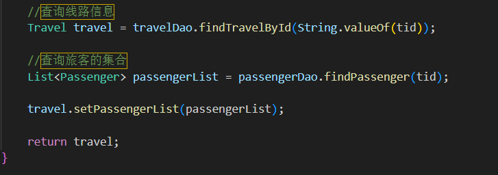
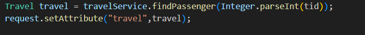
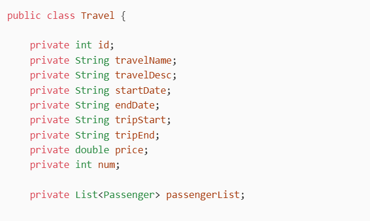
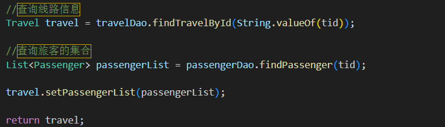
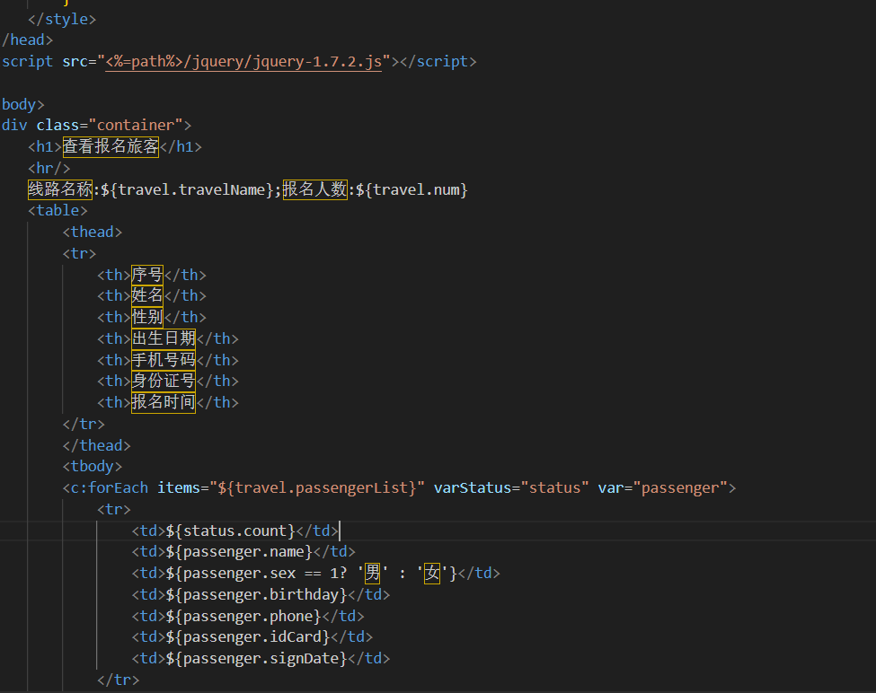

### 1.前端实现

#### 1.1.在travel-list前端页面的查看旅客报名信息的函数

```html
<script>
function findPassenger(){

            let length = $("[name = 'cks']:checked").length;

            if (length == 1){
                let id = $("[name = 'cks']:checked").val()
                location.href = "http://localhost:8083/web/travel?flag=findPassenger&tid="+id;

            }else {
                alert("只能选择一条线路进行查看~")
            }
        }
  </script>
```

#### 1.2.查看报名信息的页面

```html
<%@ page contentType="text/html;charset=UTF-8" language="java" %>
<%--引入jstl的标签库--%>
<%@ taglib prefix="c" uri="http://java.sun.com/jsp/jstl/core" %>
<%
    //获取当前工程的绝对路径
    String path = request.getContextPath();
%>
<html>
<head>
    <title>travel列表</title>
    <style>
        body {
            font-family: 'Segoe UI', Tahoma, Geneva, Verdana, sans-serif;
            background-color: #f4f4f9;
            margin: 0;
            padding: 20px;
        }

        h1 {
            color: #333;
            text-align: center;
            margin-bottom: 30px;
        }

        table {
            width: 100%;
            border-collapse: collapse;
            box-shadow: 0 0 20px rgba(0, 0, 0, 0.1);
            background-color: white;
        }

        th, td {
            padding: 12px 15px;
            text-align: left;
            border-bottom: 1px solid #ddd;
        }

        th {
            background-color: #007BFF;
            color: white;
        }

        tr:hover {
            background-color: #f5f5f5;
        }

        .container {
            max-width: 1200px;
            margin: 0 auto;
        }

        /* 新增按钮样式 */
        .btn {
            display: inline-block;
            padding: 8px 16px;
            border: none;
            border-radius: 4px;
            cursor: pointer;
            text-decoration: none;
            font-size: 14px;
            margin-right: 10px;
            transition: background-color 0.3s ease;
        }

        .btn-primary {
            background-color: #007BFF;
            color: white;
        }

        .btn-primary:hover {
            background-color: #0056b3;
        }

        .btn-danger {
            background-color: #dc3545;
            color: white;
        }

        .btn-danger:hover {
            background-color: #c82333;
        }

        .btn-warning {
            background-color: #ffc107;
            color: #212529;
        }

        .btn-warning:hover {
            background-color: #e0a800;
        }

        /* 搜索框样式 */
        .search-box {
            margin-bottom: 20px;
            display: flex;
            gap: 10px;
        }

        .search-input {
            /*flex: 1;*/
            padding: 8px;
            border: 1px solid #ddd;
            border-radius: 4px;
            font-size: 14px;
            width: 60%;
        }
    </style>
</head>
<script src="<%=path%>/jquery/jquery-1.7.2.js"></script>

<body>
<div class="container">
    <h1>查看报名旅客</h1>
    <hr/>
    线路名称:${travel.travelName};报名人数:${travel.num}
    <table>
        <thead>
        <tr>
            <th>序号</th>
            <th>姓名</th>
            <th>性别</th>
            <th>出生日期</th>
            <th>手机号码</th>
            <th>身份证号</th>
            <th>报名时间</th>
        </tr>
        </thead>
        <tbody>
        <c:forEach items="${travel.passengerList}" varStatus="status" var="passenger">
            <tr>
                <td>${status.count}</td>
                <td>${passenger.name}</td>
                <td>${passenger.sex == 1? '男' : '女'}</td>
                <td>${passenger.birthday}</td>
                <td>${passenger.phone}</td>
                <td>${passenger.idCard}</td>
                <td>${passenger.signDate}</td>
            </tr>
        </c:forEach>
        </tbody>
    </table>
</div>

</body>
</html>
```

### 2.后端实现

#### 2.1.创建表现层TravelServlet

```java
package com.eagles.servlet;
import com.alibaba.fastjson.JSON;
import com.eagles.pojo.Passenger;
import com.eagles.pojo.Travel;
import com.eagles.service.PassengerService;
import com.eagles.service.PassengerServiceImpl;
import com.eagles.service.TravelService;
import com.eagles.service.TravelServiceImpl;

import javax.servlet.ServletException;
import javax.servlet.http.HttpServlet;
import javax.servlet.http.HttpServletRequest;
import javax.servlet.http.HttpServletResponse;
import java.io.IOException;
import java.util.List;

public class TravelServlet extends HttpServlet {

    private TravelService travelService = new TravelServiceImpl();
    private PassengerService passengerService = new PassengerServiceImpl();

    @Override
    protected void doPost(HttpServletRequest request, HttpServletResponse response) throws ServletException, IOException {

        //中文乱码的处理
        request.setCharacterEncoding("utf-8");
        response.setContentType("text/html;charset=utf-8");

        else if (flag != null && flag.equals("findPassenger")){
            findPassenger(request,response);
        }

    }
   //查看报名信息
    public void findPassenger(HttpServletRequest request, HttpServletResponse response) {

        String tid = request.getParameter("tid");
        Travel travel = travelService.findPassenger(Integer.parseInt(tid));
        request.setAttribute("travel",travel);

        try {
            request.getRequestDispatcher("/jsp/passenger-select.jsp").forward(request,response);
        } catch (ServletException e) {
            throw new RuntimeException(e);
        } catch (IOException e) {
            throw new RuntimeException(e);
        }

    }

    @Override
    protected void doGet(HttpServletRequest req, HttpServletResponse resp) throws ServletException, IOException {
        doPost(req,resp);
    }
}
```

接收选择的当前选择路线的tid（flag=findPassenger&tid="+id;）这里改了一个名字其值就等于路线所对应的sid，就收的值往下面传，调用业务层去写findPassenger函数，返回值地址转发给查看报名信息页面（passenger-select.jsp）

#### 2.2.创建业务层TravelService

```java
package com.eagles.service;
import com.eagles.pojo.Passenger;
import com.eagles.pojo.Travel;
import java.util.List;

public interface TravelService {

    Travel findPassenger(int tid);
}
```

#### 创建业务层TravelServiceImpl

```java
package com.eagles.service;
import com.eagles.dao.PassengerDao;
import com.eagles.dao.PassengerDaoImpl;
import com.eagles.dao.TravelDao;
import com.eagles.dao.TravelDaoImpl;
import com.eagles.pojo.Passenger;
import com.eagles.pojo.Travel;
import java.text.SimpleDateFormat;
import java.util.Date;
import java.util.List;

public class TravelServiceImpl implements TravelService {

    private TravelDao travelDao = new TravelDaoImpl();
    private PassengerDao passengerDao = new PassengerDaoImpl();

    @Override
    public List<Travel> findTravelAll(String likeName) {
        return travelDao.findTravelAll(likeName);
    }

    

    @Override
    public Travel findPassenger(int tid) {

        //查询线路信息
        Travel travel = travelDao.findTravelById(String.valueOf(tid));

        //查询旅客的集合
        List<Passenger> passengerList = passengerDao.findPassenger(tid);

        travel.setPassengerList(passengerList);

        return travel;
    }
}
```

### 为什么这里不用多表查询而是分别调取两个持久层进行：

这是一个非常经典且重要的问题！你问到了 **数据库查询设计的核心权衡**：**“是应该在 Service 层组合单表查询，还是在 DAO 层写一个多表 JOIN 查询？”**

你观察得很敏锐：当前代码是：

1. 先查线路信息 → `travelDao.findTravelById(...)`
2. 再查乘客列表 → `passengerDao.findPassenger(...)`
3. 最后在 Java 代码里组合 → `travel.setPassengerList(...)`

而不是写一个 SQL `JOIN` 一次性查出来。

---

##### 答案是：**两种方式都可以，但当前做法（分开查）在很多场景下是更合理、更灵活的设计！**

下面我们来深入分析为什么。

---

##### 一、先看“多表 JOIN 查询”方案（你设想的方式）

```sql
SELECT t.*, p.*
FROM travel t
LEFT JOIN passenger p ON t.tid = p.tid
WHERE t.tid = ?
```

###### 存在的问题：

|  |  |
| --- | --- |
| **问题** | **说明** |
| **1. 数据重复（N+1 问题的反面）** | 如果一条线路有 100 个乘客，这条 SQL 会返回 100 行，其中**线路信息重复了 100 次**（`t.*`  重复），浪费网络和内存。 |
| **2. 对象映射复杂** | JDBC/MyBatis 需要手动处理“一对多”的结果集，把 100 行数据“组装”成 1 个 `Travel`  对象和 100 个 `Passenger`  对象。容易出错。 |
| **3. 不灵活** | 如果某次请求**只需要线路信息，不需要乘客**，你也得执行这个 JOIN，性能浪费。 |

---

##### 二、当前做法（分开查）的优势

###### 1. **职责清晰，复用性强**

- `travelDao.findTravelById()`：**只负责查线路** → 可被“线路列表”、“线路详情”等多个功能复用。
- `passengerDao.findPassenger(tid)`：**只负责查乘客** → 可被“乘客管理”、“导出名单”等功能复用。

👉 **每个 DAO 方法都专注单一职责，像乐高积木一样可复用。**

###### 2. **避免数据冗余**

- 第一次查询：返回 1 条线路数据（无重复）。
- 第二次查询：返回 N 条乘客数据（无线路信息冗余）。
- 内存和网络开销最小。

###### 3. **灵活性高**

想象一下这些场景：

|  |  |  |
| --- | --- | --- |
| **场景** | **当前做法** | **JOIN 做法** |
| 只看线路列表（不看乘客） | ✅ 只调 `findTravelAll()` | ❌ 仍要 JOIN，浪费 |
| 看线路详情（带乘客） | ✅ 调两个方法 | ✅ 可以 |
| 看线路详情（不带乘客） | ✅ 只调 `findTravelById()` | ❌ 仍要 JOIN |
| 分页显示乘客 | ✅ 可在 `findPassenger()`  中加 `LIMIT` | ❌ 复杂，分页逻辑混乱 |

👉 **分开查 = 按需加载**，更灵活。

###### 4. **缓存友好**

- 你可以缓存 `Travel` 对象。
- 也可以单独缓存 `PassengerList`。
- 而 JOIN 的结果是一个“组合对象”，缓存粒度粗，失效频繁。

###### 5. **易于优化和监控**

- 你可以清楚地看到：

- 查线路耗时 5ms
- 查乘客耗时 10ms

- 如果 JOIN，你只能看到“总耗时 15ms”，无法定位瓶颈。

---

##### 三、什么时候应该用 JOIN？

虽然“分开查”有很多优势，但 **JOIN 也不是一无是处**。以下情况适合用 JOIN：

|  |  |
| --- | --- |
| **适合 JOIN 的场景** | **说明** |
| **数据量极小** | 比如查“用户+角色”，一共就几条数据，JOIN 很快。 |
| **必须在数据库层计算** | 比如“查报名人数 > 10 的线路”，必须 `GROUP BY`  + `HAVING`  。 |
| **性能要求极高，且数据固定** | 比如首页展示，可以接受数据冗余来换速度。 |
| **使用 ORM 框架（如 MyBatis Plus, JPA）** | 它们能自动处理 JOIN 结果的“去重组装”，简化开发。 |

---

##### 四、当前代码可以进一步优化

虽然思路正确，但可以改进：

###### 1. **加事务（可选）**

确保“查线路”和“查乘客”在同一个事务中，避免中间数据变化。

```java
@Transactional(readOnly = true)
public Travel findPassenger(int tid) {
Travel travel = travelDao.findTravelById(String.valueOf(tid));
List<Passenger> passengerList = passengerDao.findPassenger(tid);
travel.setPassengerList(passengerList);
return travel;
}
```

###### 2. **异步查询（高性能场景）**

如果乘客很多，可以并行查询：

```java
// 伪代码
Future<Travel> travelFuture = executor.submit(() -> travelDao.findTravelById(...));
Future<List<Passenger>> passengerFuture = executor.submit(() -> passengerDao.findPassenger(...));

Travel travel = travelFuture.get();
List<Passenger> list = passengerFuture.get();
travel.setPassengerList(list);
```

---

##### 五、总结：为什么分开查？

|  |  |
| --- | --- |
| **原因** | **说明** |
| **避免数据冗余** | 不重复传输线路信息 |
| **职责分离** | DAO 方法更通用、可复用 |
| **灵活性高** | 可按需加载，支持分页、缓存 |
| **易于维护** | 逻辑清晰，便于调试和优化 |
| **符合领域驱动设计** | 先查聚合根（Travel），再查其子实体（Passenger） |

**核心思想**： **“用代码组合数据” 比 “用 SQL JOIN 组合数据” 更灵活、更现代。**

尤其在微服务、缓存、分库分表的架构中，**“先查主表，再查子表”** 是更主流的做法。

**一句话回答你的问题**：

因为 **分开查询更灵活、更高效、更易维护**，它避免了 JOIN 带来的数据冗余和耦合，是更符合现代应用架构的设计。

#### 2.3.创建持久层TravelDao

```java
package com.eagles.dao;
import com.eagles.pojo.Passenger;
import com.eagles.pojo.Travel;
import java.util.List;

public interface TravelDao {

    Travel findTravelById(String tid);
  
}
```

#### 创建持久层TravelDaoImpl

```java
package com.eagles.dao;
import com.eagles.pojo.Passenger;
import com.eagles.pojo.Travel;
import com.eagles.utils.JDBCUtils;
import java.sql.Connection;
import java.sql.PreparedStatement;
import java.sql.ResultSet;
import java.sql.SQLException;
import java.util.ArrayList;
import java.util.List;

public class TravelDaoImpl implements TravelDao {

    

    @Override
    public Travel findTravelById(String tid) {

        Connection connection = null;
        PreparedStatement preparedStatement = null;
        ResultSet resultSet = null;

        Travel travel = null;

        try {
            connection = JDBCUtils.getConnection();

            String sql = "select * from tb_travel where id = ?";

            preparedStatement = connection.prepareStatement(sql);
            preparedStatement.setInt(1,Integer.parseInt(tid));

            resultSet = preparedStatement.executeQuery();

            if (resultSet != null && resultSet.next()){

                //根据数据类型取出记录
                String travelName = resultSet.getString("travel_name");
                String travelDesc = resultSet.getString("travel_desc");
                String startDate = resultSet.getString("start_date");
                String endDate = resultSet.getString("end_date");
                String tripStart = resultSet.getString("trip_start");
                String tripEnd = resultSet.getString("trip_end");
                double price = resultSet.getDouble("price");
                int num = resultSet.getInt("num");

                //创建travel对象
                travel = new Travel();

                travel.setId(Integer.parseInt(tid));
                travel.setTravelName(travelName);
                travel.setTravelDesc(travelDesc);
                travel.setStartDate(startDate);
                travel.setEndDate(endDate);
                travel.setTripStart(tripStart);
                travel.setTripEnd(tripEnd);
                travel.setPrice(price);
                travel.setNum(num);
            }

        } catch (SQLException e) {
            throw new RuntimeException(e);
        }finally {
            JDBCUtils.close(resultSet,preparedStatement,connection);
        }

        return travel;
    }

}
```

#### 创建持久层PassengerDao

```java
package com.eagles.dao;
import com.eagles.pojo.Passenger;

import java.util.List;

public interface PassengerDao {

    List<Passenger> findPassenger(int tid);
}
```

#### 创建持久层PassengerDaoImpl

```java
package com.eagles.dao;
import com.eagles.pojo.Passenger;
import com.eagles.pojo.Travel;
import com.eagles.utils.JDBCUtils;
import java.sql.Connection;
import java.sql.PreparedStatement;
import java.sql.ResultSet;
import java.sql.SQLException;
import java.util.ArrayList;
import java.util.List;

public class PassengerDaoImpl implements PassengerDao {

    
  //查看报名信息
    @Override
    public List<Passenger> findPassenger(int tid) {

        Connection connection = null;
        PreparedStatement preparedStatement = null;
        ResultSet resultSet = null;

        List<Passenger> passengerList = new ArrayList<>();

        try {
            connection = JDBCUtils.getConnection();

            String sql = "select * from tb_passenger where tid = ?";
            preparedStatement = connection.prepareStatement(sql);

            preparedStatement.setInt(1,tid);

            resultSet = preparedStatement.executeQuery();

            while (resultSet != null && resultSet.next() ){
                int pid = resultSet.getInt("pid");
                int sex = resultSet.getInt("sex");
                String name = resultSet.getString("name");
                String birthday = resultSet.getString("birthday");
                String phone = resultSet.getString("phone");
                String idCard = resultSet.getString("idCard");
                String signDate = resultSet.getString("sign_date");

                Passenger passenger = new Passenger();
                passenger.setPid(pid);
                passenger.setSex(sex);
                passenger.setName(name);
                passenger.setBirthday(birthday);
                passenger.setPhone(phone);
                passenger.setIdCard(idCard);
                passenger.setSignDate(signDate);

                passengerList.add(passenger);

            }

        } catch (SQLException e) {
            throw new RuntimeException(e);
        }finally {
            JDBCUtils.close(resultSet,preparedStatement,connection);
        }

        return passengerList;
    }

}
```

查询的细节：



travelDaoImpl返回值是一个travel，一直传，传给TravelServlet层，将数据存到域中



在实现类里面Travel类聚合了一个PassengerList集合



passengerDao.findPassenger传来旅客信息集合，因为在Travel有聚合过所以将传过来集合存入Travel里面的PassengerList里面，这样travel类里面就集合了一张大表



之后需要什么就调取里面的方法就好了，需要路线的名字就${travel.travelName}，需要报名人数就${travel.num}，需要报名者信息就${travel.passengerList}，极大的提高了便携性和可操作性



`varStatus="status"` 是 JSTL `<c:forEach>` 标签中的一个**非常有用**的属性，它用来**获取当前循环的“状态信息”**。在这里是用来为了显示前面的一个数字

---

### 一句话解释：

`varStatus="status"` 会创建一个名为 `status` 的变量，它包含了当前循环的**详细状态信息**，比如：当前是第几次循环、索引是多少、是否是第一次/最后一次等。

---

#### 一、`varStatus` 能提供哪些信息？

假设你有这样一个循环：

```html
<c:forEach items="${travelList}" var="travel" varStatus="status">
  <!-- 在这里可以使用 ${status} -->
</c:forEach>
```

`status` 对象（类型是 `javax.servlet.jsp.jstl.core.LoopTagStatus`）包含以下属性：

|  |  |  |
| --- | --- | --- |
| **属性** | **说明** | **示例** |
| `${status.index}` | **当前索引**（从 0 开始） | 第1次循环：0，第2次：1 |
| `${status.count}` | **当前次数**（从 1 开始） | 第1次循环：1，第2次：2 |
| `${status.first}` | 是否是**第一次循环**（布尔值） | 第1次：true，其他：false |
| `${status.last}` | 是否是**最后一次循环**（布尔值） | 最后一次：true，其他：false |
| `${status.begin}` | 循环的起始索引（通常为 0） | 0 |
| `${status.end}` | 循环的结束索引 | 列表长度 - 1 |
| `${status.step}` | 步长（默认为 1） | 1 |

---

#### 二、实际应用场景（非常实用！）

##### 1. **给表格添加行号**

```html
<c:forEach items="${travelList}" var="travel" varStatus="status">
  <tr>
    <td>${status.count}</td> <!-- 显示 1, 2, 3, ... -->
    <td>${travel.travelName}</td>
    <td>${travel.price}</td>
  </tr>
</c:forEach>
```

效果：

|  |  |  |
| --- | --- | --- |
| **序号** | **线路名称** | **价格** |
| 1 | 海南游 | 5000 |
| 2 | 北京游 | 1200 |

---

##### 2. **给第一行或最后一行加特殊样式**

```html
<c:forEach items="${travelList}" var="travel" varStatus="status">
  <tr class="${status.first ? 'highlight' : ''}">
    <td>${travel.travelName}</td>
  </tr>
</c:forEach>
```

```css
.highlight {
  background-color: yellow;
}
```

第一行会高亮显示。

---

##### 3. **每隔一行换色（斑马线效果）**

```html
<c:forEach items="${travelList}" var="travel" varStatus="status">
  <tr class="${status.index % 2 == 0 ? 'even' : 'odd'}">
    <td>${travel.travelName}</td>
  </tr>
</c:forEach>
```

```css
.even { background: #f9f9f9; }
.odd  { background: #eef; }
```

---

##### 4. **在循环末尾添加分隔符（如逗号）**

```html
<ul>
  <c:forEach items="${tags}" var="tag" varStatus="status">
    <li>${tag}${!status.last ? ',' : ''}</li>
  </c:forEach>
</ul>
```

输出：`标签1, 标签2, 标签3`（最后一个不加逗号）

---

#### 三、`var` 和 `varStatus` 的区别

|  |  |
| --- | --- |
| **属性** | **作用** |
| `var="travel"` | 代表**当前遍历的元素本身**（如一个 `Travel`  对象） |
| `varStatus="status"` | 代表**当前循环的状态信息**（如索引、是否第一次等） |

它们经常**一起使用**：

```html
<c:forEach items="${travelList}" var="travel" varStatus="status">
  第 ${status.count} 条：${travel.travelName} 
  (索引: ${status.index}, 是否第一次: ${status.first})
</c:forEach>
```

---

##### 总结

`varStatus="status"` 就像是一个“**循环计数器 + 状态监控器**”，它让你能：

- 知道“现在是第几次循环”
- 判断“是不是第一次/最后一次”
- 实现隔行变色、添加序号、控制分隔符等 UI 效果

**一句话记住**：

`var` 告诉你“**当前是谁**”，`varStatus` 告诉你“**现在是第几个、是不是第一个、是不是最后一个**”。
